Put nginx on a public box and the access log fills up with `/wp-login.php`, `/.env` and `/phpmyadmin/` from addresses you've never heard of. Fail2ban can catch that, one jail and one regex at a time. CrowdSec comes with the parsers and scenarios already written, and it can share what it sees with everyone else running it.

My hardening pass puts fail2ban on port 22. But Nginx is usually the first thing I throw on there, and my sshd jail never looks at its logs. CrowdSec watches both, so I put it on a plain 26.04 box to see what it gets wrong.

This post installs it the sane way on Ubuntu 26.04, adds two bouncers (one for the firewall, one inside nginx), and walks through the traps I hit on the way.

> **TL;DR.** Ubuntu's universe has CrowdSec 1.4.6. Add CrowdSec's repo and you get 1.8.2. Install nginx **before** CrowdSec so setup finds it. Allowlist your own address before any bouncer goes on. Install `crowdsec-firewall-bouncer-nftables` (the name without `-nftables` is Ubuntu's old 0.0.25) and `crowdsec-nginx-bouncer`. If something else owns port 8080, CrowdSec doesn't start; move it in `config.yaml.local` and `local_api_credentials.yaml`. Check `cscli bouncers list` after any change: a bouncer that can't reach CrowdSec stays `active` and quietly stops blocking.

## Contents

- [The one thing to get straight](#the-one-thing-to-get-straight)
- [What I tested on](#what-i-tested-on)
- [1. Skip the CrowdSec in universe](#1-skip-the-crowdsec-in-universe)
- [2. Install nginx first, then CrowdSec](#2-install-nginx-first-then-crowdsec)
- [3. Allowlist yourself before any bouncer](#3-allowlist-yourself-before-any-bouncer)
- [4. The firewall bouncer](#4-the-firewall-bouncer)
- [5. The nginx bouncer](#5-the-nginx-bouncer)
- [6. Test a ban without locking yourself out](#6-test-a-ban-without-locking-yourself-out)
- [7. "bind: address already in use" on port 8080](#7-bind-address-already-in-use-on-port-8080)
- [8. The bouncers that say active and do nothing](#8-the-bouncers-that-say-active-and-do-nothing)
- [9. Signal sharing is on by default](#9-signal-sharing-is-on-by-default)
- [Day to day](#day-to-day)
- [Where things live](#where-things-live)
- [Gotchas I hit](#gotchas-i-hit)
- [Quick reference](#quick-reference)

## The one thing to get straight

CrowdSec on its own blocks nothing. It's two halves:

- **The engine** (`crowdsec`) reads logs, matches them against scenarios, and turns a match into a *decision*: "ban this IP for 4 hours". It keeps the decisions in its local API, the LAPI, on `127.0.0.1:8080`.
- **Bouncers** ask the LAPI for decisions and enforce them. Install none and you get a nice list of attackers and no blocking at all. The package says so itself: "CrowdSec alone will not block any IP address."

The two bouncers here do different jobs:

| | Firewall bouncer | Nginx bouncer |
| --- | --- | --- |
| Where it acts | nftables, before any service sees the packet | inside nginx, per request |
| What a banned IP sees | a timeout, on every port, SSH included | `403` with a "CrowdSec Ban" page, only on nginx |
| How fast | pulls new decisions every 10 seconds | asks the LAPI on the request |

On one box with a public IP, the firewall bouncer does most of the work. The nginx bouncer earns its place when nginx sits behind something else (a CDN or another proxy) and the firewall only ever sees the proxy's address, or when you want a page instead of a dropped packet. I didn't test the proxy case; everything below is a single box.

## What I tested on

Three fresh Ubuntu 26.04.1 servers on DigitalOcean (2 GB, kernel 7.0.0-38), plus two more for the screenshots (the first of those taught me the `sleep` in section 6), on 8 November 2026, as a sudo user called `example`. Versions: CrowdSec 1.8.2, `crowdsec-firewall-bouncer-nftables` 0.0.38, `crowdsec-nginx-bouncer` 1.2.2, nginx 1.28.3. The first box ran the whole post in order. The second box did it in the wrong order on purpose: something on port 8080 first, and nginx after CrowdSec. The third followed the finished post top to bottom, exactly as written, to catch anything I'd skipped.

The lab firewall only lets my own address in, so no real bot ever reached these boxes. Every ban I set off came from fake attacker addresses I put on the box itself (section 6 shows how), and they were real detections from real log lines.

## 1. Skip the CrowdSec in universe

Ubuntu 26.04 ships CrowdSec in universe, and it's old:

```bash
apt policy crowdsec
```

```text
crowdsec:
  Installed: (none)
  Candidate: 1.4.6-10.1
  Version table:
     1.4.6-10.1 500
        500 http://mirrors.digitalocean.com/ubuntu resolute/universe amd64 Packages
```

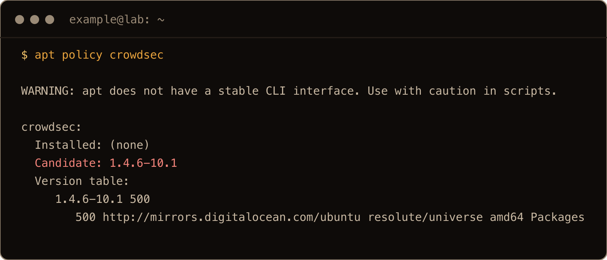

*The screenshots come from a final clean run on one more fresh 26.04 box. The text blocks come from the earlier boxes, so times, IDs and key names differ. Machine IDs are shortened to four characters.*

1.4.6 is from early 2023, and it predates the `cscli allowlists` command this post leans on. I unpacked it on the test box to be sure: `unknown command "allowlists" for "cscli"`. Add CrowdSec's own repo instead. Their script does it in one line:

```bash
curl -s https://install.crowdsec.net | sudo sh
```

It installs a few prerequisites, drops a key in `/etc/apt/keyrings/`, writes one source file and runs `apt-get update`. It doesn't install CrowdSec yet. Read what it wrote:

```bash
cat /etc/apt/sources.list.d/crowdsec_crowdsec.list
apt policy crowdsec | head -3
```

```text
deb [signed-by=/etc/apt/keyrings/crowdsec_crowdsec-archive-keyring.gpg] https://packagecloud.io/crowdsec/crowdsec/any/ any main
deb-src [signed-by=/etc/apt/keyrings/crowdsec_crowdsec-archive-keyring.gpg] https://packagecloud.io/crowdsec/crowdsec/any/ any main
crowdsec:
  Installed: (none)
  Candidate: 1.8.2
```

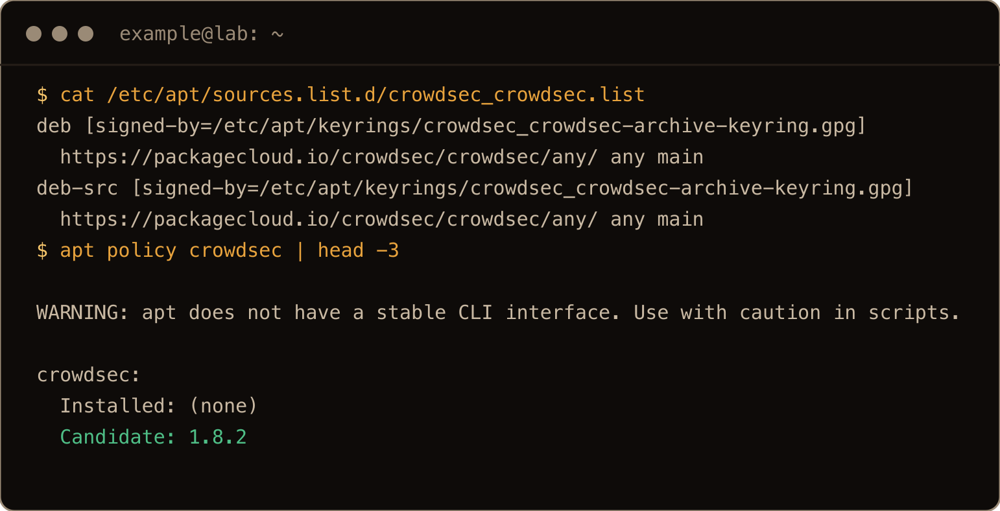

The repo isn't per release. It's one `any` suite for every Debian and Ubuntu, so 26.04 works without waiting for anyone to add `resolute`. Prefer to read a script before piping it to `sh`? `curl -s https://install.crowdsec.net -o install.sh` and read it first. The Debian part is a short block that writes the key and that file.

## 2. Install nginx first, then CrowdSec

Order matters here. When the `crowdsec` package installs, it runs `cscli setup`, which looks at what's running and installs the matching collections and log sources. If nginx isn't there yet, nobody tells CrowdSec about it later.

```bash
sudo apt install -y nginx
sudo apt install -y crowdsec
```

If the install prints `Not attempting to start crowdsec, port 8080 is already used`, do [section 7](#7-bind-address-already-in-use-on-port-8080) now, before any bouncer.

Check what it found:

```bash
sudo cscli collections list
sudo ls /etc/crowdsec/acquis.d/
```

```text
 crowdsecurity/base-http-scenarios    ✔️  enabled  1.4      /etc/crowdsec/collections/base-http-scenarios.yaml
 crowdsecurity/http-cve               ✔️  enabled  3.0      /etc/crowdsec/collections/http-cve.yaml
 crowdsecurity/linux                  ✔️  enabled  0.4      /etc/crowdsec/collections/linux.yaml
 crowdsecurity/nginx                  ✔️  enabled  0.3      /etc/crowdsec/collections/nginx.yaml
 crowdsecurity/sshd                   ✔️  enabled  0.9      /etc/crowdsec/collections/sshd.yaml
 crowdsecurity/whitelist-good-actors  ✔️  enabled  0.4      /etc/crowdsec/collections/whitelist-good-actors.yaml
setup.linux.yaml
setup.nginx.yaml
setup.sshd.yaml
```

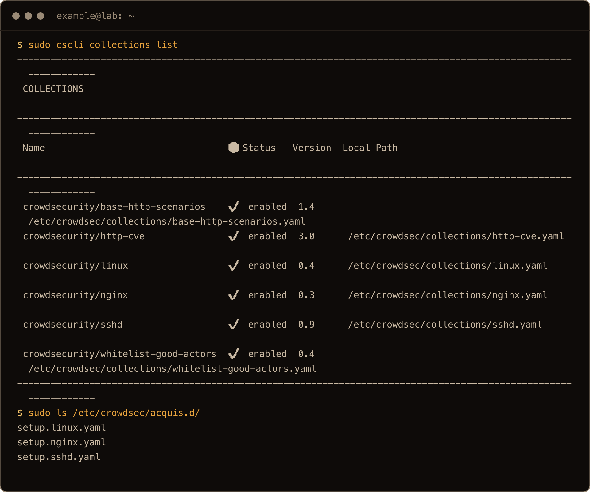

`setup.nginx.yaml` reads `/var/log/nginx/*.log`, and `setup.sshd.yaml` reads `/var/log/auth.log`. That file exists on 26.04 because rsyslog is installed (it was on the DigitalOcean image). There's no `acquis.yaml` any more; 1.8 writes these `setup.*.yaml` files instead, so an old guide that tells you to edit `acquis.yaml` is pointing at a file that isn't there.

### If nginx went on after CrowdSec

On the second box I installed CrowdSec first. It found `linux`, `sshd` and `whitelist-good-actors`, and no nginx. Installing nginx and the nginx bouncer afterwards didn't change that. The bouncer happily enforced bans, but CrowdSec never read a line of the nginx log, so nothing on the web side could ever cause one.

Run the detection again, then reload:

```bash
sudo cscli setup unattended
sudo systemctl reload crowdsec
```

That added `crowdsecurity/nginx`, `base-http-scenarios`, `http-cve` and `setup.nginx.yaml`. After the next request, `sudo cscli metrics show acquisition` listed `file:/var/log/nginx/access.log`. The same goes for anything you add later (Apache, a database): rerun `cscli setup unattended`.

## 3. Allowlist yourself before any bouncer

As soon as a firewall bouncer is on, a ban on your address drops your SSH session too. CrowdSec already ignores private ranges (`10.0.0.0/8`, `172.16.0.0/12`, `192.168.0.0/16`, loopback), and the `whitelist-good-actors` collection adds some well known crawlers. Your home IP and your Tailscale range aren't on any of them.

Your current SSH client address is in `$SSH_CLIENT`:

```bash
echo ${SSH_CLIENT%% *}
```

Make an allowlist and add it:

```bash
sudo cscli allowlists create home -d "my own addresses"
sudo cscli allowlists add home 198.51.100.7 -d "home"
```

Use your address instead of `198.51.100.7`.

I reach my boxes over [Tailscale](/blog/install-tailscale-ubuntu-26-04/), so if you do too, put the tailnet range on the list.

Tailscale addresses live in `100.64.0.0/10`, which none of the built in lists cover. If you reach the box over Tailscale, add it:

```bash
sudo cscli allowlists add home 100.64.0.0/10 -d "tailnet"
sudo cscli allowlists inspect home
```

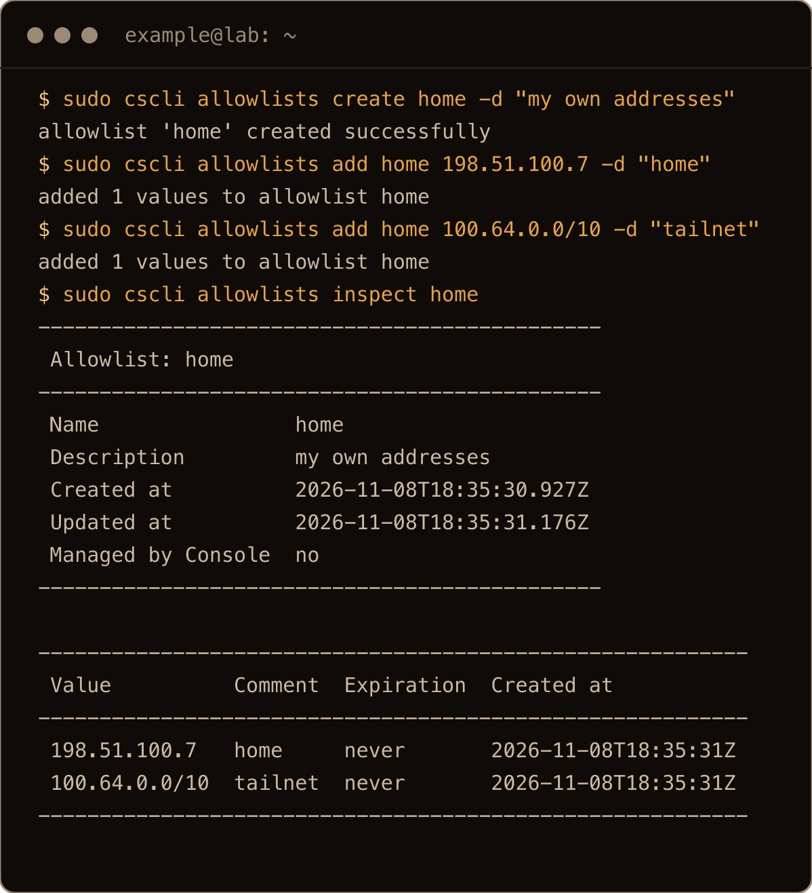

*198.51.100.7 is a documentation address standing in for a real home IP.*

I tested both halves of that. A fake address at `100.100.1.5` with no allowlist got banned for `crowdsecurity/http-probing`. Adding `100.64.0.0/10` printed `1 decisions deleted by allowlists`, so it also clears bans already in place, and a second fake address in the range sent the same 30 bad requests and got nothing. An allowlisted address can't be banned by hand either: `cscli decisions add` refuses with `is allowlisted by item ... use --bypass-allowlist to add the decision anyway`.

## 4. The firewall bouncer

Watch the name. CrowdSec's package is `crowdsec-firewall-bouncer-nftables`. The plain `crowdsec-firewall-bouncer` comes from Ubuntu's universe, at 0.0.25:

```bash
apt policy crowdsec-firewall-bouncer crowdsec-firewall-bouncer-nftables | grep -E "^c|Candidate"
```

```text
crowdsec-firewall-bouncer:
  Candidate: 0.0.25-5build1
crowdsec-firewall-bouncer-nftables:
  Candidate: 0.0.38
```

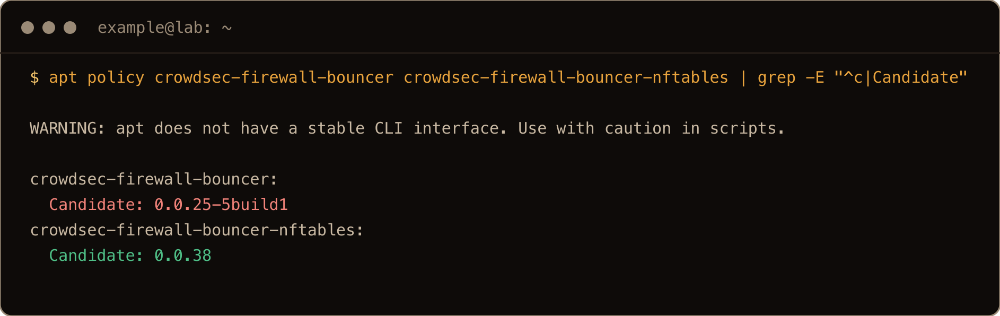

Install the one with the suffix. 26.04 uses nftables, so that's the right flavour:

```bash
sudo apt install -y crowdsec-firewall-bouncer-nftables
```

The package registers itself with the LAPI and starts. Check it:

```bash
sudo cscli bouncers list
sudo nft list tables
```

```text
 cs-firewall-bouncer-1794160827  127.0.0.1   ✔️      2026-11-08T18:00:29Z  crowdsec-firewall-bouncer  v0.0.38-debian-pragmatic-amd64-a09363eebbd5ba90e8aea205728bf26194d11bf2  api-key
table ip crowdsec
table ip6 crowdsec6
```

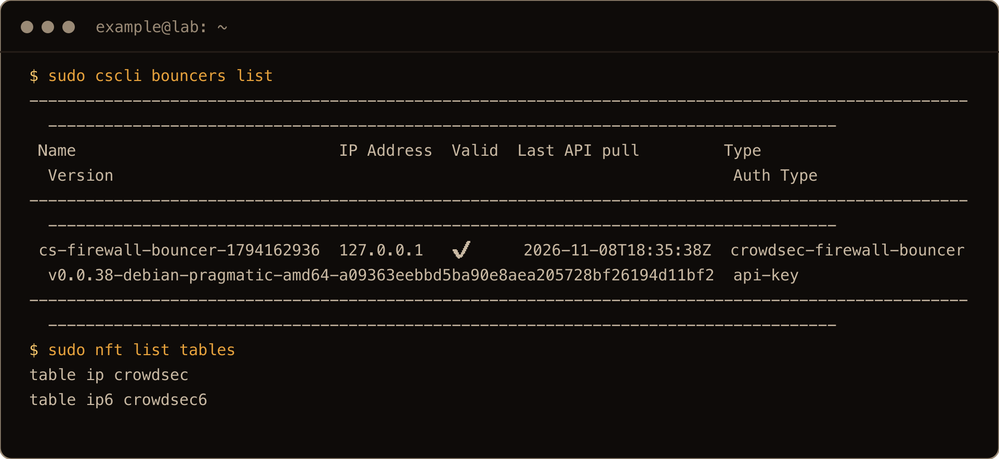

The column that matters is **Last API pull**. A timestamp from the last few seconds means the bouncer is talking to CrowdSec. You'll come back to that column in section 8.

It sits fine next to ufw. The bouncer's chain hooks `input` at `priority filter - 10`, which runs before ufw's rules, so a banned address is dropped even on a port ufw allows. I tested that with ufw enabled and port 80 open: `200` before the ban, a timeout after.

## 5. The nginx bouncer

```bash
sudo apt install -y crowdsec-nginx-bouncer
```

This one is heavier than it looks. It depends on `lua5.1`, `libnginx-mod-http-lua` and `luarocks`, and then builds `lua-cjson` from source with `gcc`, so it pulls in a compiler and lands a library in `/usr/local`. That was 49 new packages on a box that already had nginx.

Near the end it prints this:

```text
cscli/crowdsec is present, generating API key
API Key : kJQL...
Restart nginx to enable the crowdsec bouncer : sudo systemctl restart nginx
```

That key is the bouncer's password to the LAPI, now sitting in your terminal scrollback and `/etc/crowdsec/bouncers/crowdsec-nginx-bouncer.conf`. Treat it like one. Then do what it says:

```bash
sudo nginx -t
sudo systemctl restart nginx
curl -s -o /dev/null -w "%{http_code}\n" localhost
sudo cscli bouncers list
```

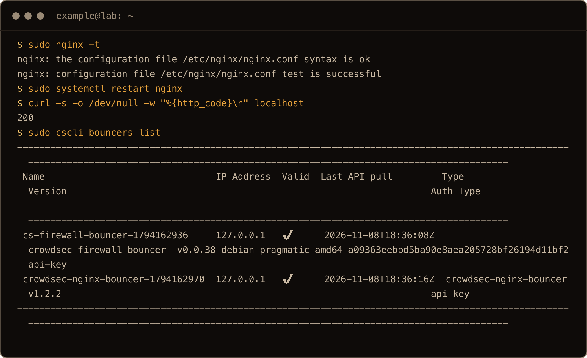

The bouncer config lands in `/etc/nginx/conf.d/crowdsec_nginx.conf`, which the stock `nginx.conf` already includes, so it covers every server block. It runs in `MODE=live`: each request asks the LAPI about that IP, with a one second cache. Its Last API pull only fills in after nginx has served a request, so an empty column right after the restart is normal.

## 6. Test a ban without locking yourself out

You don't need a second machine, and you shouldn't use your own address. Give the box a fake one. `203.0.113.0/24` is reserved for documentation, so nothing real lives there:

```bash
sudo ip addr add 203.0.113.50/32 dev lo
ME=$(hostname -I | awk '{print $1}')
curl -s -o /dev/null -w "%{http_code}\n" --interface 203.0.113.50 http://$ME/
```

```text
200
```

`ME` is the box's first own address. `--interface` makes curl send from the fake address to it, so the request never leaves the box and nginx logs `203.0.113.50` as the client. Now behave like a scanner:

```bash
for i in $(seq 1 30); do curl -s -o /dev/null --max-time 3 --interface 203.0.113.50 http://$ME/probe-$i.php; done
sleep 15
sudo cscli alerts list
sudo cscli decisions list
```

The `sleep` matters. CrowdSec reads the log a few seconds behind nginx. On my first screenshot run I called `alerts list` straight after the loop and got `No active alerts`; the ban showed up seconds later.

```text
| 1  | Ip:203.0.113.50 | crowdsecurity/http-probing |         |    | ban:1     | 2026-11-08T18:06:07Z | crowdsec |
| 1  | crowdsec | Ip:203.0.113.50 | crowdsecurity/http-probing | ban    |         |    | 11     | 3h59m54s   | 1        |
```

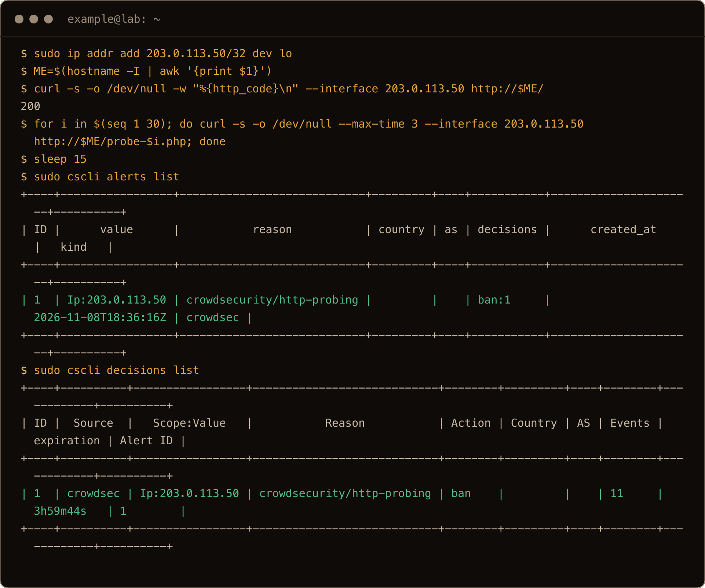

Eleven 404s was enough for `http-probing`, and the default ban is 4 hours. The 15 seconds also gave the firewall bouncer time for its pull. Send one more request:

```bash
curl -s -o /dev/null -w "%{http_code}\n" --max-time 5 --interface 203.0.113.50 http://$ME/
```

```text
000
```

`000` is curl's way of saying it timed out. The firewall bouncer had already pulled the decision, so the request never reached nginx. The address is in an nftables set now:

```bash
sudo nft list table ip crowdsec
```

```text
	set crowdsec-blacklists-crowdsec {
		type ipv4_addr
		flags timeout
		elements = { 203.0.113.50 timeout 3h59m48s expires 3h59m36s700ms }
	}
```

There's one set per origin: `crowdsec-blacklists-crowdsec` for what the engine detected, `-cscli` for bans you add by hand, `-CAPI` for the community blocklist. Don't count on listing one by name. On one box `nft list set` for `crowdsec-blacklists-crowdsec` failed with `No such file or directory` even with a ban in place. Listing the whole table always works.

The nginx bouncer is harder to catch, because the firewall gets there first. A manual ban on a second fake address, with curl straight after it and again 10 seconds later, shows both:

```bash
sudo ip addr add 203.0.113.53/32 dev lo
sudo cscli decisions add --ip 203.0.113.53 --duration 5m
curl -s -o /dev/null -w "%{http_code}\n" --max-time 5 --interface 203.0.113.53 http://$ME/
sleep 10
curl -s -o /dev/null -w "%{http_code}\n" --max-time 5 --interface 203.0.113.53 http://$ME/
```

```text
level=info msg="Decision successfully added"
403
000
```

That's the table from the top in action. The first answer is the nginx bouncer: `403` and a page titled "CrowdSec Ban". By the second, the firewall bouncer's 10 second pull has happened and nginx never sees the request.

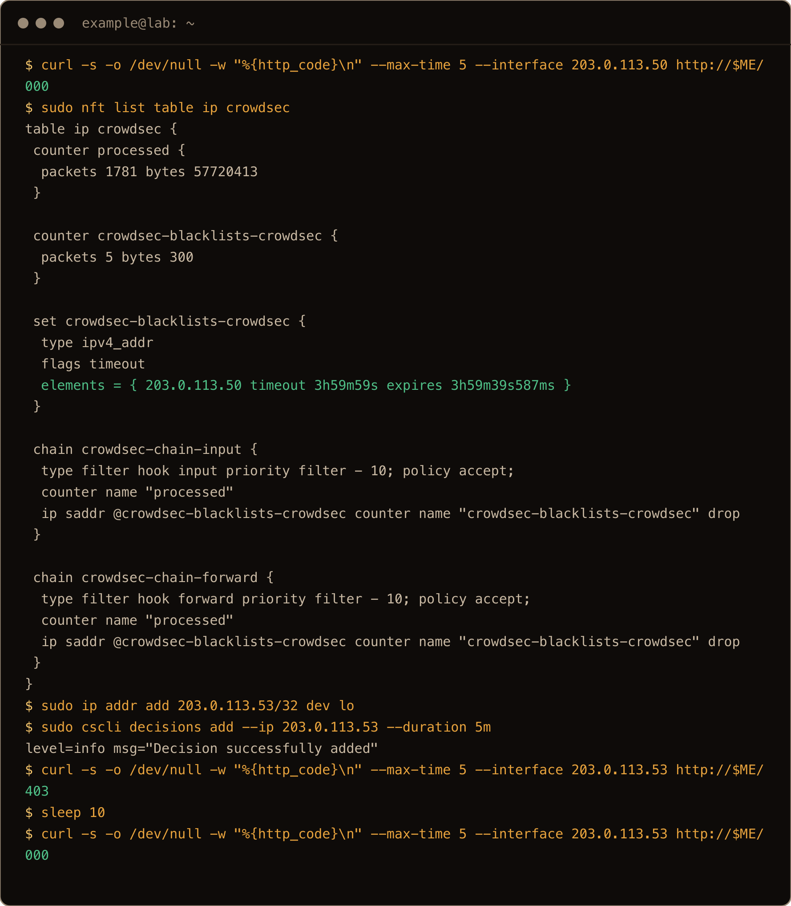

SSH works the same way. Eight logins as made up users from `203.0.113.51` (`ssh -b 203.0.113.51 admin1@$ME` and so on) set off `ssh-bf`, `ssh-bf_user-enum` and `ssh-slow-bf` together, and the next `ssh` from that address got `Connection timed out`.

### Unban

```bash
sudo cscli decisions delete --ip 203.0.113.50
```

```text
level=info msg="1 decision(s) deleted"
```

Give the firewall bouncer its 10 seconds and the next request is a `200` again. Clean up the fake address when you're done:

```bash
sudo cscli decisions delete --ip 203.0.113.53
sudo ip addr del 203.0.113.50/32 dev lo
sudo ip addr del 203.0.113.53/32 dev lo
```

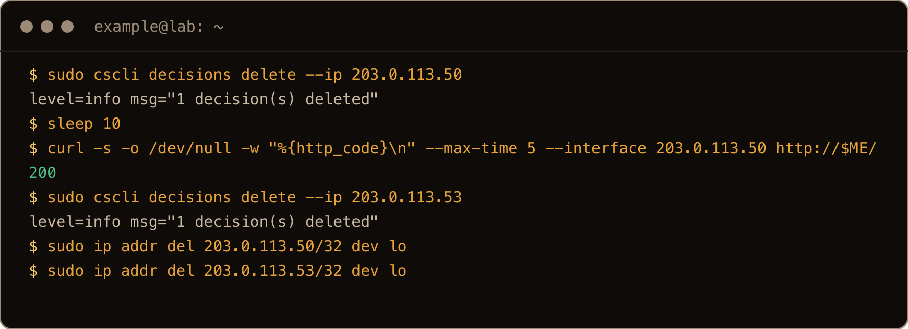

*The screenshot adds a `sleep 10` and a `curl` after the delete, to show the address getting through again.*

## 7. "bind: address already in use" on port 8080

8080 is the most popular spare port there is. If anything already holds port 8080 (a test app, a container), CrowdSec's LAPI can't start. On the second box I left a Python web server on 8080 and then installed CrowdSec. The install noticed and stepped back:

```text
Not attempting to start crowdsec, port 8080 is already used or lapi was disabled
This port is configured through /etc/crowdsec/config.yaml and /etc/crowdsec/local_api_credentials.yaml
```

The service is still enabled, so the next boot or `systemctl start` fails:

```text
Job for crowdsec.service failed because the control process exited with error code.
FATAL local API server stopped with error: listening on 127.0.0.1:8080: listen tcp 127.0.0.1:8080: bind: address already in use
```

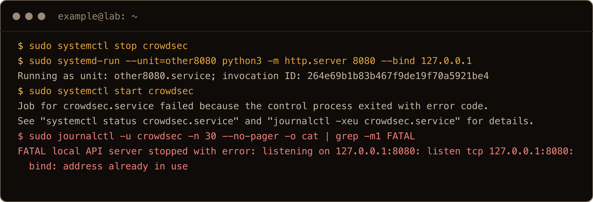

*On the screenshot box CrowdSec was already installed, so I stopped it, put a Python server on 8080 and started it again. The first three commands and the `journalctl` line aren't in the post.*

Find who has it, then move CrowdSec. Don't edit `config.yaml` itself (it's the package's file); put the change in `config.yaml.local`, which CrowdSec merges on top. The engine also talks to its own LAPI as a client, so that URL changes too:

```bash
sudo ss -tlnp | grep ':8080'
printf 'api:\n  server:\n    listen_uri: 127.0.0.1:8081\n' | sudo tee /etc/crowdsec/config.yaml.local
sudo sed -i 's|^url: http://127.0.0.1:8080|url: http://127.0.0.1:8081|' /etc/crowdsec/local_api_credentials.yaml
sudo systemctl restart crowdsec
sudo cscli lapi status
```

```text
Trying to authenticate with username "1aa1...LgLB" on http://127.0.0.1:8081/
You can successfully interact with Local API (LAPI)
```

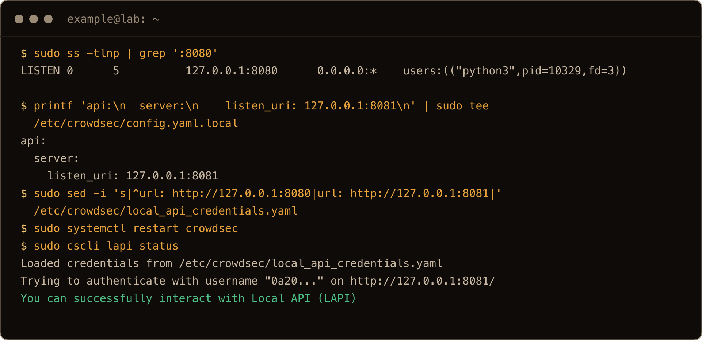

Do this **before** you install the bouncers and they pick the new port up on their own. Both of mine wrote `8081` into their configs. Move it after, and you're in the next section.

## 8. The bouncers that say active and do nothing

On the second box I moved the LAPI again, from 8081 to 8082, with both bouncers already installed. Nothing complained:

```text
active
active
```

That's `systemctl is-active crowdsec-firewall-bouncer` and nginx, and both were lying in the way that matters. The firewall bouncer kept retrying the old port, every 10 seconds, in its own log file, not the journal:

```bash
sudo tail -2 /var/log/crowdsec-firewall-bouncer.log
```

```text
time="2026-11-08T18:12:02Z" level=error msg="auth-api: auth with api key failed return nil response, error: dial tcp 127.0.0.1:8081: connect: connection refused"
time="2026-11-08T18:12:02Z" level=error msg="Get \"http://127.0.0.1:8081/v1/decisions/stream?additional_pull=false&community_pull=false\": dial tcp 127.0.0.1:8081: connect: connection refused"
```

Nginx kept serving pages to everyone. I banned a fake address by hand while both bouncers pointed at the old port, and it got a `200`. The nginx bouncer **fails open**, the firewall bouncer never hears about new bans, and the only trace on the nginx side is in `/var/log/nginx/error.log`:

```text
[lua] live.lua:39: live_query_api(): failed to query LAPI http://127.0.0.1:8081/v1/decisions?ip=::1: connection refused
```

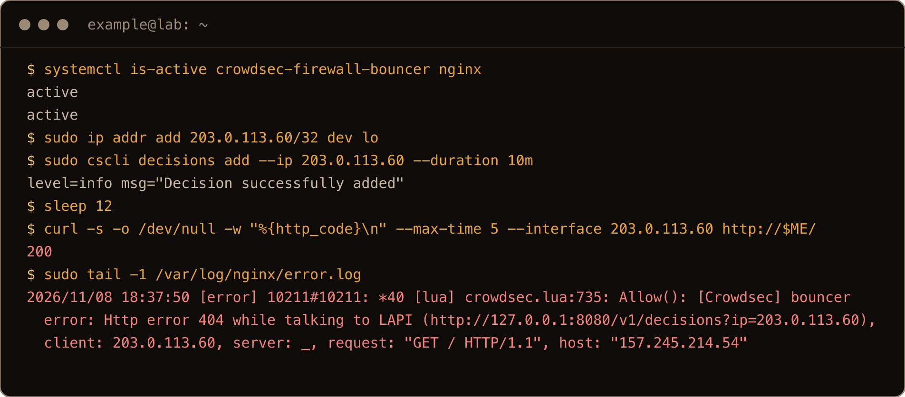

*On the screenshot box the bouncers still pointed at 8080, where the Python server answered with a 404 instead of refusing the connection. Different error, same result: active, and not blocking.*

The tell is `sudo cscli bouncers list`: the Last API pull stops moving. Point both configs at the new port and restart them. For the usual case, 8080 moved to 8081:

```bash
sudo sed -i 's|127.0.0.1:8080|127.0.0.1:8081|' /etc/crowdsec/bouncers/crowdsec-firewall-bouncer.yaml /etc/crowdsec/bouncers/crowdsec-nginx-bouncer.conf
sudo systemctl restart crowdsec-firewall-bouncer nginx
sudo cscli bouncers list
```

(On my box the numbers were 8081 and 8082; same files, same fix.) The firewall bouncer's pull was current again within seconds, and the banned address was blocked again: a `403` or a timeout, depending on whether the firewall bouncer had made its first pull yet. I got one of each on two boxes. The nginx row only moves when a request actually reaches nginx, and a banned address never does, so send it one from somewhere allowed (`curl -s localhost` on the box works) and check again.
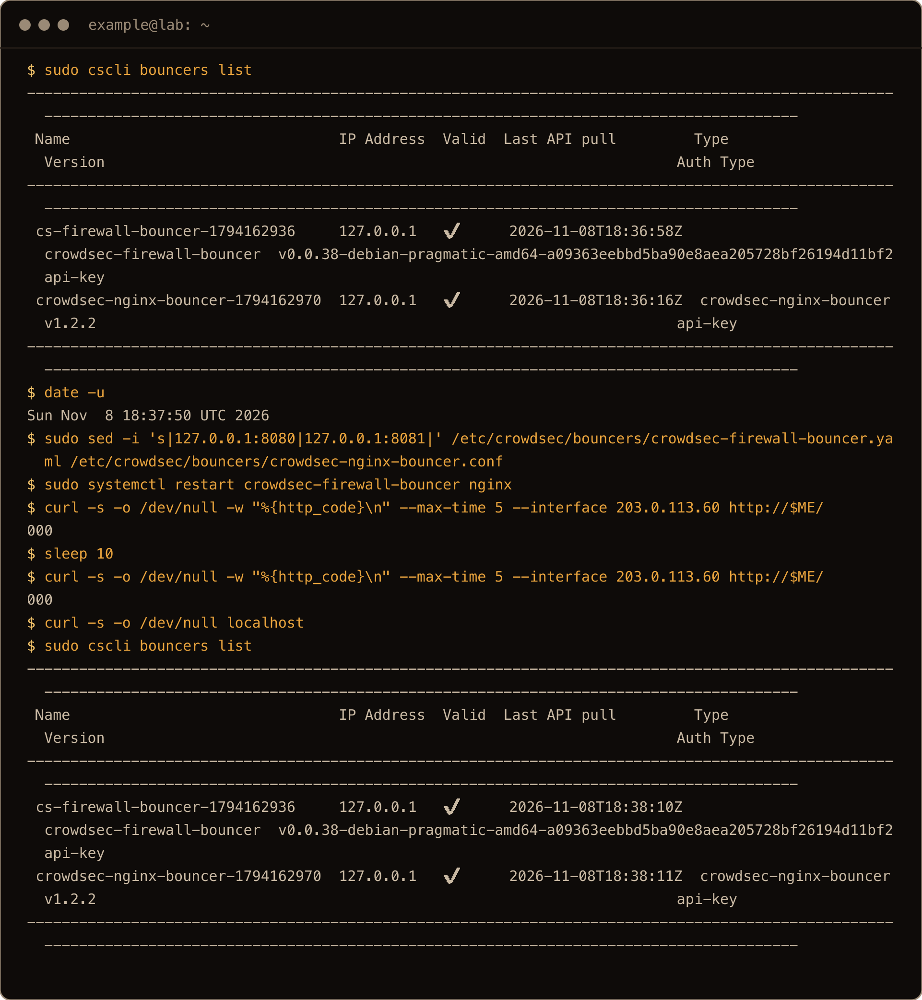

*The screenshot adds a `bouncers list` before the fix, `date -u` for comparison, two test `curl`s with a sleep, and the `curl localhost` that moves the nginx pull time.*

## 9. Signal sharing is on by default

```bash
sudo cscli capi status
```

```text
You can successfully interact with Central API (CAPI)
Sharing signals is enabled
Pulling community blocklist is enabled
Pulling blocklists from the console is enabled
```

"Sharing signals" means that when your box bans an address, CrowdSec sends that address and the scenario name to its central API. That's the deal behind the community blocklist. If you'd rather keep it to yourself, turn it off in `config.yaml.local`. With no file there yet:

```bash
printf 'api:\n  server:\n    online_client:\n      sharing: false\n' | sudo tee /etc/crowdsec/config.yaml.local
```

If you already moved the port in section 7, the file needs both settings under the one `server:` key (YAML doesn't let you repeat `api:`):

```bash
printf 'api:\n  server:\n    listen_uri: 127.0.0.1:8081\n    online_client:\n      sharing: false\n' | sudo tee /etc/crowdsec/config.yaml.local
```

Then:

```bash
sudo systemctl restart crowdsec
sudo cscli capi status
```

```text
Sharing signals is disabled
Pulling community blocklist is enabled
```

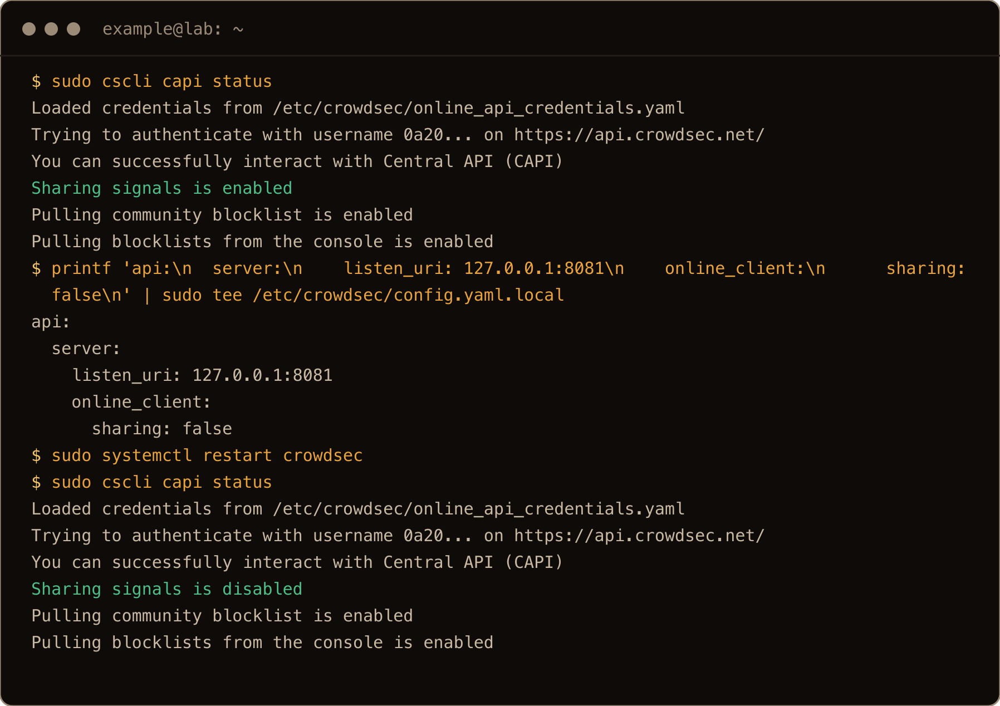

The community blocklist doesn't arrive straight away. The first pull after install logs `received 0 new entries (expected if you just installed crowdsec)` in `/var/log/crowdsec.log`. On the second box, a later pull after one of my restarts brought in about 15,000 addresses, mostly `http:scan` and `ssh:bruteforce`, loaded into the crowdsec sets. The first box, which I didn't restart, was still on zero an hour later, waiting for its next scheduled pull. So an empty `cscli decisions list --origin CAPI` on a new box isn't broken. It's early.

## Day to day

```bash
sudo cscli alerts list                  # what was detected
sudo cscli alerts inspect -d 1          # the log lines behind alert 1
sudo cscli decisions list               # who is banned right now
sudo cscli decisions delete --ip <ip>   # unban
sudo cscli metrics show acquisition     # which log files are being read (since the last restart)
sudo cscli bouncers list                # is every bouncer still pulling?
```

The metrics reset when CrowdSec restarts, and a log file only gets a row once a line has been read from it. Right after a restart, no `nginx/access.log` row just means nobody has hit nginx since.

Hub content (parsers and scenarios) updates itself: the package installs `crowdsec-hubupdate.timer`, which runs daily. The engine and bouncers update with `apt upgrade`, like anything else from a repo.

Coming from my [Fail2ban post](/blog/set-up-fail2ban-ubuntu-26-04/)? CrowdSec reads `/var/log/auth.log`, fail2ban reads the journal, and they both see the same failed logins. Neither knows about the other. I didn't run them together. If CrowdSec is taking over, turn fail2ban off with `sudo systemctl disable --now fail2ban` rather than keeping two things banning the same addresses.

## Where things live

| Path | What |
| --- | --- |
| `/etc/crowdsec/config.yaml` | main config, the package's file |
| `/etc/crowdsec/config.yaml.local` | your overrides (port, sharing) |
| `/etc/crowdsec/local_api_credentials.yaml` | how the engine reaches its LAPI |
| `/etc/crowdsec/acquis.d/setup.*.yaml` | which log files are read |
| `/etc/crowdsec/bouncers/crowdsec-firewall-bouncer.yaml` | firewall bouncer, `api_url`, `update_frequency: 10s` |
| `/etc/crowdsec/bouncers/crowdsec-nginx-bouncer.conf` | nginx bouncer, `API_URL`, `API_KEY` |
| `/etc/nginx/conf.d/crowdsec_nginx.conf` | the Lua hooks in nginx |
| `/var/log/crowdsec.log` | engine log |
| `/var/log/crowdsec-firewall-bouncer.log` | firewall bouncer log (not the journal) |

## Gotchas I hit

- **Universe is 1.4.6.** Add CrowdSec's repo first or `apt install crowdsec` installs a 2023 release.
- **`crowdsec-firewall-bouncer` without `-nftables`** is Ubuntu's 0.0.25, not CrowdSec's 0.0.38.
- **Nginx installed after CrowdSec isn't watched.** Run `sudo cscli setup unattended` and reload.
- **Your own IP and your tailnet aren't protected.** Only private ranges and some well known crawlers are. Allowlist before the firewall bouncer.
- **Port 8080 taken:** the install skips starting the service, and the next start fails with `bind: address already in use`.
- **Moving the LAPI after the bouncers** leaves both `active` and useless. Nginx fails open.
- **The nginx bouncer prints its API key** to the terminal and brings in `gcc`.
- **Bans aren't instant on the firewall.** Up to 10 seconds, the bouncer's pull interval. Nginx is quicker.

## Quick reference

```bash
# repo and install (nginx first)
curl -s https://install.crowdsec.net | sudo sh
sudo apt install -y nginx
sudo apt install -y crowdsec

# allowlist yourself
sudo cscli allowlists create home -d "my own addresses"
sudo cscli allowlists add home <your-ip> -d "home"
sudo cscli allowlists add home 100.64.0.0/10 -d "tailnet"

# bouncers
sudo apt install -y crowdsec-firewall-bouncer-nftables
sudo apt install -y crowdsec-nginx-bouncer
sudo systemctl restart nginx
sudo cscli bouncers list

# found a service late
sudo cscli setup unattended && sudo systemctl reload crowdsec

# unban
sudo cscli decisions delete --ip <ip>
```

Install it from CrowdSec's repo, put yourself on the allowlist first, and check `cscli bouncers list` after every change. That's most of it.
