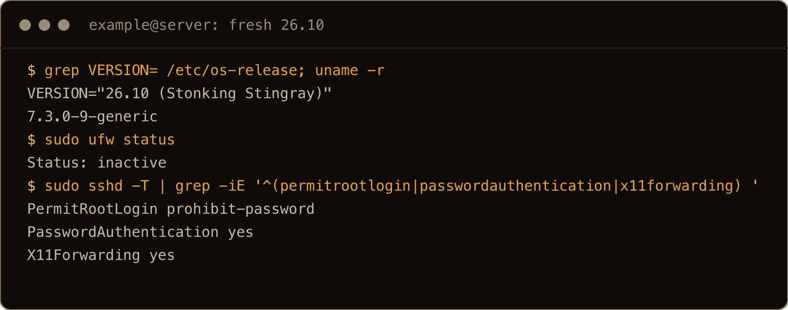
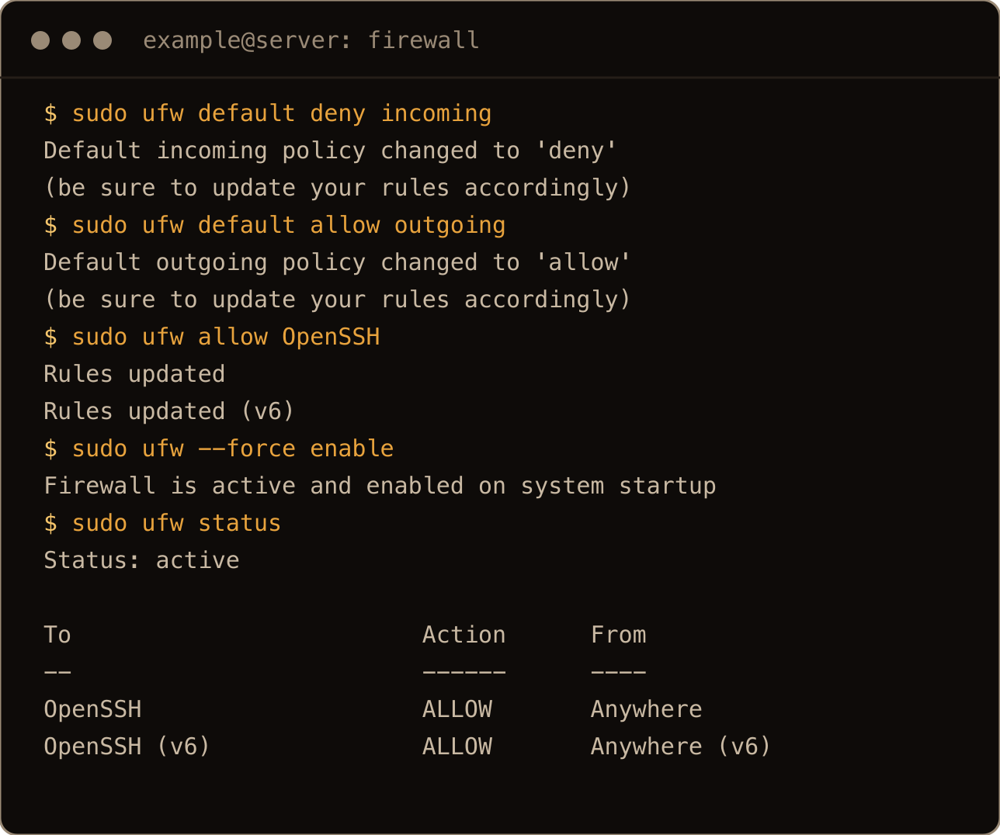
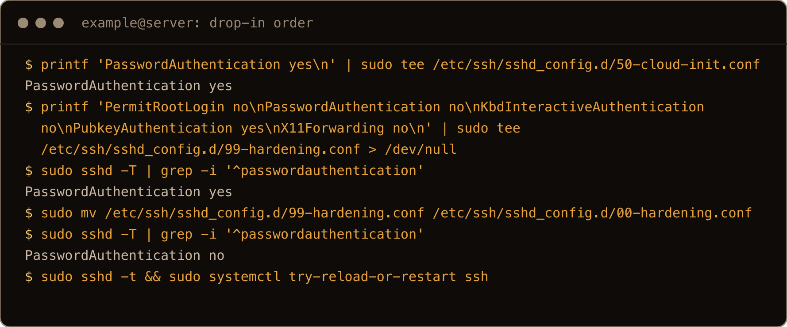
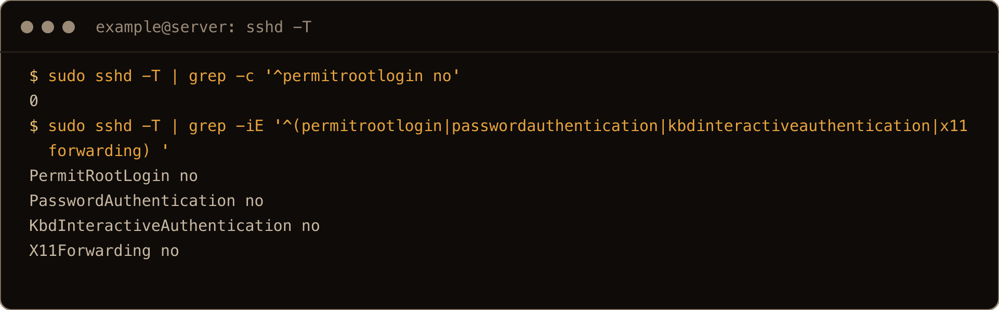
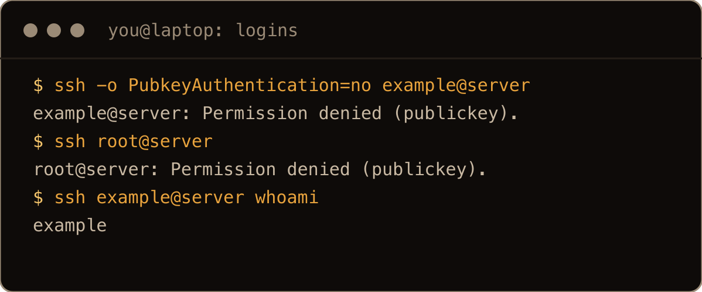
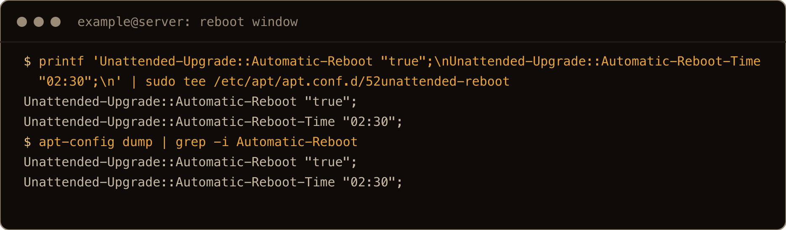
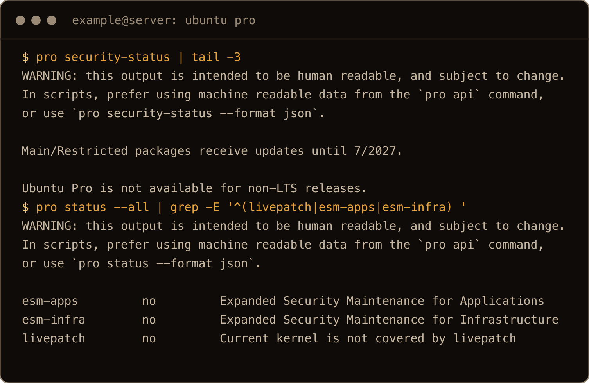
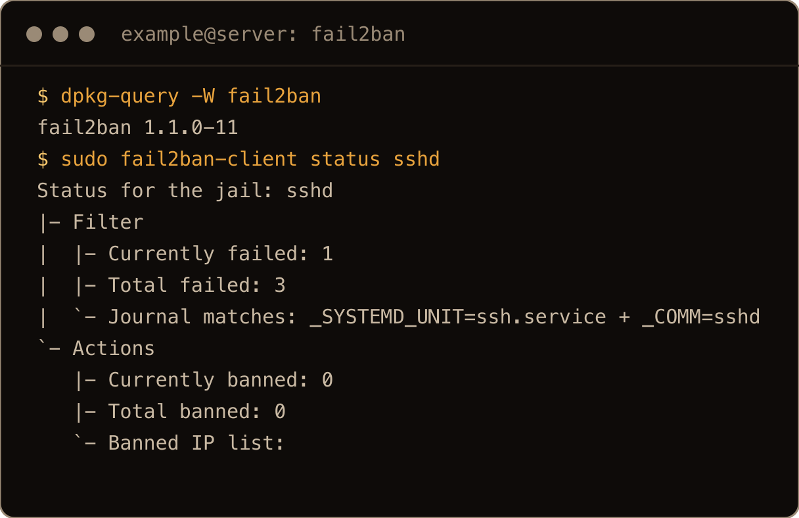
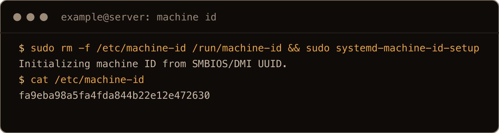
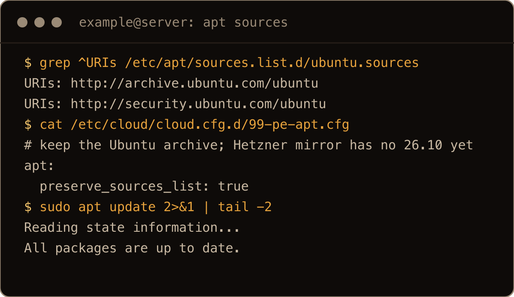

I want the latest and greatest, and with all the exploits AI is finding, I want to be fully patched.

Ubuntu 26.10, "Stonking Stingray", came out today, 15 October 2026. This is the hardening pass I run on a fresh 26.10 server, done on release day on a box upgraded from 26.04. Most of it is the same pass as my [26.04 server hardening](/blog/hardening-ubuntu-26-04-server/), and that's the point: the steps carry over. What changed are the details that decide whether they actually work, and one thing 26.10 can't give you at all.

> **TL;DR.** Get a key login as a sudo user first. Turn on `ufw` with SSH allowed. Put your SSH settings in `/etc/ssh/sshd_config.d/00-hardening.conf` (00, not 99) and check them with `sshd -T | grep -i`. Let unattended-upgrades reboot at a set time, because 26.10 has no Livepatch. Add fail2ban. Or run [the script](#8-the-one-shot-script), which does all of that and refuses to run if it would lock you out. Support ends July 2027, so plan the move to 27.04.

## Contents

- [What is different on 26.10](#what-is-different-on-2610)
- [1. A key login first](#1-a-key-login-first)
- [2. Firewall before you cut the cord](#2-firewall-before-you-cut-the-cord)
- [3. SSH keys only, in a drop-in named 00](#3-ssh-keys-only-in-a-drop-in-named-00)
- [4. Automatic updates, with a reboot window](#4-automatic-updates-with-a-reboot-window)
- [5. "Ubuntu Pro is not available for non-LTS releases"](#5-ubuntu-pro-is-not-available-for-non-lts-releases)
- [6. fail2ban on the front door](#6-fail2ban-on-the-front-door)
- [7. See what is listening](#7-see-what-is-listening)
- [8. The one-shot script](#8-the-one-shot-script)
- [9. Snapshot the hardened box](#9-snapshot-the-hardened-box)
- [Gotchas I hit](#gotchas-i-hit)
- [Quick reference](#quick-reference)

## What is different on 26.10

What I found on a 26.10 box straight after the upgrade, before changing anything:

| | On 26.10 |
| --- | --- |
| Support | until July 2027 (`pro security-status`: "Main/Restricted packages receive updates until 7/2027") |
| Livepatch, ESM | not available: `Ubuntu Pro is not available for non-LTS releases.` |
| SSH | OpenSSH 10.5p1, started by `ssh.socket`; `PasswordAuthentication yes` and `X11Forwarding yes` by default; `sshd -T` prints keywords in CamelCase |
| Firewall | `ufw` 0.36.2 on the nftables backend, inactive |
| Updates | `unattended-upgrades` on for security updates, automatic reboot off |
| Listening | only `sshd` on port 22; DNS and chrony on loopback |
| sudo | `sudo-rs` 0.2.14 |



The screenshots in this post come from a final clean run on fresh servers built from my 26.10 snapshot, set up with a user called `example`.

And on release day itself, the plain upgrade from 26.04 wasn't offered yet. With `Prompt=normal` already set in `/etc/update-manager/release-upgrades` (a stock 26.04 has `Prompt=lts`, which never offers 26.10), `do-release-upgrade -c` said `No new release found`, and only `-d` offered 26.10. On release day, at least, that's how it was; my [26.04 to 26.10 upgrade post](/blog/upgrade-ubuntu-26-04-to-26-10-beta/) covers `-d`.

## 1. A key login first

Everything below assumes you log in as a normal user with an SSH key and that user can `sudo`. If you're still logging in as root, [create a sudo user](/blog/create-sudo-user-ubuntu-26-04/) and copy your key to it first:

```bash
ssh-copy-id you@your-server
```

Then prove the key works in a *second* terminal, and keep the first one open until the end. The firewall and SSH steps are where people lock themselves out, and an open session is your way back.

## 2. Firewall before you cut the cord

`ufw` is installed and inactive. Allow SSH before you enable it, or `enable` drops you:

```bash
sudo ufw default deny incoming
sudo ufw default allow outgoing
sudo ufw allow OpenSSH
sudo ufw enable
```

`OpenSSH` is the profile for port 22. If your SSH listens on another port, allow that number instead (`sudo ufw allow 2222/tcp`), before `enable`.



## 3. SSH keys only, in a drop-in named 00

Put the settings in a drop-in file rather than editing `sshd_config`:

```bash
sudo tee /etc/ssh/sshd_config.d/00-hardening.conf <<'EOF'
PermitRootLogin no
PasswordAuthentication no
KbdInteractiveAuthentication no
PubkeyAuthentication yes
X11Forwarding no
EOF
sudo sshd -t && sudo systemctl try-reload-or-restart ssh
```

Why `00` and not `99`: sshd keeps the **first** value it reads for most settings, and it reads the files in `sshd_config.d` in name order. When a provider turns password login on, cloud-init writes it to a `50-cloud-init.conf` as `PasswordAuthentication yes`. A file of yours that sorts after it never gets a say, and nothing warns you. I tested it: with a `50-cloud-init.conf` like that in place and my settings in `99-hardening.conf`, `sshd -T` still said `PasswordAuthentication yes`. Renamed to `00-hardening.conf`, it said `no`, and password logins got `Permission denied (publickey)`.



`try-reload-or-restart` instead of `reload`: on 26.10 SSH is started by `ssh.socket`, so `ssh.service` may not be running yet (say, if you're on the console and nobody has connected since boot). `reload` expects a running service; `try-reload-or-restart` just does nothing in that case, and the next connection starts sshd with the new config.

Now check what sshd actually uses. On 26.10 `sshd -T` prints `PermitRootLogin no`, not `permitrootlogin no`, so grep without `-i` finds nothing and looks like a failure:

```bash
sudo sshd -T | grep -iE '^(permitrootlogin|passwordauthentication|kbdinteractiveauthentication|x11forwarding) '
```

```text
PermitRootLogin no
PasswordAuthentication no
KbdInteractiveAuthentication no
X11Forwarding no
```



From your laptop, a password-only attempt and a root login should both get `Permission denied (publickey).`, and your key login should still work.



## 4. Automatic updates, with a reboot window

`unattended-upgrades` is already installing security updates. What it doesn't do by default is reboot, and a kernel fix does nothing until you do. Add a small file of your own rather than editing `50unattended-upgrades`:

```bash
sudo tee /etc/apt/apt.conf.d/52unattended-reboot <<'EOF'
Unattended-Upgrade::Automatic-Reboot "true";
Unattended-Upgrade::Automatic-Reboot-Time "02:30";
EOF
apt-config dump | grep -i Automatic-Reboot
```

It reboots only when an update asks for it, at 02:30.



I love automation. As a professional SRE, I'm always trying to offload tasks from my mind so I can work on more complex issues.

On 26.10 this isn't optional polish. Without Livepatch (next section), a reboot is the only way kernel fixes take effect, and this makes it happen without you.

## 5. "Ubuntu Pro is not available for non-LTS releases"

On 26.04 I attach the free Ubuntu Pro tier for Livepatch and ESM. On 26.10 there's nothing to attach to:

```text
$ pro security-status
...
Main/Restricted packages receive updates until 7/2027.

Ubuntu Pro is not available for non-LTS releases.
```



`pro status --all` lists every service, Livepatch and both ESM ones included, as not available. So on an interim release:

- kernel security fixes land with a reboot, which is why section 4 matters;
- packages from universe get no ESM coverage;
- the clock runs out in July 2027. Before then, move to 27.04 (or back to an LTS). An unsupported release stops getting fixes, which undoes everything else here.

## 6. fail2ban on the front door

```bash
sudo apt install fail2ban
sudo fail2ban-client status sshd
```

I got fail2ban 1.1.0 with the `sshd` jail on, reading the systemd journal (`Journal matches: _SYSTEMD_UNIT=ssh.service + _COMM=sshd`). Don't be surprised if `Total failed` isn't 0 straight away: on my box it counted the password and root logins I had just tested in section 3. With passwords off this is about quieting the log more than stopping a break-in. My [fail2ban guide](/blog/set-up-fail2ban-ubuntu-26-04/) has the configuration details; they carry over to 26.10.



## 7. See what is listening

```bash
sudo ss -tulpn
```

On my fresh box the only thing listening on a public address was `sshd` on 22; `systemd-resolved` and `chrony` were on loopback. Go down the list and justify every line. Anything you didn't put there, `sudo systemctl disable --now <service>`.

![ss -tulpn shows sshd on 0.0.0.0:22 and [::]:22, with systemd-resolved and chronyd only on loopback addresses](../../assets/harden-2610-shot-10-listening.png)

## 8. The one-shot script

I use the script, because these are just testing boxes. I'll eventually build it into Terraform, but for now running a script on the new servers I spin up once in a blue moon is fine. Plus, I usually take snapshots of new servers so I don't have to do the same thing over and over again.

It does sections 2, 3, 4 and 6 in one go, plus a full upgrade first:

```bash
curl -fsSLO https://peculiarengineer.com/scripts/harden-ubuntu-2610.sh
less harden-ubuntu-2610.sh
sudo bash harden-ubuntu-2610.sh <your-username>
```

Read it before you run it; it's short. Before it changes anything it checks that it's running as root through `sudo` from your own login as that user, that the user has an `authorized_keys` file with something in it, and that the user is in the `sudo` group. If any of that is off it prints one line and stops. Then it:

- runs a full upgrade;
- opens the port sshd is configured on (from `sshd -T`, so set a custom port in `sshd_config` or a drop-in, not in an `ssh.socket` override) and enables `ufw`;
- writes `00-hardening.conf`, tests it with `sshd -t` (and removes it again if the test fails), reloads, and then checks the live values, exiting with a message if an earlier drop-in still wins;
- adds the 02:30 reboot and installs fail2ban;
- prints `ss -tulpn`.

I ran it on fresh 26.10 boxes: twice in a row on the same box, on one with a `50-cloud-init.conf` turning passwords on, and on one with SSH on port 2222. All three finished with key login working. On the fresh box and the `50-cloud-init.conf` box, password logins were refused afterwards, and on the fresh box root logins too; the 2222 box got its own firewall rule and kept its login on 2222.


## 9. Snapshot the hardened box

It's Ubuntu, so I just snapshot after a new build and the hardening. I don't really have to clean it.

I wanted to know what that copies, so I snapshotted a hardened box without cleaning it and booted a clone. cloud-init noticed it was a new instance and gave the clone its own hostname and new SSH host keys. The hardening came across intact. The one thing that didn't change was the machine ID:

```text
original  machine-id=62b677fd769f4332b0ad06d19fc8d28a
clone     machine-id=62b677fd769f4332b0ad06d19fc8d28a
```

The clone's journal even listed the original's boot as its own previous boot. Anything that identifies the machine by that ID sees two copies of the same box. On each clone, once:

```bash
sudo rm -f /etc/machine-id /run/machine-id && sudo systemd-machine-id-setup
sudo reboot
```

`systemd-machine-id-setup` printed `Initializing machine ID from SMBIOS/DMI UUID.` and the clone came back with its own ID and no failed units. On Hetzner that ID is the server's own hardware UUID, so each server gets a different one. Remove `/run/machine-id` too: on a box where systemd already keeps a copy there, removing only `/etc/machine-id` brings the same ID straight back (`Reusing machine ID stored in /run/machine-id`).



One more, specific to Hetzner and 26.10 right now. Hetzner has no 26.10 image yet, so a 26.10 box there starts as an upgraded 26.04, and the upgrader moves its apt sources to the Ubuntu archive (it disables mirrors it doesn't recognise; I saw that in the [26.10 upgrade](/blog/upgrade-ubuntu-26-04-to-26-10-beta/) runs). Snapshot that box and every server built from the snapshot is a new instance to cloud-init, and Hetzner's cloud-init config rewrites the apt sources to its own mirror. That mirror has no 26.10 packages yet, so `apt update` on those servers fails with `no longer has a Release file` (and so does the script's first step). Before you snapshot, tell cloud-init to leave the sources alone and point them at the Ubuntu archive:

```bash
printf 'apt:\n  preserve_sources_list: true\n' | sudo tee /etc/cloud/cloud.cfg.d/99-keep-apt-sources.cfg
sudo sed -i -e 's#https://mirror.hetzner.com/ubuntu/packages#http://archive.ubuntu.com/ubuntu#' -e 's#https://mirror.hetzner.com/ubuntu/security#http://security.ubuntu.com/ubuntu#' /etc/apt/sources.list.d/ubuntu.sources
```



My snapshot's copy of that file is called `99-pe-apt.cfg`; the name doesn't matter, only that it's in `cloud.cfg.d`.

## Gotchas I hit

- A drop-in named `99-` loses to a provider's `50-cloud-init.conf`; name yours `00-`.
- `sshd -T | grep '^permitrootlogin'` finds nothing on 26.10; use `grep -i`.
- `try-reload-or-restart ssh` instead of `reload`, because `ssh.service` may not be running under `ssh.socket`.
- No Livepatch or ESM on 26.10. Kernel fixes need the reboot window, and support ends July 2027.
- fail2ban's first `status` counts your own test logins.
- A clone of an uncleaned snapshot keeps the machine ID.
- On Hetzner, every server built from a 26.10 snapshot gets the Hetzner mirror back, which has no 26.10 yet.

## Quick reference

| Step | Command |
| --- | --- |
| Firewall | `ufw default deny incoming`, `ufw allow OpenSSH`, `ufw enable` |
| SSH | `/etc/ssh/sshd_config.d/00-hardening.conf`, `sshd -t`, `systemctl try-reload-or-restart ssh` |
| Check SSH | `sshd -T \| grep -iE '^(permitrootlogin\|passwordauthentication) '` |
| Reboot window | `/etc/apt/apt.conf.d/52unattended-reboot`, `Automatic-Reboot-Time "02:30"` |
| Support | `pro security-status` |
| fail2ban | `apt install fail2ban`, `fail2ban-client status sshd` |
| Listening | `ss -tulpn` |
| Script | `sudo bash harden-ubuntu-2610.sh <your-username>` |
| After cloning | `rm -f /etc/machine-id /run/machine-id && systemd-machine-id-setup`, reboot |

Same pass as 26.04, a drop-in name and a grep flag different, and one calendar date to remember: July 2027.
