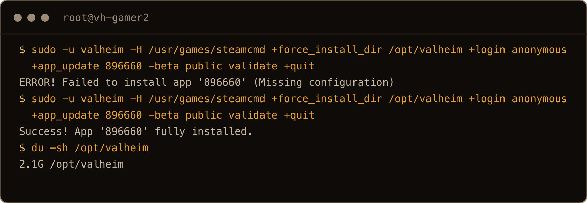
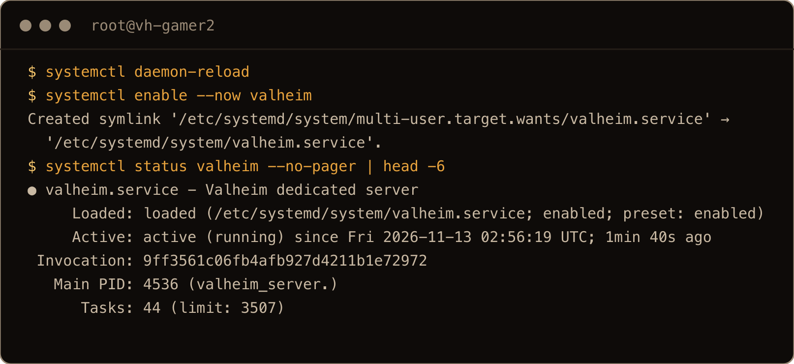
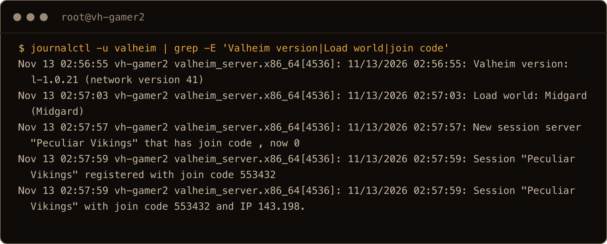
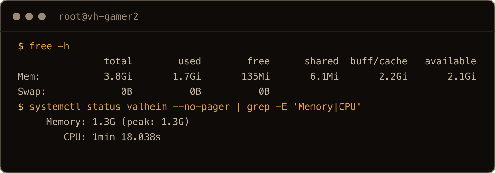
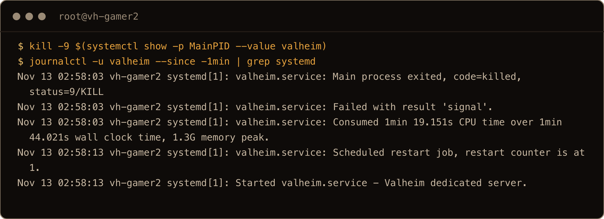
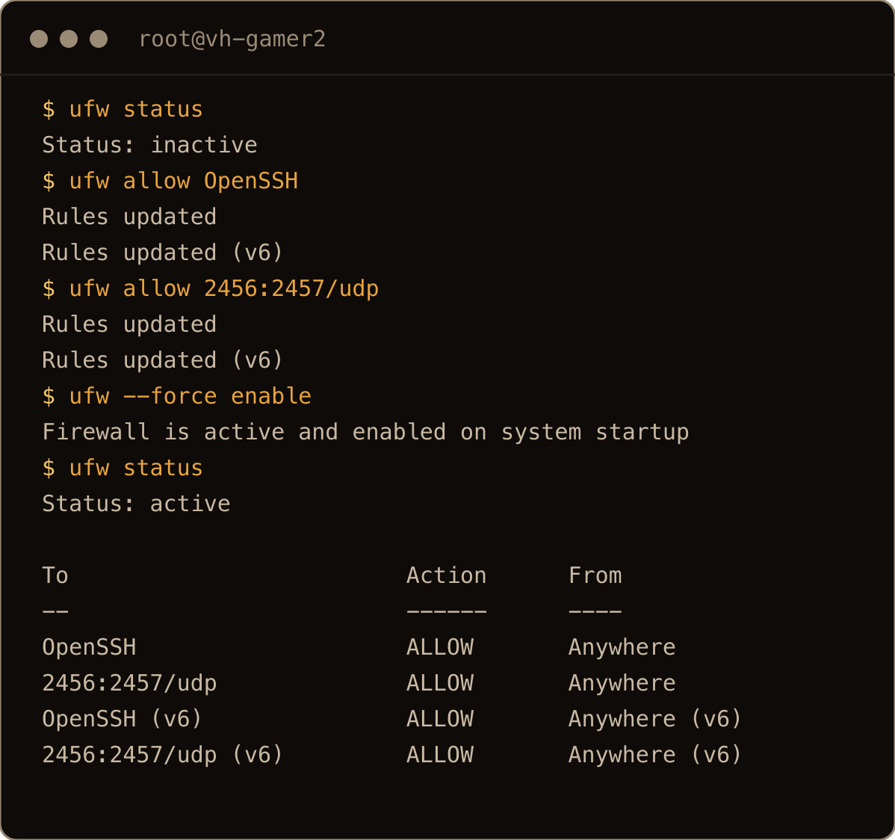
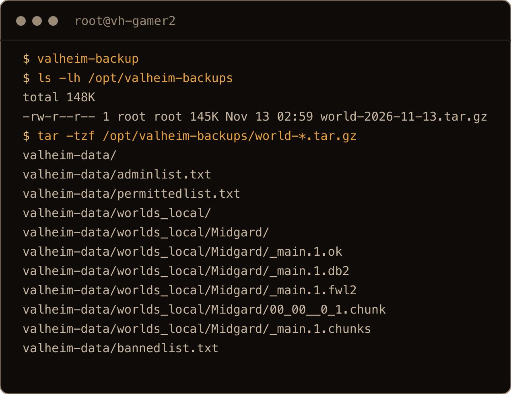
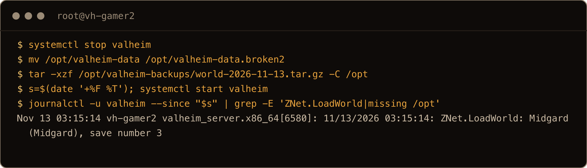
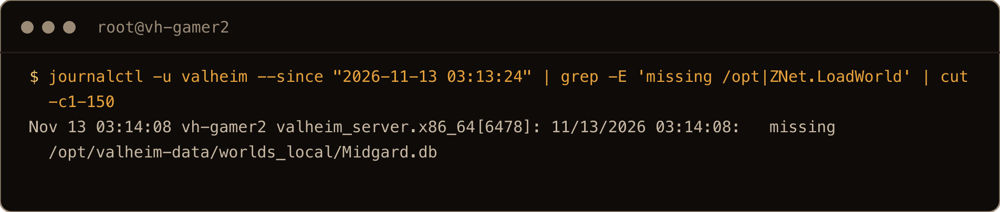
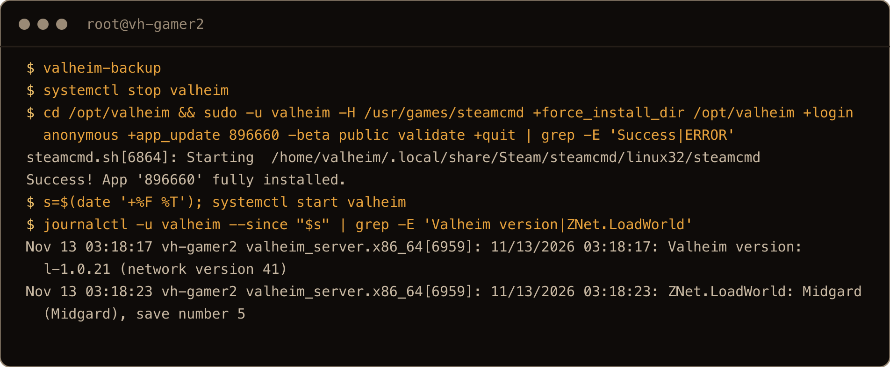

Hosting from your own PC works until you log off and your friends can't play. This guide puts your world on a small rented server that stays on all the time. You copy and paste every command, and each step says what it does. You don't need to know Linux.

I ran every step on a fresh DigitalOcean server (2 vCPU, 4 GB of memory, $24 a month) with Ubuntu 26.04 and Valheim 1.0.21. Most hosts sell something similar; you want **4 GB of memory** and **Ubuntu 26.04**.

> **TL;DR** Rent a 4 GB Ubuntu 26.04 server. Install SteamCMD and three extra libraries, without which crossplay doesn't work. Download the server, save your settings in one file, and run it as a service so it starts on its own after a crash or a reboot. Open UDP ports 2456 and 2457. Back up every night with a small script, download a copy to your PC now and then, and **restore one backup once** so you know it works. Update with `-beta public` in the command.

Not tested: nobody joined. My test server only let me in over SSH, so the game ports and the join code were never used by a real player. The memory numbers are for a new, empty world.

## Contents

- [What you need](#what-you-need)
- [1. Rent a server and log in](#1-rent-a-server-and-log-in)
- [2. Install SteamCMD](#2-install-steamcmd)
- [3. Download the Valheim server](#3-download-the-valheim-server)
- [4. Pick a name, world and password](#4-pick-a-name-world-and-password)
- [5. Start it and keep it running](#5-start-it-and-keep-it-running)
- [6. Open the ports](#6-open-the-ports)
- [7. Join from the game](#7-join-from-the-game)
- [8. Nightly backups](#8-nightly-backups)
- [9. Restore a backup](#9-restore-a-backup)
- [10. Update after a game patch](#10-update-after-a-game-patch)
- [When something goes wrong](#when-something-goes-wrong)
- [Cheat sheet](#cheat-sheet)

## What you need

- A rented server (a "VPS") with **4 GB of memory** and **Ubuntu 26.04**. With an empty world the game used 1.3 GB and the whole server 1.7 GB, so 4 GB leaves room for a world that grows and a few players. I haven't measured how much a full group adds.
- About 30 minutes.
- A terminal on your PC. On Windows that's **PowerShell** (or **Windows Terminal** on Windows 11). On a Mac it's **Terminal**. I ran everything from a Mac.

## 1. Rent a server and log in

At your host, create a server with the **Ubuntu 26.04** image and at least 4 GB of memory. Pick the location closest to most of your group; distance is lag. The host asks how you want to log in: an SSH key is safest; if you pick a password, make it long and random, because the whole internet can try it. When it's ready, the host shows you its **IP address**, four numbers like `203.0.113.25`.

Open your terminal and log in, with your own IP address:

```bash
ssh root@203.0.113.25
```

Type `yes` the first time it asks about the fingerprint, then your password. You are now typing on the server, not on your PC. Everything below is pasted into this window, except the one `scp` command in step 8.

Some hosts log you in as a user called `ubuntu` instead of `root`. If your prompt doesn't start with `root@`, run `sudo -i` first.

## 2. Install SteamCMD

SteamCMD is Valve's command line Steam, which downloads the server. The two `echo` lines accept Valve's license ahead of time so the install doesn't stop to ask.

```bash
dpkg --add-architecture i386
apt update
echo steam steam/question select "I AGREE" | debconf-set-selections
echo steam steam/license note "" | debconf-set-selections
apt install -y steamcmd libatomic1 libpulse0 libpulse-mainloop-glib0
```

Don't drop the last three names. Without them the server still starts and still says `Game server connected`, but no join code ever appears, so crossplay friends on Xbox or Game Pass have nothing to join with. I found that out the hard way on an earlier test.

## 3. Download the Valheim server

This makes a user called `valheim` to run the game (so it isn't running as the all powerful `root`), two folders, one for the game and one for your world, and then downloads the game into the first.

```bash
useradd -m -s /bin/bash valheim
mkdir -p /opt/valheim /opt/valheim-data
chown valheim:valheim /opt/valheim /opt/valheim-data
cd /opt/valheim
sudo -u valheim -H /usr/games/steamcmd +force_install_dir /opt/valheim +login anonymous +app_update 896660 -beta public validate +quit
```

You want to see this line near the end:

```text
Success! App '896660' fully installed.
```

**If it says `ERROR! Failed to install app '896660' (Missing configuration)`, run the same `sudo -u valheim ...` line again.** That happened to me on the first try, and the second try worked. The download is 2.1 GB and took about two minutes.



*Screenshots come from the same test server as the text. Some commands had a `grep` or `cut` added to keep the output short.*

## 4. Pick a name, world and password

Your settings live in one small file. **Change the three values before you paste**: the name your friends will see, the world name, and a password.

```bash
cat > /etc/valheim.env <<'EOF'
SERVER_NAME=Peculiar Vikings
WORLD=Midgard
PASSWORD=skol-4471
EOF
chmod 600 /etc/valheim.env
```

The `chmod` line makes the file readable only by `root`, because your password is in it. If there's no world with that name yet, the server makes a new one. To change a value later, open the file with `nano /etc/valheim.env`, save with Ctrl+O and Enter, exit with Ctrl+X, then restart the server (`systemctl restart valheim`).

## 5. Start it and keep it running

This creates a service: a small file that tells Ubuntu how to run the server, to start it when the machine boots, and to start it again ten seconds after a crash. Paste it as it is; it reads your settings from the file in step 4.

```bash
cat > /etc/systemd/system/valheim.service <<'EOF'
[Unit]
Description=Valheim dedicated server
Wants=network-online.target
After=network-online.target

[Service]
User=valheim
WorkingDirectory=/opt/valheim
EnvironmentFile=/etc/valheim.env
Environment=SteamAppId=892970
Environment=LD_LIBRARY_PATH=/opt/valheim/linux64
ExecStart=/opt/valheim/valheim_server.x86_64 -nographics -batchmode -name ${SERVER_NAME} -port 2456 -world ${WORLD} -password ${PASSWORD} -public 1 -crossplay -savedir /opt/valheim-data
Restart=always
RestartSec=10
TimeoutStopSec=120

[Install]
WantedBy=multi-user.target
EOF
systemctl daemon-reload
systemctl enable --now valheim
```

`-public 1` lists the server in the game's community server list. Change it to `-public 0` if you only want people who have the address or the code. I couldn't check whether my test server actually showed up in the list.

Check that it's running:

```bash
systemctl status valheim --no-pager | head -6
```



The server needs about a minute to load the world, and a little longer to get a crossplay join code. Its log lines come in bursts, so give it two minutes, then look:

```bash
journalctl -u valheim | grep -E 'Valheim version|Load world|join code'
```



The six digit number at the end is your **join code**. Write it down for your friends on Xbox or Game Pass. If the server has restarted, you'll see several lines; the last one is the current code. On my server the code changed once, then was the same after a reboot later on, so check it again after a restart.

How much of the server the game uses:



It also comes back on its own. I killed the game process the hard way, as a crash would, and the service started it again ten seconds later:



After a reboot of the whole server it came back too, with the world loaded and the same join code within about a minute of the machine coming up.

## 6. Open the ports

Players who join by address reach your server on UDP ports 2456 and 2457. Ubuntu's firewall, `ufw`, is off on a new server. These lines let in SSH (so you don't lock yourself out) and the game, and turn it on:

```bash
ufw allow OpenSSH
ufw allow 2456:2457/udp
ufw --force enable
ufw status
```



Some hosts also have a firewall in their web dashboard (DigitalOcean calls it Cloud Firewalls). If you added one there, open UDP 2456 and 2457 in it too. I couldn't test whether players joining with the code need these ports, so open them either way.

## 7. Join from the game

In Valheim, pick your character, go to **Join Game**, and add a server with your IP address and the port, for example `203.0.113.25:2456`, or with the join code from step 5. Enter the password from step 4.

I couldn't test this part from my test server, so tell me if the menus look different.

Everyone has to be on the same game version as the server. When the game patches, update the server the same day (step 10), or people get a version error.

## 8. Nightly backups

Valheim makes some automatic backups of its own next to the world (I saw them on an earlier, longer test), but they live on the same server. This script makes a full copy: it stops the server, packs the world into one file in `/opt/valheim-backups`, starts the server again, and deletes copies older than seven days. It skips Valheim's own backup folders, since they'd only make the file bigger. If anything fails in the middle, the `trap` line still starts the server.

```bash
cat > /usr/local/bin/valheim-backup <<'EOF'
#!/bin/bash
# Stops the server, saves a copy of the world, starts it again, keeps 7 days.
set -e
mkdir -p /opt/valheim-backups
systemctl stop valheim
trap 'systemctl start valheim' EXIT
tar -czf /opt/valheim-backups/world-$(date +%F).tar.gz --exclude='*_backup_auto-*' -C /opt valheim-data
find /opt/valheim-backups -name 'world-*.tar.gz' -mtime +7 -delete
EOF
chmod +x /usr/local/bin/valheim-backup
```

Run it once now:

```bash
valheim-backup
ls -lh /opt/valheim-backups
```



It took 4 seconds. A new world is 145 KB; yours grows as you build and explore.

Now make it run every night at 5:00:

```bash
echo '0 5 * * * root /usr/local/bin/valheim-backup' > /etc/cron.d/valheim-backup
```

That's 5:00 in the server's time zone, which is UTC on a new server. Anyone online at that moment gets kicked, and the server is back about a minute or two later, once the world has loaded. I tested the schedule by setting it two minutes ahead: it ran, made a new copy and started the server again.

**Keep a copy on your PC too**, in case you lose the server. Run this on your PC, in a new terminal window (not the one logged in to the server), with your IP address and the date of the file:

```bash
scp root@203.0.113.25:/opt/valheim-backups/world-2026-11-13.tar.gz .
```

The file lands in the folder your terminal is in. I ran that from a Mac; Windows 10 and 11 should have `scp` too, but I didn't test that.

## 9. Restore a backup

**Do this once now, while nothing is at stake.** A backup you've never restored is a guess. Restoring puts the world back to the moment of the backup, so for this practice run, make a fresh one first with `valheim-backup`.

List your backups and pick one:

```bash
ls -lh /opt/valheim-backups
```

Put its name in the first line below (the date will be different from mine), then paste all of it:

```bash
f=/opt/valheim-backups/world-2026-11-13.tar.gz
systemctl stop valheim
mv -T /opt/valheim-data /opt/valheim-data.old && tar -xzf "$f" -C /opt && s=$(date '+%F %T') && systemctl start valheim
```

The `mv` keeps the current world as `/opt/valheim-data.old` instead of deleting it. If it says `cannot overwrite`, there's still an `.old` copy from an earlier restore and nothing else ran: delete that copy (`rm -rf /opt/valheim-data.old`) if you don't need it, then paste the last line again. If the file name is wrong, `tar` says `No such file or directory` and the server stays off; see the end of this step. Wait a minute, in the same window, then check which world loaded:

```bash
journalctl -u valheim --since "$s" | grep -E 'ZNet.LoadWorld|missing /opt'
```

You want `ZNet.LoadWorld` with your world's name, like this:

*In this screenshot the old folder is called `.broken2`, because it was my second restore on that server and I used a different name then.*



On my server, the restored world files matched the backup exactly.

**If you see `missing /opt/valheim-data/worlds_local/Midgard.db` instead, the world wasn't there**, and the server has quietly made a brand new, empty world with the same name. There's no error and the server looks fine. I deleted my world on purpose to see what that looks like:



**To try again** (wrong file, or you saw `missing`), don't run the `mv` line a second time, because it would move the folder inside `.old`. Instead, remove the folder the failed try made and unpack again:

```bash
systemctl stop valheim
[ -d /opt/valheim-data.old ] && rm -rf /opt/valheim-data && tar -xzf "$f" -C /opt && s=$(date '+%F %T') && systemctl start valheim
```

The `[ -d ... ]` part makes sure your old world is safe in `.old` before anything is deleted. Finish the restore before you log off: the 5:00 backup would otherwise start the server on whatever is there.

Change the `f=` line first if you picked the wrong file. Also check that `WORLD=` in `/etc/valheim.env` matches the world name in the backup. If you closed the window, `$f` and `$s` are gone: set `f=` again, and check the log with `--since -3min` instead of `--since "$s"`.

When you're sure the restored world is right, delete the old copy with `rm -rf /opt/valheim-data.old`.

## 10. Update after a game patch

Take a backup, stop the server, download the update, start it again:

```bash
valheim-backup
systemctl stop valheim
cd /opt/valheim
sudo -u valheim -H /usr/games/steamcmd +force_install_dir /opt/valheim +login anonymous +app_update 896660 -beta public validate +quit
s=$(date '+%F %T'); systemctl start valheim
```

After a minute, in the same window, check the version (if you closed it, use `--since -3min` instead of `--since "$s"`):

```bash
journalctl -u valheim --since "$s" | grep -E 'Valheim version|ZNet.LoadWorld'
```

To test this for real, I first put my server on the previous version, 1.0.20, then ran the update above. It came back on 1.0.21 with the same world:



**Keep `-beta public` in that line.** Without it, a server that was ever switched to another version stays on it. I ran the update without `-beta public` on my 1.0.20 server, and SteamCMD said `Success!` but left it on 1.0.20.

## When something goes wrong

| What you see | Why | Fix |
| --- | --- | --- |
| `ERROR! Failed to install app '896660' (Missing configuration)` | SteamCMD on its first try | Run the same line again |
| Server says `Game server connected` but no join code ever appears | The three libraries from step 2 are missing | Run the `apt install` line from step 2, then `systemctl restart valheim` |
| `missing /opt/valheim-data/worlds_local/<World>.db` | No world with that name in the folder; a new empty one was made | Restore (step 9) and check `WORLD=` in `/etc/valheim.env` |
| Players get a version error | Server and game are on different versions | Update the server (step 10) |
| Update said `Success!` but the version didn't change | Server is stuck on another version | Keep `-beta public` in the update line |
| Friends can't join by address | Ports closed | Step 6, and your host's dashboard firewall |
| Server down and you don't know why | | `journalctl -u valheim -n 50` shows the last 50 log lines |

## Cheat sheet

| Task | Command |
| --- | --- |
| Log in | `ssh root@<your IP>` |
| Is it running? | `systemctl status valheim --no-pager` |
| Join code | `journalctl -u valheim \| grep 'registered with join code' \| tail -1` |
| Restart | `systemctl restart valheim` |
| Change settings | `nano /etc/valheim.env`, then restart |
| Back up now | `valheim-backup` |
| List backups | `ls -lh /opt/valheim-backups` |
| Copy a backup to your PC (run on your PC) | `scp root@<your IP>:/opt/valheim-backups/<file> .` |
| Last 50 log lines | `journalctl -u valheim -n 50` |

Running several worlds on one server, or mods, is more work than this. That's a separate post.

Restore a backup once before your group puts a hundred hours into the world. It's two minutes now, and it's the only way to know the nightly copy is any good.
