<!-- KEITH REVIEW -->
For audiobooks, Audiobookshelf is the name that keeps coming up. I wanted to see what the official setup gets wrong before I trust it with a library.

Audiobookshelf is a self hosted server for audiobooks and podcasts. It remembers where each listener stopped, and it has phone apps. The official Compose file gets it running in a minute. Where it bites is later, and this post covers each place it bit me, with the fix.

So I ran it on a fresh Ubuntu 26.04 server, broke each of those on purpose, and wrote down the fix. The commands below are the ones I ran.

> **TL;DR.** Make `/srv/audiobookshelf` and its four folders yourself, owned by you, before the first start. Run the container as you with `user: "1000:1000"` and publish it on `127.0.0.1:13378` only. Reach it over `ssh -L 13378:localhost:13378` and create the root account straight away. Give every book its own folder: `Author/Title` or `Author/Series/Title`. Press Scan after you create the library. Turn on automatic backups, then copy `metadata/backups` off the box.

## Contents

- [What I tested on](#what-i-tested-on)
- [1. Make the folders before Docker does](#1-make-the-folders-before-docker-does)
- [2. The Compose file](#2-the-compose-file)
- [3. Start it and claim the root account](#3-start-it-and-claim-the-root-account)
- [4. Lay out the books](#4-lay-out-the-books)
- [5. Add the library, then press Scan](#5-add-the-library-then-press-scan)
- [6. Two books showed up as one](#6-two-books-showed-up-as-one)
- [7. Turn on backups](#7-turn-on-backups)
- [8. Reaching it from your phone](#8-reaching-it-from-your-phone)
- [9. Updates](#9-updates)
- [Where things live](#where-things-live)
- [Gotchas I hit](#gotchas-i-hit)
- [Quick reference](#quick-reference)

## What I tested on

- Fresh DigitalOcean servers with 2 vCPU and 4 GB of RAM: Ubuntu 26.04.1 LTS, kernel 7.0.0-38, in November 2026.
- Docker 29.9.3 and Compose v5.7.0 from Docker's own repo, installed the way my [Docker on Ubuntu 26.04 post](/blog/install-docker-ubuntu-26-04/) does it.
- Audiobookshelf 2.37.2, the newest release (October 23, 2026), image `ghcr.io/advplyr/audiobookshelf`.
- A normal user called `example` with `sudo`, in the `docker` group. Test books made with `ffmpeg`: 30 second tones tagged with a title, an author and an album, in a few different folder layouts. `sqlite3` installed for the database checks in section 7.
- I didn't test podcasts, the phone apps or a real reverse proxy. Section 8 says what I did test instead.

## 1. Make the folders before Docker does

The official Compose file mounts four folders: `./audiobooks`, `./podcasts`, `./metadata` and `./config`. If they don't exist, Docker makes them for you, as `root`. I downloaded the official file, started it as it is, and got this:

```text
drwxr-xr-x 2 root    root    4096 Nov  8 18:25 audiobooks
-rw-rw-r-- 1 example example 1180 Nov  8 18:25 compose.yaml
drwxr-xr-x 3 root    root    4096 Nov  8 18:25 config
drwxr-xr-x 6 root    root    4096 Nov  8 18:25 metadata
drwxr-xr-x 2 root    root    4096 Nov  8 18:25 podcasts
```

The image has no `USER` line, so the server runs as `root` too, and everything it writes inside is `root`'s. The first thing you'll do is copy books in, and that fails:

```text
mkdir: cannot create directory ‘audiobooks/x’: Permission denied
```

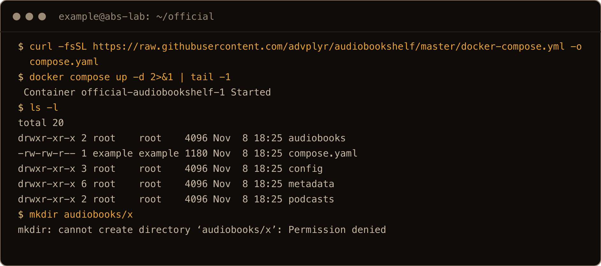

The screenshots come from a final clean run on a fresh 26.04 server. Some text blocks come from earlier test boxes, so times and IDs differ.

So make the folders yourself, first, under `/srv`:

```bash
sudo mkdir -p /srv/audiobookshelf
sudo chown "$USER": /srv/audiobookshelf
cd /srv/audiobookshelf
mkdir config metadata audiobooks podcasts
ls -l
```

```text
drwxrwxr-x 2 example example 4096 Nov  8 18:13 audiobooks
drwxrwxr-x 2 example example 4096 Nov  8 18:13 config
drwxrwxr-x 2 example example 4096 Nov  8 18:13 metadata
drwxrwxr-x 2 example example 4096 Nov  8 18:13 podcasts
```

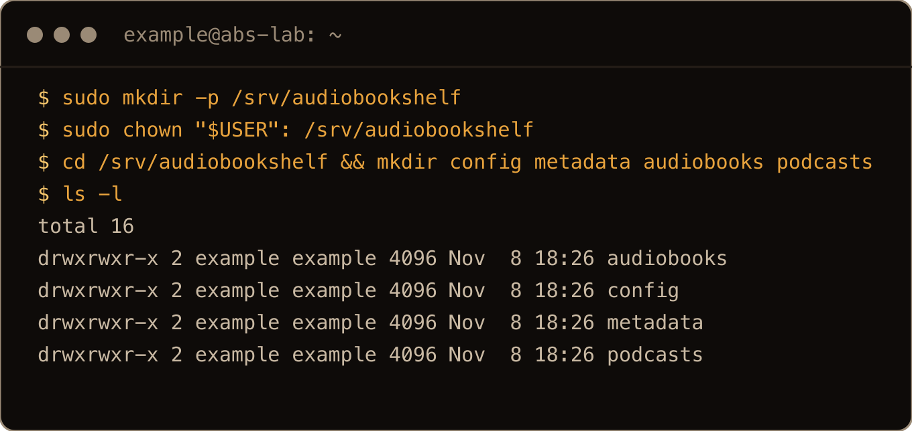

<!-- KEITH REVIEW -->
Why `/srv`? I use bind mounts, so my container data sits under `/srv`, and that's what my [restic backups](/blog/backup-homelab-restic-object-storage/) pick up.

## 2. The Compose file

Still in `/srv/audiobookshelf`:

```bash
cat > compose.yaml <<EOF
services:
  audiobookshelf:
    image: ghcr.io/advplyr/audiobookshelf:2.37.2
    container_name: audiobookshelf
    user: "$(id -u):$(id -g)"
    ports:
      - "127.0.0.1:13378:80"
    volumes:
      - ./audiobooks:/audiobooks
      - ./podcasts:/podcasts
      - ./metadata:/metadata
      - ./config:/config
    environment:
      - TZ=America/New_York
    restart: unless-stopped
EOF
cat compose.yaml
```

The `$(id -u):$(id -g)` part fills in your own IDs as the file is written, so check the `cat`. Mine said `user: "1000:1000"`.

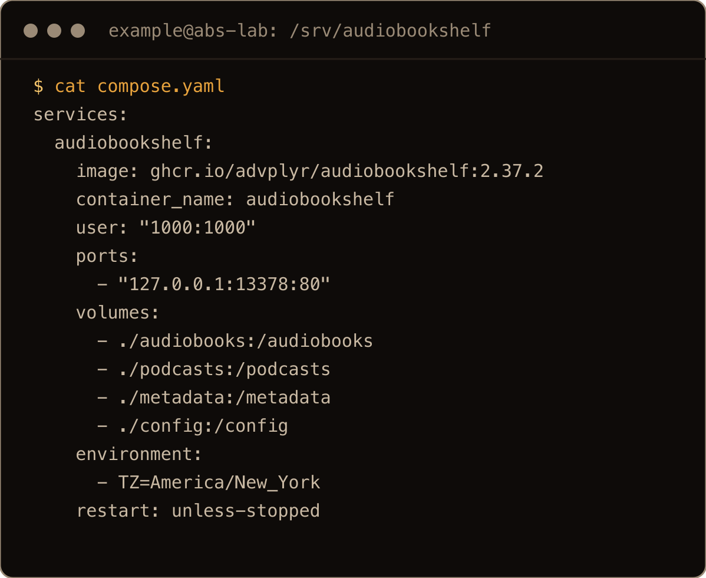

What's different from the official file, and why:

- **`user:`** runs the server as you, so everything it writes in `config` and `metadata` is yours. The official file has this line commented out.
- **`127.0.0.1:13378:80`** publishes the port on localhost only. A plain `13378:80` listens on every address, and `ufw` doesn't stop it ([section 8](#8-reaching-it-from-your-phone)). 13378 is the port the project uses; inside the container it's 80.
- **A pinned tag.** `2.37.2` instead of `latest`, so an update happens when you change the line, not whenever the image gets pulled.
- **`TZ`.** Set it to yours. Without it the container runs on UTC. With it, the log times and the backup schedule in section 7 follow your clock.

### "SQLITE_READONLY: attempt to write a readonly database"

This is what you get if you started with the official file, which made everything as `root`, and then added `user:`. I did exactly that. The container went into a restart loop:

```text
audiobookshelf-audiobookshelf-1 Restarting (1) 2 seconds ago
```

```text
FATAL: [Server] Unhandled rejection: Error
  parent: [Error: SQLITE_READONLY: attempt to write a readonly database] {
[LogManager] Appended crash log [Error: EACCES: permission denied, open '/metadata/logs/crash_logs.txt'] {
```

The database and the logs belong to `root`, and the server is now `1000`. Give them back and start it again:

```bash
docker compose down
sudo chown -R "$(id -u):$(id -g)" config metadata
docker compose up -d
```

After that it came up, and the library and the logins were still there.


On the screenshot box I set `config` and `metadata` back to `root` first, to get the same starting point as the official file leaves you with. It also ran `chown -R 1000:1000`, which is what `$(id -u):$(id -g)` comes to for `example`.

## 3. Start it and claim the root account

```bash
docker compose up -d
docker compose ps
curl -s localhost:13378/status; echo
```

```text
NAME             IMAGE                                   COMMAND                  SERVICE          CREATED          STATUS          PORTS
audiobookshelf   ghcr.io/advplyr/audiobookshelf:2.37.2   "tini -- node dist-s…"   audiobookshelf   10 seconds ago   Up 10 seconds   127.0.0.1:13378->80/tcp
{"app":"audiobookshelf","serverVersion":"2.37.2","isInit":false,"language":"en-us","authMethods":["local"],"authFormData":{"authLoginCustomMessage":""},"ConfigPath":"/config","MetadataPath":"/metadata"}
```

`"isInit":false` is the part that matters. There's no account yet, and the first person to load the page creates the root user. I tested what happens when someone tries second: the first `POST /init` returned 200, and a second one with a different name returned 500. So whoever gets there first wins. With the port on `127.0.0.1`, that's you.

The logs already say something you'll want later:

```text
[BackupManager] Auto Backups are disabled
```


The screenshot uses `--format` on `ps` and `tail -1` on `up` to keep it narrow.

From your own computer, open a tunnel to the server:

```bash
ssh -N -L 13378:localhost:13378 example@your-server
```

Then browse to `http://localhost:13378`. It redirects to `/audiobookshelf/login` and shows **Initial Server Setup**. The username is already `root`. Give it a long password and press Submit. Leave the two paths as they are: `/config` and `/metadata` are paths inside the container.

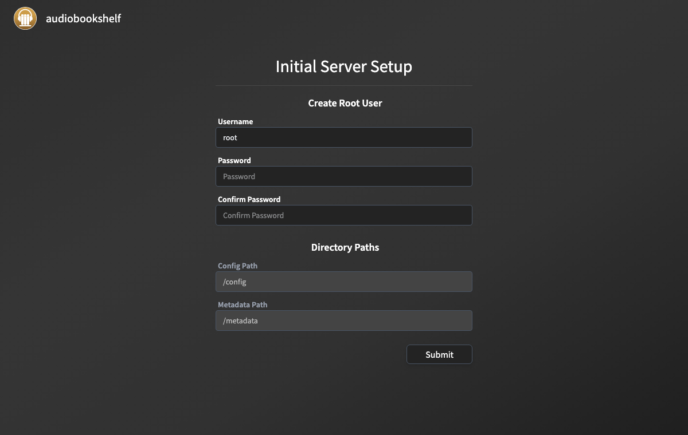

## 4. Lay out the books

Audiobookshelf works out what counts as one book from folders, not from tags. Each book gets its own folder:

```text
audiobooks/
├── Ada Lane/
│   ├── Harbor Lights/
│   │   ├── Book 1 - Salt and Signal/
│   │   │   └── 01.mp3
│   │   └── Book 2 - Low Tide/
│   │       └── 01.mp3
│   └── The Quiet Harbor/
│       ├── 01 - Arrival.mp3
│       └── 02 - Departure.mp3
└── Ben Marsh/
    ├── Cold Open/
    │   └── Cold Open.mp3
    └── Second Draft/
        └── Second Draft.mp3
```

That's `Author/Title`, or `Author/Series/Title` for a series. The folder names fill in the author, title and series. `Book 1 - Salt and Signal` under `Harbor Lights` came out as "Salt and Signal", series "Harbor Lights #1". A book split into several files, like `The Quiet Harbor`, is one book with two files.

Copy your books into `/srv/audiobookshelf/audiobooks` with whatever you like: `rsync`, `scp`, a mounted share. You own the folder now, so no `sudo`.

## 5. Add the library, then press Scan

In the web page: **Settings**, **Libraries**, **Add Library**. Name it, and for the folder type the path **inside the container**:

```text
/audiobooks
```

Not `/srv/audiobookshelf/audiobooks`. That path doesn't exist inside the container. Running as `1000`, the server refused it with `Invalid folder directory "/home/example/audiobookshelf/audiobooks"` (my first test lived in my home directory). Running as `root`, it's worse: it quietly created the folder inside the container and saved the library, pointed at an empty directory.

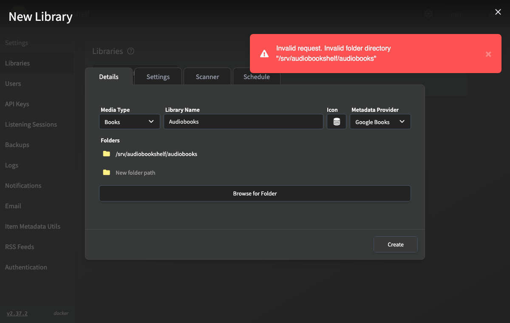

Press Create. Then the part I didn't expect: the library is empty. Creating a library doesn't scan it. The home page said:

```text
Audiobooks Library is empty!
```

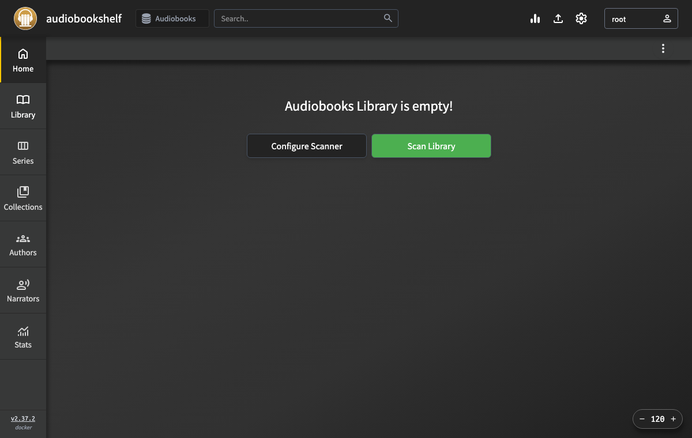

Press **Scan Library**. The log shows what it found:

```text
[LibraryScanner] Library scan "0a2a..." completed in 0:00 | 4 Added | 0 Updated | 0 Missing
```

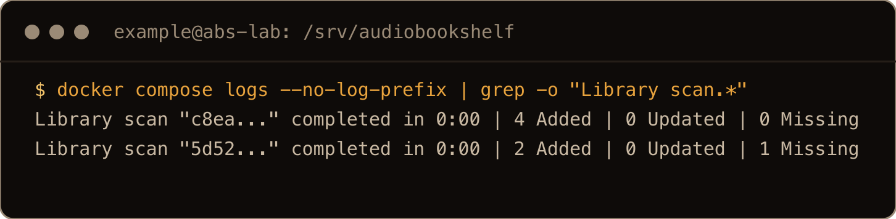

After that, a watcher picks up new books. I copied a new `Cara Holt/North Road` folder in with `cp -r`, and it appeared about 20 seconds later without a scan.

## 6. Two books showed up as one

My first layout had two books as loose files straight under the author:

```text
Ben Marsh/
├── Cold Open.mp3
└── Second Draft.mp3
```

The scan made that into one book, titled "Cold Open", with two files and a 60 second runtime. "Second Draft" didn't exist as a book at all. With files sitting directly in it, the author folder itself became the book.

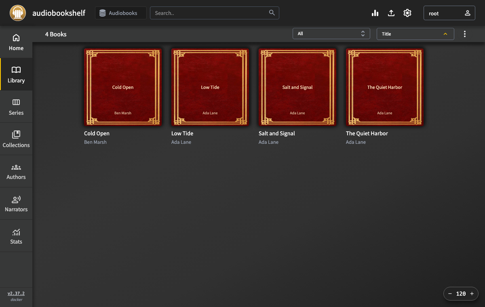

The fix is a folder per book:

```bash
cd "/srv/audiobookshelf/audiobooks/Ben Marsh"
mkdir "Cold Open" "Second Draft"
mv "Cold Open.mp3" "Cold Open"/
mv "Second Draft.mp3" "Second Draft"/
```

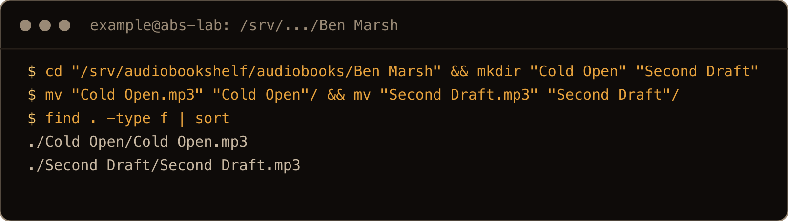

The screenshot runs the two `mv` lines as one.

Two things caught me out here:

- **The watcher didn't notice.** Ninety seconds later the library still showed the one merged book. I had to press Scan.
- **The old book stayed behind.** The scan said `2 Added | 0 Updated | 1 Missing`. The two real books were there, and so was the merged one, marked missing.


On the screenshot box this was about a minute after the move; on the first box I waited ninety seconds.

To get rid of it, an **Issues** entry shows up in the left sidebar with a count. Open it and press **Remove All 1 Books**. It asks "Are you sure you want to remove all library items with issues?" and adds "This will not delete any files". It removes the library entry only.

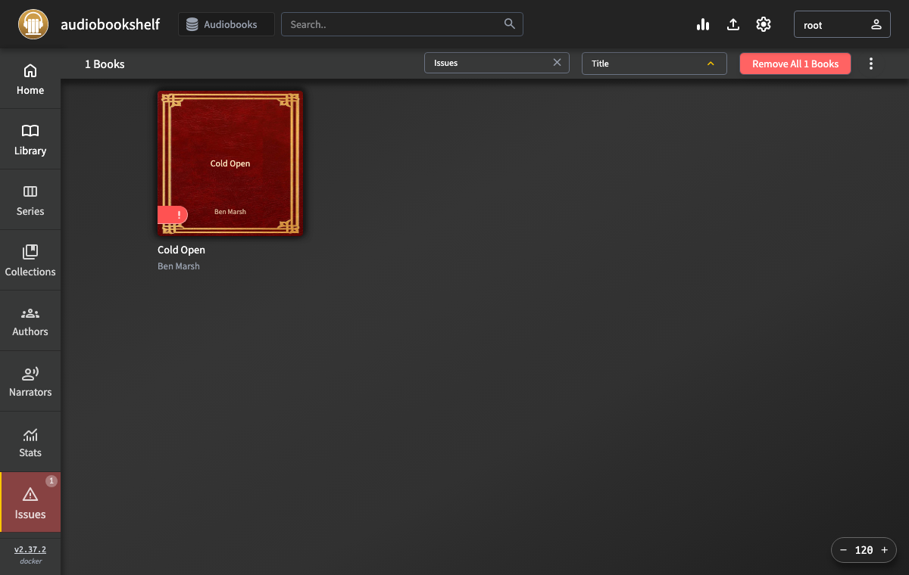

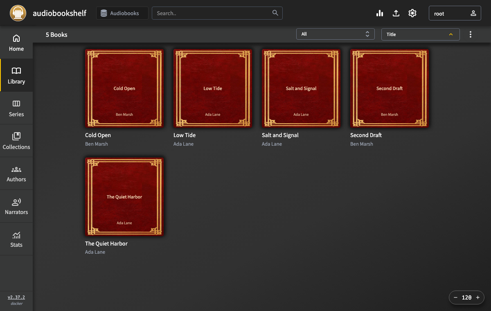

I expect any listening progress on the merged book goes with it, but I didn't test that.

## 7. Turn on backups

A fresh install doesn't back anything up. The log said `Auto Backups are disabled` at the first start, and the **Settings**, **Backups** page has the switch off.

Turn **Automatic backups** on. It picked a schedule by itself: "Run every day at 1:30", in the container's `TZ`. It keeps 2 backups and has a 1 GB size limit, and you can change both on the same page. **Create Backup** makes one right away.

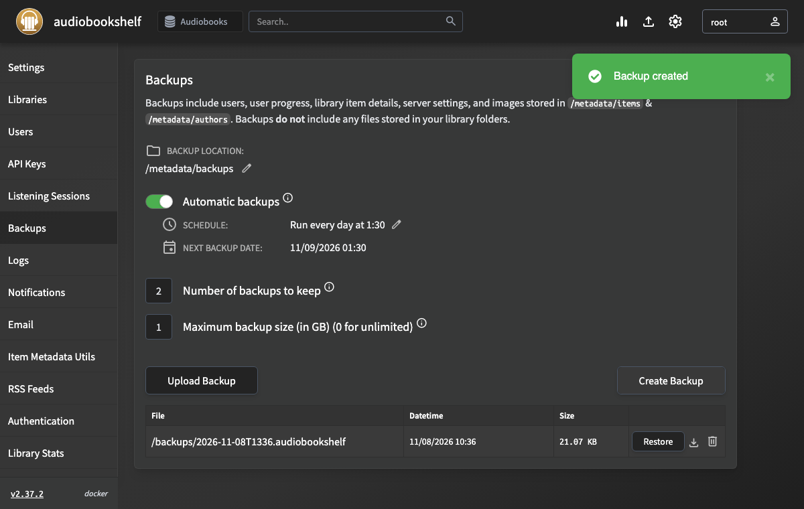

What a backup holds, from the page itself: "users, user progress, library item details, server settings, and images stored in /metadata/items & /metadata/authors. Backups do not include any files stored in your library folders." I opened one: it's a zip with the database, `absdatabase.sqlite`, and a `metadata.json` per book.

Two things to know:

- **The backups sit on the same disk**, in `/srv/audiobookshelf/metadata/backups`. Copy that folder somewhere else, or it dies with the server.
- **Back up those files, not the live database.** I checked: `PRAGMA journal_mode` on `absdatabase.sqlite` says `delete`, the rollback journal mode. In my [restic tests](/blog/backup-homelab-restic-object-storage/), live copies of a database in that mode, taken while it was being written to, came back broken about nine times in ten. The `.audiobookshelf` file is a finished copy. I ran `PRAGMA integrity_check` on the database inside one and got `ok`.

I tested a restore too, through the API on an earlier box: I deleted the library, then applied the backup, and the library came back with all 6 books.

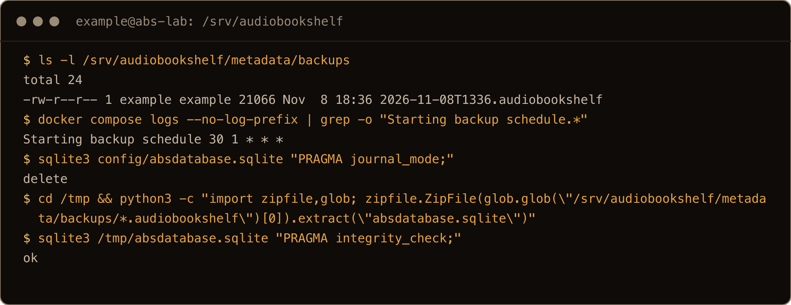

The backup's file name uses the container's New York time; `ls` shows the server's UTC.

## 8. Reaching it from your phone

The phone apps need a server address they can reach. Don't just change the port back to `13378:80` and turn on `ufw`. I tested that: Docker's published ports go around `ufw`.

The lab's cloud firewall only lets SSH in, so I used a network namespace on the same box as a stand in for an outside client, the same way as in my [Docker on 26.10 post](/blog/install-docker-ubuntu-26-10/). With the official `13378:80`:

| | port 13378 from outside |
| --- | --- |
| `ufw` inactive | 200 |
| `ufw` on, only OpenSSH allowed | **200** |
| plus `ufw deny 13378/tcp` | **200** |

With `127.0.0.1:13378:80` the outside client got nothing (`000`), and `curl` on the box got 200.

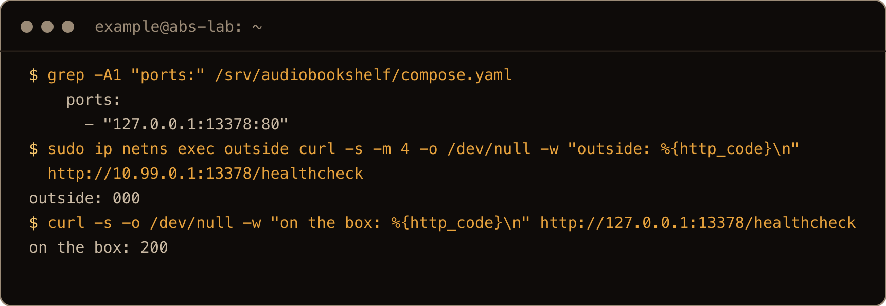

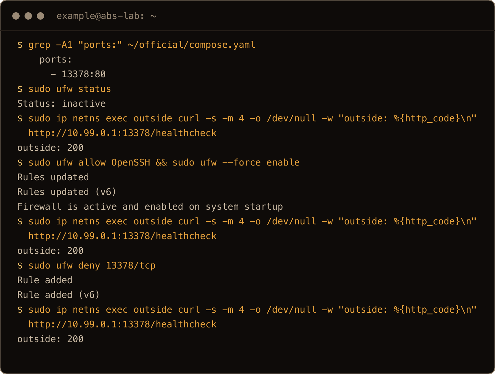

The `outside` namespace was set up before the capture. `ufw --force enable` is `ufw enable` without the prompt.

So keep it on localhost, and put something in front of it that you choose on purpose:

- **A reverse proxy** with HTTPS, like [Caddy](/blog/caddy-reverse-proxy-docker-compose-ubuntu-26-04/) or [Nginx Proxy Manager](/blog/nginx-proxy-manager-docker-compose-ubuntu-26-04/).
- **Tailscale**, so only your own devices can reach it.

If your proxy runs in Docker, like in those two posts, it can't reach `127.0.0.1` on the host. Put `audiobookshelf` on the proxy's network and point the proxy at `audiobookshelf:80`. The `127.0.0.1` port is then just for your SSH tunnel.

<!-- KEITH REVIEW -->
How do I reach my home server from outside? I use Tailscale to reach it from anywhere, but it's locked down to my home network. My [Tailscale post](/blog/install-tailscale-ubuntu-26-04/) covers the setup.

A tailnet only helps if Docker listens on the tailnet address. Publish on the server's Tailscale IP (`tailscale ip -4`), as in `"100.x.y.z:13378:80"`. The Docker on 26.10 post has the catch: that address has to exist when the container starts.

## 9. Updates

Make a backup from the Backups page first. Then find the new version on the [releases page](https://github.com/advplyr/audiobookshelf/releases), change the `image:` line in `compose.yaml` to it, and pull and recreate:

```bash
cd /srv/audiobookshelf
nano compose.yaml
docker compose pull
docker compose up -d
```

2.37.2 was the newest release when I wrote this, so I couldn't test a real version jump. On the same tag, `up -d` just said `Running`, because nothing had changed. With `docker compose up -d --force-recreate` the container was replaced, and all 6 books were still there. Your data lives in the four bind mounts, not in the container.

## Where things live

| What | Host | Container |
| --- | --- | --- |
| Compose file | `/srv/audiobookshelf/compose.yaml` | |
| Database (`absdatabase.sqlite`) | `/srv/audiobookshelf/config` | `/config` |
| Covers, item metadata, logs, cache | `/srv/audiobookshelf/metadata` | `/metadata` |
| Backups | `/srv/audiobookshelf/metadata/backups` | `/metadata/backups` |
| Scan logs | `/srv/audiobookshelf/metadata/logs/scans` | |
| Books | `/srv/audiobookshelf/audiobooks` | `/audiobooks` |
| Podcasts | `/srv/audiobookshelf/podcasts` | `/podcasts` |

## Gotchas I hit

- Docker created the four folders as `root`, so I couldn't copy books into them.
- Adding `user: "1000:1000"` to an install that had already run as `root` crash looped with `SQLITE_READONLY: attempt to write a readonly database`. `chown -R` of `config` and `metadata` to your user fixed it.
- A new library stayed empty until I pressed Scan.
- A host path in the library folder box was refused as `Invalid folder directory` when the server ran as me. Running as `root`, it silently pointed the library at an empty folder inside the container.
- Two loose files in an author folder became one book.
- Moving those files into their own folders needed a manual Scan, and left the merged book behind as missing.
- Automatic backups were off, and turned on they land on the same disk.
- A published port without `127.0.0.1` answered from outside with `ufw` on and a deny rule for it.
- A `docker compose up -d` that failed with `Bind for 127.0.0.1:13378 failed: port is already allocated` left the container behind. When the port was free again, the next `up -d` started that same container with no published port at all. Run `docker compose down` after a failed start.

## Quick reference

| Step | Command |
| --- | --- |
| Folders | `sudo mkdir -p /srv/audiobookshelf && sudo chown "$USER": /srv/audiobookshelf`, then `mkdir config metadata audiobooks podcasts` |
| Start | `docker compose up -d` in `/srv/audiobookshelf` |
| Check | `docker compose ps`, `curl -s localhost:13378/status` |
| First login | `ssh -N -L 13378:localhost:13378 you@server`, then `http://localhost:13378` |
| Library folder | `/audiobooks`, then Scan Library |
| Layout | `Author/Title/` or `Author/Series/Title/`, one folder per book |
| Logs | `docker compose logs -f` |
| `SQLITE_READONLY` | `docker compose down`, `sudo chown -R "$(id -u):$(id -g)" config metadata`, `docker compose up -d` |
| Update | change the tag, `docker compose pull && docker compose up -d` |

Make the folders before Docker does, and give every book its own folder. Then press Scan.
