During the 26.10 beta, Docker wouldn't install on Ubuntu 26.10. Docker's repo had no `stonking` suite, and `apt update` failed with `does not have a Release file` (I hit it in my [beta upgrade post](/blog/upgrade-ubuntu-26-04-to-26-10-beta/)). That's fixed now. Docker published the suite the day before release, and its install page lists "Ubuntu Stonking 26.10" first:

```bash
curl -s -o /dev/null -w '%{http_code}\n' https://download.docker.com/linux/ubuntu/dists/stonking/Release
```

```text
200
```

The `Release` file is dated `Wed, 14 Oct 2026 18:57:31`. So here's the honest headline: the steps from my [26.04 Docker post](/blog/install-docker-ubuntu-26-04/) work on 26.10 unchanged. The repo file reads the codename itself and picks up `stonking`.

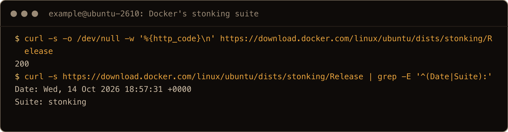

The screenshots come from a final clean run on a fresh 26.10 server, as user `example` with passwordless sudo (and a second user, `rootie`, for section 7). The text blocks come from the earlier test boxes, so times, IDs and hashes differ.

What changed is around the edges, and some of it bites. I tested on two fresh Ubuntu 26.10 servers, plus a third for the screenshots (kernel 7.3.0-9-generic, sudo-rs 0.2.14) on 18 October 2026, as a sudo user called `example`. The first box ran everything once. Sections 3 to 5 ran on it after purging the previous install. The second box followed sections 1 to 7 in order and then section 9, and the 20 second wait in section 5 comes from it too. Section 6 wasn't run on either, and it says so.

What goes on first once Docker is in? Nginx is usually the first thing I throw on there, or a Python instance for testing.

> **TL;DR.** Two ways work on 26.10. Ubuntu's own `docker.io` (29.7.2, now in `main`) is the simpler pick for most boxes. Add `docker-buildx` for BuildKit. Ubuntu's Compose (`docker-compose-v2`) is 2.40.3, three major versions behind Docker's. Docker's official steps work as they are too: the `docker.sources` file resolves to `stonking` and installs Docker 29.9.1, Compose 5.6.0 and Buildx 0.38.0. Pick one: installing `docker.io` on top of `docker-ce` removes `docker-ce` without asking twice. If you ran `get.docker.com` after the manual steps, delete `/etc/apt/sources.list.d/docker.list`. Published ports still bypass `ufw`; bind to `127.0.0.1` for anything that shouldn't be public.

## Contents

- [What's different on 26.10](#whats-different-on-2610)
- [1. Install from Docker's repo](#1-install-from-dockers-repo)
- [2. What you get](#2-what-you-get)
- [3. Or use Ubuntu's docker.io](#3-or-use-ubuntus-dockerio)
- [4. "REMOVING: containerd.io docker-ce docker-ce-cli"](#4-removing-containerdio-docker-ce-docker-ce-cli)
- [5. "Target Packages ... is configured multiple times"](#5-target-packages--is-configured-multiple-times)
- [6. If you pointed Docker at resolute during the beta](#6-if-you-pointed-docker-at-resolute-during-the-beta)
- [7. The docker group walks straight past sudo-rs](#7-the-docker-group-walks-straight-past-sudo-rs)
- [8. Published ports still ignore ufw](#8-published-ports-still-ignore-ufw)
- [9. Rootless mode on 26.10](#9-rootless-mode-on-2610)
- [Gotchas I hit](#gotchas-i-hit)
- [Quick reference](#quick-reference)

## What's different on 26.10

| | Ubuntu 26.04 | Ubuntu 26.10 |
| --- | --- | --- |
| Docker repo suite | `resolute` | `stonking`, live since 14 October |
| `docker-ce` versions in that suite | 21, from 29.3.1 to 29.9.1 | one: `5:29.9.1-1~ubuntu.26.10~stonking` |
| Ubuntu's `docker.io` | 29.1.3, in `universe` | 29.7.2, in `main` |
| Ubuntu's `docker-compose-v2` | 2.40.3 | 2.40.3 |
| Support | until April 2031 (LTS) | until July 2027 |

The single version matters if you pin. On 26.04 you can `apt install docker-ce=<older version>` to hold back. On 26.10 there's nothing older to pick yet. The suite started at 29.9.1.

The `main` move is the interesting one. On 26.04, `docker.io` sits in `universe`. On 26.10 it's in `main`, next to `containerd`. That's where Canonical puts the packages it supports. It's a fairer fight than it was on 26.04.

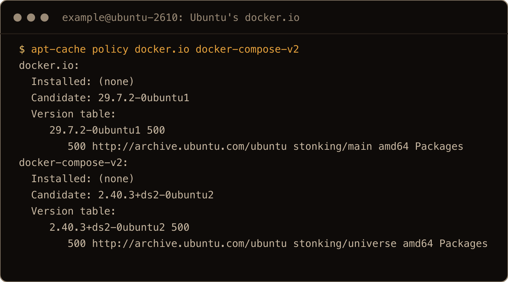

## 1. Install from Docker's repo

These are Docker's own steps from [docs.docker.com](https://docs.docker.com/engine/install/ubuntu/), copied as they are today. My [26.04 post](/blog/install-docker-ubuntu-26-04/) explains each line, so I won't repeat that here.

Clear out any distro packages first. Docker's removal list now includes `docker-buildx`, which the 26.04 post's version doesn't have:

```bash
sudo apt remove $(dpkg --get-selections docker.io docker-compose docker-compose-v2 docker-doc docker-buildx podman-docker containerd runc | cut -f1)
```

On a fresh box, `dpkg` prints `dpkg: no packages found matching docker.io` and the same line for each other name. Then apt removes nothing and exits 0. That's expected.

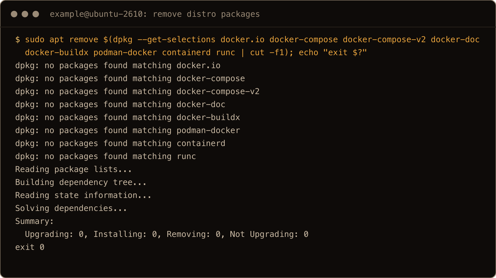

Add the key and the repo:

```bash
sudo apt update
sudo apt install ca-certificates curl
sudo install -m 0755 -d /etc/apt/keyrings
sudo curl -fsSL https://download.docker.com/linux/ubuntu/gpg -o /etc/apt/keyrings/docker.asc
sudo chmod a+r /etc/apt/keyrings/docker.asc

sudo tee /etc/apt/sources.list.d/docker.sources <<EOF
Types: deb
URIs: https://download.docker.com/linux/ubuntu
Suites: $(. /etc/os-release && echo "${UBUNTU_CODENAME:-$VERSION_CODENAME}")
Components: stable
Architectures: $(dpkg --print-architecture)
Signed-By: /etc/apt/keyrings/docker.asc
EOF

sudo apt update
```

`tee` echoes the file back. The line to check is `Suites: stonking`. Then `apt update` fetches the new suite:

```text
Get:2 https://download.docker.com/linux/ubuntu stonking InRelease [19.8 kB]
Get:6 https://download.docker.com/linux/ubuntu stonking/stable amd64 Packages [3,002 B]
```

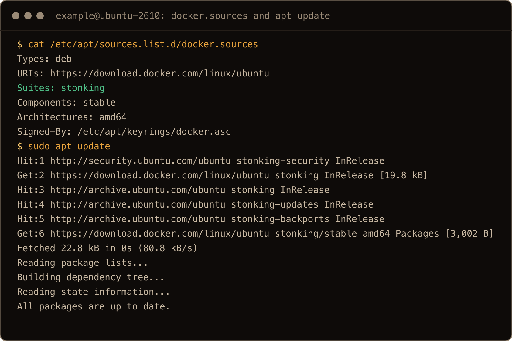

If you get `does not have a Release file` here instead, check the URL and the suite name for a typo first. The suite is there.

Install:

```bash
sudo apt install docker-ce docker-ce-cli containerd.io docker-buildx-plugin docker-compose-plugin
```

apt adds `docker-ce-rootless-extras` and `pigz` on its own. The `docker` and `containerd` services come up active and enabled.

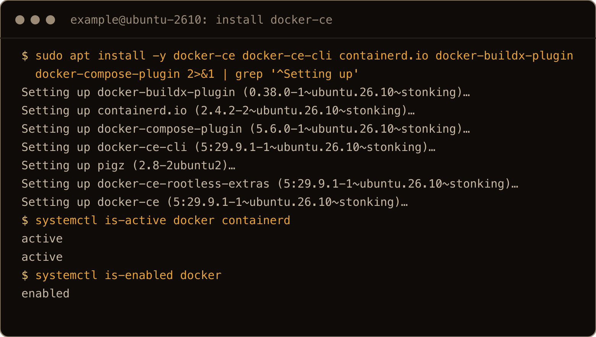

For the screenshots I sometimes added `-y` (the capture had no terminal to answer apt's prompt) or a `head` or `grep` to keep the output short. Each shot shows the exact command it ran.

## 2. What you get

```bash
sudo docker run hello-world
sudo docker version
docker compose version
docker buildx version
```

`hello-world` printed `Hello from Docker!`. The versions:

| Component | Version on 26.10 (18 October) |
| --- | --- |
| Docker Engine (client and server) | 29.9.1, API 1.56 |
| containerd | v2.4.2 |
| runc | 1.5.2 |
| Compose plugin | v5.6.0 |
| Buildx | v0.38.0 |

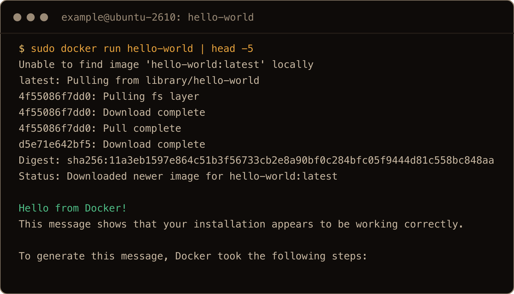

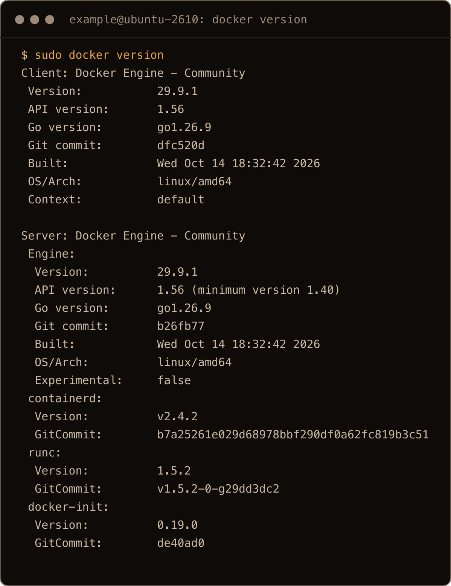

`sudo docker info` showed:

- the `overlayfs` storage driver on the containerd snapshotter
- cgroup v2 with the systemd driver
- `apparmor` and `seccomp` under security options
- `Firewall Backend: iptables`

AppArmor on 26.10 is the 6.0 alpha parser (`6.0.0~alpha1`). The `docker-default` profile was loaded and containers ran normally.

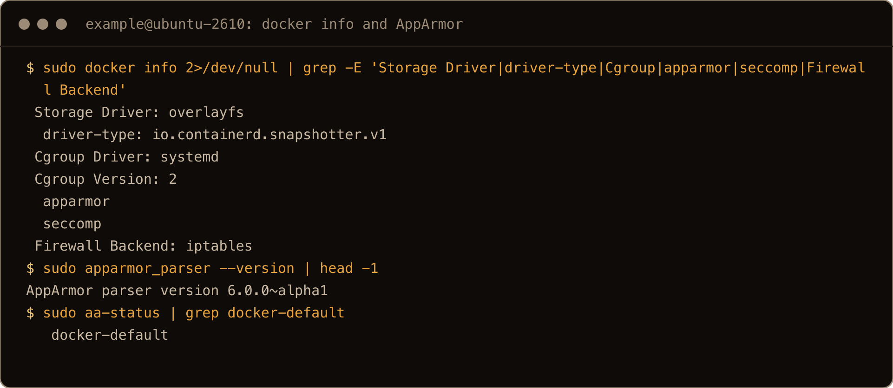

One small trap. `docker compose version` worked without `sudo` before I was in the `docker` group. It never talks to the daemon, so it proves nothing about permissions. `docker ps` in the same shell said `permission denied while trying to connect to the docker API at unix:///var/run/docker.sock`. My [permission denied post](/blog/docker-permission-denied-docker-api-ubuntu-26-04/) covers that error, and it reads the same on 26.10.

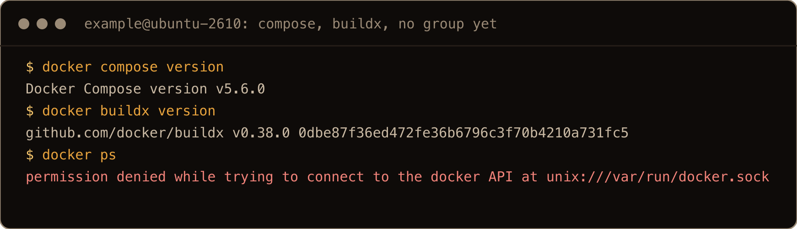

## 3. Or use Ubuntu's docker.io

Ubuntu packages Docker too, and on 26.10 it's closer to upstream than it used to be. I installed it on the same box after purging Docker's packages and repo file:

```bash
sudo apt install docker.io docker-compose-v2
```

That's two packages plus seven dependencies (`containerd`, `runc`, `dnsmasq-base`, `bridge-utils`, `ubuntu-fan`, `dns-root-data`, `pigz`), 90.4 MB. It also enables an `ubuntu-fan` service. Docker's packages don't. Then (output trimmed):

```text
$ sudo docker version
Client:
 Version:           29.7.2
Server:
  Version:          29.7.2
 containerd:
  Version:          2.3.4+dfsg1
 runc:
  Version:          1.5.1-0ubuntu2
$ docker compose version
Docker Compose version 2.40.3+ds2-0ubuntu2
$ docker buildx version
docker: unknown command: docker buildx
```

The engine is two minor releases behind Docker's own build. Compose is the real gap: 2.40.3 against 5.6.0. And there's no Buildx until you add it, so `docker build` falls back to the old builder and says so:

```text
DEPRECATED: The legacy builder is deprecated and will be removed in a future release.
            Install the buildx component to build images with BuildKit:
            https://docs.docker.com/go/buildx/
```

`sudo apt install docker-buildx` fixes that with Ubuntu's Buildx 0.36.1. The `docker.io` install script creates the `docker` group if it's missing (I read that in the script; the group already existed on my test box). So section 7 works the same either way.

So which one? On 26.10, `docker.io` is the simpler pick for most boxes. The engine is in `main` now, so Ubuntu's security updates cover it, and there's no extra repo to look after. Compose and Buildx are still in `universe`. Add `docker-buildx` and it builds with BuildKit too. The case for Docker's repo is newer releases: its Compose is three major versions ahead, and if you run other people's Compose files, that gap is where "works on my machine" comes from.

Which do I use? Docker's, always. I don't really depend on Ubuntu for Docker releases.

## 4. "REMOVING: containerd.io docker-ce docker-ce-cli"

The two don't mix. `docker-ce` declares `Conflicts: docker.io`, and `containerd.io` conflicts with Ubuntu's `containerd` and `runc`. With Docker's packages installed, I asked apt for Ubuntu's. I only simulated it, with `apt install -s`. The plan:

```text
REMOVING:
  containerd.io  docker-ce  docker-ce-cli
```

It's one line in the normal apt summary. With `-y` in a script, nothing stops to ask. The other direction is the same: installing `docker-ce` over `docker.io` planned to remove `containerd docker-buildx docker.io runc`.

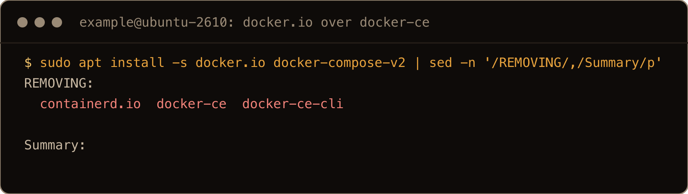

Switching on purpose is fine, and your data survives it. I went from `docker.io` to `docker-ce` with the removal command from section 1, then the install command. My three images and a test volume were still there under the 29.9.1 engine. Just don't do it by accident.

## 5. "Target Packages ... is configured multiple times"

Docker's convenience script works on 26.10. It reads the codename from `/etc/os-release` and has no list of allowed Ubuntu releases. So it asks for `stonking` and finds it. The dry run shows what it does. On a box that already has Docker from section 1, it first prints `Warning: the "docker" command appears to already exist on this system.`. Then it says `You may press Ctrl+C now to abort this script.` and waits 20 seconds before it carries on:

```bash
curl -fsSL https://get.docker.com -o get-docker.sh
sudo sh ./get-docker.sh --dry-run
```

```text
echo "deb [arch=amd64 signed-by=/etc/apt/keyrings/docker.asc] https://download.docker.com/linux/ubuntu stonking stable" > /etc/apt/sources.list.d/docker.list
...
DEBIAN_FRONTEND=noninteractive apt-get -y -qq install docker-ce docker-ce-cli containerd.io docker-compose-plugin docker-ce-rootless-extras docker-buildx-plugin docker-model-plugin >/dev/null
```

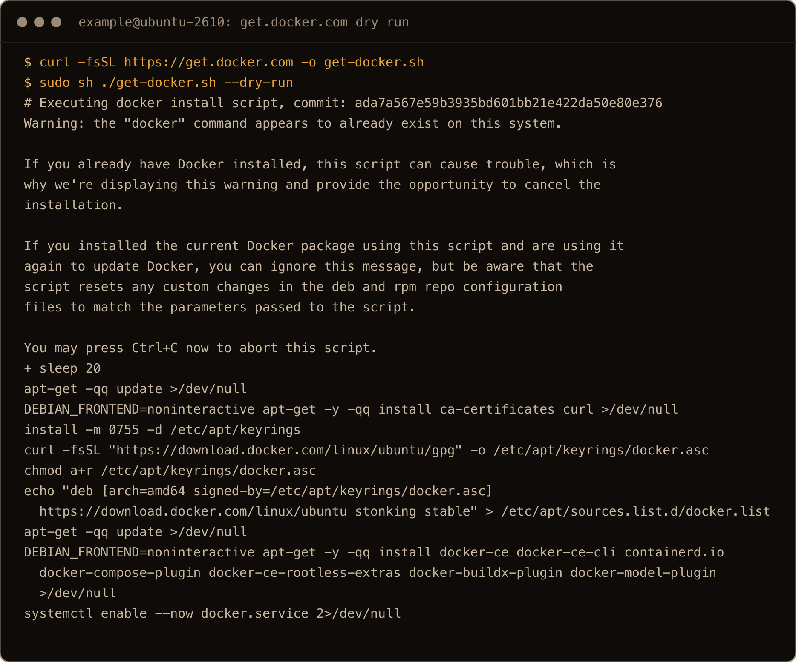

Two things differ from the manual steps. It writes the old one line format to `docker.list`, not `docker.sources`. And it also installs `docker-model-plugin` (1.2.6 here).

The trap is running the script on a box that already has the manual repo file. I did exactly that. The install worked, but every `apt update` afterwards prints ten lines like this:

```text
Warning: Target Packages (stable/binary-amd64/Packages) is configured multiple times in /etc/apt/sources.list.d/docker.list:1 and /etc/apt/sources.list.d/docker.sources:1
```

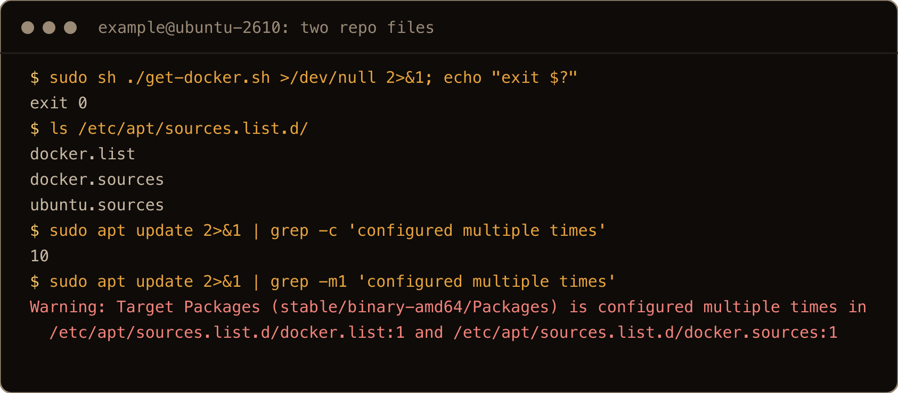

The script's own output went to `/dev/null` here; the dry run above shows what it does.

Nothing is broken; it's the same repo twice. Keep one file:

```bash
sudo rm /etc/apt/sources.list.d/docker.list
sudo apt update
```

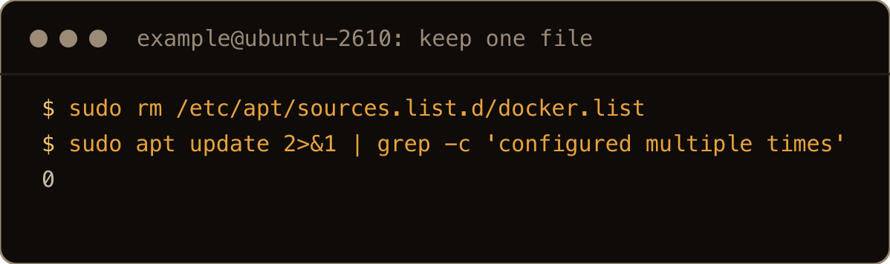

## 6. If you pointed Docker at resolute during the beta

The beta workaround was to set the suite to `resolute` and borrow the 26.04 packages. Maybe you did that. Or you upgraded from 26.04 and the upgrader disabled your `docker.sources`. Either way, move it to `stonking` now:

```bash
sudo sed -i -e 's/^Suites: resolute$/Suites: stonking/' -e '/^Enabled: no$/d' /etc/apt/sources.list.d/docker.sources
sudo apt update && sudo apt upgrade
```

I didn't repeat this on the box for this post. I tested it on a box upgraded from 26.04, in my [26.04 to 26.10 upgrade post](/blog/upgrade-ubuntu-26-04-to-26-10/#7-turn-your-vendor-repos-back-on). apt offered the same Docker versions rebuilt for `stonking`, and a running container stayed up through it. Two limits: I only tested the deb822 `docker.sources` file, not an older one line `docker.list`, and I didn't test the beta case of a fresh 26.10 box pointed at `resolute`.

## 7. The docker group walks straight past sudo-rs

Adding yourself to the `docker` group works on 26.10 exactly as on 26.04:

```bash
sudo usermod -aG docker $USER
```

The group already exists after the install (`sudo groupadd docker` says `group 'docker' already exists`). Group membership only applies to new logins. Log out and back in, or use `newgrp docker` for the current shell. On 26.10 `newgrp` comes from `util-linux-extra`, and it worked. After a fresh SSH login, `docker run hello-world` ran without `sudo`.

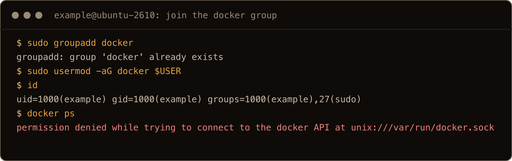

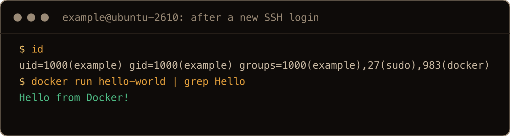

`sudo` on 26.10 is sudo-rs. The `docker` group makes it irrelevant. To show it, I made a second user, `rootie`, with no sudo rights at all, and added it to the `docker` group. In a fresh login, sudo still says no, and `/etc/shadow` is still off limits:

```text
$ sudo -n true
sudo: I'm sorry rootie. I'm afraid I can't do that
$ head -c 0 /etc/shadow
head: cannot open '/etc/shadow' for reading: Permission denied
```

Then one container in the same session:

```text
$ docker run --rm -v /:/host alpine sh -c "head -1 /host/etc/shadow | cut -c1-12; id"
root:!*:1747
uid=0(root) gid=0(root) ...
```

Root, with no sudo involved. Nothing in sudo's rules or sudo's log applies. The daemon runs as root and does whatever its socket asks. Adding someone to the `docker` group has the same effect as giving them the root password. If that's too much, see section 9.

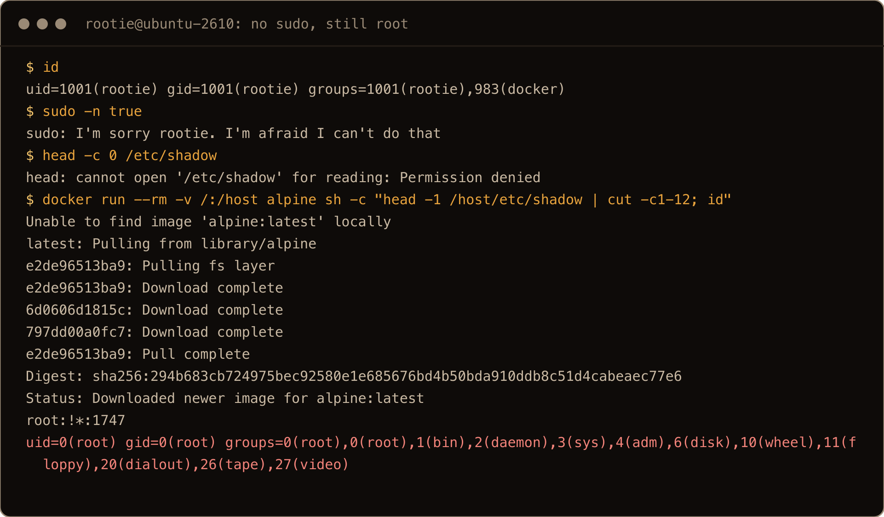

So what do I do on my own boxes? I add myself to the group, so I don't have to sudo anymore, and it's the standard way in Docker's docs.

## 8. Published ports still ignore ufw

`ufw` is off on a fresh 26.10 server. When you turn it on, it doesn't cover Docker's published ports.

How I tested it: the lab's cloud firewall only lets SSH in, so I couldn't test from the internet. Instead I made a stand in for an outside client. It's a network namespace on the same box, joined by a virtual Ethernet pair, so its traffic arrives on an interface like a remote client's would. Then I ran a container on `-p 8080:80` and a plain Python web server on port 9090:

| | port 8080 (container) | port 9090 (not Docker) |
| --- | --- | --- |
| `ufw` inactive | 200 | 200 |
| `ufw enable`, only OpenSSH allowed | **200** | blocked |
| plus `ufw deny 8080/tcp` | **200** | not retested |

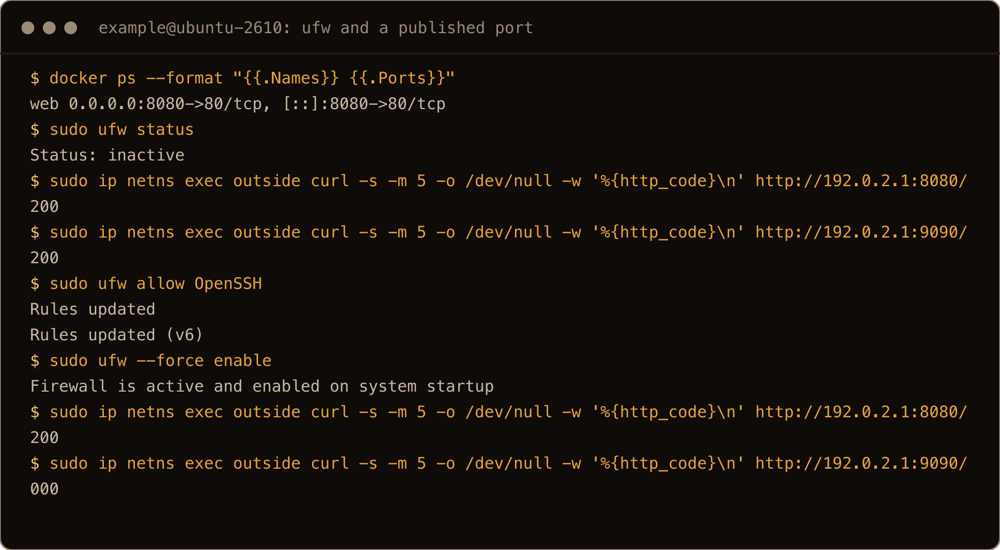

The Python server on 9090 and the `outside` namespace were set up before the capture. `ufw --force enable` is `ufw enable` without the confirmation prompt.

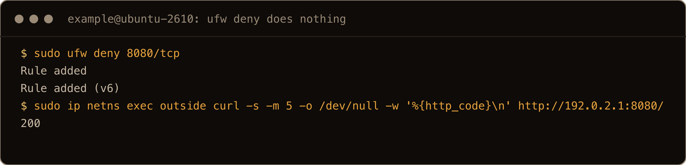

Docker's own docs say it plainly: published ports bypass your firewall rules. On 26.10 both `ufw` and Docker use `iptables` on the `nf_tables` backend. Docker's NAT rule sends the packet to the container before `ufw`'s input rules see it. Then, in the `FORWARD` chain, Docker's chains come before `ufw`'s. Ubuntu's `docker.io` 29.7.2 uses the same `iptables` backend, and its published port was reachable with `ufw` on too.

```text
-P FORWARD DROP
-A FORWARD -j DOCKER-USER
-A FORWARD -j DOCKER-FORWARD
-A FORWARD -j ufw-before-logging-forward
...
```

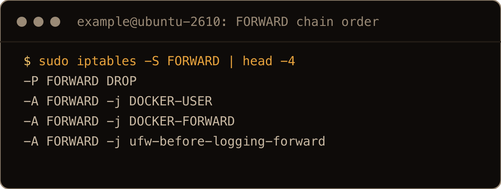

The fix for anything that shouldn't be public: publish it on localhost only, and put a reverse proxy or a tunnel in front.

```bash
docker run -d --name web -p 127.0.0.1:8080:80 nginx:alpine
```

From the namespace, that was blocked. From the box itself, `curl http://127.0.0.1:8080/` returned 200. In Compose it's `"127.0.0.1:8080:80"` under `ports:`.

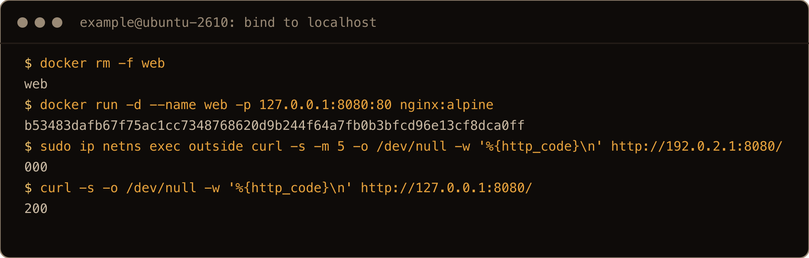

**The nftables backend experiment.** Docker 29 has an experimental `nftables` firewall backend. 26.10 is all nftables underneath, so I tried it with `{"firewall-backend": "nftables"}` in `/etc/docker/daemon.json`. With `ufw` on, it went the other way. The published port was blocked, and so was the containers' outbound traffic (`wget: bad address 'archive.ubuntu.com'` from inside one). Docker warns about it in the journal:

```text
Network traffic for published ports may be dropped, iptables chain FORWARD has policy DROP.
```


`sudo ufw route allow in on docker0` brought outbound back. A `ufw route allow proto tcp from any to 172.17.0.0/16 port 80` rule opened the published port. So with that backend, `ufw` does control containers, and you open everything yourself. It's marked experimental, so I put the default back.

How do I reach mine? I usually just use [Tailscale](/blog/install-tailscale-ubuntu-26-10/), as these are meant as test machines for any crazy ideas that pop into my head.

Tailscale doesn't hide a port on its own, though. A port published the usual way (`-p 8080:80`) listens on `0.0.0.0`, public IP included, and the `ufw` bypass above still applies. To keep a container on the tailnet only, publish it on the server's tailnet address: `-p 100.x.y.z:8080:80`. `tailscale ip -4` prints that address.

I couldn't join a tailnet from the lab, so I tested with a dummy interface holding a `100.x` address in place of `tailscale0`. Docker listened only on that address. From the box itself, curl to the public IP on 8080 couldn't connect, while a normal `-p 8081:80` on the same box answered on the public IP. That shows which address Docker bound to; it isn't a test from the internet. The catch is that the address has to exist when the container starts. With the interface gone, `docker run` failed with `failed to bind host port 100.101.102.103:8080/tcp: cannot assign requested address`, and the container stayed in `Created`. So after a reboot, Tailscale has to be up before Docker starts the container. I didn't test the boot order itself.

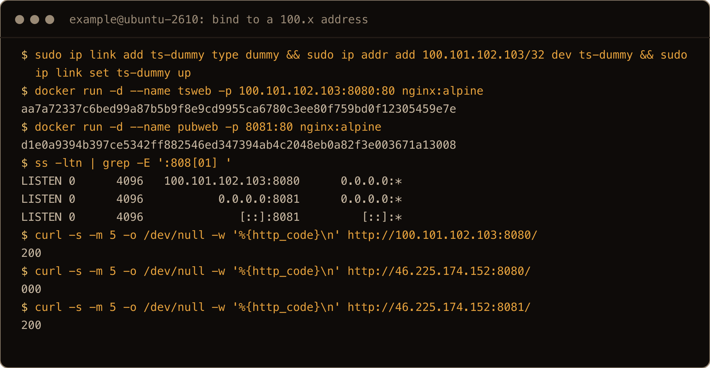

This is my own repeat of that test on the screenshot box, with a dummy interface in place of `tailscale0`.

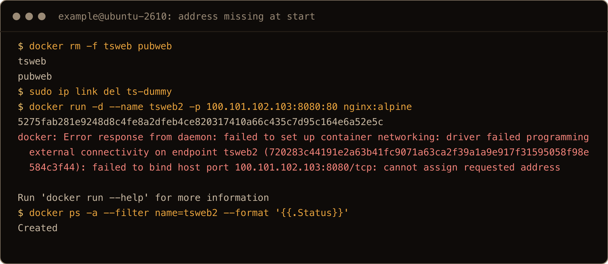

## 9. Rootless mode on 26.10

Rootless mode runs a separate Docker daemon as your own user. A container escape lands you as you, not root.

Ubuntu restricts unprivileged user namespaces with AppArmor (`kernel.apparmor_restrict_unprivileged_userns = 1` on the first box). Docker's rootless docs warn about that. But on 26.10, Ubuntu's `apparmor` package ships a profile for `/usr/bin/rootlesskit`, and that's exactly where `docker-ce-rootless-extras` puts it. I didn't need to write a profile.

You need `uidmap`, which isn't installed on a fresh 26.10 server. For a user who can't reach the system daemon, the setup tool stops with:

```text
[ERROR] Missing system requirements. Run the following commands to
[ERROR] install the requirements and run this tool again.
```

If you followed sections 1 to 7, you hit a different stop first. The system daemon is running and you're in the `docker` group, so the setup tool refuses, with or without `uidmap`:

```text
[ERROR] Aborting because rootful Docker (/var/run/docker.sock) is running and accessible. Set --force to ignore.
```

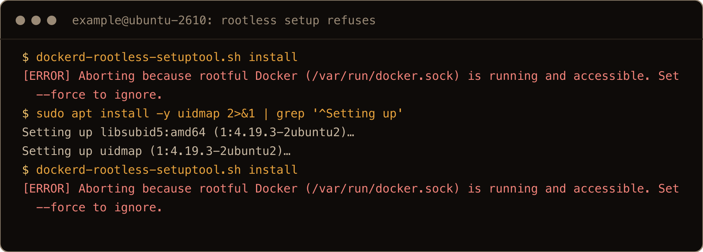

You have two ways out. Docker's [rootless docs](https://docs.docker.com/engine/security/rootless/) recommend turning the system daemon off first, and that's the path I tested end to end. The other is to run rootless as a separate user who isn't in the `docker` group. That user can't reach the root socket, so the check passes. My first box did it that way, with the `rootie` user from section 7, before I added it to the `docker` group. (`--force` keeps both daemons running. I didn't test it.)

To switch your own user to rootless, as that user:

```bash
sudo apt install uidmap
sudo systemctl disable --now docker.service docker.socket
sudo rm /var/run/docker.sock
dockerd-rootless-setuptool.sh install
sudo loginctl enable-linger $USER
```

`systemctl disable` warns `Disabling 'docker.service', but its triggering units are still active: docker.socket`. Both units were `inactive` afterwards, so the warning didn't matter here. The setup tool then creates a `rootless` CLI context and switches to it (output trimmed):

```text
[INFO] Installed docker.service successfully.
[INFO] Creating CLI context "rootless"
Current context is now "rootless"
```


The setup tool colours its `[INFO]` tags, so only the lines containing `context` got through this grep. `[INFO] Installed docker.service successfully.` in the text block above comes from the second test box.

In a new login, `docker context show` said `rootless`, `docker info` showed `rootless` under security options, and `hello-world` ran. Images you pulled with the system daemon don't come along. Per Docker's docs, the rootless daemon keeps its own storage, `~/.local/share/docker` by default.

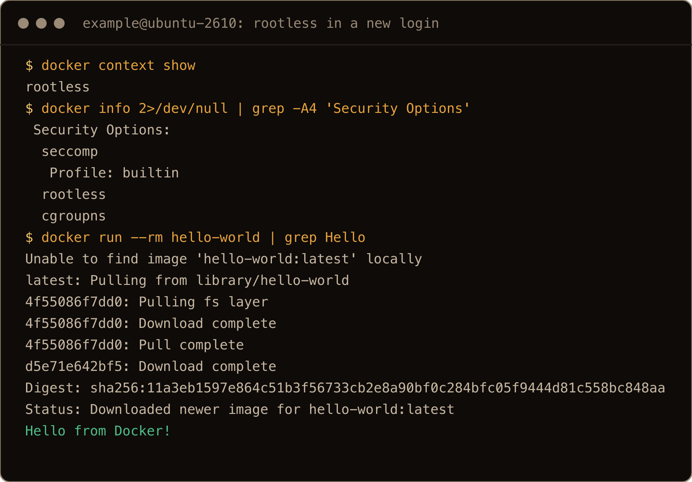

The `enable-linger` line is easy to miss. Without it, `rootie`'s rootless daemon on the first box stopped when the SSH session ended. The next login got `dial unix /run/user/1001/docker.sock: connect: no such file or directory` (yours will show your own uid). With it, I rebooted the box: the rootless daemon was `active`, the system `docker` service and socket stayed `inactive`, and a container with `--restart unless-stopped` was back up. `/var/run/docker.sock` was gone, so being in the `docker` group no longer gets you root.

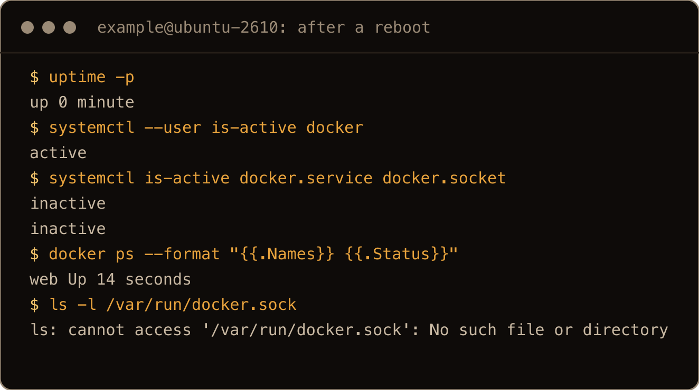

Two things work differently in rootless mode. Ports below 1024 are refused (`cannot expose privileged port 80, you can add 'net.ipv4.ip_unprivileged_port_start=80' to /etc/sysctl.conf (currently 1024)`), so publish on 1024 and up. And `ufw` does apply. RootlessKit listens on the port as an ordinary process on the host, so the traffic goes through `ufw`'s input rules. A published port 8080 was blocked from the namespace with `ufw` on, and reachable after `sudo ufw allow 8080/tcp`.

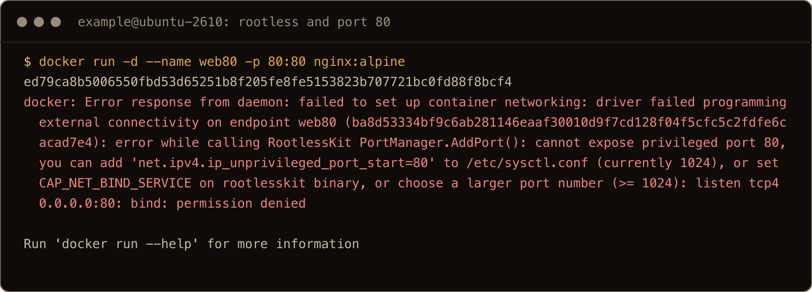

Captured after the reboot, once nginx was already pulled, so the pull lines don't bury the error.

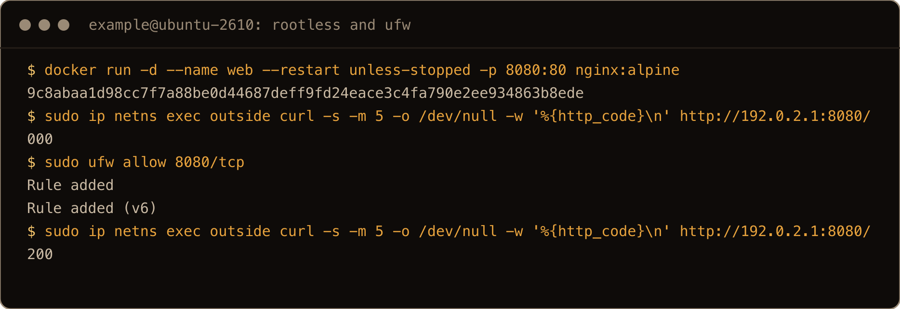

Captured before the reboot shown above; this `web` container, started with `--restart unless-stopped`, is the one that came back up.

## Gotchas I hit

- `docker.io` on top of `docker-ce` removes `docker-ce`, `docker-ce-cli` and `containerd.io`, listed in one line of apt's summary.
- `get.docker.com` after the manual steps leaves `docker.list` and `docker.sources` side by side, and `apt update` warns about it forever.
- Only one `docker-ce` version is in the `stonking` suite so far, so there's nothing older to pin to.
- Ubuntu's `docker.io` has no Buildx, so `docker build` uses the deprecated legacy builder until you install `docker-buildx`.
- Being in the `docker` group is root, and sudo-rs never gets a say.
- `ufw deny` on a published port does nothing. Bind to `127.0.0.1` instead.
- Docker's experimental nftables backend with `ufw` on cuts off container outbound traffic too.
- Rootless needs `uidmap` and `loginctl enable-linger`, and can't publish ports below 1024 by default.
- The rootless setup aborts while the system daemon runs and you're in the `docker` group. Disable `docker.service` and `docker.socket` and remove `/var/run/docker.sock` first (section 9).
- Docker 29.9.1 rejected a one letter container name: `invalid container name (w): name must be at least 2 characters`. I found that by accident.
- 26.10 support ends in July 2027. Docker's repo will need moving again for 27.04.

## Quick reference

| Task | Command |
| --- | --- |
| Is Docker's 26.10 suite there? | `curl -s -o /dev/null -w '%{http_code}\n' https://download.docker.com/linux/ubuntu/dists/stonking/Release` |
| Remove distro packages | `sudo apt remove $(dpkg --get-selections docker.io docker-compose docker-compose-v2 docker-doc docker-buildx podman-docker containerd runc \| cut -f1)` |
| Install from Docker's repo | key plus `docker.sources` as in section 1, then `sudo apt install docker-ce docker-ce-cli containerd.io docker-buildx-plugin docker-compose-plugin` |
| Install Ubuntu's instead | `sudo apt install docker.io docker-compose-v2 docker-buildx` |
| See what apt would remove | `sudo apt install -s <packages>` |
| Duplicate repo warning | `sudo rm /etc/apt/sources.list.d/docker.list` |
| Beta or upgraded repo to stonking | `sudo sed -i -e 's/^Suites: resolute$/Suites: stonking/' -e '/^Enabled: no$/d' /etc/apt/sources.list.d/docker.sources` |
| Drop the sudo | `sudo usermod -aG docker $USER`, then log in again |
| Keep a port private | `-p 127.0.0.1:8080:80` |
| Rootless | `sudo apt install uidmap`, `sudo systemctl disable --now docker.service docker.socket`, `sudo rm /var/run/docker.sock`, `dockerd-rootless-setuptool.sh install`, `sudo loginctl enable-linger $USER` |

Same install as 26.04, one codename further along. Before you put anything real on the box, run `sudo docker ps --format '{{.Ports}}'` and look for `0.0.0.0`. `ufw` isn't watching those.
