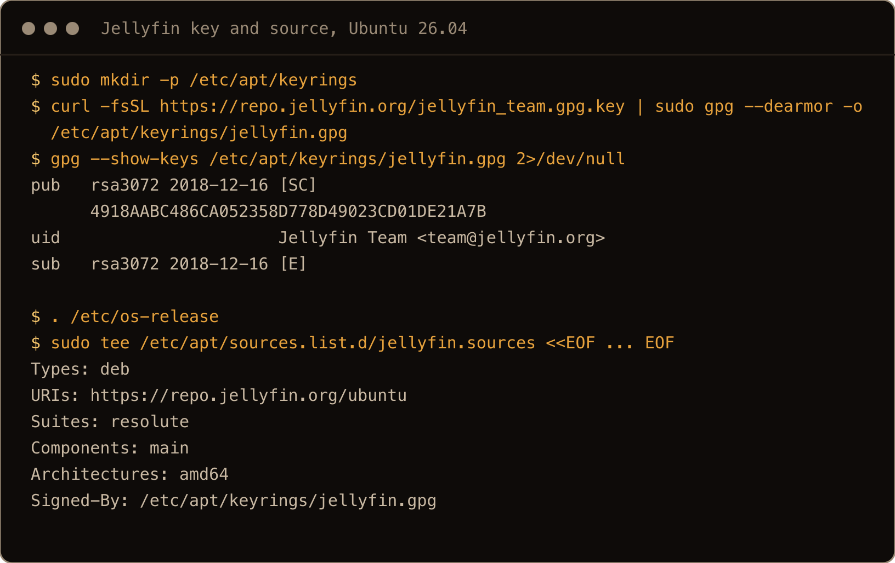
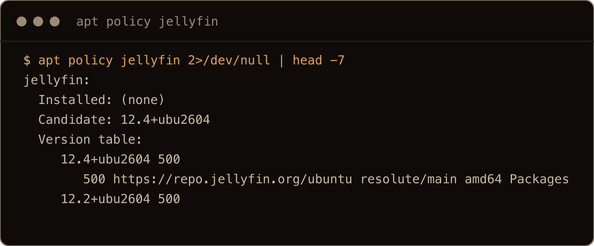
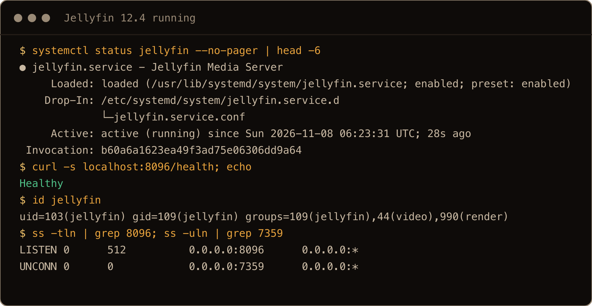
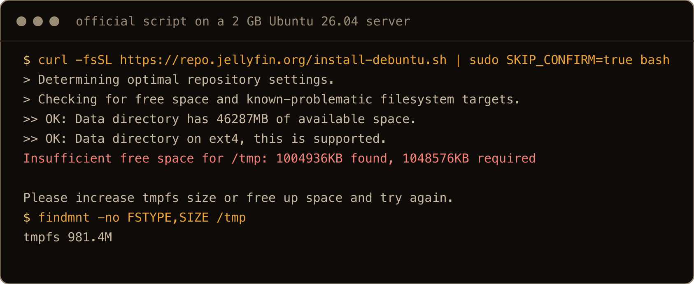
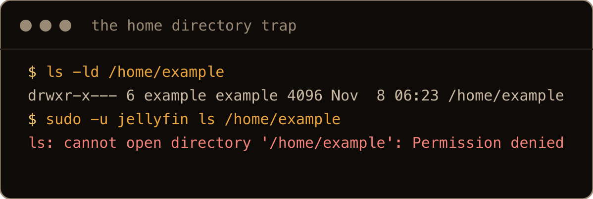
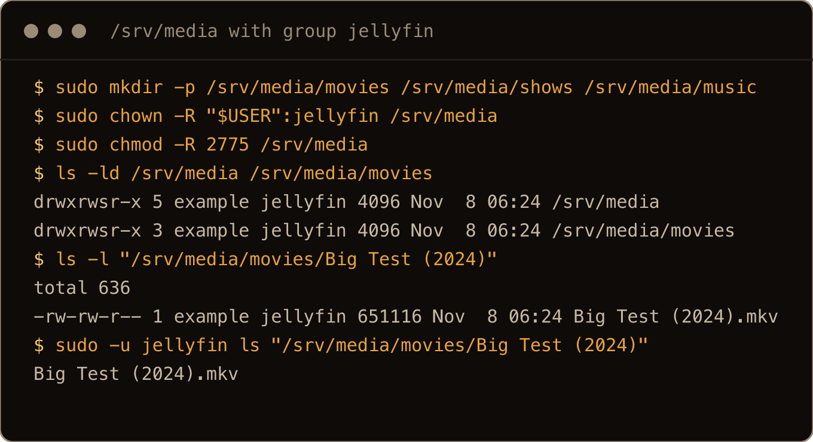
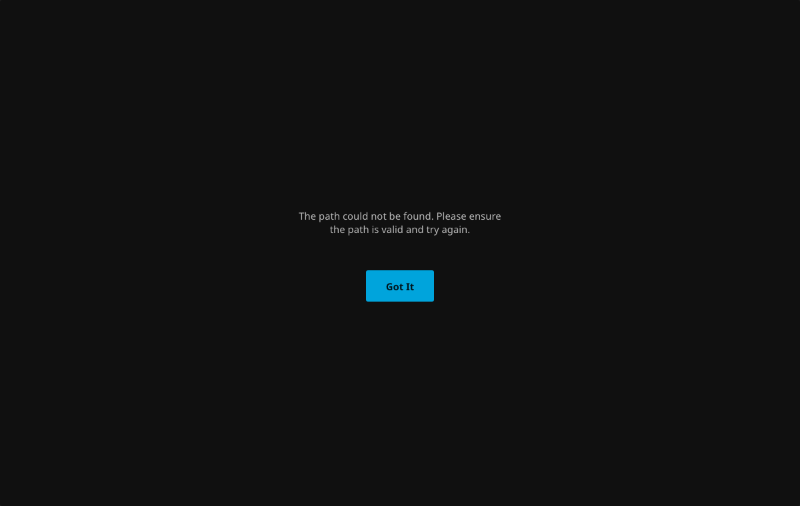
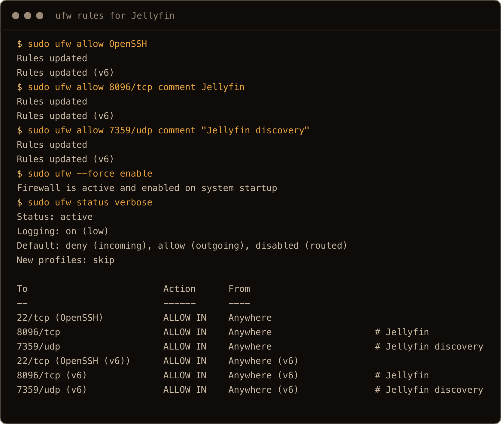

<!-- KEITH REVIEW -->
I use Plex to share my videos with family. Jellyfin is the other big name, and it has nothing to sign in to. I wanted to see how it holds up on a plain install, because why not.

Jellyfin is the free, open source media server. The install is the easy part. The part that bites is the first library, because Jellyfin runs as its own `jellyfin` user and can't see into your home directory. It tells you the folder doesn't exist when it does.

So I installed Jellyfin 12.4 the same way on fresh Ubuntu 26.04, Ubuntu 24.04 and Debian 13 servers, walked the setup wizard in a browser, and broke the library on purpose before fixing it. The commands below are the ones I ran, and they are the same on all three.

> **TL;DR.** Add Jellyfin's signing key and a `jellyfin.sources` file built from `/etc/os-release`, then `sudo apt install jellyfin`. It runs as the `jellyfin` user on port 8096. Put your media in `/srv/media` with the group set to `jellyfin`, not in your home directory, or the wizard says "The path could not be found". On a VPS, reach the wizard with `ssh -L 8096:localhost:8096`. To remove it, `apt remove jellyfin` is not enough: `jellyfin-server` keeps running until you remove that too.

## Contents

- [What I tested on](#what-i-tested-on)
- [1. Add the Jellyfin repo](#1-add-the-jellyfin-repo)
- [2. Install Jellyfin](#2-install-jellyfin)
- [The official script, and why it failed on 2 GB](#the-official-script-and-why-it-failed-on-2-gb)
- [3. Make a media folder Jellyfin can read](#3-make-a-media-folder-jellyfin-can-read)
- [4. Run the setup wizard](#4-run-the-setup-wizard)
- [5. Open the firewall](#5-open-the-firewall)
- [6. Updates, holding a version, removing it](#6-updates-holding-a-version-removing-it)
- [Where things live](#where-things-live)
- [Gotchas I hit](#gotchas-i-hit)
- [Quick reference](#quick-reference)

## What I tested on

- Three fresh DigitalOcean servers with 2 vCPU and 4 GB of RAM: Ubuntu 26.04.1 LTS (kernel 7.0.0-38), Ubuntu 24.04.5 LTS (kernel 6.8.0-147) and Debian 13 trixie (kernel 6.12.113). A fourth Ubuntu 26.04.1 server with 1 vCPU and 2 GB for the install script test, and a fifth like it for the screenshots.
- Jellyfin 12.4 with `jellyfin-ffmpeg8` 8.1.3, from `repo.jellyfin.org`, in November 2026.
- A normal user called `example` with `sudo`, logged in over SSH. A 20 second test film made with ffmpeg.
- None of these servers has a real GPU, so hardware transcoding is not tested here.

<!-- KEITH REVIEW -->
Where would I run it? My Plex box lives on my home network as a Proxmox VM, nothing crazy. This post is the native install, straight from Jellyfin's repo. If you'd rather run it in Docker, my [Jellyfin 12 upgrade post](/blog/upgrade-jellyfin-12-docker-ubuntu-26-04/) uses Compose.

## 1. Add the Jellyfin repo

Neither Ubuntu nor Debian ships Jellyfin, so you add Jellyfin's own repo. It has a suite for each release (`resolute` for 26.04, `noble` for 24.04, `trixie` for Debian 13) under `https://repo.jellyfin.org/ubuntu` or `https://repo.jellyfin.org/debian`. The commands below read both of those from `/etc/os-release`, so the same lines work on all three.

First `curl` and `gpg`. All three images already had them; a minimal install might not:

```bash
sudo apt update
sudo apt install -y curl gnupg
```

Then the signing key:

```bash
sudo mkdir -p /etc/apt/keyrings
curl -fsSL https://repo.jellyfin.org/jellyfin_team.gpg.key | sudo gpg --dearmor -o /etc/apt/keyrings/jellyfin.gpg
gpg --show-keys /etc/apt/keyrings/jellyfin.gpg
```

The key should be the Jellyfin Team's, fingerprint `4918AABC486CA052358D778D49023CD01DE21A7B`:

```text
pub   rsa3072 2018-12-16 [SC]
      4918AABC486CA052358D778D49023CD01DE21A7B
uid                      Jellyfin Team <team@jellyfin.org>
sub   rsa3072 2018-12-16 [E]
```

Then the source, in the deb822 format all three releases use now:

```bash
. /etc/os-release
sudo tee /etc/apt/sources.list.d/jellyfin.sources <<EOF
Types: deb
URIs: https://repo.jellyfin.org/${ID}
Suites: ${VERSION_CODENAME}
Components: main
Architectures: $(dpkg --print-architecture)
Signed-By: /etc/apt/keyrings/jellyfin.gpg
EOF
```

`tee` prints what it wrote. On 26.04 that was:

```text
Types: deb
URIs: https://repo.jellyfin.org/ubuntu
Suites: resolute
Components: main
Architectures: amd64
Signed-By: /etc/apt/keyrings/jellyfin.gpg
```

On 24.04 the suite was `noble`. On Debian 13 the URI ended in `/debian` and the suite was `trixie`. If yours says something else, like a derivative's own codename, fix that line before going on.



The screenshots in this post come from a final clean run on a fresh 2 GB Ubuntu 26.04 server, so times and sizes differ a little from the text blocks. In this one I shortened the heredoc on the `tee` command line to `<<EOF ... EOF` (the six lines under it are what `tee` printed), and added `2>/dev/null` to `gpg` to hide its first run notices about creating `~/.gnupg`.

## 2. Install Jellyfin

```bash
sudo apt update
apt policy jellyfin
```

The candidate should come from `repo.jellyfin.org`:

```text
jellyfin:
  Installed: (none)
  Candidate: 12.4+ubu2604
  Version table:
     12.4+ubu2604 500
        500 https://repo.jellyfin.org/ubuntu resolute/main amd64 Packages
     12.2+ubu2604 500
     ...
     10.11.11+ubu2604 500
```

On 24.04 the candidate was `12.4+ubu2404`, on Debian 13 `12.4+deb13`. The same suite carries 10.11 as well as 12, so a plain install gets you 12. I only installed 12 here. Going back from 12 to 10.11 later is not a simple downgrade; my [Jellyfin 12 upgrade post](/blog/upgrade-jellyfin-12-docker-ubuntu-26-04/) covers why.



I cut it to the first seven lines with `head -7`.

Install it:

```bash
sudo apt install -y jellyfin
```

`jellyfin` is a metapackage. It pulls in `jellyfin-server`, `jellyfin-web` and `jellyfin-ffmpeg8`, Jellyfin's own build of ffmpeg. It took 15 to 24 seconds on these servers. The service is enabled and started for you:

```bash
systemctl status jellyfin --no-pager
curl -s localhost:8096/health; echo
```

```text
● jellyfin.service - Jellyfin Media Server
     Loaded: loaded (/usr/lib/systemd/system/jellyfin.service; enabled; preset: enabled)
    Drop-In: /etc/systemd/system/jellyfin.service.d
             └─jellyfin.service.conf
     Active: active (running) since Sun 2026-11-08 04:59:06 UTC; 19s ago
   Main PID: 3639 (jellyfin)
...
Healthy
```

If you check straight after the install, `/health` can answer `Jellyfin Server is loading. Please try again shortly.` or `Degraded` for the first few seconds. On fresh servers it said `Healthy` within 15 seconds.

What you get, the same on all three releases:

- A `jellyfin` system user, already in the `video` and `render` groups. Older guides tell you to add it to `render` for hardware transcoding; the 12.4 package does that for you. (I had no GPU to test transcoding with.)
- The web interface on TCP port 8096, on every address (`0.0.0.0:8096`).
- Client discovery on UDP port 7359, a few seconds after the web port comes up. Nothing listens on 8920 (HTTPS is off until you give it a certificate) or on 1900.
- It came back by itself after a reboot (I rebooted the Debian 13 server to check).



Here `head -6` trims the status, and `id` and `ss` show the user's groups and the two ports from the list above.

## The official script, and why it failed on 2 GB

Jellyfin also publishes a script that does sections 1 and 2 for you:

```bash
curl -fsSL https://repo.jellyfin.org/install-debuntu.sh | sudo bash
```

It knows `resolute`, `noble` and `trixie`. It also checks free space before it does anything, and that check is what stopped it on my 2 GB Ubuntu 26.04 server:

```text
> Checking for free space and known-problematic filesystem targets.
>> OK: Data directory has 46287MB of available space.
>> OK: Data directory on ext4, this is supported.
Insufficient free space for /tmp: 1004944KB found, 1048576KB required

Please increase tmpfs size or free up space and try again.
```

The script wants 1 GiB free in `/tmp`. Ubuntu 26.04 and Debian 13 mount `/tmp` as `tmpfs`, in RAM, sized at half the memory. On a 2 GB machine that's about 981 MB, so the script quits. Ubuntu 24.04 still has `/tmp` on the disk. On my 4 GB servers running 26.04 and Debian 13, `/tmp` was 1.9 GB, enough to pass.

```text
$ findmnt -no FSTYPE,SIZE /tmp
tmpfs 981.4M
```



This is the same refusal on the fresh 2 GB screenshot server, a few KB off the first run's number.

The manual steps above don't make that check, and they installed and ran Jellyfin fine on that same 2 GB server. You can also see every file they touch.

If you do use the script, its source shows it waits for Enter before installing. Setting `SKIP_CONFIRM=true` skips that, but it has to go after `sudo`, because `sudo` drops variables set before it:

```bash
curl -fsSL https://repo.jellyfin.org/install-debuntu.sh | sudo SKIP_CONFIRM=true bash
```

That's the line I ran; it stopped at the same `/tmp` check, so I only know the skip from reading the script.

## 3. Make a media folder Jellyfin can read

Do this before the wizard, because the wizard asks for your media folders.

Jellyfin runs as `jellyfin`, not as you. Your home directory is closed to other users: mine was mode `750` on both Ubuntu releases and `700` on Debian 13. So Jellyfin can't get inside it, even to look:

```text
$ sudo -u jellyfin ls /home/example
ls: cannot open directory '/home/example': Permission denied
```



Put the media outside your home directory instead. `/srv/media` is a good place:

```bash
sudo mkdir -p /srv/media/movies /srv/media/shows /srv/media/music
sudo chown -R "$USER":jellyfin /srv/media
sudo chmod -R 2775 /srv/media
```

You own it, so you can copy files in without `sudo`. The group is `jellyfin`, so Jellyfin can read it. The `2` in `2775` is the setgid bit: new files and folders inside get the `jellyfin` group too, instead of yours. Group write matters as well, because Jellyfin saves downloaded subtitles next to the film by default.

```text
$ ls -ld /srv/media /srv/media/movies
drwxrwsr-x 5 example jellyfin 4096 Nov  8 05:00 /srv/media
drwxrwsr-x 2 example jellyfin 4096 Nov  8 05:00 /srv/media/movies
$ ls -l "/srv/media/movies/Big Test (2024)"
-rw-rw-r-- 1 example jellyfin 651116 Nov  8 05:00 Big Test (2024).mkv
```



That `chmod -R 2775` is for empty folders. Run it on a folder full of films and every file becomes executable and setgid. For media you already have, set the group and add group access instead:

```bash
sudo chown -R "$USER":jellyfin /path/to/media
sudo chmod -R g+rwX /path/to/media
sudo find /path/to/media -type d -exec chmod g+s {} +
```

The capital `X` adds execute to folders only. I tested that on a folder I had locked down to `700` first, and `jellyfin` could read the film and write to its folder afterwards.

If the media has to stay in your home directory, give `jellyfin` just enough with an ACL. The `acl` package wasn't installed on any of my three servers, so `setfacl` was "command not found" until I added it:

```bash
sudo apt install -y acl
setfacl -m u:jellyfin:x "$HOME"
setfacl -R -m u:jellyfin:rX "$HOME/Media"
setfacl -R -d -m u:jellyfin:rX "$HOME/Media"
```

The first line lets `jellyfin` pass through your home directory without listing it. The second lets it read `~/Media`. The third (`-d`, a default ACL) makes new files in `~/Media` readable too. I tested this on 26.04: the library added and scanned, and a film I added later was readable without running anything again.

<!-- KEITH REVIEW -->
Where does mine live? On an external disk I have mounted on my Ubuntu machine.

If the media is on another disk, mount it somewhere like `/srv/media` with an fstab entry so it comes back after a reboot. My [disk and fstab post](/blog/add-disk-fstab-lvm-ubuntu-26-04/) covers that.

## 4. Run the setup wizard

The wizard is at `http://<server-ip>:8096`. If the server isn't on your network, a VPS for example, tunnel the port over SSH and open it as if you were on the box:

```bash
ssh -N -L 8096:localhost:8096 you@server
```

Then open `http://localhost:8096` on your own machine. That's how I reached it, because the cloud firewall on my test servers only let SSH in. If your provider has a firewall like that, open 8096 there as well as in `ufw` if you want to skip the tunnel.

The wizard has five pages:

1. **Welcome.** A server name (it defaults to the hostname) and the display language.
2. **Tell us about yourself.** The admin username and password. A password is required for the admin account.
3. **Set up your media libraries.** Click **Add Media Library**, pick a content type (Movies, Shows, Music and so on), give it a name, and click **+** next to **Folders** to choose the folder. Pick `/srv/media/movies`, not something under `/home`.
4. **Preferred Metadata Language.** The language and country for posters and descriptions.
5. **Set up Remote Access.** One box, **Allow remote connections to this server**, ticked by default. The page says that unticked, "all remote connections will be blocked". Remote means outside your local network, so on a VPS reached by its public IP, that's you. Through the SSH tunnel you come in from the server itself. I left it ticked and didn't test unticking it.

Then **Finish**, and sign in with the admin account.

### "The path could not be found"

Here is what happens when you choose a folder inside your home directory. I typed `/home/example/Media/Movies`, a folder that exists and has a film in it, and clicked OK:

```text
The path could not be found. Please ensure the path is valid and try again.
```



The path is valid. Jellyfin can't reach it as the `jellyfin` user, and it reports that as not found. Run `sudo -u jellyfin ls` on the folder; if that says "Permission denied", go back to section 3.

With `/srv/media/movies` the library added and the scan found the test film. The library settings have **Enable real time monitoring** ticked by default. I copied a second film into `/srv/media/movies` afterwards, and it showed up in under 100 seconds without a manual scan.


That's the browser on the screenshot server, after the wizard with `/srv/media/movies`.

## 5. Open the firewall

`ufw` was installed but inactive on both Ubuntu servers, and my Debian 13 image didn't have it at all, so there was nothing to open by default. If you run `ufw`, allow SSH first, then Jellyfin:

```bash
sudo ufw allow OpenSSH
sudo ufw allow 8096/tcp comment Jellyfin
sudo ufw allow 7359/udp comment "Jellyfin discovery"
sudo ufw enable
sudo ufw status verbose
```

`ufw enable` asks you to confirm with `y` because it can cut SSH sessions. The OpenSSH rule is why it won't.

```text
To                         Action      From
--                         ------      ----
22/tcp (OpenSSH)           ALLOW IN    Anywhere
8096/tcp                   ALLOW IN    Anywhere                   # Jellyfin
7359/udp                   ALLOW IN    Anywhere                   # Jellyfin discovery
```



I used `ufw --force enable` here because the capture script couldn't answer the `y` prompt.

UDP 7359 is only for apps on your network finding the server by themselves. Skip it if you type the address in. To keep 8096 to your own network, use `sudo ufw allow from 192.168.1.0/24 to any port 8096 proto tcp` with your subnet instead. The [ufw post](/blog/ufw-firewall-basics-ubuntu/) has the rest.

<!-- KEITH REVIEW -->
And from outside the house? I use Tailscale to reach my home server from anywhere, but it's locked down to my home network. My [Tailscale post](/blog/install-tailscale-ubuntu-26-04/) covers the setup.

## 6. Updates, holding a version, removing it

Jellyfin updates with everything else:

```bash
sudo apt update && sudo apt upgrade
```

The repo carries every version from 10.11 to 12.4 in one suite, so a routine upgrade can be a big jump. If you want to choose when that happens, hold the three packages:

```bash
sudo apt-mark hold jellyfin jellyfin-server jellyfin-web
```

I installed 12.2 on 24.04, held it, and `apt upgrade` kept all three back while `apt list --upgradable` still showed 12.4 waiting. `sudo apt-mark unhold` with the same names lets it through; the upgrade to 12.4 came up `Healthy`.

Removing it has a catch. `jellyfin` is only the metapackage, so removing it leaves the server installed and running:

```text
$ sudo apt remove jellyfin
$ systemctl is-active jellyfin
active
```

Take the rest with it:

```bash
sudo apt remove jellyfin jellyfin-server jellyfin-web jellyfin-ffmpeg8
```


I added `-y`, `2>/dev/null` and a `grep` to trim apt's output. The `grep` also cut the header above the first list, which is apt saying those packages are no longer required.

`apt autoremove` after removing only `jellyfin` also took the other three. Either way the service stops, and `/etc/jellyfin` and `/var/lib/jellyfin` stay behind. The second one holds the database with your users and libraries. To wipe it all:

```bash
sudo apt purge 'jellyfin*'
```

That removed `/etc/jellyfin`, `/var/lib/jellyfin`, `/var/cache/jellyfin`, `/var/log/jellyfin` and the `jellyfin` user. It left one thing, with a warning:

```text
dpkg: warning: while removing jellyfin-server, directory '/usr/lib/jellyfin' not empty so not removed
```

Inside was a single `libjemalloc.so` symlink, on Ubuntu and Debian alike. `sudo rm -r /usr/lib/jellyfin` finishes the job. Your media in `/srv/media` isn't touched.

## Where things live

| What | Where |
| --- | --- |
| Settings (`system.xml`, `network.xml`, `encoding.xml`) | `/etc/jellyfin` |
| Database, metadata, plugins | `/var/lib/jellyfin` |
| Cache | `/var/cache/jellyfin` |
| Logs | `/var/log/jellyfin/jellyfinYYYYMMDD.log`, or `journalctl -u jellyfin` |
| Service options | `/etc/default/jellyfin` |
| systemd overrides | `/etc/systemd/system/jellyfin.service.d/jellyfin.service.conf` |

All four folders belong to `jellyfin:adm` with mode `750`, so `ls /etc/jellyfin` as yourself gives "Permission denied". Use `sudo`.

## Gotchas I hit

- The wizard said "The path could not be found" for a folder that existed. The `jellyfin` user couldn't get into my home directory.
- The official install script quit on a 2 GB Ubuntu 26.04 server, because `/tmp` is a RAM disk of half the memory and the script wants 1 GiB of it free. The manual install worked on the same server.
- `setfacl` wasn't installed on any of the three images. `sudo apt install acl`.
- `chmod -R 2775` on existing media makes every file executable. Use `g+rwX` and set `g+s` on folders only.
- `apt remove jellyfin` removed the metapackage and left the server running.
- `apt purge 'jellyfin*'` left `/usr/lib/jellyfin` behind with one symlink in it.
- Every library scan logs `Library folder /var/lib/jellyfin/data/playlists is inaccessible or empty, skipping`. That's the empty playlists folder; it's harmless.

## Quick reference

| Step | Command |
| --- | --- |
| Key | `curl -fsSL https://repo.jellyfin.org/jellyfin_team.gpg.key \| sudo gpg --dearmor -o /etc/apt/keyrings/jellyfin.gpg` |
| Source | `/etc/apt/sources.list.d/jellyfin.sources`, URI `https://repo.jellyfin.org/$ID`, suite `$VERSION_CODENAME` |
| Install | `sudo apt update && sudo apt install jellyfin` |
| Check | `systemctl status jellyfin`, `curl localhost:8096/health` |
| Media | `/srv/media`, owner you, group `jellyfin`, folders `2775` |
| Wizard on a VPS | `ssh -N -L 8096:localhost:8096 you@server`, then `http://localhost:8096` |
| Firewall | `sudo ufw allow 8096/tcp`, optional `7359/udp` |
| Hold | `sudo apt-mark hold jellyfin jellyfin-server jellyfin-web` |
| Remove | `sudo apt remove jellyfin jellyfin-server jellyfin-web jellyfin-ffmpeg8` |
| Logs | `journalctl -u jellyfin` |

<!-- KEITH REVIEW -->
Install it from the repo and keep your media out of your home directory. That skips most of the pain.
