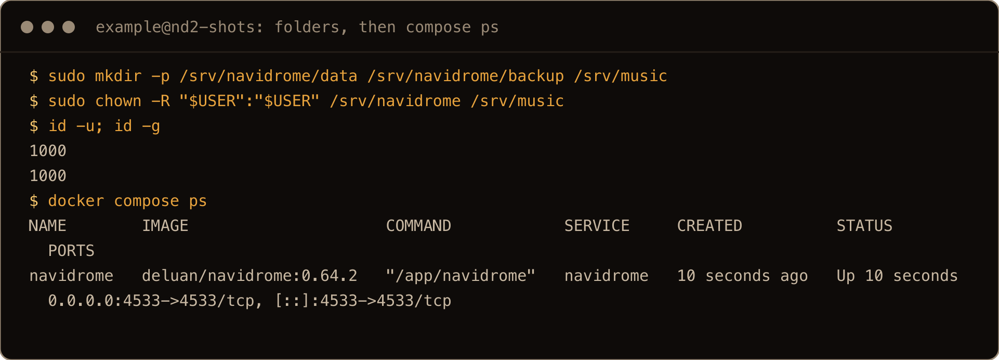
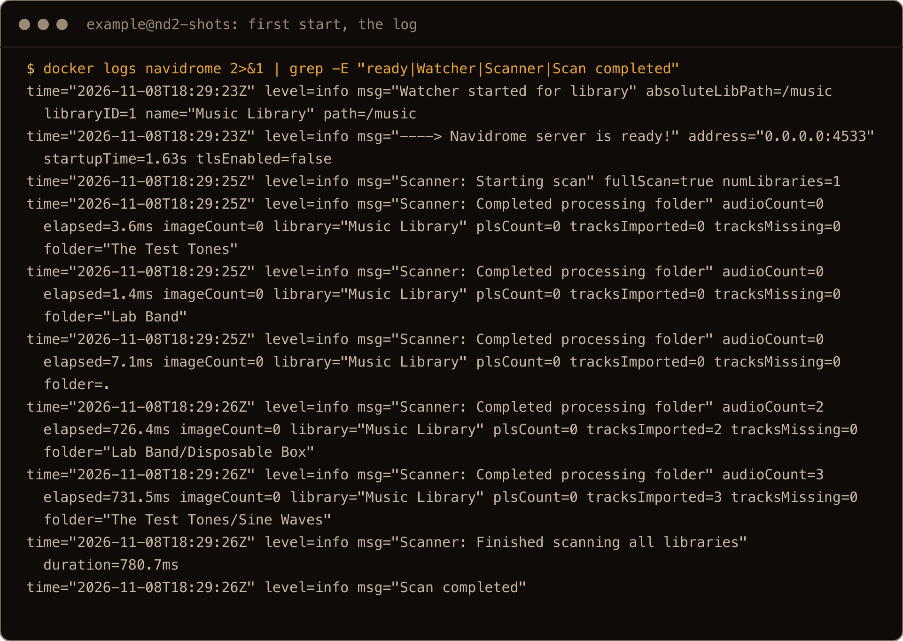
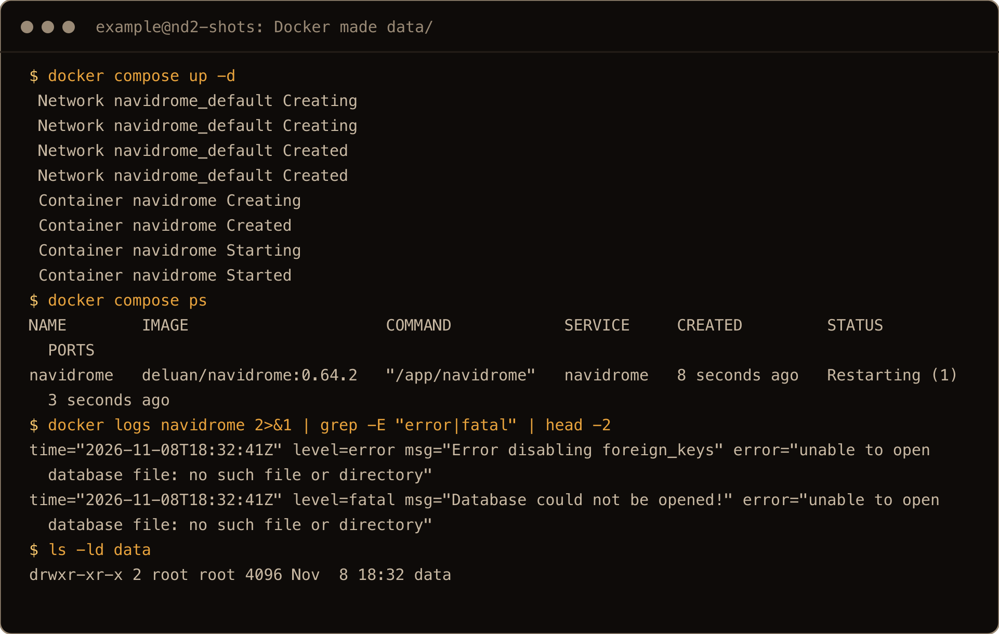
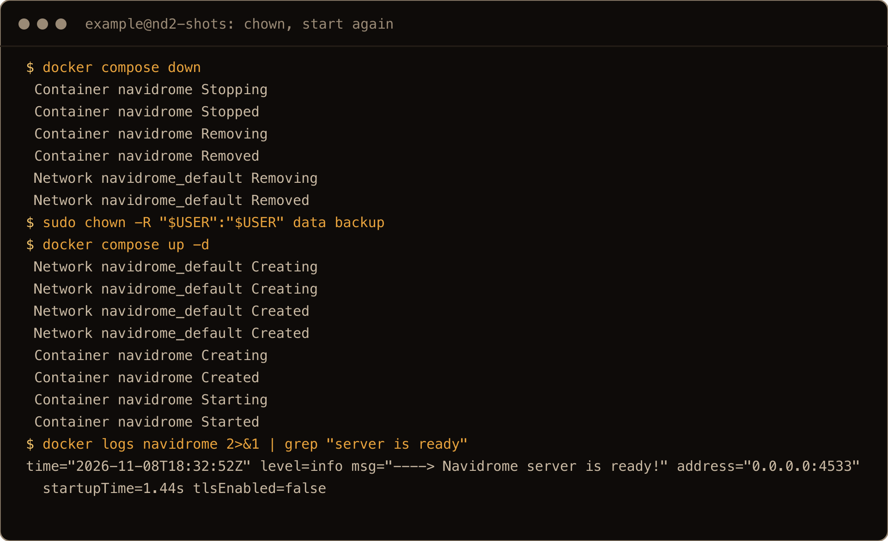
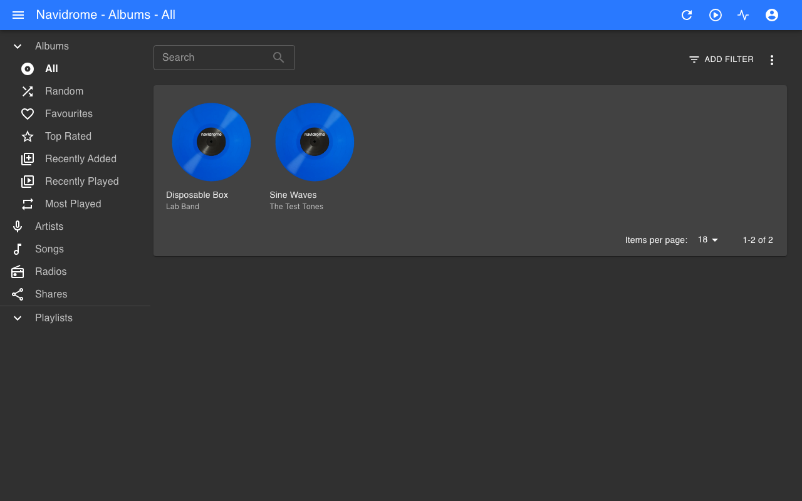
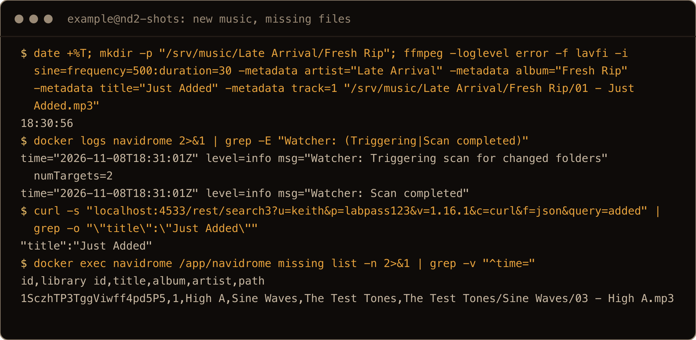
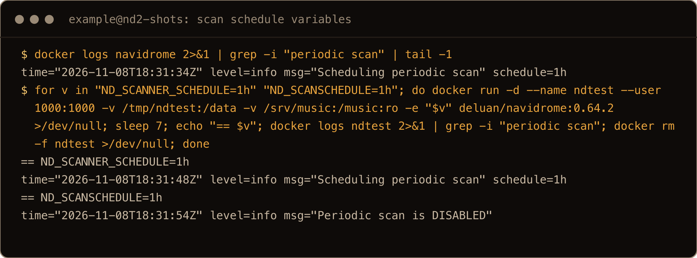
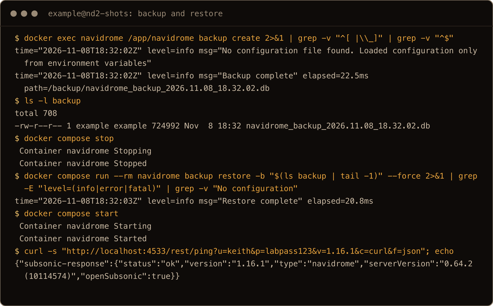

I use Plex to share my videos with family, and I've tried Jellyfin on a plain install. Music is the piece I hadn't covered yet. I wanted to see how it runs in Docker, because why not.

Navidrome is a small, self-hosted music server. It scans a folder of music files, serves a web player, and speaks the Subsonic API, so most phone music apps can stream from it. The official Compose file is about a dozen lines, and it works. The trouble is how it fails when a folder is wrong: the error says a file doesn't exist when the real problem is ownership, and one unreadable folder in your library stops new music from showing up without a single error in the web UI.

So I ran Navidrome 0.64.2 on a fresh Ubuntu 26.04 server, fed it a small library of tagged test files, and broke each of those on purpose before fixing it. Everything below is what I ran and what came back.

> **TL;DR.** Make `/srv/navidrome/data` and `/srv/navidrome/backup` yourself, owned by your user, before `docker compose up`, and set `user:` to your own UID and GID. If Docker makes `data` for you, it's owned by root and Navidrome dies with `Database could not be opened!`. Open the web UI and create the admin right away: the first person to reach port 4533 gets it. New music shows up on its own within seconds, as long as every folder in the library is readable. The scan schedule variable is `ND_SCANNER_SCHEDULE` now; the old `ND_SCANSCHEDULE` from older guides is ignored. Pin the image tag and take a backup before you bump it, because upgrades migrate the database.

## Contents

- [What I tested on](#what-i-tested-on)
- [1. Make the folders first](#1-make-the-folders-first)
- [2. The Compose file](#2-the-compose-file)
- [3. Start it](#3-start-it)
- ["Database could not be opened!"](#database-could-not-be-opened)
- [4. Create the admin before anyone else does](#4-create-the-admin-before-anyone-else-does)
- [5. Check the Subsonic API your phone app will use](#5-check-the-subsonic-api-your-phone-app-will-use)
- [6. How new music shows up](#6-how-new-music-shows-up)
- [7. Back up the database](#7-back-up-the-database)
- [8. Upgrading](#8-upgrading)
- [Reaching it from outside](#reaching-it-from-outside)
- [Where things live](#where-things-live)
- [Gotchas I hit](#gotchas-i-hit)
- [Quick reference](#quick-reference)

## What I tested on

DigitalOcean droplets with 2 GB of RAM running Ubuntu 26.04.1 LTS (kernel 7.0.0-38-generic), on 8 November 2026. Docker came from Docker's own repo, as in my [Docker on 26.04 post](/blog/install-docker-ubuntu-26-04/): Docker 29.9.3 and Compose v5.7.0. The image was `deluan/navidrome:0.64.2`, which is what `latest` pointed at that day. I worked as a sudo user called `example` (UID 1000) in the `docker` group, so the `docker` commands below have no `sudo`. If your user isn't in the group, put `sudo` in front.

The music was five short tracks I made with `ffmpeg`: two albums, two artists, MP3 and FLAC, with real tags. That's enough for the scanner, the search and the stream to return real results. I didn't test a phone app. I tested the API those apps use, with `curl`.

The first box was for the testing and most of the text blocks. A second fresh box ran every step again as a check, and a third ran the post from top to bottom for the screenshots, so times and IDs differ between the text and the images.

## 1. Make the folders first

Where does it all live? I use bind mounts, so my container data sits under `/srv`. Navidrome gets the same treatment.

Make the folders as your own user, before Docker gets a chance to:

```bash
sudo mkdir -p /srv/navidrome/data /srv/navidrome/backup /srv/music
sudo chown -R "$USER":"$USER" /srv/navidrome /srv/music
id -u; id -g
```

```
1000
1000
```

Write those two numbers down. They go into the Compose file as `user:`.



*From the screenshot box. The `docker compose up -d` in between, and its image pull output, are left out.*


This step is the whole fix for the most common Navidrome failure. If `data` doesn't exist when you run `docker compose up`, Docker creates it, and Docker creates it as root. A container running as UID 1000 can't write to a root-owned folder, and you get the error in the section after next.

Your music can live anywhere the container can read. I used `/srv/music`. If yours is on a mounted disk, point the Compose file at that path instead. Navidrome only reads it.

## 2. The Compose file

```bash
cd /srv/navidrome
cat > compose.yaml <<'EOF'
services:
  navidrome:
    image: deluan/navidrome:0.64.2
    container_name: navidrome
    user: 1000:1000
    ports:
      - "4533:4533"
    restart: unless-stopped
    environment:
      ND_SCANNER_SCHEDULE: 1h
      ND_BACKUP_PATH: /backup
      ND_BACKUP_SCHEDULE: "0 3 * * *"
      ND_BACKUP_COUNT: 7
    volumes:
      - ./data:/data
      - ./backup:/backup
      - /srv/music:/music:ro
EOF
```

What each part is for:

- `image: deluan/navidrome:0.64.2` pins the version. Navidrome ships often (0.60 in February 2026, 0.64 in September), and point releases change the database. With `latest`, a routine `docker compose pull` upgrades you whether you meant to or not.
- `user: 1000:1000` runs Navidrome as you, not as root. The image has no user set, so without this line it runs as root and every file in `data` ends up owned by root. Use the numbers from `id -u` and `id -g`.
- `4533` is Navidrome's port. More on who can reach it [below](#reaching-it-from-outside).
- `ND_SCANNER_SCHEDULE: 1h` is a safety net. Navidrome watches the folder and picks up changes by itself, but the hourly scan catches anything the watcher misses. Section 6 shows when that happens.
- The three `ND_BACKUP_*` lines turn on the built-in nightly backup at 03:00 and keep seven copies. That count comes from the docs; I didn't leave a box up for a week to watch it prune. Backups are off by default.
- `./data:/data` holds the database and caches. `./backup:/backup` holds the backups. `/srv/music:/music:ro` is your library, read only, because Navidrome never needs to write to it.

## 3. Start it

```bash
docker compose up -d
docker compose ps
```

```
NAME        IMAGE                     COMMAND            SERVICE     CREATED          STATUS          PORTS
navidrome   deluan/navidrome:0.64.2   "/app/navidrome"   navidrome   11 seconds ago   Up 10 seconds   0.0.0.0:4533->4533/tcp, [::]:4533->4533/tcp
```

`Up` is a good sign, but read the logs anyway, because they tell you whether it found your music:

```bash
docker logs navidrome 2>&1 | grep -E "ready|Watcher|Scanner|Scan completed"
```

```
time="2026-11-08T18:29:23Z" level=info msg="Watcher started for library" absoluteLibPath=/music libraryID=1 name="Music Library" path=/music
time="2026-11-08T18:29:23Z" level=info msg="----> Navidrome server is ready!" address="0.0.0.0:4533" startupTime=1.63s tlsEnabled=false
time="2026-11-08T18:29:25Z" level=info msg="Scanner: Starting scan" fullScan=true numLibraries=1
time="2026-11-08T18:29:25Z" level=info msg="Scanner: Completed processing folder" audioCount=0 elapsed=3.6ms imageCount=0 library="Music Library" plsCount=0 tracksImported=0 tracksMissing=0 ​folder="The Test Tones"
time="2026-11-08T18:29:25Z" level=info msg="Scanner: Completed processing folder" audioCount=0 elapsed=1.4ms imageCount=0 library="Music Library" plsCount=0 tracksImported=0 tracksMissing=0 ​folder="Lab Band"
time="2026-11-08T18:29:25Z" level=info msg="Scanner: Completed processing folder" audioCount=0 elapsed=7.1ms imageCount=0 library="Music Library" plsCount=0 tracksImported=0 tracksMissing=0 ​folder=.
time="2026-11-08T18:29:26Z" level=info msg="Scanner: Completed processing folder" audioCount=2 elapsed=726.4ms imageCount=0 library="Music Library" plsCount=0 tracksImported=2 tracksMissing=0 ​folder="Lab Band/Disposable Box"
time="2026-11-08T18:29:26Z" level=info msg="Scanner: Completed processing folder" audioCount=3 elapsed=731.5ms imageCount=0 library="Music Library" plsCount=0 tracksImported=3 tracksMissing=0 ​folder="The Test Tones/Sine Waves"
time="2026-11-08T18:29:26Z" level=info msg="Scanner: Finished scanning all libraries" duration=780.7ms
time="2026-11-08T18:29:26Z" level=info msg="Scan completed"
```




The three lines with `audioCount=0` are the parent folders, which hold no files themselves. Two lines matter. `Watcher started for library` means new music will show up by itself. The `tracksImported` counts tell you the scan found your files. If you see `Watcher error` instead of `Watcher started`, jump to [section 6](#a-watcher-error-means-no-new-music).

You'll also see Deezer lines in the full log. Navidrome looks artists up online for pictures and bios. On my first box it logged `Artist not found in deezer` for my made-up artists. On another, Deezer answered with a 403, and the log filled with `Error calling deezer ... deezer http status: (403)` until Navidrome gave up for a minute (`Circuit breaker opened for agent`). Both are harmless. They cost you artist pictures, nothing else.

## "Database could not be opened!"

This is what you get if you skip step 1 and let Docker make the `data` folder:

```bash
docker compose ps
```

```
NAME        IMAGE                     COMMAND            SERVICE     CREATED         STATUS                        PORTS
navidrome   deluan/navidrome:0.64.2   "/app/navidrome"   navidrome   9 seconds ago   Restarting (1) 1 second ago
```

```bash
docker logs navidrome 2>&1 | grep -E "error|fatal" | head -2
ls -ld data
```

```
time="2026-11-08T18:01:17Z" level=error msg="Error disabling foreign_keys" error="unable to open database file: no such file or directory"
time="2026-11-08T18:01:17Z" level=fatal msg="Database could not be opened!" error="unable to open database file: no such file or directory"
drwxr-xr-x 2 root root 4096 Nov  8 18:01 data
```




*Reproduced on the screenshot box after the rest of the run, by deleting data and starting again.*

The message is misleading. The folder exists. What's missing is the database file, and Navidrome can't create it, because `data` is owned by root and the container runs as UID 1000. The container restarts in a loop and the web UI never comes up.

The fix is ownership, then a fresh start:

```bash
docker compose down
sudo chown -R "$USER":"$USER" data backup
docker compose up -d
```

After that, the log shows `Navidrome server is ready!` and the scan. Nothing else needs changing.




## 4. Create the admin before anyone else does

Open `http://<server-ip>:4533`. On a fresh install there are no users, so instead of a login page Navidrome asks you to create the admin account. Whoever fills in that form first owns the server.

On a VPS, that form is open to anyone who finds port 4533 from the first `up`, and `ufw` won't stop them. If that worries you, change the port line to `"127.0.0.1:4533:4533"` (shown [below](#reaching-it-from-outside)) before you start it, then reach it over SSH. Run this on your own machine and browse to `http://localhost:4533`. I tested the localhost binding, not the tunnel itself:

```bash
ssh -L 4533:localhost:4533 example@<server-ip>
```


*From a second, empty Navidrome container on the screenshot box, because the main one already had its admin. The form posts to `/auth/createAdmin`.*

After the form you land in the library. My two test albums were already there from the first scan:



The first-run form isn't a race you can lose twice. I sent the same request the web form sends, a POST to `/auth/createAdmin`, a second time after my admin existed:

```
{"error":"Cannot create another first admin"} http=403
```

So once you've claimed it, nobody else can. Before you do, anyone who reaches port 4533 can. Do it right after the first `up`.

## 5. Check the Subsonic API your phone app will use

Phone apps don't use the web UI. They talk to the Subsonic API under `/rest`. When an app says it can't connect, this is how you find out whether it's the server or the app. Use the user you just made:

```bash
curl -s "http://localhost:4533/rest/ping?u=keith&p=labpass123&v=1.16.1&c=curl&f=json"; echo
```

```
{"subsonic-response":{"status":"ok","version":"1.16.1","type":"navidrome","serverVersion":"0.64.2 (10114574)","openSubsonic":true}}
```

A wrong password still gets an HTTP 200, so check the body, not the status code:

```
{"subsonic-response":{"status":"failed","version":"1.16.1","type":"navidrome","serverVersion":"0.64.2 (10114574)","openSubsonic":true,"error":{"code":40,"message":"Wrong username or password"}}}
```

Most apps don't send the password itself. They send a salted token: `t` is the MD5 of the password plus a random salt `s`. That works too:

```bash
SALT=$(openssl rand -hex 6)
TOK=$(printf '%s' "labpass123$SALT" | md5sum | cut -d' ' -f1)
curl -s "http://localhost:4533/rest/ping?u=keith&t=$TOK&s=$SALT&v=1.16.1&c=curl&f=json"; echo
```

That returned the same `"status":"ok"`.


From there I checked the library the way an app sees it. `search3` found the FLAC track by name, and `stream` on one of the MP3s returned 240,693 bytes of `audio/mpeg`, a real file you can play.

Putting a password in a URL is fine on your own box for a quick test. It ends up in your shell history, so don't do it with a password you care about.

## 6. How new music shows up

You don't need to press anything. Navidrome watches the music folder. I added a new album while it was running. These times are from my notes, not raw output:

```
18:02:13 added "Late Arrival/Fresh Rip/01 - Just Added.mp3"
18:02:19 Watcher: Triggering scan for changed folders numTargets=2
18:02:24 search finds "Just Added"
```

The watcher fired six seconds after the copy, and search found the track five seconds after that. Deleting a file works the same way, with one twist: the track doesn't vanish. Navidrome marks it missing, so a renamed or moved file can be matched back to its play counts and playlists. You can list them from the command line:

```bash
docker exec navidrome /app/navidrome missing list -n
```

```
id,library id,title,album,artist,path
3J4yT8fJVcdqJPheU6zzHy,1,High A,Sine Waves,The Test Tones,The Test Tones/Sine Waves/03 - High A.mp3
```




*The `rm` of `High A` ran just before the `missing list` and is left out of the image.*

### A "Watcher error" means no new music

This one is quiet. If one folder in your library can't be read by the container's user, the watcher doesn't start at all. I tested a top-level folder. I made one root-owned folder with mode `700` and restarted the container:

```
time="2026-11-08T18:03:47Z" level=error msg="Watcher error" error="starting watcher: starting watcher on /music/...: open /music/Root Owned: permission denied" libraryID=1 name="Music Library" path=/music
time="2026-11-08T18:03:49Z" level=warning msg="Scanner: Skipping unreadable directory" error="open Root Owned: permission denied" path="Root Owned"
```

The scan carries on and skips that folder, so everything you already had still plays. But the watcher is gone for the whole library, not just that folder. I added another album, waited 30 seconds, and searched: nothing. The only place I found the problem was the log.

The usual way into this is copying music in with `sudo` or from a disk with odd permissions. The container runs as you, so anything your own user can't read, it can't either. Run this as yourself, not with `sudo`, to list them:

```bash
find /srv/music \( ! -readable -o -type d ! -executable \) -prune -print
```

```
/srv/music/Root Owned
```

Then open them up and restart:

```bash
sudo chmod 755 "/srv/music/Root Owned"
docker compose restart
```


After the restart, the log said `Watcher started for library` again and the missing album showed up. The hourly `ND_SCANNER_SCHEDULE` from the Compose file is your backstop for this: even with the watcher dead, new music arrives within the hour. Without a schedule there's nothing, because periodic scans are off by default.

### ND_SCANSCHEDULE is ignored now

A lot of guides, and plenty of Compose files people copy around, set `ND_SCANSCHEDULE: 1h`. On 0.64.2 that variable does nothing. Here's the log line each variable produced on a fresh container:

```
== ND_SCANNER_SCHEDULE=1h
level=info msg="Scheduling periodic scan" schedule=1h
== ND_SCANSCHEDULE=@every 1h
level=info msg="Periodic scan is DISABLED"
== ND_SCANINTERVAL=1h
level=info msg="Periodic scan is DISABLED"
```

No warning, no error, just no schedule.



If you're carrying an old Compose file forward, check for that line:

```bash
docker logs navidrome 2>&1 | grep -i "periodic scan"
```

## 7. Back up the database

Your music is just files, and you probably back those up already. The part that's new is the database: your users, playlists, play counts, stars and ratings. Navidrome can back that up itself, and the `ND_BACKUP_*` lines in the Compose file schedule it. The log confirms it at startup:

```
level=info msg="Scheduling periodic backup" schedule="0 3 * * *"
```

Take one by hand before any change you're nervous about:

```bash
docker exec navidrome /app/navidrome backup create
ls -l backup
```

```
level=info msg="Backup complete" elapsed=24.8ms path=/backup/navidrome_backup_2026.11.08_18.03.36.db
-rw-r--r-- 1 example example 733184 Nov  8 18:03 navidrome_backup_2026.11.08_18.03.36.db
```

`backup create` needs `ND_BACKUP_PATH` set. Without it, it fails with the same misleading `unable to open database file: no such file or directory`.

To restore, stop the server and run the restore in a throwaway container from the same Compose file. `-b` takes a file name from the `backup` folder. Use your own; this one picks the newest:

```bash
docker compose stop
docker compose run --rm navidrome backup restore -b "$(ls backup | tail -1)" --force
docker compose start
```

```
level=info msg="Restore complete" elapsed=19.7ms
```

I logged in with the same user afterwards, and `ping` came back `ok`.



*The `backup create` and `restore` commands are piped through `grep` here to drop the Navidrome start-up banner.*

The `backup` folder is a plain folder on the host, so copy it off the box with whatever you already use.

## 8. Upgrading

Take a backup, change the version on the `image:` line of `compose.yaml`, then pull and start it again:

```bash
docker exec navidrome /app/navidrome backup create
nano compose.yaml        # deluan/navidrome:0.64.2 -> the new version
docker compose pull
docker compose up -d
```

I tested this from 0.64.1 to 0.64.2, on a second Compose project with an admin already set up. It came up on 0.64.2 with its existing database, and the log shows why a backup first is worth the ten seconds:

```
level=info msg="Upgrading DB Schema to latest version"
level=info msg="goose: successfully migrated database to version: 20260922230428"
```

Even a point release migrated the schema. If a new version goes wrong, putting the old tag back isn't a clean rollback. Restoring the backup you took first is.

## Reaching it from outside

`"4533:4533"` publishes the port on every address the server has, and `ufw` doesn't stop it. Docker writes its own firewall rules ahead of `ufw`'s, so a box with `ufw` on and only SSH allowed still answers on 4533. I tested that in the [Docker on 26.10 post](/blog/install-docker-ubuntu-26-10/#7-published-ports-still-ignore-ufw), not again here.

If the server is on the public internet and you don't want the music server there too, publish it on localhost only:

```yaml
    ports:
      - "127.0.0.1:4533:4533"
```

Then put a reverse proxy in front of it, like [Caddy](/blog/caddy-reverse-proxy-docker-compose-ubuntu-26-04/), or reach it some other private way. I tested the `127.0.0.1` binding: `ss -ltn` showed it listening on `127.0.0.1` only.

And from outside the house? I use Tailscale to reach my home server from anywhere, but it's locked down to my home network. My [Tailscale post](/blog/install-tailscale-ubuntu-26-04/) covers the setup.

## Where things live

| Path | What |
| --- | --- |
| `/srv/navidrome/compose.yaml` | The Compose file |
| `/srv/navidrome/data/navidrome.db` | The database: users, playlists, play counts |
| `/srv/navidrome/data/cache/` | Image and transcoding caches |
| `/srv/navidrome/data/plugins/` | Plugins (new in 0.60) |
| `/srv/navidrome/backup/` | Database backups |
| `/srv/music/` | Your music, mounted read only at `/music` |

There's no config file by default. Every setting is an `ND_` variable in the Compose file, which is why the log says `No configuration file found. Loaded configuration only from environment variables`. That line is normal.

## Gotchas I hit

- **`Database could not be opened!` with `no such file or directory`** means `data` is owned by root. Docker made it. `chown` it to your user and start again.
- **The first visitor becomes admin.** Create your account right after the first `up`, over an SSH tunnel if the box is public.
- **One unreadable folder kills the watcher** for the whole library, with nothing in the web UI. Look for `Watcher error` in the log.
- **`ND_SCANSCHEDULE` is ignored on 0.64.2.** Use `ND_SCANNER_SCHEDULE`. The log says `Periodic scan is DISABLED` when nothing is set.
- **Deleted files show up as missing, not gone.** That's on purpose, so moved files keep their history.
- **Backups are off by default**, and `backup create` fails until `ND_BACKUP_PATH` is set.
- **Point releases migrate the database.** Back up before you change the tag.
- **Published ports ignore `ufw`.** Bind to `127.0.0.1` if it shouldn't be public.
- **Navidrome sends anonymous usage stats** by default. The log says `Starting Insight Collector`. Add `ND_ENABLEINSIGHTSCOLLECTOR: "false"` to the environment if you'd rather it didn't, and the log changes to `Insight Collector is DISABLED`.

## Quick reference

```bash
# folders first, owned by you
sudo mkdir -p /srv/navidrome/data /srv/navidrome/backup /srv/music
sudo chown -R "$USER":"$USER" /srv/navidrome /srv/music

# start, and read the log
cd /srv/navidrome && docker compose up -d
docker logs navidrome 2>&1 | grep -E "ready|Watcher|Scan completed|periodic"

# is the API up for phone apps?
curl -s "http://localhost:4533/rest/ping?u=USER&p=PASS&v=1.16.1&c=curl&f=json"

# folders the container can't read (run as yourself)
find /srv/music \( ! -readable -o -type d ! -executable \) -prune -print

# backup, restore
docker exec navidrome /app/navidrome backup create
docker compose stop && docker compose run --rm navidrome backup restore -b "$(ls backup | tail -1)" --force && docker compose start

# missing files, health check
docker exec navidrome /app/navidrome missing list -n
docker exec navidrome /app/navidrome doctor
```

Make the folders before Docker does, claim the admin right away, and read the log. That's most of it.
