Ubuntu 26.10 came out on Thursday. On a fresh 26.10 server, HashiCorp's install steps for Terraform fail. HashiCorp builds its apt repo per Ubuntu codename, and there's no `stonking` suite yet:

```bash
curl -s -o /dev/null -w '%{http_code}\n' https://apt.releases.hashicorp.com/dists/stonking/Release
```

```text
404
```

The same URL with `resolute` (26.04) returns `200`. OpenTofu doesn't have this problem. It's the open source fork of Terraform, and its repo uses one suite called `any` for every Debian and Ubuntu release.

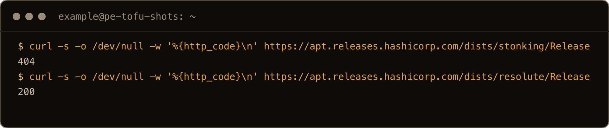

The screenshots come from a final clean run on a fresh 26.10 server, as a user called `example`. The text blocks come from the first test box, so times and IPs differ. In the screenshots, `terraform` and `tofu` run with `-no-color`, `echo "exit=$?"` shows exit codes, and a few long outputs go through `grep` or `tail`, as the commands show. Some shots also include the setup steps the text describes in words, like the downgrade and putting the `stonking` line back.

Terraform is an important part of my job, and I like to keep my skills sharp, so of course I had to test it on Ubuntu 26.10.

This post covers the errors you'll hit installing either tool on 26.10 and what each one means. Then the fixes I tested on a fresh server: Terraform from HashiCorp's 26.04 repo, and OpenTofu from its own installer. Plus two traps that show up when you have both.

> **TL;DR.** For Terraform, use HashiCorp's normal steps with `resolute` in place of the codename. The `deb` line ends `https://apt.releases.hashicorp.com resolute main`. That installed Terraform 1.16.6 on 26.10, and it applied a config fine. For OpenTofu, run its installer with `--install-method deb`. It writes a repo with the suite `any`, so 26.10 makes no difference. It installed OpenTofu 1.13.1. Fix the HashiCorp line first, though. The OpenTofu installer runs `apt-get update` before anything else, and it quits on HashiCorp's broken `stonking` line. When `https://apt.releases.hashicorp.com/dists/stonking/Release` stops returning 404, swap `resolute` for `stonking` in `/etc/apt/sources.list.d/hashicorp.list`.

## Contents

- [What breaks on 26.10](#what-breaks-on-2610)
- [1. "The repository 'https://apt.releases.hashicorp.com stonking Release' does not have a Release file."](#1-the-repository-httpsaptreleaseshashicorpcom-stonking-release-does-not-have-a-release-file)
- [2. "Unable to locate package terraform"](#2-unable-to-locate-package-terraform)
- [3. "File exists. Overwrite? (y/N)" when you run the steps again](#3-file-exists-overwrite-yn-when-you-run-the-steps-again)
- [4. The Terraform fix: use the resolute repo](#4-the-terraform-fix-use-the-resolute-repo)
- [5. OpenTofu: the installer doesn't care about the codename](#5-opentofu-the-installer-doesnt-care-about-the-codename)
- [6. "Failed to update apt package list." from the OpenTofu installer](#6-failed-to-update-apt-package-list-from-the-opentofu-installer)
- [7. Both on one box: "Inconsistent dependency lock file"](#7-both-on-one-box-inconsistent-dependency-lock-file)
- [8. Move Terraform to stonking when it ships](#8-move-terraform-to-stonking-when-it-ships)
- [Gotchas I hit](#gotchas-i-hit)
- [Quick reference](#quick-reference)

## What breaks on 26.10

I tested on a fresh Ubuntu 26.10 server (kernel 7.3.0-9-generic) as a sudo user called `example`, on 18 October 2026, three days after release.

| What you run | What happens |
| --- | --- |
| HashiCorp's official apt steps | the key installs, the list file says `stonking`, `apt update` fails with `does not have a Release file`, exit 100 |
| `sudo apt install terraform` after that | `Unable to locate package terraform`, plus a hint to install a snap |
| HashiCorp's steps with `resolute` | installs Terraform 1.16.6, `init`, `plan` and `apply` work |
| OpenTofu's installer, `--install-method deb` | installs OpenTofu 1.13.1 from a suite called `any`, same config applies |
| OpenTofu's installer with HashiCorp's `stonking` line still there | stops at `Failed to update apt package list.`, installs nothing |

The one thing to get straight: Terraform runs fine on 26.10. What's missing is a directory on HashiCorp's package server. HashiCorp's install steps look up that directory by your codename. This happened with 25.10 too. The GitHub issue about the missing `questing` suite was [opened in February and closed in April](https://github.com/hashicorp/terraform/issues/38131), with a Terraform maintainer writing in March: "In the past this has been a relatively speedy process, I am not sure why this is taking so long this time." So don't count on a `stonking` suite this week.

## 1. "The repository 'https://apt.releases.hashicorp.com stonking Release' does not have a Release file."

These are HashiCorp's [official Ubuntu steps](https://developer.hashicorp.com/terraform/install), copied as they are. The second command takes the suite from `UBUNTU_CODENAME` in `/etc/os-release`. On 26.10 that's `stonking`:

```bash
wget -O - https://apt.releases.hashicorp.com/gpg | sudo gpg --dearmor -o /usr/share/keyrings/hashicorp-archive-keyring.gpg
echo "deb [arch=$(dpkg --print-architecture) signed-by=/usr/share/keyrings/hashicorp-archive-keyring.gpg] https://apt.releases.hashicorp.com $(grep -oP '(?<=UBUNTU_CODENAME=).*' /etc/os-release || lsb_release -cs) main" | sudo tee /etc/apt/sources.list.d/hashicorp.list
sudo apt update && sudo apt install terraform
```

The first two work. `tee` echoes the line it wrote, and there's the problem:

```text
deb [arch=amd64 signed-by=/usr/share/keyrings/hashicorp-archive-keyring.gpg] https://apt.releases.hashicorp.com stonking main
```

Then `apt update` fails:

```text
Hit:1 http://security.ubuntu.com/ubuntu stonking-security InRelease
Hit:2 http://archive.ubuntu.com/ubuntu stonking InRelease
Hit:3 http://archive.ubuntu.com/ubuntu stonking-updates InRelease
Hit:4 http://archive.ubuntu.com/ubuntu stonking-backports InRelease
Ign:5 https://apt.releases.hashicorp.com stonking InRelease
Err:6 https://apt.releases.hashicorp.com stonking Release
  404  Not Found [IP: 2600:9000:223d:1400:18:566b:ecc0:93a1 443]
Reading package lists...
Error: The repository 'https://apt.releases.hashicorp.com stonking Release' does not have a Release file.
```

It exits with status 100, so the `&&` never runs `apt install`. `apt-get update` prints the same line with `E:` instead of `Error:`, and the same exit status. That matters in a script or a cloud-init run. The Ubuntu lists still refresh, but one missing vendor suite makes the whole command exit 100. Anything chained after it with `&&` doesn't run.

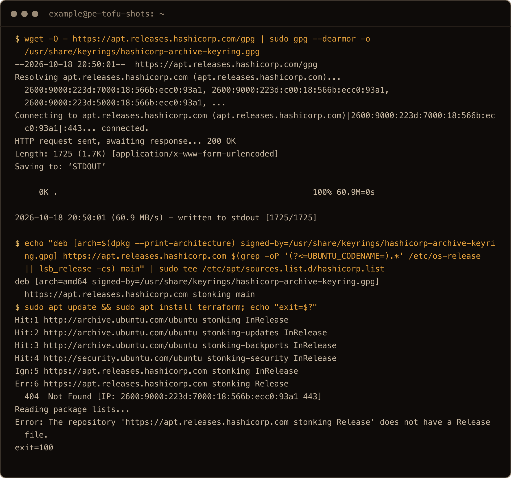

"Does not have a Release file" sounds like a broken repo. It isn't. The `404  Not Found` on the `Err:` line is the real message. That suite doesn't exist on the server. It's the same error I hit with Tailscale's repo in my [Tailscale on 26.10 post](/blog/install-tailscale-ubuntu-26-10/) and with HashiCorp's in the [26.10 beta upgrade](/blog/upgrade-ubuntu-26-04-to-26-10-beta/).

If you've seen my Tailscale post, you might expect an empty keyring here too. Not with HashiCorp's current steps. The key URL has no codename in it, so it downloads fine. Both files had real content afterwards (1213 bytes for the key, 126 for the list). The only wrong thing is the word `stonking`.

## 2. "Unable to locate package terraform"

Run the install on its own after the failed update, and apt says it has never heard of Terraform:

```text
$ sudo apt install -y terraform
Reading package lists...
Building dependency tree...
Reading state information...

No apt package "terraform", but there is a snap with that name.
Try "snap install terraform"

Error: Unable to locate package terraform
```

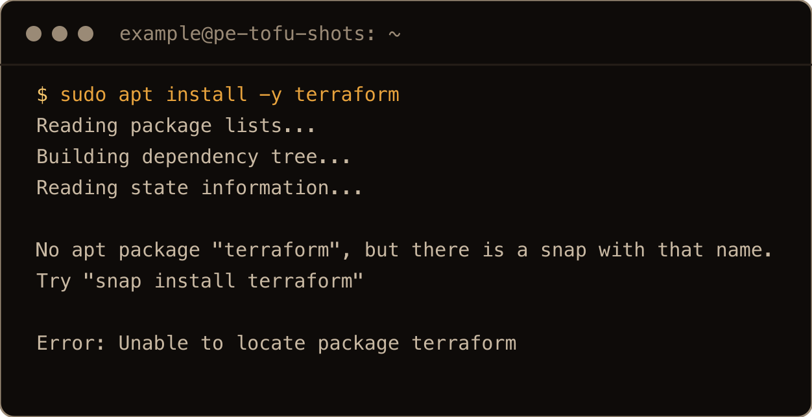

As far as apt knows, that's true. It never got a package list from HashiCorp. The snap it suggests isn't HashiCorp's own package. `snap info terraform` lists the publisher as `Snapcrafters`, and the description says the Snapcrafters community maintains it. Its stable channel had 1.16.6, the same version as HashiCorp's repo. I only looked at the snap. I didn't install Terraform from it.

## 3. "File exists. Overwrite? (y/N)" when you run the steps again

Once you know the fix, you'll probably run HashiCorp's steps again with the change. The first line bites on the second run. `gpg -o` won't overwrite a file without asking. In a terminal you get:

```text
File '/usr/share/keyrings/hashicorp-archive-keyring.gpg' exists. Overwrite? (y/N)
```

If you answer `n`, it asks `Enter new filename:` instead. In a script, or anything without a terminal, there's nobody to ask. The step fails with exit status 2:

```text
gpg: cannot open '/dev/tty': No such device or address
```

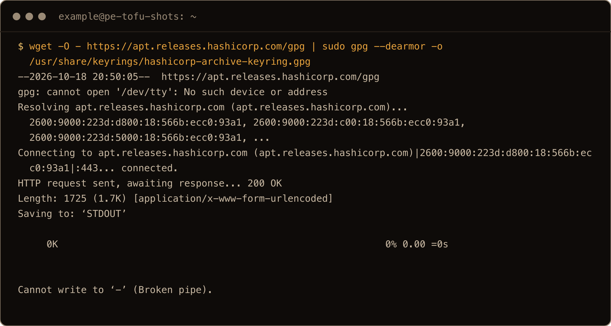

You don't need a new key at all. It's the same file for every suite, so skip that line on a rerun. If it's in a script you run more than once, add `--yes`. That overwrote the file without a prompt when I tried it:

```bash
wget -qO - https://apt.releases.hashicorp.com/gpg | sudo gpg --yes --dearmor -o /usr/share/keyrings/hashicorp-archive-keyring.gpg
```

## 4. The Terraform fix: use the resolute repo

Same steps, with `resolute` written in where the codename lookup was:

```bash
wget -qO - https://apt.releases.hashicorp.com/gpg | sudo gpg --yes --dearmor -o /usr/share/keyrings/hashicorp-archive-keyring.gpg
echo "deb [arch=$(dpkg --print-architecture) signed-by=/usr/share/keyrings/hashicorp-archive-keyring.gpg] https://apt.releases.hashicorp.com resolute main" | sudo tee /etc/apt/sources.list.d/hashicorp.list
sudo apt-get update
sudo apt-get install -y terraform
```

`tee` overwrites the old list file, so there's nothing to clean up first. This time `apt-get update` fetched HashiCorp's lists:

```text
Get:1 https://apt.releases.hashicorp.com resolute InRelease [12.9 kB]
Hit:2 http://security.ubuntu.com/ubuntu stonking-security InRelease
Get:3 https://apt.releases.hashicorp.com resolute/main amd64 Packages [327 kB]
```

and the install got the current release:

```text
Get:1 https://apt.releases.hashicorp.com resolute/main amd64 terraform amd64 1.16.6-1 [35.9 MB]
...
Setting up terraform (1.16.6-1)…
```

```text
$ terraform version
Terraform v1.16.6
on linux_amd64
```

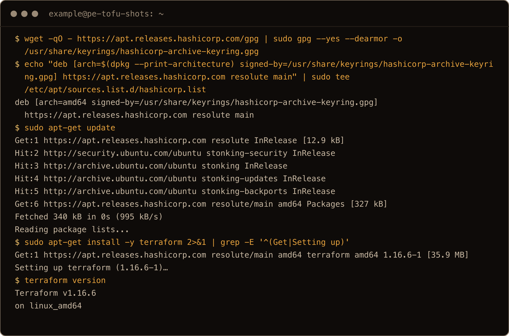

A version number only proves the binary starts, so I gave it something to do. This config uses the `local` provider to write a file. It needs no cloud account. It still makes Terraform download a provider from its registry and keep state:

```hcl
terraform {
  required_providers {
    local = {
      source = "hashicorp/local"
    }
  }
}

resource "local_file" "hello" {
  filename = "${path.module}/hello.txt"
  content  = "hello from Ubuntu 26.10\n"
}
```

Save it as `main.tf` in an empty directory and run:

```bash
terraform init
terraform plan
terraform apply -auto-approve
```

`init` installed `hashicorp/local v2.9.1 (signed by HashiCorp)`, `plan` showed `Plan: 1 to add, 0 to change, 0 to destroy.`, and `apply` finished with:

```text
local_file.hello: Creating...
local_file.hello: Creation complete after 1s [id=b885fdb565475fcdbbdf1e70f95ae39b3c3dd6db]

Apply complete! Resources: 1 added, 0 changed, 0 destroyed.
```

`hello.txt` held the line from the config.

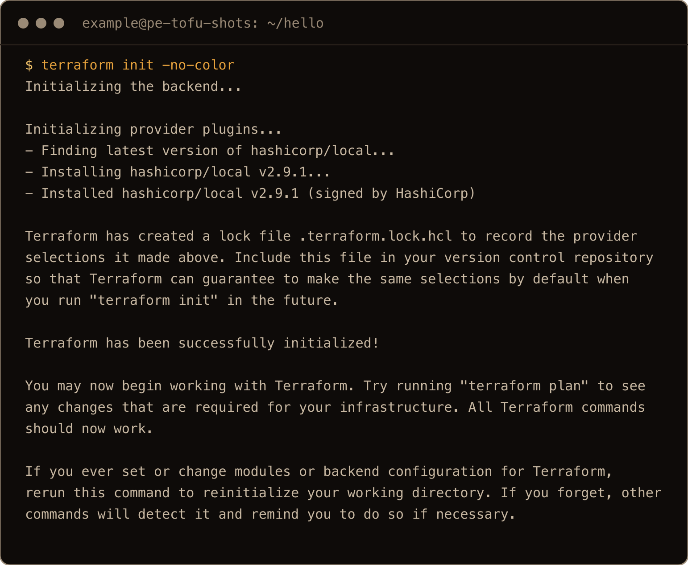

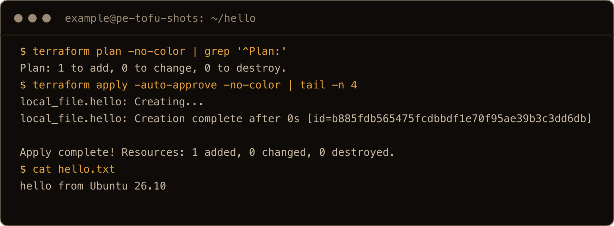

Is a 26.04 package safe on 26.10? For Terraform, it ran everything I gave it. The `resolute` repo also carried 1.16.6, the same version HashiCorp's install page lists as the latest. So you aren't stuck on an old build. Updates come through apt as normal. I downgraded to 1.16.5 to check, and `apt list --upgradable` offered 1.16.6 again:

```text
terraform/resolute 1.16.6-1 amd64 [upgradable from: 1.16.5-1]
```

`sudo apt-get install --only-upgrade terraform` put 1.16.6 back. One thing worth knowing: Ubuntu's `unattended-upgrades` only allows Ubuntu's own origins by default. I checked `/etc/apt/apt.conf.d/50unattended-upgrades` on the box. So it won't update Terraform or OpenTofu on its own. Run `sudo apt upgrade` now and then.

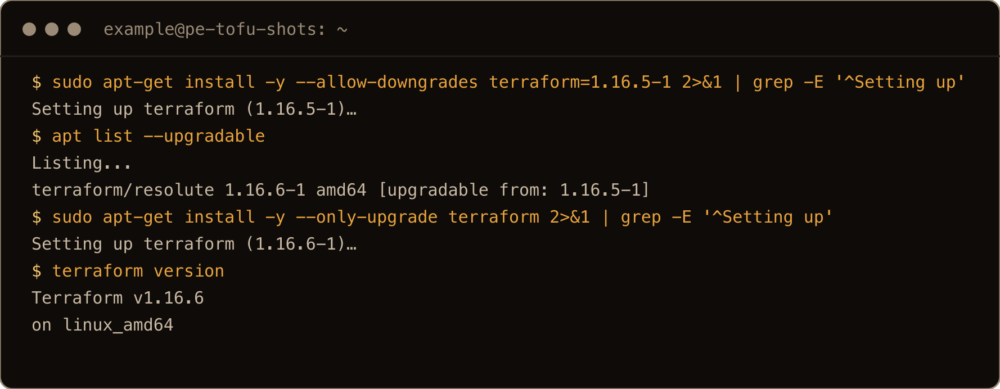

I'd just use the `resolute` repo for the time being. It's one word to change later, and apt keeps track of the install.

If you'd rather keep apt out of it, HashiCorp also publishes plain zip files. I got `terraform_1.16.6_linux_amd64.zip` and `terraform_1.16.6_SHA256SUMS` from `https://releases.hashicorp.com/terraform/1.16.6/`. They passed `sha256sum --ignore-missing -c`, and the binary ran fine. The 26.10 server image has no `unzip`, though, so run `sudo apt-get install -y unzip` first. Updates are up to you on that route.

## 5. OpenTofu: the installer doesn't care about the codename

These are OpenTofu's [official Debian and Ubuntu steps](https://opentofu.org/docs/intro/install/deb/), run as they are:

```bash
curl --proto '=https' --tlsv1.2 -fsSL https://get.opentofu.org/install-opentofu.sh -o install-opentofu.sh
chmod +x install-opentofu.sh
./install-opentofu.sh --install-method deb
rm -f install-opentofu.sh
```

Run it as your normal user. It uses `sudo` for the parts that need root. It updates apt, installs `apt-transport-https` and adds two keys under `/etc/apt/keyrings/`. Then it writes the repo and installs the `tofu` package. The repo line is why 26.10 doesn't matter:

```text
Creating OpenTofu sources list...
deb [signed-by=/etc/apt/keyrings/opentofu.gpg,/etc/apt/keyrings/opentofu-repo.gpg] https://packages.opentofu.org/opentofu/tofu/any/ any main
deb-src [signed-by=/etc/apt/keyrings/opentofu.gpg,/etc/apt/keyrings/opentofu-repo.gpg] https://packages.opentofu.org/opentofu/tofu/any/ any main
```

The suite is `any`. There's no codename in it, so a new Ubuntu release needs nothing from OpenTofu's side. The install went through:

```text
Get:1 https://packages.opentofu.org/opentofu/tofu/any any/main amd64 tofu amd64 1.13.1 [35.3 MB]
...
Setting up tofu (1.13.1)…
...
Checking if OpenTofu is installed correctly...
```

```text
$ tofu version
OpenTofu v1.13.1
on linux_amd64
```

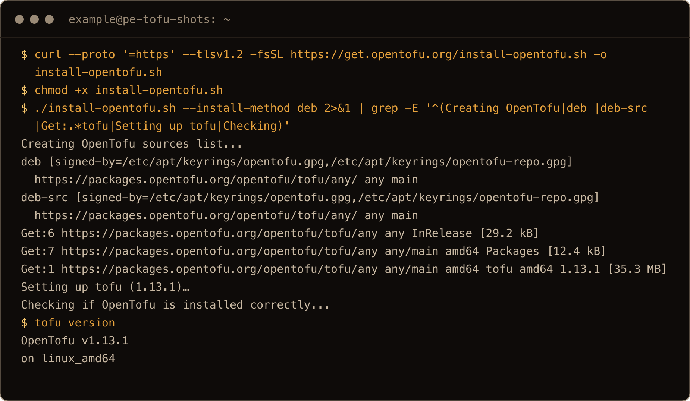

The same `main.tf` in a fresh directory, with `tofu` in place of `terraform`:

```bash
tofu init
tofu plan
tofu apply -auto-approve
```

```text
- Installing hashicorp/local v2.9.1...
- Installed hashicorp/local v2.9.1 (signed, key ID 0C0AF313E5FD9F80)
...
local_file.hello: Creating...
local_file.hello: Creation complete after 0s [id=b885fdb565475fcdbbdf1e70f95ae39b3c3dd6db]

Apply complete! Resources: 1 added, 0 changed, 0 destroyed.
```

The config didn't change at all. The provider came from somewhere else, though. The lock file says `registry.opentofu.org/hashicorp/local`. Terraform's said `registry.terraform.io/hashicorp/local`. That difference comes back in section 7.

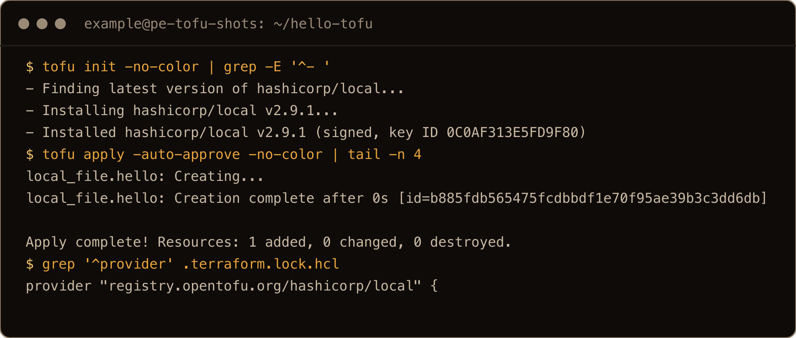

My [disposable Hetzner lab](/blog/disposable-hetzner-lab-opentofu/) runs on OpenTofu. It built the box for this post and destroyed it afterwards.

Beyond the lab, it's mostly cloud infrastructure and DNS. I've been copying an existing environment's settings into Terraform so the entire environment is under source control.

## 6. "Failed to update apt package list." from the OpenTofu installer

This one comes from doing things in the obvious order. You try HashiCorp's steps, hit the Release file error, then try OpenTofu instead. To test it on purpose, I removed OpenTofu and put HashiCorp's `stonking` line back. Then I ran the installer again:

```text
$ ./install-opentofu.sh --install-method deb
OpenTofu Installer

Attempting installation via Debian repository...
Root privileges are required to install OpenTofu as a Debian package.
The installer will now verify if it can correctly assume root privileges.
You may be asked to enter your password.
Updating package list...
...
Ign:5 https://apt.releases.hashicorp.com stonking InRelease
Err:6 https://apt.releases.hashicorp.com stonking Release
  404  Not Found [IP: 2600:9000:223d:e00:18:566b:ecc0:93a1 443]
Reading package lists...
E: The repository 'https://apt.releases.hashicorp.com stonking Release' does not have a Release file.
Failed to update apt package list.
```

The installer's very first step is `apt-get update`. That runs before it adds its own repo, and it stops if the update fails. Exit status 2, no OpenTofu repo written, no `tofu`. The error names HashiCorp, which is a good clue. But the last line, `Failed to update apt package list.`, is the one you notice, and it's easy to read it as OpenTofu's repo being broken.

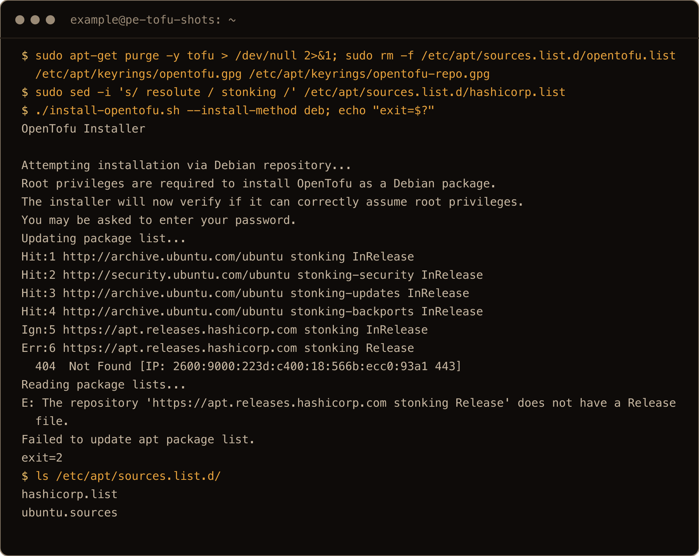

Fix the HashiCorp file first. Use section 4's `resolute` line, or remove the file if you've given up on Terraform:

```bash
sudo rm /etc/apt/sources.list.d/hashicorp.list
```

Then run the installer again. The same goes for any other vendor repo on the box that hasn't caught up with 26.10 yet.

There's also a way around apt. The installer's `standalone` method downloads the release zip, checks it and puts it in `/opt/opentofu`. It never touches apt, so HashiCorp's broken line (still in place for this test) doesn't matter. On the 26.10 server image it stopped straight away, though:

```text
Unzip is missing, please install it to use the standalone installation method.
```

`sudo apt-get install -y unzip` worked even with the broken repo. `install` uses the package lists apt already has, so it doesn't need a successful update. After that, `./install-opentofu.sh --install-method standalone` checked the checksum and the GPG signature. It installed 1.13.1 to `/opt/opentofu` and linked `/usr/local/bin/tofu` to it. Apt doesn't know about it, so updating means running the installer again.

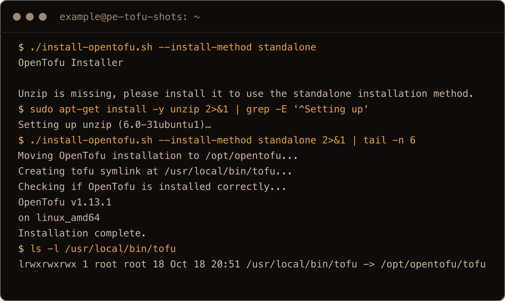

## 7. Both on one box: "Inconsistent dependency lock file"

Terraform and OpenTofu install side by side without trouble. One is `terraform` and the other is `tofu`. The trouble starts when you point both at the same directory. I ran `tofu plan` in the directory Terraform had already applied:

```text
$ tofu plan

Error: Inconsistent dependency lock file

The following dependency selections recorded in the lock file are
inconsistent with the current configuration:
  - provider registry.opentofu.org/hashicorp/local: required by this configuration but no version is selected

To update the locked dependency selections to match a changed configuration,
run:
  tofu init -upgrade
```

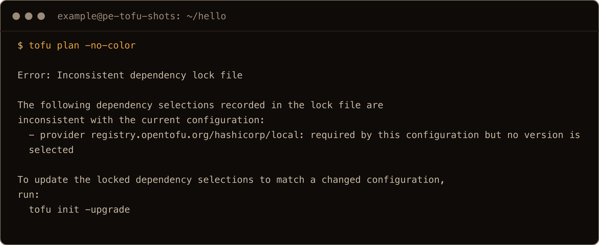

That's the registry difference from section 5. The lock file only has an entry for `registry.terraform.io/hashicorp/local`. OpenTofu looks for `registry.opentofu.org/hashicorp/local`. A plain `tofu init` sorts it out (no `-upgrade` needed) and tells you what it did:

```text
Warning: Dependency lock file entries automatically updated

OpenTofu automatically rewrote some entries in your dependency lock file:
  - registry.terraform.io/hashicorp/local => registry.opentofu.org/hashicorp/local

The version selections were preserved, but the hashes were not because the
OpenTofu project's provider releases are not byte-for-byte identical.
```

After that, `tofu plan` read the state Terraform had written and said `No changes. Your infrastructure matches the configuration.` For this small config, moving from Terraform to OpenTofu was one `init`.


The catch: it's a rewrite, not an addition. Now `terraform plan` failed with the same error the other way round (`provider registry.terraform.io/hashicorp/local: required by this configuration but no version is selected`). A plain `terraform init` rewrote the lock file back. Each tool's `init` flips `.terraform.lock.hcl` to its own registry. Say that file is committed, and half your team runs `tofu` while the other half runs `terraform`. Every `init` shows up as a change. Pick one tool per directory.

So do I keep both? I never have both on the same box, because of that. For enterprise work I usually just go with Terraform, since it's an approved piece of software. OpenTofu is for my own personal projects.

## 8. Move Terraform to stonking when it ships

HashiCorp will publish a `stonking` suite. I don't know when. This is the URL to watch:

```bash
curl -s -o /dev/null -w '%{http_code}\n' https://apt.releases.hashicorp.com/dists/stonking/Release
```

Today it prints `404`. For `resolute` it prints `200`. When `stonking` prints `200`, change the suite in your list file and update:

```bash
sudo sed -i 's/ resolute / stonking /' /etc/apt/sources.list.d/hashicorp.list
sudo apt-get update
```

The key stays as it is. I ran that `sed` on the lab box to check it edits the right word. Today `apt-get update` then fails with the section 1 error, as you'd expect. The reverse `sed` (`s/ stonking / resolute /`) put it back, and the next update fetched cleanly. I couldn't test the real `stonking` suite, because it doesn't exist yet.


OpenTofu needs nothing here. Its `any` suite keeps working on 26.10, and on whatever comes next.

As for my own Terraform boxes: I'll move them to `stonking` as soon as HashiCorp publishes the 26.10 repo.

## Gotchas I hit

- HashiCorp's official steps write `stonking` into the list file, and `apt update` then fails with `does not have a Release file` and exit 100. It's a 404, not a broken repo.
- `Unable to locate package terraform` afterwards means apt never got HashiCorp's package list. The snap it suggests comes from the Snapcrafters community, not from HashiCorp's own packages.
- Running the key step twice prompts `File ... exists. Overwrite? (y/N)`, and without a terminal it fails with `gpg: cannot open '/dev/tty'`. Use `--yes`.
- The OpenTofu installer runs `apt-get update` first, so a broken HashiCorp line makes it fail with `Failed to update apt package list.` Fix that file first.
- The standalone OpenTofu method needs `unzip`, which the 26.10 server image doesn't have.
- `terraform init` and `tofu init` each rewrite `.terraform.lock.hcl` to their own registry. Pick one tool per directory.
- `unattended-upgrades` won't touch either vendor repo by default; update them yourself.

## Quick reference

| Task | Command |
| --- | --- |
| Is there a 26.10 HashiCorp suite yet? | `curl -s -o /dev/null -w '%{http_code}\n' https://apt.releases.hashicorp.com/dists/stonking/Release` |
| Terraform from the 26.04 repo | `resolute` instead of the codename in the `deb` line in `/etc/apt/sources.list.d/hashicorp.list`, then `sudo apt-get update && sudo apt-get install -y terraform` |
| Reinstall the key without a prompt | `wget -qO - https://apt.releases.hashicorp.com/gpg \| sudo gpg --yes --dearmor -o /usr/share/keyrings/hashicorp-archive-keyring.gpg` |
| OpenTofu | `./install-opentofu.sh --install-method deb` |
| OpenTofu without apt | `sudo apt-get install -y unzip`, then `./install-opentofu.sh --install-method standalone` |
| Check the installs | `terraform version`, `tofu version` |
| Move a Terraform directory to OpenTofu | `tofu init` |
| Update | `sudo apt update && sudo apt upgrade` |
| Move Terraform to stonking later | `sudo sed -i 's/ resolute / stonking /' /etc/apt/sources.list.d/hashicorp.list` |

Terraform borrowed from 26.04 for now. OpenTofu doesn't care what release you're on. One word to change when HashiCorp catches up.
