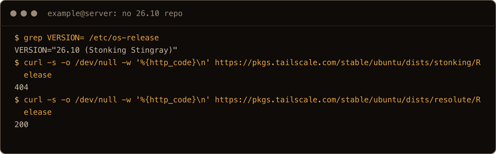
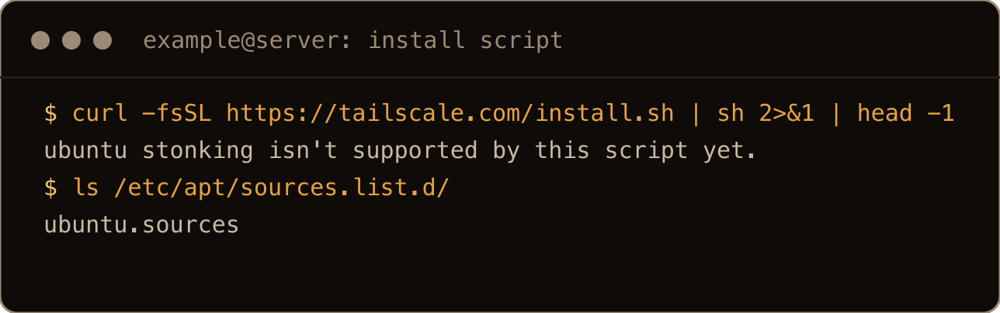
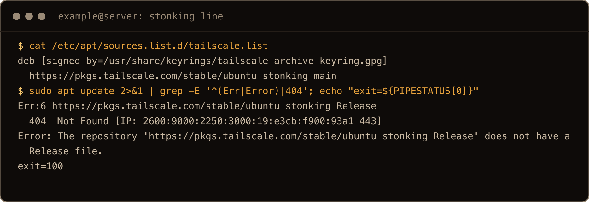
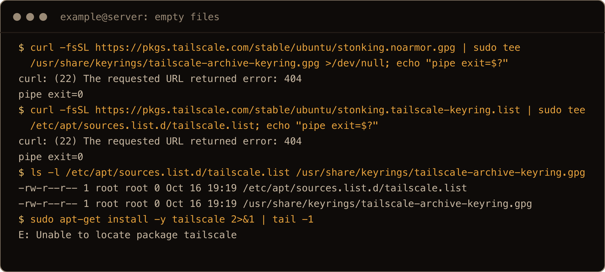
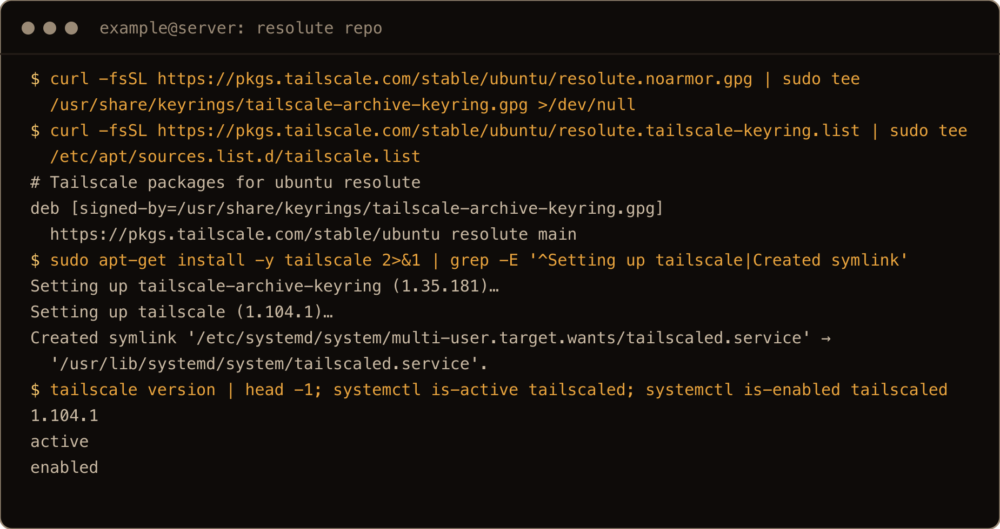
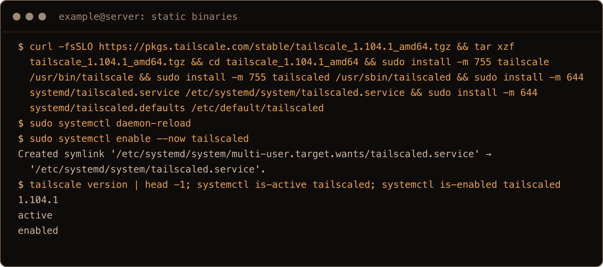
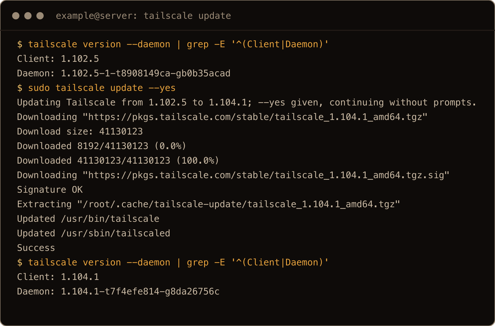
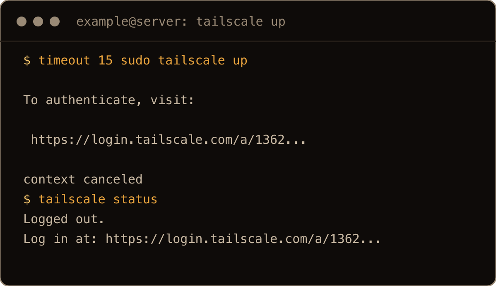
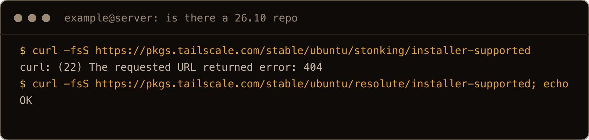

Ubuntu 26.10 came out yesterday, and I wanted Tailscale on a fresh 26.10 box. I use Tailscale for development, so I can test apps and get to the box from anywhere. On 26.10 the usual one liner doesn't work. Tailscale builds its apt repo per Ubuntu codename, and there's no `stonking` repo yet:

```bash
curl -s -o /dev/null -w '%{http_code}\n' https://pkgs.tailscale.com/stable/ubuntu/dists/stonking/Release
```

```text
404
```

The same URL with `resolute` (26.04) returns `200`. Tailscale's [package page](https://pkgs.tailscale.com/stable/) starts at 26.04, then 25.10, 25.04 and older. There's no 26.10.



The screenshots come from a final clean run on a fresh 26.10 server, as a user called `example`; the text blocks come from the first test box, so times and IDs differ.

So this post is the error text you'll hit, what each one means, and two fixes I tested on a fresh 26.10 server. For everything after the install (auth keys on a headless box, MagicDNS, exit nodes), my [26.04 Tailscale guide](/blog/install-tailscale-ubuntu-26-04/) uses the same commands, so I won't repeat it here (I couldn't test joining a tailnet from the lab; see section 6).

> **TL;DR.** Use Tailscale's 26.04 repo until a 26.10 one exists: fetch `resolute.noarmor.gpg` and `resolute.tailscale-keyring.list` instead of the `stonking` ones, then `sudo apt-get install tailscale`. It installed Tailscale 1.104.1 on 26.10 and `tailscaled` came up enabled and running. If you'd rather keep apt out of it, the static binaries plus the systemd unit in the tarball work too, and `tailscale update` keeps them current. When `https://pkgs.tailscale.com/stable/ubuntu/stonking/installer-supported` says `OK`, swap `resolute` for `stonking` in `/etc/apt/sources.list.d/tailscale.list`.

## Contents

- [What breaks on 26.10](#what-breaks-on-2610)
- [1. "ubuntu stonking isn't supported by this script yet."](#1-ubuntu-stonking-isnt-supported-by-this-script-yet)
- [2. "The repository 'https://pkgs.tailscale.com/stable/ubuntu stonking Release' does not have a Release file."](#2-the-repository-httpspkgstailscalecomstableubuntu-stonking-release-does-not-have-a-release-file)
- [3. The quiet one: "Unable to locate package tailscale"](#3-the-quiet-one-unable-to-locate-package-tailscale)
- [4. The fix: use the resolute repo](#4-the-fix-use-the-resolute-repo)
- [5. Or run the static binaries](#5-or-run-the-static-binaries)
- [6. Join the tailnet](#6-join-the-tailnet)
- [7. Move to stonking when it ships](#7-move-to-stonking-when-it-ships)
- [Gotchas I hit](#gotchas-i-hit)
- [Quick reference](#quick-reference)

## What breaks on 26.10

I tested on a fresh Ubuntu 26.10 server (kernel 7.3.0-9-generic) as a sudo user called `example`, on 16 October 2026, the day after release.

| What you run | What happens |
| --- | --- |
| `curl -fsSL https://tailscale.com/install.sh \| sh` | stops with `ubuntu stonking isn't supported by this script yet.`, changes nothing |
| Tailscale's manual steps with `stonking` in the URLs | both downloads 404, `tee` writes two empty files, and `apt-get install` says `Unable to locate package tailscale` |
| A `deb ... stonking main` line written by hand | `apt update` fails with `does not have a Release file` |
| The same steps with `resolute` | installs Tailscale 1.104.1, `tailscaled` active and enabled |

The one thing to get straight: nothing is wrong with Tailscale on 26.10. The package from the 26.04 repo runs fine. What's missing is a directory on Tailscale's package server, and every official install path looks up the directory by your codename.

## 1. "ubuntu stonking isn't supported by this script yet."

The install script reads the codename from `/etc/os-release` (`UBUNTU_CODENAME=stonking` on 26.10) and asks the package server whether that codename is supported before it touches apt. For `stonking` the server answers with a 404, so the script bails:

```text
$ curl -fsSL https://tailscale.com/install.sh | sh
ubuntu stonking isn't supported by this script yet.

If you'd like us to support your system better, please email support@tailscale.com
and tell us what OS you're running.

Please include the following information we gathered from your system:

OS=ubuntu
VERSION=stonking
PACKAGETYPE=apt
UNAME=Linux pe-ts2610-1 7.3.0-9-generic #9-Ubuntu SMP PREEMPT_DYNAMIC Mon Oct  5 10:38:02 UTC 2026 x86_64 GNU/Linux
```

It then prints your whole `/etc/os-release` and exits with status 1. This is the friendly failure: it stops before writing anything, and `/etc/apt/sources.list.d/` still held only `ubuntu.sources` afterwards. There's no flag to make the script use another codename (it takes `TRACK` and `TAILSCALE_VERSION`, neither of which helps), so skip it and add the repo yourself.



## 2. "The repository 'https://pkgs.tailscale.com/stable/ubuntu stonking Release' does not have a Release file."

This is what you get if your apt source says `stonking`, for example because you wrote the `deb` line yourself with the codename, or a config management template fills it in from the OS facts:

```text
$ sudo apt update
Ign:1 https://pkgs.tailscale.com/stable/ubuntu stonking InRelease
Hit:2 http://security.ubuntu.com/ubuntu stonking-security InRelease
Hit:3 http://archive.ubuntu.com/ubuntu stonking InRelease
Err:4 https://pkgs.tailscale.com/stable/ubuntu stonking Release
  404  Not Found [IP: 2600:9000:2250:ac00:19:e3cb:f900:93a1 443]
Hit:5 http://archive.ubuntu.com/ubuntu stonking-updates InRelease
Hit:6 http://archive.ubuntu.com/ubuntu stonking-backports InRelease
Reading package lists...
Error: The repository 'https://pkgs.tailscale.com/stable/ubuntu stonking Release' does not have a Release file.
```

`apt-get update` prints the same line starting `E:` instead of `Error:`. Both exit with status 100, which matters in a script or a cloud-init run: one missing vendor repo fails the whole update, not just the Tailscale part.

"Does not have a Release file" sounds like a broken repo. It isn't. The `404 Not Found` on the `Err:` line is the real message: that suite doesn't exist on the server. It's the same thing I hit with Docker's and HashiCorp's repos in the [26.04 to 26.10 upgrade](/blog/upgrade-ubuntu-26-04-to-26-10-beta/), and the fix is the same too.



## 3. The quiet one: "Unable to locate package tailscale"

Tailscale's own manual instructions are two `curl | sudo tee` lines with the codename in the URL. Swap in `stonking` and both URLs 404, but look at what happens:

```text
$ curl -fsSL https://pkgs.tailscale.com/stable/ubuntu/stonking.noarmor.gpg | sudo tee /usr/share/keyrings/tailscale-archive-keyring.gpg >/dev/null; echo "pipe exit=$?"
curl: (22) The requested URL returned error: 404
pipe exit=0
$ curl -fsSL https://pkgs.tailscale.com/stable/ubuntu/stonking.tailscale-keyring.list | sudo tee /etc/apt/sources.list.d/tailscale.list; echo "pipe exit=$?"
curl: (22) The requested URL returned error: 404
pipe exit=0
```

The pipeline's exit status is `tee`'s, and `tee` happily wrote what it was given, which was nothing. You now have a 0 byte keyring and a 0 byte list file:

```text
-rw-r--r-- 1 root root 0 Oct 16 17:58 /etc/apt/sources.list.d/tailscale.list
-rw-r--r-- 1 root root 0 Oct 16 17:58 /usr/share/keyrings/tailscale-archive-keyring.gpg
```

An empty list file has no sources in it, so `sudo apt-get update` succeeds without a word about Tailscale, and the failure turns up one command later, looking like a typo:

```text
$ sudo apt-get install -y tailscale
Reading package lists...
Building dependency tree...
Reading state information...
E: Unable to locate package tailscale
```

If you see that, `cat /etc/apt/sources.list.d/tailscale.list`. Empty means the download failed. The next section overwrites both files, so there's nothing to clean up first.



## 4. The fix: use the resolute repo

Same steps as Tailscale's 26.04 instructions, with `resolute` where you'd expect `stonking`:

```bash
curl -fsSL https://pkgs.tailscale.com/stable/ubuntu/resolute.noarmor.gpg \
  | sudo tee /usr/share/keyrings/tailscale-archive-keyring.gpg >/dev/null
curl -fsSL https://pkgs.tailscale.com/stable/ubuntu/resolute.tailscale-keyring.list \
  | sudo tee /etc/apt/sources.list.d/tailscale.list
sudo apt-get update
sudo apt-get install -y tailscale
```

The second `tee` echoes the file, which is how you know it isn't empty this time:

```text
# Tailscale packages for ubuntu resolute
deb [signed-by=/usr/share/keyrings/tailscale-archive-keyring.gpg] https://pkgs.tailscale.com/stable/ubuntu resolute main
```

`apt-get update` fetched `resolute InRelease` and the package lists, and the install pulled in `tailscale-archive-keyring` alongside it (a recommended package that owns `/usr/share/keyrings/tailscale-archive-keyring.gpg` from then on):

```text
Setting up tailscale-archive-keyring (1.35.181)…
Setting up tailscale (1.104.1)…
Created symlink '/etc/systemd/system/multi-user.target.wants/tailscaled.service' → '/usr/lib/systemd/system/tailscaled.service'.
```

Check it:

```bash
tailscale version
systemctl is-active tailscaled
systemctl is-enabled tailscaled
```

```text
1.104.1
  tailscale commit: 7f4efe814ff14b064eb080344389ceb9ea2d37ac
  long version: 1.104.1-t7f4efe814-g8da26756c
  other commit: 8da26756c9a2af700dfd05fa38d21b1eef2bcaa2
  go version: go1.27.1 (tailscale/go 24ee2fd061)
active
enabled
```



Is it safe to run a 26.04 package on 26.10? For Tailscale, in practice yes. The signing key is the same file for every suite (the `resolute`, `questing` and `noble` keys all had the same sha256 when I checked), and 1.104.1 is the same version the static tarball ships. The only cost is one line in a list file to change once Tailscale publishes `stonking`, which section 7 covers.

Updates come through apt as normal. I downgraded to 1.102.5 to check, and `apt list --upgradable` offered `tailscale 1.104.1`, which `sudo apt-get install --only-upgrade tailscale` put back with `tailscaled` still active. One thing worth knowing: Ubuntu's `unattended-upgrades` only allows Ubuntu's own origins by default, so it won't update Tailscale on its own. Run `sudo apt upgrade` now and then. (`sudo tailscale update --dry-run` also recognised the apt install, but I only ran a real `tailscale update` on the static install below.)

I'd just use the `resolute` repo for the time being.

## 5. Or run the static binaries

If you'd rather not point apt at another release's repo, Tailscale publishes [static binaries](https://tailscale.com/kb/1053/install-static-binaries) for Linux. The tarball has `tailscale`, `tailscaled` and a `systemd/` folder with the unit and its defaults file. Tailscale's page shows starting `tailscaled` by hand and points at the unit in the tarball. To install it as a service the way the package does, put the files where the unit expects them (it runs `/usr/sbin/tailscaled` and reads `/etc/default/tailscaled`):

```bash
curl -fsSLO https://pkgs.tailscale.com/stable/tailscale_1.104.1_amd64.tgz
tar xzf tailscale_1.104.1_amd64.tgz
cd tailscale_1.104.1_amd64
sudo install -m 755 tailscale /usr/bin/tailscale
sudo install -m 755 tailscaled /usr/sbin/tailscaled
sudo install -m 644 systemd/tailscaled.service /etc/systemd/system/tailscaled.service
sudo install -m 644 systemd/tailscaled.defaults /etc/default/tailscaled
sudo systemctl daemon-reload
sudo systemctl enable --now tailscaled
```

1.104.1 was the current stable version when I tested; check the [package page](https://pkgs.tailscale.com/stable/#static) for the latest, and use `arm64` instead of `amd64` on an ARM box (I only tested `amd64`). I did this on the same box after `sudo apt-get purge tailscale tailscale-archive-keyring` and removing the list and keyring files, so nothing from section 4 was left over.

```text
Created symlink '/etc/systemd/system/multi-user.target.wants/tailscaled.service' → '/etc/systemd/system/tailscaled.service'.
```

`tailscale version` printed the same 1.104.1 block, and `systemctl is-active tailscaled` and `is-enabled` said `active` and `enabled`. After a reboot it came back `active` on its own.



Without apt, updates are up to you, and `tailscale update` handles them. I put 1.102.5 binaries in place and ran it:

```text
$ sudo tailscale update --yes
Updating Tailscale from 1.102.5 to 1.104.1; --yes given, continuing without prompts.
Downloading "https://pkgs.tailscale.com/stable/tailscale_1.104.1_amd64.tgz"
Download size: 41130123
Downloading "https://pkgs.tailscale.com/stable/tailscale_1.104.1_amd64.tgz.sig"
Signature OK
Extracting "/root/.cache/tailscale-update/tailscale_1.104.1_amd64.tgz"
Updated /usr/bin/tailscale
Updated /usr/sbin/tailscaled
Success
```

It checks the signature, replaces both binaries, and restarted the service: `tailscale version --daemon` showed the daemon at 1.104.1 straight after, and the service's start time had moved. Don't pipe it into `head` to keep the output short, though. I did, `head` closed the pipe, and the update died partway through the download with the old binaries still in place.



So my pick is the `resolute` repo. It's one file to change later, and apt keeps track of what it installed. The static route is for when you don't want another release's repo on the box at all.

## 6. Join the tailnet

Either way, joining is the same as on any other release:

```bash
sudo tailscale up
```

```text
To authenticate, visit:

	https://login.tailscale.com/a/5021...
```

Open that URL in a browser logged into your tailnet and approve the machine. I tested on a throwaway box with no auth key, so I stopped here: I haven't shown it joining a tailnet on 26.10, only that the daemon runs and hands out a login URL (with both installs). Before that, `tailscale status` just says `Logged out.`



For a headless server, use an auth key with `sudo tailscale up --authkey ...`; the [26.04 guide](/blog/install-tailscale-ubuntu-26-04/#on-a-headless-server) covers it, along with checking the connection with `tailscale ip -4` and `tailscale ping`.

Once it's on the tailnet, the first thing I do is SSH in over Tailscale, usually to test it before I start throwing apps on it.

## 7. Move to stonking when it ships

Tailscale will publish a `stonking` repo; I don't know when. The install script's own check is the easiest thing to watch:

```bash
curl -fsS https://pkgs.tailscale.com/stable/ubuntu/stonking/installer-supported
```

Today that fails with `curl: (22) The requested URL returned error: 404`. For `resolute` it prints `OK`. When `stonking` prints `OK`, change the suite in your list file and update:

```bash
sudo sed -i 's/ resolute / stonking /' /etc/apt/sources.list.d/tailscale.list
sudo apt-get update
```

The keyring stays as it is, since it's the same key. I ran that `sed` on the lab box to check it edits the right word, and today `apt-get update` then fails with the `does not have a Release file` error from section 2, as you'd expect; I put `resolute` back with the reverse `sed` and it fetched cleanly again. What I couldn't test is the real `stonking` repo, because it doesn't exist yet. The comment line in the file will still say `resolute`; apt ignores it.



If you used the static binaries, there's nothing to switch: `tailscale update` keeps working. If you want to move to the apt package later, I'd remove the four files from section 5 first (I didn't test installing the package over them).

As for going back to an LTS: I'll stay with 26.10.

## Gotchas I hit

- The install script refuses 26.10 outright and leaves nothing behind, which is the good failure.
- `curl -fsSL ... | sudo tee` exits 0 when the download 404s, and leaves an empty keyring and an empty list file. The error shows up later as `Unable to locate package tailscale`.
- `does not have a Release file` is a 404, not a broken repo, and it fails the whole `apt update` with status 100.
- `unattended-upgrades` won't touch Tailscale's repo by default; update it yourself.
- `tailscale update --yes | head` kills the update partway through.
- I couldn't join a tailnet from the lab (no auth key), so everything here stops at the login URL.

## Quick reference

| Task | Command |
| --- | --- |
| Is there a 26.10 repo yet? | `curl -fsS https://pkgs.tailscale.com/stable/ubuntu/stonking/installer-supported` |
| Install from the 26.04 repo | `resolute.noarmor.gpg` and `resolute.tailscale-keyring.list`, then `sudo apt-get install -y tailscale` |
| Check for the empty list file | `cat /etc/apt/sources.list.d/tailscale.list` |
| Static binaries | `tailscale` to `/usr/bin`, `tailscaled` to `/usr/sbin`, unit to `/etc/systemd/system`, defaults to `/etc/default/tailscaled` |
| Check the install | `tailscale version`, `systemctl is-active tailscaled` |
| Update | `sudo apt upgrade` (repo), `sudo tailscale update` (static) |
| Join | `sudo tailscale up` |
| Move to stonking later | `sudo sed -i 's/ resolute / stonking /' /etc/apt/sources.list.d/tailscale.list` |

Same Tailscale, borrowed from 26.04 for now, and one word to change when `stonking` shows up.
