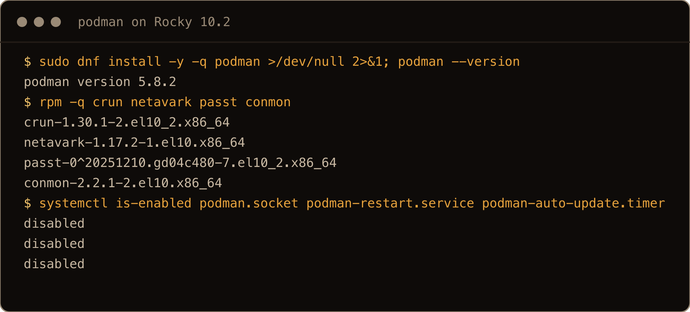
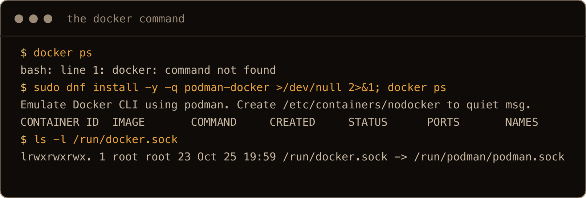
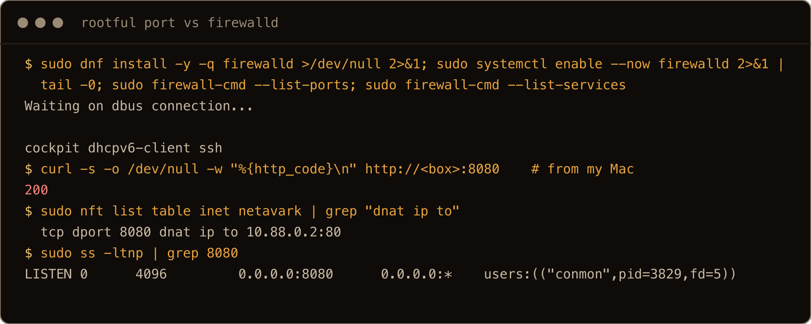
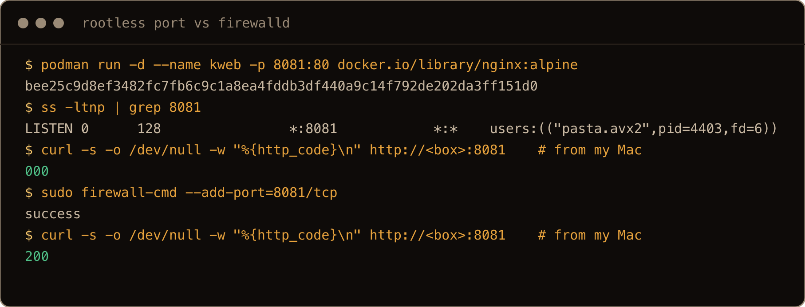
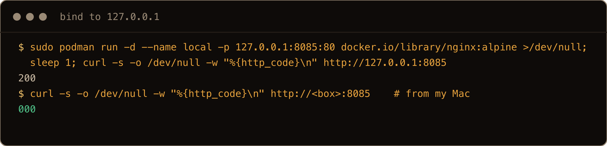
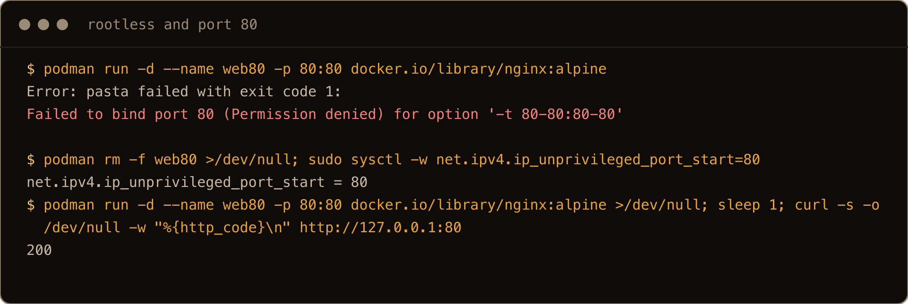

You know Docker. Somebody hands you a Rocky Linux box, you type `docker ps`, and bash says `docker: command not found`. The [Rocky Linux post](/blog/rocky-linux-10-for-ubuntu-people/) showed that Docker's own RHEL repo works fine here. This post is the other road: the container tool the distribution actually ships, which is Podman.

So why Podman, when Docker's repo works? Podman because of the enterprise portion of it, and it can be used free of charge.

The commands are close enough that most of your muscle memory works on day one. That's the trap. `podman run -d -p 8080:80 nginx` looks like Docker and mostly acts like Docker. Then a script fails on an image name. A port you never opened in firewalld answers from the internet. A bind mount serves a 403. Your container is gone after the next reboot. I put Podman on a fresh Rocky Linux 10.2 server and reproduced each of those, as root and as a normal user, so every error below is the one the box printed.

Have I been running Podman for years? No. This was my experiment of using Podman for the first time and playing around with it.

The one thing to get straight: **Podman has no daemon.** Docker is a background service that owns every container and starts them again at boot. Podman is a command that starts a container and exits. Everything that's different follows from that. There's no service to restart your containers, so systemd does it. There's no root daemon in the middle, so every user gets their own private set of images and containers, and rootless is the normal way to run it. And there's no `dockerd` socket unless you ask for one.

> **TL;DR.** `sudo dnf install podman` (5.8.2 on Rocky 10.2). Add `podman-docker` if you want the `docker` command. Always write full image names (`docker.io/library/nginx:alpine`), because a short name that isn't on Red Hat's alias list fails in a script with `short-name resolution enforced but cannot prompt without a TTY`. A **rootful** `-p 8080:80` is reachable from outside even with firewalld running and the port not open, same as Docker and ufw, so bind to `127.0.0.1` or run rootless, where firewalld does gate the port. Add `:Z` to bind mounts or SELinux serves a 403 with nothing in `ausearch`. For anything long lived, write a Quadlet file in `~/.config/containers/systemd/`, start it with `systemctl --user`, and run `loginctl enable-linger <user>` or it dies when you log out.

## Contents

- [What I tested on](#what-i-tested-on)
- [Install it, and the docker command](#install-it-and-the-docker-command)
- [What carries over unchanged](#what-carries-over-unchanged)
- [Short names: works in your shell, fails in your script](#short-names-works-in-your-shell-fails-in-your-script)
- [Rootful and rootless are two separate worlds](#rootful-and-rootless-are-two-separate-worlds)
- [Ports: the one firewalld never sees](#ports-the-one-firewalld-never-sees)
- [Ports below 1024 when rootless](#ports-below-1024-when-rootless)
- [Bind mounts and SELinux: a 403 with nothing in the audit log](#bind-mounts-and-selinux-a-403-with-nothing-in-the-audit-log)
- [--restart=always does nothing after a reboot](#restartalways-does-nothing-after-a-reboot)
- [Quadlet: containers as systemd units](#quadlet-containers-as-systemd-units)
- [Linger, or your containers die when you log out](#linger-or-your-containers-die-when-you-log-out)
- [Auto updates](#auto-updates)
- [Compose: podman compose is a wrapper](#compose-podman-compose-is-a-wrapper)
- [Which way I would run it](#which-way-i-would-run-it)
- [Gotchas I hit](#gotchas-i-hit)
- [Quick reference: Docker habit to Podman equivalent](#quick-reference-docker-habit-to-podman-equivalent)

## What I tested on

One Hetzner Cloud cx23 in Helsinki, the stock `rocky-10` image, on 25 October 2026. It booted as Rocky Linux 10.2 (Red Quartz) with kernel `6.12.0-211.49.1.el10_2` and, like the image in the Rocky post, SELinux **permissive**. I turned enforcing on for the SELinux section and say so there. A second user, `keith`, with no sudo, ran the rootless half. I reached the box's published ports from my Mac through the provider's firewall, so "from outside" below means a real connection from another network, not a curl on the box.

One aside that cost me ten minutes: the first `dnf` command on this box sat for about eight minutes on `Rocky Linux 10 - BaseOS 1.8 kB/s`. The mirror list had put a slow mirror first. Adding `fastestmirror=True` to `/etc/dnf/dnf.conf` and running `dnf makecache` again took eight seconds. If your first install hangs, that's the first thing to try.

## Install it, and the docker command

Podman isn't on the cloud image. It's one package from AppStream:

```bash
sudo dnf install podman
podman --version
```

That printed `podman version 5.8.2`. It also pulled in the pieces Docker hides inside `dockerd`: `crun` 1.30.1 as the runtime, `netavark` 1.17.2 for rootful networking and `passt` (which provides `pasta`) for rootless networking. Then there's `conmon` 2.2.1, a small process that babysits each container so Podman itself can exit. `podman info` reported the `overlay` storage driver and SELinux enabled.



The screenshots come from a second fresh box, run after the post was written, so IDs, PIDs, container addresses, uptimes, SELinux category numbers and which images each user had pulled differ from the text. On that box the `keith` user had passwordless sudo, so root commands show as `sudo`. The curls marked `# from my Mac` ran on my Mac against the box's public address.

If your fingers type `docker`, install the shim:

```bash
sudo dnf install podman-docker
docker ps
```

```text
Emulate Docker CLI using podman. Create /etc/containers/nodocker to quiet msg.
CONTAINER ID  IMAGE       COMMAND     CREATED     STATUS      PORTS       NAMES
```

`/usr/bin/docker` is now a wrapper that runs `podman`, and it prints that line on every call until you `sudo touch /etc/containers/nodocker`. The package also drops a tmpfiles rule that links `/run/docker.sock` to `/run/podman/podman.sock`, so tools that look for Docker's socket find Podman's. That socket only answers if `podman.socket` is running. On a fresh install, `podman.socket`, `podman-restart.service` and `podman-auto-update.timer` are all disabled. Two of those come up again below.



`container-tools` is also in AppStream, a metapackage for the wider toolset. I didn't install it; for a Docker replacement, `podman` alone was enough.

## What carries over unchanged

Most of it. `run`, `ps`, `logs`, `exec`, `stop`, `rm`, `images`, `pull`, `build`, `-d`, `-p`, `-v`, `-e`, `--name`, `--rm`, `--restart`: same commands, same flags. A Dockerfile builds as is. Images come from Docker Hub when you name it:

```text
$ podman run --rm docker.io/library/hello-world
...
Hello from Docker!
This message shows that your installation appears to be working correctly.
```

Yes, it says Docker. It's the same image.

## Short names: works in your shell, fails in your script

This is the first thing that breaks a Docker habit, and it breaks it unevenly. Docker treats `nginx` as `docker.io/library/nginx`. Podman doesn't assume Docker Hub. Rocky's `/etc/containers/registries.conf` has:

```text
unqualified-search-registries = ["registry.access.redhat.com", "registry.redhat.io", "docker.io"]
short-name-mode = "enforcing"
```

Three registries could answer for a bare name, and enforcing mode means Podman won't guess. It asks you which one. To save you that question for popular images, Red Hat ships an alias file, `/etc/containers/registries.conf.d/000-shortnames.conf`, with a long list of known names. `nginx` is on it:

```text
$ podman pull nginx
Resolved "nginx" as an alias (/etc/containers/registries.conf.d/000-shortnames.conf)
Trying to pull docker.io/library/nginx:latest...
```

`traefik/whoami` isn't. In a script, a cron job or any ssh command without a terminal, there's nobody to ask:

```text
$ podman pull traefik/whoami
Error: short-name resolution enforced but cannot prompt without a TTY
```

Exit code 125. I didn't test the interactive prompt you'd get at a real terminal, only the scripted failure, because the scripted one is the one that bites at 2am. The fix is the habit, not the config: write the full name every time, `docker.io/traefik/whoami:latest`. It works in both tools, so your Compose files and scripts stay portable. You could also set `short-name-mode = "permissive"`. Per the `containers-registries.conf` docs, a script then gets a bare name resolved by trying the search list in order, Red Hat's registries first, and that's how you end up running something you didn't mean to. (I didn't test permissive mode.)


## Rootful and rootless are two separate worlds

With Docker, every user in the `docker` group talks to the same daemon and sees the same containers. With Podman, `sudo podman` and plain `podman` are two different installations that happen to share a binary. On the test box, root and `keith` each pulled `nginx:alpine`:

```text
root$  podman images  →  nginx:alpine, nginx:latest, hello-world
keith$ podman images  →  nginx:alpine, whoami:latest
root$  podman ps      →  web
keith$ podman ps      →  systemd-site
```

The `keith` user's images live in `~/.local/share/containers/storage` (that's `podman info` talking, as `keith`). Root's live somewhere else entirely. Nothing is shared: two copies of the same image take up the space twice, and root's `podman ps` doesn't list Keith's containers. If you run `sudo podman ps` and your container is "gone", it's in the other world.

Rootless needs a range of subordinate UIDs so the container can have its own root that maps to nothing on the host. On Rocky 10, `useradd` set that up by itself:

```text
/etc/subuid:keith:524288:65536
/etc/subgid:keith:524288:65536
```

Root inside the container is the `keith` user on the host, and every other UID in the container maps into that 524288 range, which belongs to nobody. That's the point of rootless: a process that escapes the container lands as an ordinary user, not as root. `podman info` as Keith reported `rootless=true` and `pasta` as the network command.


## Ports: the one firewalld never sees

Docker people learn this one the hard way on Ubuntu: a published port walks straight past ufw. The [Docker on 26.10 post](/blog/install-docker-ubuntu-26-10/) tested it again. Rootful Podman does the same thing to firewalld.

As root:

```bash
sudo podman run -d --name web -p 8080:80 --restart=always docker.io/library/nginx:alpine
sudo dnf install firewalld
sudo systemctl enable --now firewalld
sudo firewall-cmd --list-ports      # nothing
sudo firewall-cmd --list-services   # cockpit dhcpv6-client ssh
```

firewalld's `public` zone doesn't allow 8080. From my Mac, `curl http://<box>:8080` returned **200** anyway. I restarted the container and ran `firewall-cmd --reload` to be sure. Still 200.

The reason is the same as Docker's. Netavark, Podman's rootful network stack, writes its own nftables table, `table inet netavark`, and the published port is a DNAT rule in it:

```text
tcp dport 8080 dnat ip to 10.88.0.4:80
```

My reading of the ruleset: the packet is rewritten to the container's address on the way in and forwarded to it, so it never goes through the input rules where firewalld asks "is port 8080 allowed". The curl from my Mac is the part I tested. `ss -ltnp` shows `conmon` holding 8080, which makes it look like a normal listening socket. It isn't the path the traffic takes.



Rootless is different. As the `keith` user:

```bash
podman run -d --name kweb -p 8081:80 docker.io/library/nginx:alpine
```

Here `ss -ltnp` shows `pasta.avx2` listening on `*:8081`. pasta is a normal userspace process with a normal socket, so firewalld's input rules apply to it like they would to any service. From my Mac, port 8081 failed to connect. After `sudo firewall-cmd --add-port=8081/tcp`, it answered 200. That's the behavior most Docker people wish Docker had.



So the rule for rootful containers is the same as Docker's: if a port shouldn't be public, bind it to localhost and put a reverse proxy in front.

```bash
sudo podman run -d -p 127.0.0.1:8085:80 docker.io/library/nginx:alpine
```

On the box that answered 200. From my Mac it failed to connect.



Netavark also has a firewalld driver (`firewall_driver = "firewalld"` in `containers.conf`). I tried it: publishing stopped working entirely, even from the box itself, `podman rm` failed with `INVALID_ZONE: netavark_zone`, and removing the setting didn't bring it back until a reboot. Leave it off.


## Ports below 1024 when rootless

The first rootless thing a Docker person tries is `-p 80:80`:

```text
$ podman run -d --name web80 -p 80:80 docker.io/library/nginx:alpine
Error: pasta failed with exit code 1:
Failed to bind port 80 (Permission denied) for option '-t 80-80:80-80'
```

A normal user can't bind ports below 1024. That's the kernel, not Podman: `net.ipv4.ip_unprivileged_port_start` is 1024. Lowering it lets any user bind the ports from there up:

```bash
sudo sysctl -w net.ipv4.ip_unprivileged_port_start=80
```

After that, the same `podman run` bound port 80 and answered 200. That `sysctl -w` lasts until reboot; to keep it, put the line in a file under `/etc/sysctl.d/` (I didn't reboot to test that part). It applies to every user on the box, so think of it as "any user can now run a web server on 80". The other common answer is to publish 8080 and let a reverse proxy, or a firewalld forward port, sit on 80.



## Bind mounts and SELinux: a 403 with nothing in the audit log

This one only shows up under enforcing, and the stock image ships permissive, so it waits until you harden the box. I ran `setenforce 1` first, then, as the `keith` user:

```bash
mkdir -p ~/site && echo "hello from a bind mount" > ~/site/index.html
podman run -d --name site -p 8082:80 \
  -v ~/site:/usr/share/nginx/html:ro docker.io/library/nginx:alpine
curl http://127.0.0.1:8082/
```

```text
<head><title>403 Forbidden</title></head>
```

nginx's log says `"/usr/share/nginx/html/index.html" is forbidden (13: Permission denied)`. The file is world readable. It's SELinux: the file is labelled `user_home_t`, the container runs as `container_t`, and the policy doesn't let one read the other.

The part that cost me time: `ausearch -m avc` showed **nothing** about it. This denial is on the policy's `dontaudit` list, so it's blocked silently. To see it, turn the `dontaudit` rules off, reproduce, and turn them back on:

```bash
sudo semodule -DB     # log everything, including dontaudit denials
# reproduce the 403, then:
sudo grep user_home /var/log/audit/audit.log | tail -1
sudo semodule -B      # back to normal
```

```text
avc:  denied  { getattr } for  pid=2869 comm="nginx" path="/usr/share/nginx/html/index.html" ... scontext=system_u:system_r:container_t:s0:c7,c868 tcontext=unconfined_u:object_r:user_home_t:s0 tclass=file permissive=0
```

The fix is one letter on the mount:

```bash
podman run -d --name site -p 8082:80 \
  -v ~/site:/usr/share/nginx/html:ro,Z docker.io/library/nginx:alpine
```

That served `hello from a bind mount`. `:Z` tells Podman to relabel the host directory for this one container, and `ls -Z` afterwards showed the file as `container_file_t:s0:c276,c523`. The two `c` numbers are a private category pair, so a second container can't read it. Lowercase `:z` gives a shared label instead, for a directory several containers need. Both flags change the labels on your host files, so point them at a directory you made for the container, never at `/home`, `/etc` or `/var` themselves (that warning is from the Podman docs; I didn't relabel a system directory to find out).

This isn't really a Podman tax. It's what SELinux charges for any container on this box, and Docker on Ubuntu never sent you the bill.


The `ausearch` line ran a minute after the others, with `</dev/null` added: without a terminal, `ausearch` waits on standard input.

## --restart=always does nothing after a reboot

The `web` container from the ports section was started with `--restart=always`. I checked that `podman inspect` said `always`, and rebooted:

```text
$ podman ps -a --format "{{.Names}} {{.Status}}"
web Exited (0) 49 seconds ago
```

No daemon, so nobody was there at boot to read the restart policy. Podman ships a unit for exactly this, disabled:

```bash
sudo systemctl enable podman-restart.service
```

It runs `podman start --all --filter should-start-on-boot=true`, which is every container with a restart policy of `always` (or `unless-stopped`, per the docs). After enabling it and rebooting again, `web` was `Up 51 seconds` when I logged back in. The rootless containers with no restart policy stayed exited, as they should.


That fixes the Docker habit. It isn't how Podman wants you to run things, though. That's Quadlet.

## Quadlet: containers as systemd units

`podman generate systemd` is what older guides tell you to use. On 5.8 it prints:

```text
DEPRECATED command:
It is recommended to use Quadlets for running containers and pods under systemd.
```

A Quadlet is a small file that describes one container. A systemd generator turns it into a real service at `daemon-reload`, and from then on the container is a unit: `systemctl start`, `journalctl -u`, `Restart=`, dependencies, the lot. For a rootless user the files go in `~/.config/containers/systemd/`; for root, `/etc/containers/systemd/`.

Here's the bind mount container from above as a Quadlet, `~/.config/containers/systemd/site.container`:

```ini
[Unit]
Description=nginx serving ~/site

[Container]
Image=docker.io/library/nginx:alpine
PublishPort=8082:80
Volume=%h/site:/usr/share/nginx/html:ro,Z
AutoUpdate=registry

[Service]
Restart=always

[Install]
WantedBy=default.target
```

`%h` is the user's home directory. Then:

```bash
systemctl --user daemon-reload
systemctl --user start site.service
curl http://127.0.0.1:8082/
```

`systemctl --user list-unit-files 'site*'` showed `site.service generated`, the service was `active`, and curl got the page. The container is named `systemd-site`. The docs' `ContainerName=` key in `[Container]` sets your own name; I left the default.

Now the Docker brain says "enable it so it starts at boot":

```text
$ systemctl --user enable site.service
Failed to enable unit: Unit /run/user/1000/systemd/generator/site.service is transient or generated
```

You can't enable a generated unit. The `[Install]` section in the `.container` file is what does it: the generator reads `WantedBy=default.target` and wires it up itself. So the file is the enable. Leave out `[Install]` and the container only runs when you start it.


Two commands help when a Quadlet doesn't show up as a service at all. `podman quadlet list` shows what Podman thinks is installed and its state. `/usr/libexec/podman/quadlet -dryrun -user` runs the generator and prints the units it would write, or the error in your file.

## Linger, or your containers die when you log out

This is the trap in the rootless Quadlet setup, and nothing warns you.

The Quadlet above was running. I logged out. Fifteen seconds later, from a root shell:

```text
$ curl -m3 http://127.0.0.1:8082/
(nothing came back)
```

The journal had the reason:

```text
systemd[2944]: site.service: Killing process 3191 (catatonit) with signal SIGKILL.
systemd[2944]: Stopped site.service - nginx serving ~/site.
```

A rootless Quadlet runs under the user's own systemd manager, `systemd --user`, and that manager only exists while the user has a session. Last session ends, manager stops, it takes every user service with it. The same is true at boot: no session, no manager, so `WantedBy=default.target` never fires.

The odd part is that a plain `podman run -d` as `keith` had survived logout earlier (pasta was still listening on 8081 after the session closed). That container isn't a child of the user's systemd manager, so stopping the manager doesn't touch it. It just doesn't come back after a reboot. The Quadlet is the one you'd trust, and it's the one that dies.

The fix is to let the user's manager run without a session:

```bash
sudo loginctl enable-linger keith
```

`loginctl show-user keith -p Linger` then says `yes`, and a file appears at `/var/lib/systemd/linger/keith`. Turning linger on started the user's manager straight away, which started `site.service`: three seconds later curl got the page again without me touching the unit. After a reboot, with nobody logged in, `systemd-site` was up 50 seconds after boot, and `systemctl --user -M keith@ is-active site.service` (how root asks about another user's units) said `active`.


One more thing I saw before linger was on: after a reboot, the first `podman` command as `keith` in each new login printed `level=error msg="Refreshing container ...: acquiring lock 0 for container ...: file exists"` and then did what it was asked. I didn't track down why. I didn't see it again after linger was on.

## Auto updates

The `AutoUpdate=registry` line in the Quadlet is Podman's answer to Watchtower. `podman auto-update` checks each container that has that label, pulls a newer image if the tag moved, and restarts its unit:

```text
$ podman auto-update --dry-run
UNIT          CONTAINER                    IMAGE                           POLICY      UPDATED
site.service  2b160a703759 (systemd-site)  docker.io/library/nginx:alpine  registry    false
```

It only works for containers run by a systemd unit, which is one more reason to use Quadlet. To run it on a schedule, enable the timer that ships with Podman, per user or for root:

```bash
systemctl --user enable --now podman-auto-update.timer
```

I ran the dry run only. The image was current, so there was nothing to update, and I didn't wait for the timer to fire.

## Compose: podman compose is a wrapper

`podman compose` exists, and it doesn't do Compose itself. It looks for a real compose tool and runs that. On a fresh box there isn't one, and the error lists everywhere it looked, in order:

```text
$ podman compose up -d
Error: looking up compose provider failed
7 errors occurred:
	* exec: "/home/keith/.docker/cli-plugins/docker-compose": stat ...: no such file or directory
	* exec: "/usr/local/lib/docker/cli-plugins/docker-compose": ...
	* exec: "/usr/local/libexec/docker/cli-plugins/docker-compose": ...
	* exec: "/usr/lib/docker/cli-plugins/docker-compose": ...
	* exec: "/usr/libexec/docker/cli-plugins/docker-compose": ...
	* exec: "docker-compose": executable file not found in $PATH
	* exec: "podman-compose": executable file not found in $PATH
```

That order matters later: Docker Compose wins over `podman-compose` if both are installed. I tested both with the same file, an nginx proxy in front of a `whoami` container, using full image names and `:Z` on the config mount:

```yaml
services:
  whoami:
    image: docker.io/traefik/whoami:latest
  web:
    image: docker.io/library/nginx:alpine
    ports:
      - "8084:80"
    volumes:
      - ./nginx.conf:/etc/nginx/conf.d/default.conf:ro,Z
    depends_on:
      - whoami
```

**Option 1, `podman-compose`.** It's in EPEL as version 1.5.0:

```bash
sudo dnf install epel-release
sudo dnf install podman-compose
podman compose up -d
```

`podman compose` printed `>>>> Executing external compose provider "/usr/bin/podman-compose". Please see podman-compose(1) for how to disable this message. <<<<`, made a `stack_default` network, started `stack_whoami_1` and `stack_web_1`, and nginx reached `whoami` by service name. No socket needed: podman-compose turns the file into `podman` commands.


**Option 2, Docker Compose against the Podman socket.** I put Docker's own Compose v5.6.1 binary in `~/.docker/cli-plugins/docker-compose` and turned on the `keith` user's Podman API socket:

```bash
systemctl --user enable --now podman.socket
podman compose up -d
```

`podman compose` picked Docker Compose, pointed it at `/run/user/1000/podman/podman.sock` without me setting `DOCKER_HOST`, and it brought up `stack-whoami-1` and `stack-web-1` (dashes, Docker's naming, where podman-compose uses underscores). With the socket stopped, the same command failed with `Cannot connect to the Docker daemon at unix:///run/user/1000/podman/podman.sock. Is the docker daemon running?`. So the socket is the daemon, as far as Docker Compose is concerned.


Which would I use? I don't have enough knowledge of it to pick one yet. So here are the routes side by side, plus Quadlet, the one that survives a reboot:

| Route | Install | What it needs | Fits when |
| --- | --- | --- | --- |
| `podman-compose` | `dnf install epel-release podman-compose` | EPEL, nothing running in the background | You want Compose files to work and nothing else on the box |
| Docker Compose | Docker's `docker-compose` binary in `~/.docker/cli-plugins/` | `systemctl --user enable --now podman.socket` | The Compose file came from someone using Docker and you want the same Compose they tested with |
| Quadlet | Nothing extra, it ships with Podman | One `.container` file per service | The stack has to come back after a reboot |

Whichever you pick, Compose doesn't fix the reboot problem. Neither tool left anything that starts at boot. For a stack you want running tomorrow, the Podman answer is a `.container` file per service (Quadlet also has `.network`, `.volume`, `.pod` and `.kube` files for the rest).

## Which way I would run it

Rootless or rootful? Rootless, just to make my life easier.

On the test box that held up. No `sudo` in front of every command, and the published port went through firewalld like any other service. The bonus, by design rather than something I tested, is that a process that escapes the container lands as an ordinary user. The cost is the setup the sections above walk through: full image names, `:Z` on mounts, ports above 1024 (or the sysctl), and `loginctl enable-linger` so a Quadlet keeps running when you log out.

## Gotchas I hit

- **`short-name resolution enforced but cannot prompt without a TTY`.** A bare image name that isn't in `000-shortnames.conf`, run from a script. Write `docker.io/...` in full, every time.
- **A rootful published port ignores firewalld.** Netavark's DNAT runs before firewalld's input rules. Reachable from outside with the port closed. Bind to `127.0.0.1`, or run rootless.
- **A rootless published port obeys firewalld.** pasta listens like any service. If it works on the box and fails to connect from outside, `firewall-cmd --add-port`.
- **`Failed to bind port 80 (Permission denied)`** from pasta. Rootless can't bind below 1024. `sysctl net.ipv4.ip_unprivileged_port_start=80`, or publish 8080.
- **SELinux 403 on a bind mount, and `ausearch` shows nothing.** It's a `dontaudit` denial. `:Z` fixes it; `semodule -DB` shows it.
- **The image is permissive.** Every SELinux problem above waits until you set enforcing.
- **`--restart=always` is ignored at boot.** `systemctl enable podman-restart.service`.
- **`Unit ... is transient or generated`** when you `systemctl enable` a Quadlet. The `[Install]` section in the `.container` file is the enable.
- **Rootless Quadlets die at logout and don't start at boot.** `loginctl enable-linger <user>`.
- **`sudo podman ps` doesn't show your containers.** Root and each user have separate storage.
- **`podman compose` needs a provider,** and prefers Docker Compose over `podman-compose` when both exist. Docker Compose also needs `podman.socket`.
- **`podman generate systemd` is deprecated.** Write a Quadlet.
- **The first `dnf` on a fresh box can crawl** if the mirror list hands you a slow mirror. `fastestmirror=True` in `/etc/dnf/dnf.conf`.

## Quick reference: Docker habit to Podman equivalent

| Docker habit | Podman on Rocky Linux 10 |
| --- | --- |
| `dnf install docker-ce` | `dnf install podman` (and `podman-docker` for the `docker` command) |
| `docker run nginx` | `podman run docker.io/library/nginx` (full name, always) |
| `usermod -aG docker me` | Nothing to join. Every user runs their own containers; `useradd` sets up `/etc/subuid` |
| `sudo docker ps` shows everything | `sudo podman ps` shows root's only; each user has their own |
| `-p 80:80` as a normal user | `sysctl net.ipv4.ip_unprivileged_port_start=80`, or `-p 8080:80` |
| Published ports skip ufw | Rootful ports skip firewalld; rootless ports obey it |
| `-v /data:/data` | `-v /data:/data:Z` (private) or `:z` (shared) under SELinux |
| `--restart=always` | Works after `systemctl enable podman-restart.service`; better, a Quadlet with `Restart=always` |
| `docker compose up -d` | `podman compose up -d` with `podman-compose` (EPEL) or Docker Compose plus `podman.socket` |
| `/var/run/docker.sock` | `podman.socket` (`--user` for rootless); `podman-docker` links `/run/docker.sock` for root |
| A systemd unit wrapping `docker run` | `~/.config/containers/systemd/name.container`, `systemctl --user daemon-reload`, `start` |
| `systemctl enable` | `[Install] WantedBy=default.target` in the `.container` file |
| Watchtower | `AutoUpdate=registry` plus `podman-auto-update.timer` |
| Containers survive logout | Rootless Quadlets need `loginctl enable-linger <user>` |
| `dockerd` logs | `journalctl --user -u name.service` for a Quadlet |

`[ no daemon, so systemd is the daemon, and linger is how you keep it awake ]`
