A Build 42 dedicated server on Ubuntu 26.04, start to finish: install, run under systemd, add mods, back up, restore and roll back an update. Every procedural step ran on fresh DigitalOcean droplets (4 vCPU, 8 GB RAM), build 42.22.2 on the default branch. Do your own first run on a throwaway VM too. The restore and rollback steps are meant to be rehearsed before a real world depends on them.

> **TL;DR** Install `steamcmd`, download app `380870` as a `pzserver` user, and **set `-Xmx` in `ProjectZomboid64.json` before the first start and after every `validate`**: the default `-Xmx8g` was OOM killed on an 8 GB box every time. Run it with `Restart=always`, because `start-server.sh` exits 0 even when the game crashes. Set `Password=`. Open UDP 16261 and 16262 only. Back up three folders with the server stopped. A rollback is the old branch **and** the world from before the update.

Not tested: nobody joined the server. Load, lag and how many players fit are unknown, and the memory numbers are for an empty world.

## Contents

- [Prerequisites](#prerequisites)
- [1. Install SteamCMD](#1-install-steamcmd)
- [2. Download the server](#2-download-the-server)
- [3. Set the heap](#3-set-the-heap)
- [4. First start and settings](#4-first-start-and-settings)
- [5. systemd unit](#5-systemd-unit)
- [6. RCON for console commands](#6-rcon-for-console-commands)
- [7. Mods](#7-mods)
- [8. Hang check](#8-hang-check)
- [9. Backups and restore](#9-backups-and-restore)
- [10. Update and rollback](#10-update-and-rollback)
- [11. Firewall](#11-firewall)
- [Gotchas I hit](#gotchas-i-hit)
- [Quick reference](#quick-reference)

## Prerequisites

- Ubuntu 26.04 on a 64 bit Intel or AMD machine. The server ships `linux64` libraries; ARM is untested.
- 8 GB of RAM or more (see step 3), and about 7 GB of disk plus the world.
- A sudo user. See [Create a sudo user on Ubuntu 26.04](/blog/create-sudo-user-ubuntu-26-04/) and [hardening an Ubuntu 26.04 server](/blog/hardening-ubuntu-26-04-server/).
- Players own the game. The server itself is free and downloads anonymously.

## 1. Install SteamCMD

`steamcmd` is a 32 bit package in `multiverse`. The two `debconf` lines accept Valve's license ahead of time so the install doesn't stop at a prompt.

```bash
sudo dpkg --add-architecture i386
sudo apt update
echo steam steam/question select "I AGREE" | sudo debconf-set-selections
echo steam steam/license note "" | sudo debconf-set-selections
sudo apt install -y steamcmd
```

If `apt` can't find it, run `sudo add-apt-repository multiverse` and `sudo apt update`. Both droplets already had `multiverse` enabled.

## 2. Download the server

```bash
sudo useradd -m -s /bin/bash pzserver
sudo mkdir -p /opt/pzserver
sudo chown pzserver:pzserver /opt/pzserver
cd /opt/pzserver
sudo -u pzserver -H /usr/games/steamcmd +force_install_dir /opt/pzserver \
    +login anonymous +app_update 380870 validate +quit
```

```text
Success! App '380870' fully installed.
```

6.8 GB, 3 minutes 12 seconds. Run it from `/opt/pzserver`: on 26.04 `useradd -m` makes `/home/pzserver` `drwxr-x---`, so your sudo user can't `cd` there. On two of three fresh boxes the first attempt failed with `ERROR! Failed to install app '380870' (Missing configuration)` and installed nothing. On one, the same command worked the second time; on the other, the next `steamcmd` install (a branch switch) worked. Run it again.

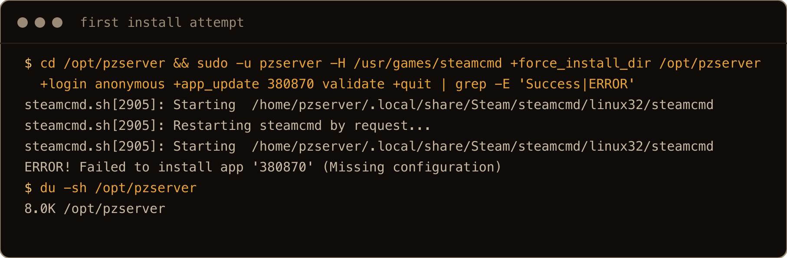

*The screenshots come from a third fresh droplet, so times, IDs and snapshot names differ from the text. On that box the first download failed (shown here), and the server was then installed straight onto the 42.21 branch, so step 10 had an older build to roll back to. Some commands add filters (`grep`, `head`, `sed`, `cut`) to keep the output short.*

List the branches now. Step 10 depends on them:

```bash
sudo -u pzserver -H /usr/games/steamcmd +login anonymous +app_info_print 380870 +quit
```

On November 11, 2026 (UTC):

| Branch | Description | Build |
| --- | --- | --- |
| `public` | (default) | 42.22.2 |
| `pre-release` | Pre-release testing | same as `public` that day |
| `42.21` | temporary fall-back | 42.21.0 |
| `42.19` | Build 42.19.2 | 42.19.2 |
| `legacy41` | Build 41.78.21 | Build 41 |

The developers decide which old builds stay and for how long.

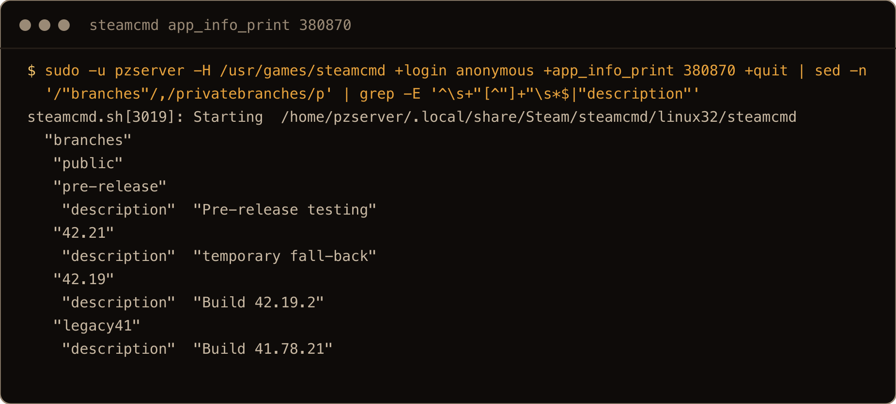

## 3. Set the heap

The heap is `-Xmx` in `/opt/pzserver/ProjectZomboid64.json`. The default is `-Xmx8g`, and on an 8 GB box the kernel killed the server during every startup:

```text
Out of memory: Killed process 20743 (ProjectZomboid6) total-vm:138642364kB, anon-rss:1040552kB, file-rss:3328kB, shmem-rss:6630088kB, UID:1000
```

With the ZGC collector this JSON enables, the heap showed up as shared memory close to the full `-Xmx`, even with an empty world. The process used about 1 GiB more on top. Measured with nobody connected:

| `-Xmx` | Shared (heap) | Other process memory | Box memory available |
| --- | --- | --- | --- |
| `8g` | OOM killed during startup | | |
| `6g` | 5.97 GiB | 0.76 to 0.92 GiB | 186 to 486 MiB |
| `4g` | 3.97 GiB | 1.04 GiB | 2.2 GiB |

So size the box for `-Xmx` plus about 1 GiB plus the OS. On 8 GB, `-Xmx6g` worked and `-Xmx8g` didn't (7g is untested). Run nothing else on the box. Players and mods will want more.

```bash
sudo sed -i 's/-Xmx[0-9]*[gm]/-Xmx6g/' /opt/pzserver/ProjectZomboid64.json
grep Xmx /opt/pzserver/ProjectZomboid64.json
```

```text
		"-Xmx6g",
```

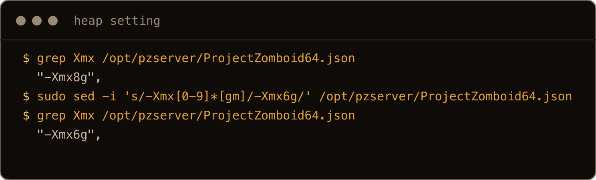

`validate` can put the file back to the default. It happened once on a reinstall of the same branch, and the next start ended in `Failed with result 'oom-kill'`. Run this `sed` after every `steamcmd` command. Step 10's commands do.

## 4. First start and settings

The first start creates the world, the settings and an `admin` account. `-servername` names the files.

```bash
cd /opt/pzserver
sudo -u pzserver -H ./start-server.sh -servername lab -adminpassword 'CHANGE_ME'
```

Wait for `*** SERVER STARTED ****` (95 seconds to 3 minutes on the droplets), then stop it with `Ctrl+C`. SIGINT runs the server's save before it exits. The log prints dozens of `ERROR` lines on a clean start (`libjsig.so ... cannot be preloaded`, `Missing ThumpSound`). They're harmless. What matters is `SERVER STARTED` or `Server Terminated`.

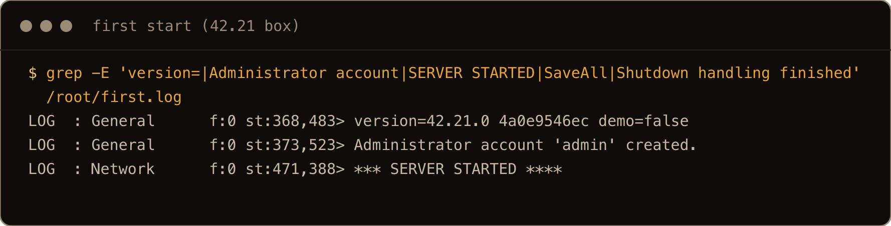

The files land in `/home/pzserver/Zomboid/`: settings in `Server/lab.ini`, the world in `Saves/Multiplayer/lab`, accounts in `db/lab.db`. Defaults from the first start:

```text
Password=
Open=true
Public=false
DefaultPort=16261
UDPPort=16262
RCONPort=27015
RCONPassword=
BackupsCount=5
BackupsOnStart=true
BackupsOnVersionChange=true
```

`Public=false` only hides the server from the in game browser, and `Open=true` means no whitelist. With `Password=` empty, nothing in the config stops someone who has the IP (joining was untested). Edit `lab.ini` with the server stopped:

```bash
sudo nano /home/pzserver/Zomboid/Server/lab.ini
```

and set:

```text
Password=YOUR_GROUP_PASSWORD
RCONPassword=A_LONG_RANDOM_STRING
```

The server rewrites `lab.ini` on every start. It kept these values and only changed defaults in its comments.

## 5. systemd unit

`/etc/systemd/system/pzserver.service`:

```ini
[Unit]
Description=Project Zomboid dedicated server
After=network-online.target
Wants=network-online.target

[Service]
User=pzserver
WorkingDirectory=/opt/pzserver
ExecStart=/opt/pzserver/start-server.sh -servername lab
Restart=always
RestartSec=10
TimeoutStopSec=120

[Install]
WantedBy=multi-user.target
```

```bash
sudo systemctl daemon-reload
sudo systemctl enable --now pzserver
sudo journalctl -u pzserver -f
```

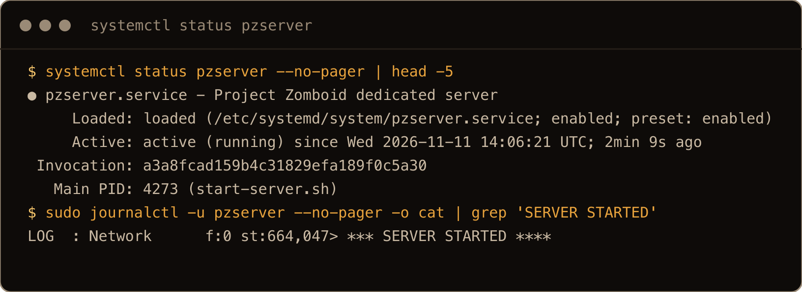

**Why `Restart=always`.** `start-server.sh` ends with `exit 0` whatever happened to the game. With `Restart=on-failure`, a `kill -9` of the game left the service down:

```text
pzserver.service: Deactivated successfully.
Result=success
NRestarts=0
```

With `Restart=always` the same crash came back 10 to 11 seconds later. `systemctl stop` still stops it for good.

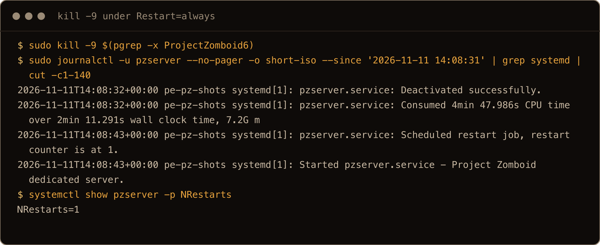

**Why no `ExecStop`.** `systemctl stop` sends SIGTERM, and the server's shutdown handler saves the world first:

```text
Shutdown handling started
...
SaveAll took 163.528161 ms
Saving players
Saving worldgen params
Saving GlobalModData
Saving finish
Shutdown handling finished
```

Stops took 6 to 12 seconds. A pipe that types `quit` into the console, which some guides use, isn't needed. When I tried one, a stop during startup hung until `TimeoutStopSec` ran out. More on units in [systemd units and timers](/blog/systemd-units-timers-ubuntu-26-04/).

## 6. RCON for console commands

Under systemd there's no console to type into. With `RCONPassword` set, RCON listens on TCP 27015, on every interface (`*:27015`). Keep it out of the firewall and use it from the server.

Ubuntu 26.04 has no RCON client package that I found, so here's a small one. `/usr/local/bin/pz-rcon`:

```python
#!/usr/bin/env python3
"""Send one console command to a Project Zomboid server over RCON."""
import socket, struct, sys

INI = "/home/pzserver/Zomboid/Server/lab.ini"

def read_ini(path):
    vals = {}
    with open(path, encoding="utf-8", errors="replace") as f:
        for line in f:
            if "=" in line and not line.startswith("#"):
                k, v = line.rstrip("\n").split("=", 1)
                vals[k] = v
    return vals

def packet(req_id, kind, body):
    data = struct.pack("<ii", req_id, kind) + body.encode() + b"\x00\x00"
    return struct.pack("<i", len(data)) + data

def recv_packet(sock):
    size = struct.unpack("<i", sock.recv(4))[0]
    data = b""
    while len(data) < size:
        data += sock.recv(size - len(data))
    req_id, kind = struct.unpack("<ii", data[:8])
    return req_id, kind, data[8:-2].decode(errors="replace")

def main():
    if len(sys.argv) < 2:
        sys.exit("usage: pz-rcon <command...>")
    cfg = read_ini(INI)
    with socket.create_connection(("127.0.0.1", int(cfg["RCONPort"])), timeout=10) as s:
        s.sendall(packet(1, 3, cfg["RCONPassword"]))
        # The server sends an empty reply first, then the auth result (type 2).
        while True:
            req_id, kind, _ = recv_packet(s)
            if kind == 2:
                break
        if req_id == -1:
            sys.exit("RCON auth failed")
        s.sendall(packet(2, 2, " ".join(sys.argv[1:])))
        _, _, body = recv_packet(s)
        print(body)

main()
```

```bash
sudo chmod 755 /usr/local/bin/pz-rcon
sudo pz-rcon players
sudo pz-rcon save
sudo pz-rcon servermsg '"Restart in 5 minutes"'
```

```text
Players connected (0): 

World saved
Message sent.
```

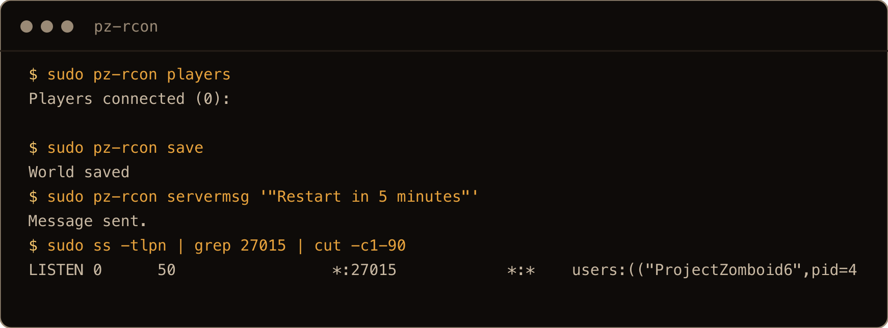

## 7. Mods

Two lines in `lab.ini`. `WorkshopItems` is the number in the Workshop URL. `Mods` is the mod's own ID from its `mod.info`, not its title.

Check a Workshop ID before using it. Steam's API needs no key:

```bash
curl -s -d 'itemcount=1&publishedfileids%5B0%5D=3389003300' \
    https://api.steampowered.com/ISteamRemoteStorage/GetPublishedFileDetails/v1/ \
    | python3 -c 'import json,sys,datetime; f=json.load(sys.stdin)["response"]["publishedfiledetails"][0]; print(f["title"], "|", datetime.date.fromtimestamp(f["time_updated"]), "|", ",".join(t["tag"] for t in f["tags"]))'
```

```text
[B42] Moodle Descriptions Expanded | 2026-08-11 | Build 42,Balance,Interface,Language/Translation,Misc,Realistic,Silly/Fun,QOL
```

Look for a `Build 42` tag and an update after your build came out. The `Mods` ID comes from the mod's files, so it takes two starts. First set `WorkshopItems` with a placeholder in `Mods` (that's what I did) and start, so the server downloads the mod:

```bash
sudo systemctl stop pzserver
sudo nano /home/pzserver/Zomboid/Server/lab.ini
```

```text
WorkshopItems=3389003300
Mods=PLACEHOLDER
```

```bash
sudo systemctl start pzserver
```

The download lands in `/opt/pzserver/steamapps/workshop/content/108600/<id>/`. Build 42 mods keep `mod.info` in a `42` folder:

```bash
sudo grep -rH '^id=' /opt/pzserver/steamapps/workshop/content/108600/3389003300/mods/*/42/mod.info
```

```text
/opt/pzserver/steamapps/workshop/content/108600/3389003300/mods/[B42] Moodle Descriptions Expanded/42/mod.info:id=B42MoodleDescriptionsExpanded
```

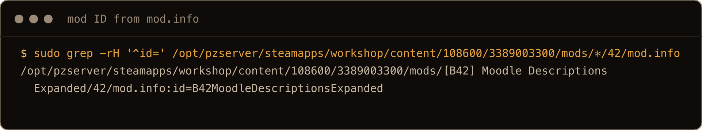

Then stop, set `Mods` to that ID, and start again:

```bash
sudo systemctl stop pzserver
sudo nano /home/pzserver/Zomboid/Server/lab.ini
```

```text
WorkshopItems=3389003300
Mods=B42MoodleDescriptionsExpanded
```

```bash
sudo systemctl start pzserver
```

A plain ID worked on 42.22 and on 42.21 (`loading B42MoodleDescriptionsExpanded` in the log). No backslash prefix needed.

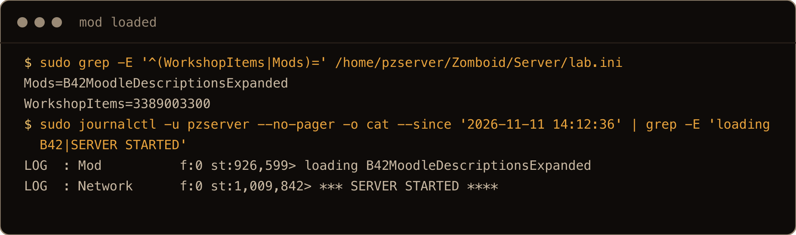

Two IDs I took from guides were wrong, and they failed in opposite ways:

| Mod | What happened |
| --- | --- |
| `2857548524`, listed as `tsarslib` | It's a Build 41 mod. The server logged `required mod "tsarslib" not found` and started without it. |
| `2875848298`, Common Sense (last updated March 7, 2025) | `World loading could not proceed, there are script load errors.` then `Server Terminated.` The process stayed up. See step 8. |

## 8. Hang check

After `Server Terminated.` from a broken mod, the process didn't exit. Minutes later it still held about 7 GB of memory with no game ports open, and systemd showed `active (running)`. `Restart=always` can't help, because nothing exited.

So check the game port. `/usr/local/bin/pz-health` restarts the service if it has been up 10 minutes and UDP 16261 still isn't open:

```bash
#!/bin/bash
# Restart the server if systemd says it is running but the game port is not open.
# Startup takes 2 to 3 minutes, so give it 10 minutes before judging.
set -u
systemctl is-active --quiet pzserver || exit 0
started=$(systemctl show -p ActiveEnterTimestampMonotonic --value pzserver)
now=$(cut -d' ' -f1 /proc/uptime | cut -d. -f1)
up=$(( now - started / 1000000 ))
[ "$up" -lt 600 ] && exit 0
if ! ss -Hulpn 'sport = :16261' | grep -q .; then
    echo "pzserver up ${up}s but UDP 16261 is not open, restarting"
    systemctl restart pzserver
fi
```

`/etc/systemd/system/pz-health.service`:

```ini
[Unit]
Description=Restart Project Zomboid if its game port is closed

[Service]
Type=oneshot
ExecStart=/usr/local/bin/pz-health
```

`/etc/systemd/system/pz-health.timer`:

```ini
[Unit]
Description=Check the Project Zomboid server every 5 minutes

[Timer]
OnBootSec=10min
OnUnitActiveSec=5min

[Install]
WantedBy=timers.target
```

```bash
sudo chmod 755 /usr/local/bin/pz-health
sudo systemctl daemon-reload
sudo systemctl enable --now pz-health.timer
```

With the broken mod in place it fired:

```text
pzserver up 601s but UDP 16261 is not open, restarting
```

On a healthy server it prints nothing and exits 0. A restart won't fix a broken mod, so add a notification next to the restart (email, a chat webhook) and remove the mod.

## 9. Backups and restore

The server zips the world into `/home/pzserver/Zomboid/backups/startup/` on every start and keeps 5. They're on the same disk and rotate on each restart, so keep your own copy too. These three folders are everything:

| Folder | Contents |
| --- | --- |
| `/home/pzserver/Zomboid/Saves/Multiplayer/lab` | the world |
| `/home/pzserver/Zomboid/db` | player accounts |
| `/home/pzserver/Zomboid/Server` | `lab.ini` (passwords, `ResetID`), sandbox and spawn settings |

`/usr/local/bin/pz-backup` stops the server, backs up with restic and starts it again:

```bash
#!/bin/bash
# Stop the server, back up the world with restic, start it again.
# usage: pz-backup [pre-update]   (pre-update snapshots are never pruned)
set -euo pipefail
export RESTIC_REPOSITORY=/srv/pz-restic
export RESTIC_PASSWORD_FILE=/root/.pz-restic-pass
Z=/home/pzserver/Zomboid
tags=(--tag pz)
[ "${1:-}" = pre-update ] && tags+=(--tag pre-update)

systemctl stop pzserver
trap 'systemctl start pzserver' EXIT

restic backup "${tags[@]}" "$Z/Saves/Multiplayer/lab" "$Z/db" "$Z/Server"
restic forget --tag pz --keep-tag pre-update --keep-daily 7 --keep-weekly 4 --prune
```

```bash
sudo apt install -y restic
sudo chmod 755 /usr/local/bin/pz-backup
head -c 32 /dev/urandom | base64 | sudo tee /root/.pz-restic-pass >/dev/null
sudo chmod 600 /root/.pz-restic-pass
sudo RESTIC_PASSWORD_FILE=/root/.pz-restic-pass restic init -r /srv/pz-restic
sudo pz-backup
```

```text
Files:          34 new,     0 changed,     0 unmodified
Added to the repository: 5.597 MiB (780.662 KiB stored)
snapshot 13f3a4d5 saved
```

The script took 12 to 16 seconds for a 5.6 MB world nobody had walked around. A played world is bigger and takes longer. A repository in `/srv` is for the test only: point `RESTIC_REPOSITORY` at object storage on a real server ([restic to object storage](/blog/backup-homelab-restic-object-storage/)) and keep a copy of the password file. The offsite repository is untested here.

Nightly, `/etc/systemd/system/pz-backup.service`:

```ini
[Unit]
Description=Back up the Project Zomboid world

[Service]
Type=oneshot
Environment=HOME=/root
ExecStart=/usr/local/bin/pz-backup
```

`/etc/systemd/system/pz-backup.timer`:

```ini
[Unit]
Description=Nightly Project Zomboid backup

[Timer]
OnCalendar=*-*-* 05:00:00
Persistent=true

[Install]
WantedBy=timers.target
```

```bash
sudo systemctl daemon-reload
sudo systemctl enable --now pz-backup.timer
sudo systemctl start pz-backup.service
```

The last line runs one backup now, so the server stops for about 12 seconds and starts again.

`Environment=HOME=/root` stops restic warning `unable to open cache: ... neither $XDG_CACHE_HOME nor $HOME are defined` on every run. The time is the server's timezone (UTC on a droplet); pick one when nobody plays.

**Restore drill.** Do this once on purpose:

```bash
sudo systemctl stop pzserver
sudo rm -rf /home/pzserver/Zomboid/Saves/Multiplayer/lab /home/pzserver/Zomboid/db /home/pzserver/Zomboid/Server
sudo RESTIC_REPOSITORY=/srv/pz-restic RESTIC_PASSWORD_FILE=/root/.pz-restic-pass \
    restic restore latest --tag pz --target /
sudo systemctl start pzserver
```

```text
Summary: Restored 51 files/dirs (5.579 MiB) in 0:00
```

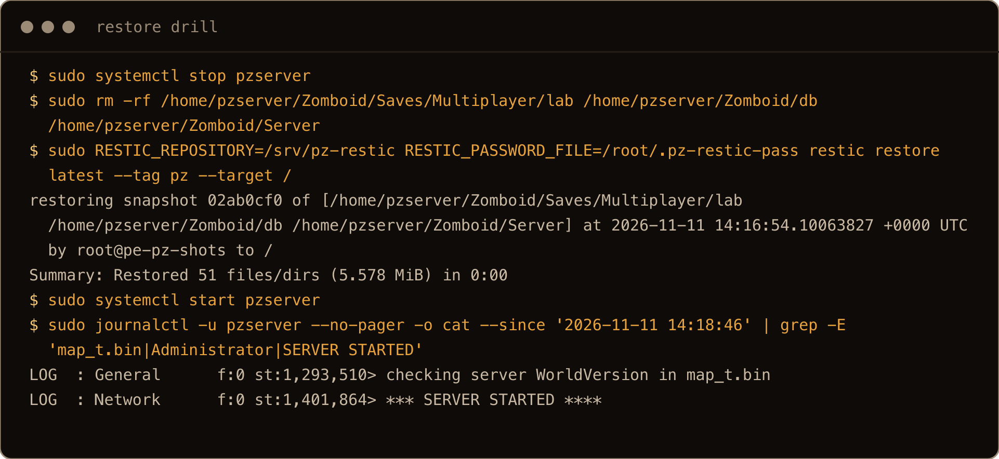

restic puts the files back as `pzserver`. On the first droplet every file's checksum matched except `lab.ini`, which the server had rewritten on a start after the backup. `ResetID` and `ServerPlayerID` matched. The log shows it loaded the existing world: a new one prints `map_t.bin does not exist` and creates the admin account again, the restored one didn't:

```text
checking server WorldVersion in map_t.bin
loading B42MoodleDescriptionsExpanded
*** SERVER STARTED ****
```

## 10. Update and rollback

Update with a tagged backup first. That snapshot is your rollback point:

```bash
sudo pz-backup pre-update
sudo systemctl stop pzserver
cd /opt/pzserver
sudo -u pzserver -H /usr/games/steamcmd +force_install_dir /opt/pzserver \
    +login anonymous +app_update 380870 -beta public validate +quit
sudo sed -i 's/-Xmx[0-9]*[gm]/-Xmx6g/' /opt/pzserver/ProjectZomboid64.json
grep Xmx /opt/pzserver/ProjectZomboid64.json
sudo systemctl start pzserver
```

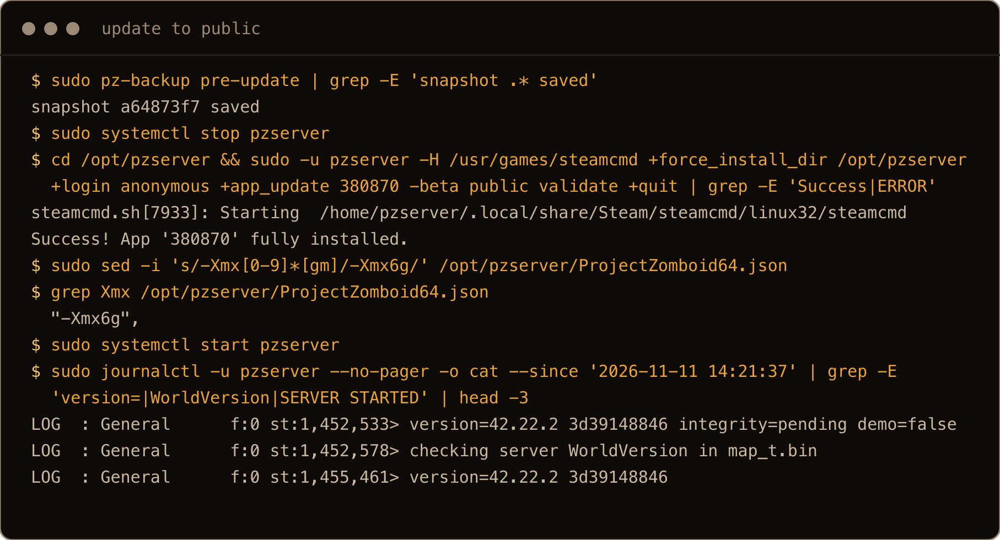

`pz-backup` starts the server on exit, so the `stop` right after it interrupts a start. Harmless in the tests, though the log shows a stack trace from the interrupted save. The `sed` sets the heap again in case `validate` reset it.

Installing the old branch on its own doesn't roll back. A 42.21 server refused a world 42.22 had saved, and restarted 26 times until I stopped it:

```text
The server savefile appears to be from a newer version of the game and cannot be loaded.
```

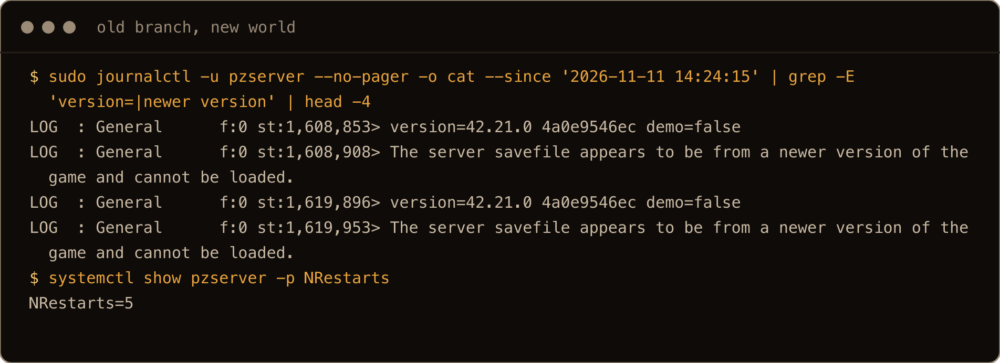

A rollback needs the old branch and the world from before the update. `/usr/local/bin/pz-rollback`:

```bash
#!/bin/bash
# Roll the server back to an older game branch AND the world snapshot taken before the update.
# usage: pz-rollback <branch> <restic-snapshot-id>
set -euo pipefail
branch=$1 snap=$2
export RESTIC_REPOSITORY=/srv/pz-restic
export RESTIC_PASSWORD_FILE=/root/.pz-restic-pass
Z=/home/pzserver/Zomboid

systemctl stop pzserver
rm -rf "$Z/Saves/Multiplayer/lab" "$Z/db" "$Z/Server"
restic restore "$snap" --target /
cd /opt/pzserver
sudo -u pzserver -H /usr/games/steamcmd +force_install_dir /opt/pzserver \
    +login anonymous +app_update 380870 -beta "$branch" validate +quit
# validate can put the heap back to the default -Xmx8g; set it again
sed -i 's/-Xmx[0-9]*[gm]/-Xmx6g/' /opt/pzserver/ProjectZomboid64.json
grep Xmx /opt/pzserver/ProjectZomboid64.json
systemctl start pzserver
```

```bash
sudo chmod 755 /usr/local/bin/pz-rollback
sudo restic -r /srv/pz-restic --password-file /root/.pz-restic-pass snapshots --compact
sudo pz-rollback 42.21 1b6d48cf
```

Use the ID of the snapshot tagged `pre-update` from the list.

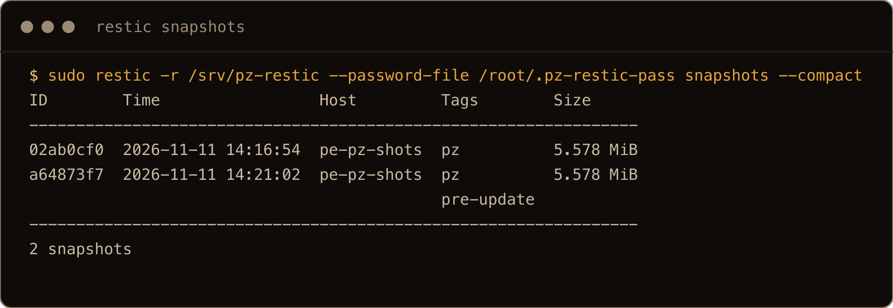

```text
Summary: Restored 51 files/dirs (5.579 MiB) in 0:00
Success! App '380870' fully installed.
```

```text
version=42.21.0 4a0e9546ec demo=false
checking server WorldVersion in map_t.bin
*** SERVER STARTED ****
```

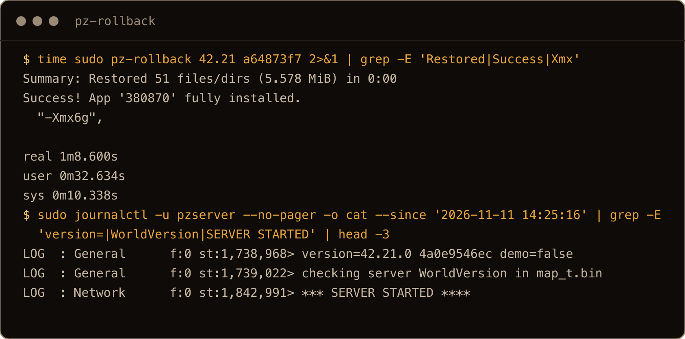

Tested both ways, 42.21 to `public` and back, on all three droplets, and once as a sudo user from their home folder. The script takes 43 to 69 seconds, then the usual start. You lose whatever was played after the snapshot, so take it right before the update.

Tag that snapshot, or a later backup the same day prunes it. `--keep-daily 7` keeps the newest snapshot of each day, plus the oldest while you have under 7 days of history (restic 0.18 calls it `oldest daily snapshot`). An untagged snapshot in between gets removed. Tagged ones stay until you `restic forget <id>` them.

## 11. Firewall

Players need UDP 16261 and 16262. RCON stays closed. More in [UFW firewall basics](/blog/ufw-firewall-basics-ubuntu/).

```bash
sudo ufw allow OpenSSH
sudo ufw allow 16261/udp
sudo ufw allow 16262/udp
sudo ufw enable
sudo ufw status
```

`ufw enable` asks `Command may disrupt existing ssh connections. Proceed with operation (y|n)?`. With OpenSSH allowed, answer `y`.

```text
Status: active

To                         Action      From
--                         ------      ----
OpenSSH                    ALLOW       Anywhere
16261/udp                  ALLOW       Anywhere
16262/udp                  ALLOW       Anywhere
OpenSSH (v6)               ALLOW       Anywhere (v6)
16261/udp (v6)             ALLOW       Anywhere (v6)
16262/udp (v6)             ALLOW       Anywhere (v6)
```

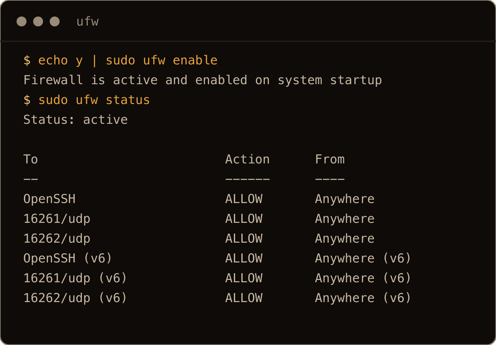

Open the same two UDP ports in your cloud provider's firewall if it has one. The log line `No UPnP-enabled Internet gateway found` is harmless on a VPS.

## Gotchas I hit

| Symptom | Cause | Fix |
| --- | --- | --- |
| `Out of memory: Killed process ... (ProjectZomboid6)` during startup | Default `-Xmx8g` on an 8 GB box | `-Xmx6g` or less; leave about 1 GiB plus the OS |
| OOM again after a `steamcmd ... validate` | `validate` reset the JSON to `-Xmx8g` | `sed` the heap after every `steamcmd` run |
| Server dead after a crash, `Result=success` | `start-server.sh` exits 0 | `Restart=always` |
| `Server Terminated.` but systemd says `active (running)` | Broken mod, process doesn't exit | Port check (step 8), remove the mod |
| `required mod "..." not found`, server starts anyway | Wrong mod ID or a Build 41 mod | Check the ID with the Steam API and `mod.info` |
| `The server savefile appears to be from a newer version` | Old branch, new world | Restore the snapshot from before the update along with the branch |
| Rollback snapshot gone | `--keep-daily` pruned it | Tag it, `--keep-tag pre-update` |
| `cd: /home/pzserver: Permission denied` | Home folder is `drwxr-x---` | Run `steamcmd` from `/opt/pzserver` |
| `ERROR! Failed to install app '380870' (Missing configuration)` | SteamCMD, first attempt | Run it again |
| No password on a new server (from the config; joining untested) | `Password=` empty, `Open=true` | Set `Password=` |

## Quick reference

| Job | Command |
| --- | --- |
| Install or update | `cd /opt/pzserver && sudo -u pzserver -H /usr/games/steamcmd +force_install_dir /opt/pzserver +login anonymous +app_update 380870 validate +quit`, then the heap `sed` from step 3 |
| List branches | `cd /opt/pzserver && sudo -u pzserver -H /usr/games/steamcmd +login anonymous +app_info_print 380870 +quit` |
| Heap | `-Xmx` in `/opt/pzserver/ProjectZomboid64.json` |
| Settings | `/home/pzserver/Zomboid/Server/<name>.ini` |
| Start, stop, logs | `sudo systemctl start pzserver`, `sudo systemctl stop pzserver`, `sudo journalctl -u pzserver -f` |
| Really up? | `ss -ulpn \| grep 16261` |
| Console command | `sudo pz-rcon save` |
| Back up | `sudo pz-backup` (before an update: `sudo pz-backup pre-update`) |
| Roll back | `sudo pz-rollback <branch> <snapshot>` |
| Ports | UDP 16261, 16262 open; TCP 27015 closed |

Rehearse the restore and the rollback on a box you can delete, then hand the IP to your group.

`[ WORLD SAVED ]`
