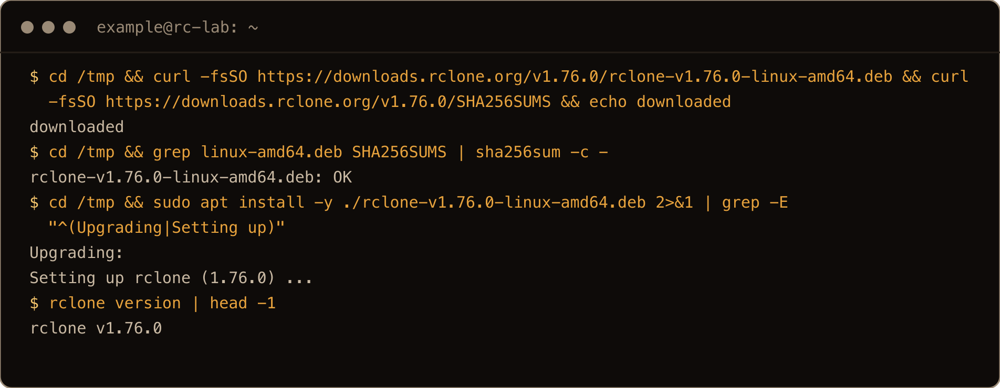
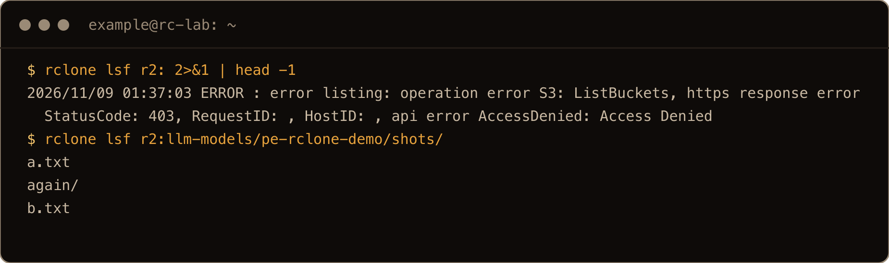
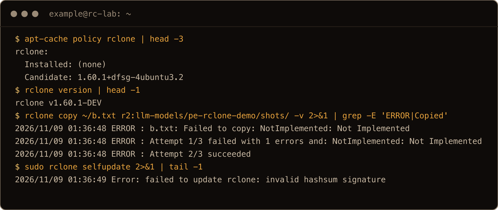

The prebuilt llama.cpp I run on rented GPUs comes out of my own Cloudflare R2 bucket, and so does the model. Moving files in and out of a bucket like that is rclone's job, so I set it up on a fresh 26.04 box and wrote down what broke.

R2 speaks the S3 API, and rclone has a Cloudflare provider built in, so the setup is one command. Two things trip people up anyway. A token that can only touch one bucket makes `rclone copy` fail with `AccessDenied` before a single byte moves, because rclone tries to create the bucket first. And the rclone in Ubuntu's archive is 1.60.1, which logs `NotImplemented` on every upload to R2 and only succeeds because it retries.

> **TL;DR.** Make an R2 token with **Object Read & Write**, scoped to the one bucket. Install rclone 1.76.0 from rclone's own `.deb`, not Ubuntu's 1.60.1. Create the remote with `provider=Cloudflare`, `region=auto` and `no_check_bucket=true`, and always put the bucket name in the path: `r2:my-bucket/folder`. `rclone lsf r2:` is denied with this token, and that's fine. Run every `sync` with `--dry-run` first. `rclone check` works on big multipart uploads because rclone stores its own MD5. Presigned links max out at one week, and rclone can't revoke them.

## Contents

- [What I tested on](#what-i-tested-on)
- [1. Make a token for one bucket](#1-make-a-token-for-one-bucket)
- [2. Install rclone 1.76, not Ubuntu's 1.60](#2-install-rclone-176-not-ubuntus-160)
- [3. Create the remote](#3-create-the-remote)
- ["CreateBucket ... AccessDenied" on the first copy](#createbucket--accessdenied-on-the-first-copy)
- ["rclone lsf r2:" is denied](#rclone-lsf-r2-is-denied)
- [4. Copy, then sync with --dry-run first](#4-copy-then-sync-with-dry-run-first)
- [5. Big files and rclone check](#5-big-files-and-rclone-check)
- [6. Share one file with rclone link](#6-share-one-file-with-rclone-link)
- ["NotImplemented: Not Implemented" with Ubuntu's rclone](#notimplemented-not-implemented-with-ubuntus-rclone)
- [Where things live](#where-things-live)
- [Gotchas I hit](#gotchas-i-hit)
- [Quick reference](#quick-reference)

## What I tested on

Fresh Ubuntu 26.04.1 servers on DigitalOcean (kernel 7.0.0-38), on 8 November 2026, as a sudo user called `example`. One box ran everything, first with Ubuntu's rclone 1.60.1 and then with rclone 1.76.0, a second box followed the finished post top to bottom, and a third did the screenshots. The R2 side was a real bucket of mine with an Object Read & Write token scoped to just that bucket. Everything I wrote went under one test folder, which I deleted at the end.

I didn't test an Admin token or the Cloudflare dashboard itself. The token steps below come from [Cloudflare's R2 token docs](https://developers.cloudflare.com/r2/api/tokens/).

## 1. Make a token for one bucket

Why one bucket? Because a leaked key should cost me one bucket, not the whole account.

In the Cloudflare dashboard, go to **R2**, then **Manage API tokens**, and create an **Account API token**. Pick **Object Read & Write** and **Apply to specific buckets only**, then choose your bucket. The last page shows three things you need:

- the **Access Key ID**
- the **Secret Access Key**, shown once, so copy it now
- the **S3 endpoint**, `https://<account-id>.r2.cloudflarestorage.com`

That token can read, write, list and delete objects in that bucket. It can't list your buckets, create one, or change bucket settings. [Cloudflare's docs](https://developers.cloudflare.com/r2/api/tokens/) say an **Admin Read & Write** token can, so it would make both errors below go away, but it opens up every bucket on the account. I didn't test one, and you shouldn't use one for this.

## 2. Install rclone 1.76, not Ubuntu's 1.60

`apt install rclone` gets you this:

```bash
apt-cache policy rclone
```

```text
rclone:
  Installed: (none)
  Candidate: 1.60.1+dfsg-4ubuntu3.2
```

1.60.1 is from 2022, and with R2 it logs an error on every upload ([details below](#notimplemented-not-implemented-with-ubuntus-rclone)). Install the current release from rclone's download site instead. They publish a `.deb` and a `SHA256SUMS` file next to it, so you can check the download before you install it:

```bash
cd /tmp
curl -fsSO https://downloads.rclone.org/v1.76.0/rclone-v1.76.0-linux-amd64.deb
curl -fsSO https://downloads.rclone.org/v1.76.0/SHA256SUMS
grep linux-amd64.deb SHA256SUMS | sha256sum -c -
sudo apt install -y ./rclone-v1.76.0-linux-amd64.deb
rclone version | head -1
```

```text
rclone-v1.76.0-linux-amd64.deb: OK
...
Setting up rclone (1.76.0) ...
rclone v1.76.0
```



*The screenshot box already had Ubuntu's 1.60.1 on it, so apt says Upgrading. Each command is prefixed with `cd /tmp &&`, and the apt output is cut down with `grep`.*

On an ARM box, use `linux-arm64` everywhere it says `amd64`. rclone also has a one line install script that you pipe into `sudo bash`. I used the `.deb` so I could check it first, and I didn't test the script.

If you already have Ubuntu's 1.60.1 installed, the same `apt install ./...deb` upgrades it in place. Its `rclone selfupdate` won't do it for you: on the box it failed with `Error: failed to update rclone: invalid hashsum signature`.

## 3. Create the remote

One command, no wizard. Put a space in front of it so it stays out of your shell history (Ubuntu's default `HISTCONTROL=ignoreboth` skips lines that start with a space):

```bash
 rclone config create r2 s3 \
  provider=Cloudflare \
  access_key_id=YOUR_ACCESS_KEY_ID \
  secret_access_key=YOUR_SECRET_ACCESS_KEY \
  endpoint=https://YOUR_ACCOUNT_ID.r2.cloudflarestorage.com \
  region=auto \
  no_check_bucket=true
```

- `provider=Cloudflare` tells rclone it's talking to R2, not AWS.
- `region=auto` is what R2 expects. Leaving it out also worked. A real AWS region like `eu-west-3` didn't: `api error BadRequest: Bad Request`.
- `no_check_bucket=true` is the line a scoped token needs. The next section shows why.
- No `acl` line. R2 accepted `--s3-acl public-read` without complaint, and the object still couldn't be fetched without a signature. Public access in R2 is a bucket setting, not an object ACL.

It prints the new config back, secret included, so don't run it with someone looking over your shoulder or a terminal being recorded. The config lands in `~/.config/rclone/rclone.conf`, mode `600`, with the secret in plain text. To show it without the keys:

```bash
rclone config redacted r2
```

```text
[r2]
type = s3
secret_access_key = XXX
endpoint = https://1149....r2.cloudflarestorage.com
region = auto
no_check_bucket = true
provider = Cloudflare
access_key_id = XXX
### Double check the config for sensitive info before posting publicly
```

Now list the bucket. With a scoped token, the bucket name always goes in the path:

```bash
rclone lsf r2:my-bucket/
```

A listing of anything, even an empty folder that prints nothing, with exit code 0 means the remote works.


*In the screenshots my keys come from environment variables, the bucket is my own `llm-models` with everything under `pe-rclone-demo/`, and the account ID is cut to its first four characters. `again/` and `b.txt` are left over from the 1.60.1 test further down, which ran first on this box.*

## "CreateBucket ... AccessDenied" on the first copy

Leave out `no_check_bucket=true`, which is easy to do if you build the config from an older example, and the first upload fails:

```text
NOTICE: Failed to copy: failed to prepare upload: operation error S3: CreateBucket, https response error StatusCode: 403, RequestID: , HostID: , api error AccessDenied: Access Denied
```

Before its first upload to a bucket, rclone makes sure the bucket exists by trying to create it. Your token isn't allowed to create buckets, so R2 says no, and rclone gives up. Listing worked a second earlier, which is what makes this one confusing. `rclone mkdir r2:my-bucket/photos` fails the same way, for the same reason.

The fix is the setting, on an existing remote:

```bash
rclone config update r2 no_check_bucket true
```

The next copy went straight through.


One catch: with `no_check_bucket` set, `rclone mkdir r2:some-new-bucket` exits 0 and creates nothing. Listing that "bucket" afterwards still gets `AccessDenied`. Make buckets in the dashboard.

Ubuntu's rclone 1.60.1 hits the same wall, but its error doesn't name the call. You just get `Failed to copy: AccessDenied: Access Denied`.

## "rclone lsf r2:" is denied

```bash
rclone lsf r2:
```

```text
ERROR : error listing: operation error S3: ListBuckets, https response error StatusCode: 403, RequestID: , HostID: , api error AccessDenied: Access Denied
```

`r2:` with nothing after it asks R2 for your list of buckets, and a scoped token can't see that. That's the token doing its job, not a broken config. `rclone lsf r2:my-bucket/` is the test that matters.



## 4. Copy, then sync with --dry-run first

`copy` only ever adds and updates. It never deletes anything at the destination:

```bash
rclone copy ~/photos r2:my-bucket/photos -v
```

`sync` makes the destination match the source, and that includes deleting files that aren't in the source anymore. Run it with `--dry-run` first, every time:

```bash
rclone sync ~/photos r2:my-bucket/photos --dry-run
```

On the box I synced three files, deleted one locally, and dry-ran the sync again:

```text
NOTICE: img2.jpg: Skipped delete as --dry-run is set (size 8)
Deleted:                1 (files), 0 (dirs), 8 B (freed)
```

That's the line to read before you drop `--dry-run`. Point `sync` at an empty folder by mistake and the dry run lists every file at the destination as a delete. A folder that doesn't exist at all is safer: it stops with `Failed to sync: directory not found`. `rclone delete` takes `--dry-run` too.


*The screenshot runs each command through `grep` to keep the summary lines.*

And `sync` isn't a backup. Like I said about rsync in my [restic post](/blog/backup-homelab-restic-object-storage/), it's a file copy: no history, and it'll happily copy your mistakes over the good version. For backups with history, that post is the one.

## 5. Big files and rclone check

Anything over 200 MiB goes up as a multipart upload. I sent a 300 MiB file of random data:

```bash
rclone copy ~/bigdir r2:my-bucket/bigdir -v
```

```text
INFO  : big.bin: Multi-thread Copied (new)
```

It took 13 to 14 seconds from a DigitalOcean box. To prove it arrived intact:

```bash
rclone check ~/bigdir r2:my-bucket/bigdir
```

```text
NOTICE: S3 bucket my-bucket path bigdir: 0 differences found
NOTICE: S3 bucket my-bucket path bigdir: 1 matching files
```

That works on a multipart file because of something rclone does on upload. The ETag R2 gives a multipart object isn't an MD5 of the file. Mine was `"d9e5...-60"`, the `-60` being the number of parts. So rclone works out the MD5 itself and stores it on the object as `X-Amz-Meta-Md5chksum`, and `check` compares against that. I changed one byte of my local copy and ran it again: `1 differences found`.


*From the screenshot box, so the ETag and the timing differ from the text.*

The catch is that only rclone writes that header. For big files uploaded by something else, rclone has no MD5 to compare, so use `rclone check --download`, which reads the whole file back. That took about 8 seconds for my 300 MiB.

## 6. Share one file with rclone link

```bash
rclone link r2:my-bucket/b.txt --expire 1h
```

That prints a presigned URL. Anyone with it can download that one file until it expires: `curl` on it got a `200`, while the same path without the signature got a `400`. Two limits worth knowing:

- **One week, maximum.** `--expire 8d` printed `Reducing expiry to 1w as 1.1428571428571428w is greater than the max time allowed`.
- **No taking it back.** `rclone link --unlink` didn't revoke anything. It printed a fresh link, valid for a week.

A presigned URL stays valid until it expires. Deleting the file or rolling the token should kill it early, but I didn't test either.


*The credential and signature in the printed link are cut. The screenshot links `a.txt` and trims the output with `grep -o`.*

## "NotImplemented: Not Implemented" with Ubuntu's rclone

With Ubuntu's 1.60.1 and a correct config, every upload logged this, and then claimed success:

```text
ERROR : b.txt: Failed to copy: NotImplemented: Not Implemented
	status code: 501, request id: , host id: 
ERROR : Attempt 1/3 failed with 1 errors and: NotImplemented: Not Implemented
	status code: 501, request id: , host id: 
ERROR : Attempt 2/3 succeeded
```

`--dump headers` shows what's going on. The upload itself works. Right after it, 1.60.1 checks the new object with a `HEAD ...?versionId=...` request, and R2 answers `501 Not Implemented`. rclone counts that as a failed copy and starts the whole run again. On the second pass the file is already there, so it "succeeds".

It still costs you:

- With `--retries 1`, the run exits 1 with `Failed to copy`, even though the file is in the bucket.
- A `sync` logs `not deleting files as there were IO errors` on its first pass, so every sync runs twice.
- Your logs and any alerting on `ERROR` fill up with noise.

`--s3-no-head` makes 1.60.1 skip that check, and the error goes away. Installing 1.76.0 fixes it properly.



*From the screenshot box, where this ran before the 1.76.0 install. The `--retries 1` and `--s3-no-head` runs come from my first box.*

## Where things live

| Path | What |
| --- | --- |
| `/usr/bin/rclone` | The binary, from the `.deb` |
| `~/.config/rclone/rclone.conf` | Your remotes, mode `600`, keys in plain text |
| `https://<account-id>.r2.cloudflarestorage.com` | The S3 endpoint for every bucket on the account |

## Gotchas I hit

- **Ubuntu's rclone is 1.60.1.** Every upload to R2 logs `NotImplemented` and is retried. Use the 1.76.0 `.deb`.
- **`CreateBucket ... AccessDenied` on the first copy** with a scoped token means `no_check_bucket` isn't set.
- **`rclone lsf r2:` is denied** with a scoped token. List `r2:my-bucket/` instead.
- **`rclone mkdir` of a new bucket "works"** with `no_check_bucket` set, and creates nothing.
- **`sync` deletes.** Dry run first, read the `Skipped delete` lines.
- **`selfupdate` on 1.60.1 fails** with `invalid hashsum signature`.
- **rclone can't revoke a presigned link**, and links max out at a week.
- **`rclone purge` logs an error with a scoped token.** Cleaning up my test folder (with rclone 1.75.2 on my Mac) printed `Failed to read versioning status, assuming unversioned: operation error S3: GetBucketVersioning ... AccessDenied`, then deleted the folder anyway. Same cause: that's a bucket setting the token can't read.

## Quick reference

```bash
# install (check the .deb first)
cd /tmp
curl -fsSO https://downloads.rclone.org/v1.76.0/rclone-v1.76.0-linux-amd64.deb
curl -fsSO https://downloads.rclone.org/v1.76.0/SHA256SUMS
grep linux-amd64.deb SHA256SUMS | sha256sum -c -
sudo apt install -y ./rclone-v1.76.0-linux-amd64.deb

# remote for a token scoped to one bucket (leading space keeps it out of history)
 rclone config create r2 s3 provider=Cloudflare \
  access_key_id=KEY secret_access_key=SECRET \
  endpoint=https://ACCOUNT_ID.r2.cloudflarestorage.com \
  region=auto no_check_bucket=true

# always name the bucket
rclone lsf r2:my-bucket/
rclone copy ~/photos r2:my-bucket/photos -v
rclone sync ~/photos r2:my-bucket/photos --dry-run
rclone check ~/photos r2:my-bucket/photos
rclone link r2:my-bucket/file.txt --expire 1h
```

Scope the token to one bucket, set `no_check_bucket`, and dry run every sync. The rest is plain rclone.
