Ubuntu 26.10, "Stonking Stingray", came out on Thursday. The announcements lead with GNOME 51, a speech to text preview and the App Center. That's nice if you have a screen. A server needs a different list: what breaks my scripts, what changed under my config files, and what do I give up by leaving 26.04 LTS.

So I put a patched 26.04.1 server next to a 26.10 server and ran the same commands on both. This is what was different, what to do about it, and the few release note items I didn't test.

Where is it going for me? It's going to be the standard OS for my test environment, and I'll install it on my own production servers.

One caveat up front. Hetzner has no 26.10 image yet. My 26.10 box is a 26.04 server I [upgraded on release day](/blog/upgrade-ubuntu-26-04-to-26-10/) and snapshotted, not a fresh install. Where that matters (OpenSSH, mostly), I say so.

> **TL;DR.** 26.10 is supported until July 2027, with no Livepatch or ESM. `cp`, `mv` and `rm` are now Rust (uutils 0.12.0) like the rest of coreutils. Going back to GNU needs `sudo apt install coreutils-from-gnu coreutils-from-uutils- --allow-remove-essential`. Scripts in `/etc/init.d` and `/etc/rc.local` no longer run, and nothing tells you, so turn them into systemd units before you upgrade. D-Bus is `dbus-broker`, OpenSSL is 4.0 with no `openssl engine`, and apt checks signatures with Sequoia's `sqv`. The firewall, listening ports and SSH key exchange defaults are the same as 26.04.

## Contents

- [Side by side](#side-by-side)
- [1. Nine months, and no Ubuntu Pro](#1-nine-months-and-no-ubuntu-pro)
- [2. Every core command is Rust now](#2-every-core-command-is-rust-now)
- [3. init.d scripts and rc.local stop running](#3-initd-scripts-and-rclocal-stop-running)
- [4. dbus-broker replaces dbus-daemon](#4-dbus-broker-replaces-dbus-daemon)
- [5. OpenSSH 10.5 and the GSSAPI split](#5-openssh-105-and-the-gssapi-split)
- [6. OpenSSL 4 has no engines](#6-openssl-4-has-no-engines)
- [7. apt verifies with Sequoia](#7-apt-verifies-with-sequoia)
- [8. A new timer: upki-fetch](#8-a-new-timer-upki-fetch)
- [9. Server packages with new defaults](#9-server-packages-with-new-defaults)
- [10. What did not change](#10-what-did-not-change)
- [11. Getting 26.10 this week](#11-getting-2610-this-week)
- [Gotchas I hit](#gotchas-i-hit)
- [Quick reference](#quick-reference)

## Side by side

Both servers were Hetzner cx23 boxes (2 vCPU, 4 GB). The 26.04 one was the stock image after `apt full-upgrade` and a reboot. So these are today's 26.04.1 versions, not April's.

| | 26.04.1 LTS | 26.10 |
| --- | --- | --- |
| Kernel | `7.0.0-38-generic` | `7.3.0-9-generic` |
| systemd | 259 | 261 |
| SysV and `rc.local` | generated into units | ignored |
| coreutils | `ls` is uutils 0.10.0; `cp`, `mv`, `rm` are GNU 9.7 | all uutils 0.12.0 |
| sudo | `sudo-rs` 0.2.13 | `sudo-rs` 0.2.14 |
| D-Bus | `dbus-daemon` 1.16.2 | `dbus-broker` 37 |
| OpenSSH | 10.2p1 | 10.5p1 |
| OpenSSL | 3.5.5 | 4.0.3 |
| Python | 3.14.4 | 3.14.8 |
| apt | 3.2.0, verifies with `gpgv` | 3.3.3, verifies with `sqv` |
| cloud-init | 26.1 | 26.2 |
| Support | 2031, ESM to 2036, Livepatch available | July 2027, no Pro services |
| Listening | `sshd` on 22, DNS and chrony on loopback | same (minus the DHCP client socket) |

The release notes say Python 3.14.7. The box had 3.14.8, so an update has already landed.

## 1. Nine months, and no Ubuntu Pro

This is the trade you make for running 26.10 on a server: nine months of support and no Ubuntu Pro. On the 26.04 box:

```text
$ pro security-status | grep -A5 'receiving security'
WARNING: this output is intended to be human readable, and subject to change.
In scripts, prefer using machine readable data from the `pro api` command,
or use `pro security-status --format json`.

This machine is receiving security patching for Ubuntu Main/Restricted
repository until 2031.
This machine is NOT attached to an Ubuntu Pro subscription.

Ubuntu Pro with 'esm-infra' enabled provides security updates for
Main/Restricted packages until 2036.
```

The `WARNING` goes to stderr, so it shows up whenever you pipe `pro`.

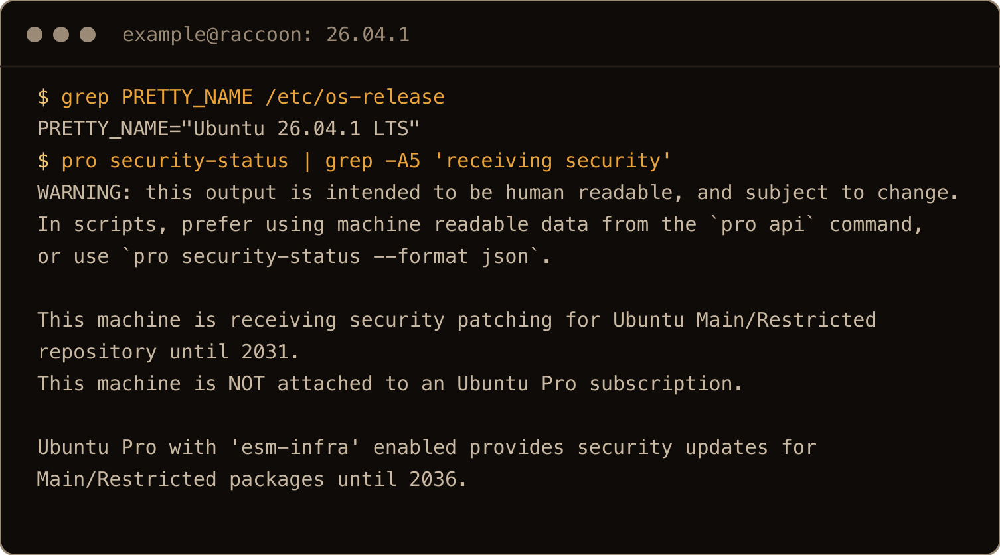

The screenshots come from a final clean run on fresh boxes (the 26.10 one built from my upgraded snapshot) as a user called `example`, so their times differ from the text blocks.

On 26.10:

```text
$ pro security-status | tail -3
WARNING: this output is intended to be human readable, and subject to change.
In scripts, prefer using machine readable data from the `pro api` command,
or use `pro security-status --format json`.

Main/Restricted packages receive updates until 7/2027.

Ubuntu Pro is not available for non-LTS releases.
```

`pro status` on 26.10 says `No Ubuntu Pro services are available to this system.`

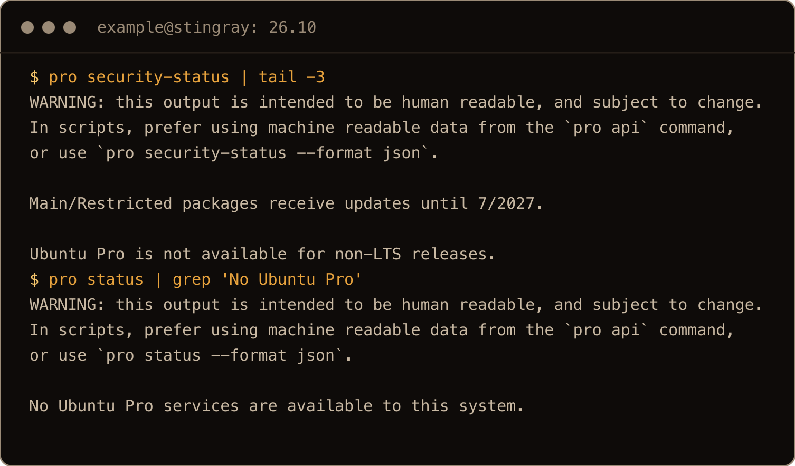

No Livepatch means a kernel fix only counts after a reboot. That's why my [26.10 hardening pass](/blog/hardening-ubuntu-26-10-server/#4-automatic-updates-with-a-reboot-window) sets an automatic reboot window. And July 2027 is a hard date. By then you need to be on 27.04, which gets its own nine months.

## 2. Every core command is Rust now

26.04 already took most of coreutils from the Rust rewrite, uutils. It kept GNU for `cp`, `mv` and `rm`. 26.10 finishes the job:

```text
$ ls --version | head -1
ls (uutils coreutils) 0.12.0
$ cp --version | head -1; rm --version | head -1; mv --version | head -1
cp (uutils coreutils) 0.12.0
rm (uutils coreutils) 0.12.0
mv (uutils coreutils) 0.12.0
```

On 26.04.1 those three still said `(GNU coreutils) 9.7`. GNU hasn't gone anywhere. The `gnu-coreutils` 9.10 package is installed with every command prefixed, so `gnuls --version` says `ls (GNU coreutils) 9.10`. `findutils` and `diffutils` are still GNU.

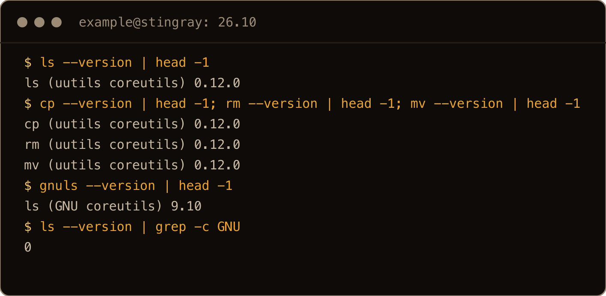

The quiet breakage is a script that checks for GNU to pick its flags:

```text
$ ls --version | grep -c GNU
0
```

That script now takes its "not GNU" branch. Usually that means BSD flags, and those fail in new and confusing ways.

Has the switch broken anything of mine? Not that I know of. I think it's perfectly fine.

If you need GNU back, the obvious command fails:

```text
$ sudo apt-get install coreutils-from-gnu
The following packages have unmet dependencies:
 coreutils-from-gnu : Conflicts: coreutils-from
 coreutils-from-uutils : Conflicts: coreutils-from
E: Unable to satisfy dependencies. Reached two conflicting assignments:
   1. coreutils-from-gnu:amd64=2ubuntu1 is selected for install
   2. coreutils-from-gnu:amd64=2ubuntu1 is not selected for install because:
      1. coreutils-from-uutils:amd64 is selected for install
      2. coreutils-from-uutils:amd64 Conflicts coreutils-from
         [selected coreutils-from-uutils:amd64]
```

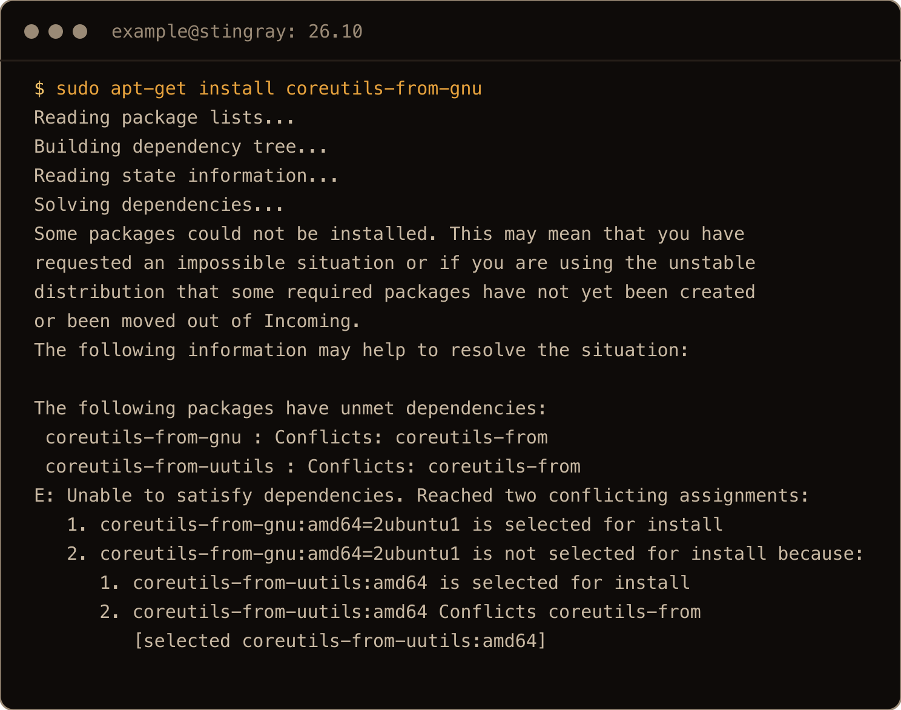

`coreutils-from-uutils` is a protected package. Adding `--allow-remove-essential` on its own failed the same way. You have to name the removal too. That's the command on Ubuntu's [system utility replacements](https://ubuntu.com/server/docs/reference/other-tools/sudo-rs/) page:

```bash
sudo apt install coreutils-from-gnu coreutils-from-uutils- --allow-remove-essential
```

apt prints `WARNING: The following essential packages will be removed.` Then dpkg says `this is a protected package; it should not be removed` 15 times. Both are expected here. Afterwards `ls --version` and `cp --version` say `(GNU coreutils) 9.10`. To go back:

```bash
sudo apt install coreutils-from-uutils coreutils-from-gnu- --allow-remove-essential
```

I ran both directions on the 26.10 box. Both worked; only the switch to GNU warns.

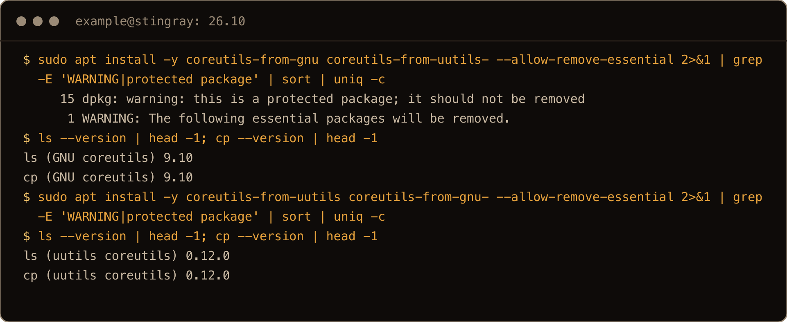

In the screenshot I added `-y`, `2>&1` and a `grep | sort | uniq -c` to both commands to count the warnings instead of printing the whole apt and dpkg log. Going back to uutils printed neither warning.

## 3. init.d scripts and rc.local stop running

The release notes say `systemd-sysv-generator` has been removed. In practice that's worse than it sounds, because nothing fails loudly. I put a minimal init script in `/etc/init.d` on both servers and ran `systemctl daemon-reload`. On 26.04:

```text
$ systemctl status hello-sysv
○ hello-sysv.service
     Loaded: loaded (/etc/init.d/hello-sysv; generated)
     Active: inactive (dead)
       Docs: man:systemd-sysv-generator(8)
```

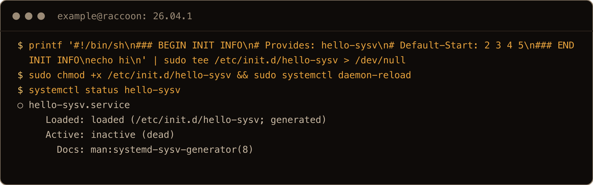

On 26.10:

```text
$ systemctl status hello-sysv
Unit hello-sysv.service could not be found.
```

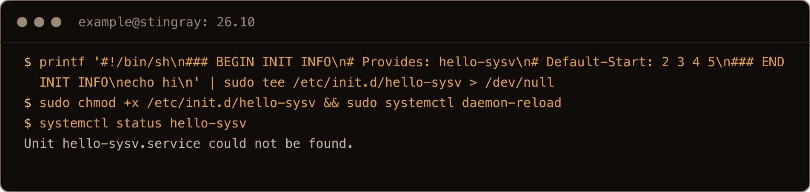

`rc.local` went the same way, and the release notes don't say so. 26.04 ships `systemd-rc-local-generator`. 26.10 doesn't. I made an executable `/etc/rc.local` that writes a file to `/run` and rebooted. The file wasn't there, and `systemctl status rc-local.service` said `Unit rc-local.service could not be found.`

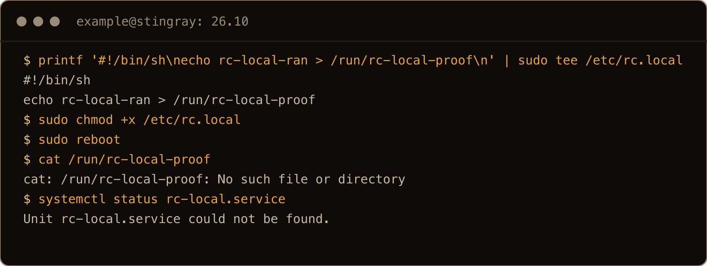

Ubuntu's own packages have moved to systemd units already. The scripts at risk are yours: a vendor agent from years ago, the `iptables-restore` line in `rc.local`, whatever someone left in `/etc/init.d`. They don't error after the upgrade. They just don't run, and you find out when the thing they did isn't done. Look before you upgrade:

```bash
ls /etc/init.d/
ls -l /etc/rc.local 2>/dev/null
```

Some files in `/etc/init.d` belong to packages that also ship a unit, and those are fine. 26.10 still has `ssh`, `cron` and friends in there. For anything without a unit, a oneshot service does what `rc.local` did:

```bash
sudo tee /etc/systemd/system/local-boot.service <<'EOF'
[Unit]
Description=Commands that used to live in rc.local
After=network-online.target
Wants=network-online.target

[Service]
Type=oneshot
ExecStart=/usr/local/sbin/local-boot.sh
RemainAfterExit=yes

[Install]
WantedBy=multi-user.target
EOF
sudo systemctl daemon-reload
sudo systemctl enable local-boot.service
```

Move the old commands into `/usr/local/sbin/local-boot.sh` and make it executable. I tested this on 26.10 with a script that writes a file to `/run`. After a reboot the file was there and the unit showed `active (exited)`.


The screenshot starts after the `tee` that wrote the unit, which is the same command as above.

Do I have any of these myself? Nope. I don't use init.d; I usually have systemd services.

## 4. dbus-broker replaces dbus-daemon

```text
$ systemctl status dbus --no-pager | head -2
● dbus-broker.service - D-Bus System Message Bus
     Loaded: loaded (/usr/lib/systemd/system/dbus-broker.service; enabled; preset: enabled)
```

Ask for `dbus` and you get `dbus-broker`, because `/etc/systemd/system/dbus.service` now links to it. The upgrade switched my server over and left the old `dbus-daemon` package installed but not running. On most servers you won't notice. You will if something refers to `dbus-daemon` by name: a monitoring check for the process, a policy that matches its binary, a tool that parses its log lines.

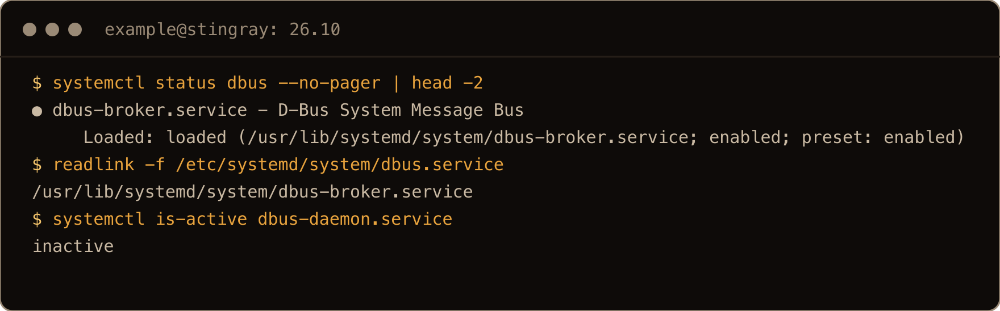

## 5. OpenSSH 10.5 and the GSSAPI split

OpenSSH goes from 10.2p1 to 10.5p1. Ubuntu also split it into two builds. The normal packages have no GSSAPI or Kerberos support, and a separate `-gssapi` set does. Per the [release notes](https://documentation.ubuntu.com/release-notes/26.10/), fresh installs get the plain build. The upgrader picks the GSSAPI one when it finds signs you use it.

On my upgraded box it picked GSSAPI for the client only. The upgrader's [detection code](https://git.launchpad.net/ubuntu-release-upgrader/tree/DistUpgrade/DistUpgradeOpenSSH.py) switches a package if any uncommented `GSSAPI` option is in its config, because the plain build can't parse one. For the server it also looks for `Kerberos` options and a host principal in `/etc/krb5.keytab`. Ubuntu's own `/etc/ssh/ssh_config` has an uncommented `GSSAPIAuthentication yes`, on 26.04 too. So a stock 26.04 server comes out of the upgrade with the GSSAPI client:

```text
$ dpkg -l | grep openssh | awk '{print $1,$2,$3}'
rc openssh-client 1:10.2p1-2ubuntu3.7
ii openssh-client-gssapi 1:10.5p1-1ubuntu3
ii openssh-common 1:10.5p1-1ubuntu2
ii openssh-server 1:10.5p1-1ubuntu2
ii openssh-sftp-server 1:10.5p1-1ubuntu2
```

Don't purge that `rc` line. The release notes warn it can cost you remote access until LP: #2169738 is fixed. My [upgrade post](/blog/upgrade-ubuntu-26-04-to-26-10/#8-leave-openssh-client-in-rc-alone) has the details.

The server is the plain build, and `sshd -T` shows it. On 26.04 it lists six `gssapi` options. On 26.10 it lists none. The rest come out in CamelCase (`PasswordAuthentication yes`, not `passwordauthentication yes`), so `grep` needs `-i`. If your servers take Kerberos logins, install `openssh-server-gssapi` on purpose. I didn't test the Kerberos side.

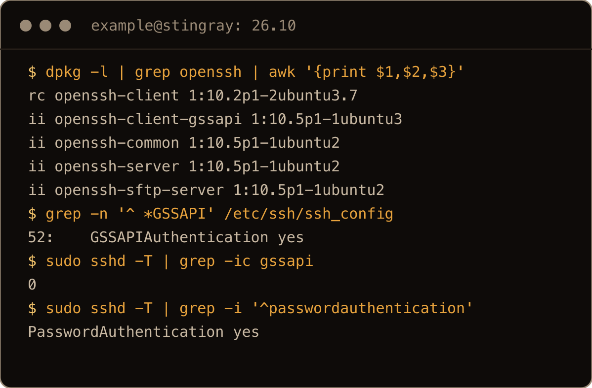

The key exchange defaults didn't change. Both releases put the post quantum hybrid first:

```text
KexAlgorithms mlkem768x25519-sha256,sntrup761x25519-sha512,sntrup761x25519-sha512@openssh.com,curve25519-sha256,...
```

The only difference: `ssh -Q kex` on 26.10 also knows `mlkem768nistp256-sha256`. It isn't in the default list.

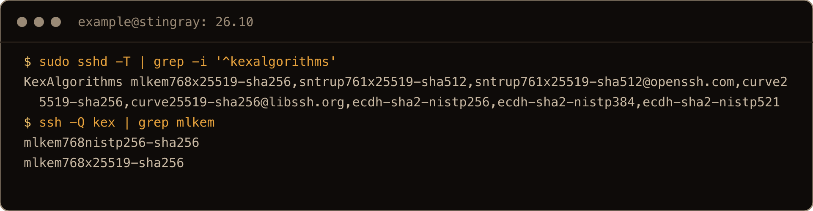

## 6. OpenSSL 4 has no engines

```text
$ openssl version
OpenSSL 4.0.3 29 Sep 2026 (Library: OpenSSL 4.0.3 29 Sep 2026)
$ openssl engine
Invalid command 'engine'; type "help" for a list.
```

On 26.04 the same command printed `(dynamic) Dynamic engine loading support`. OpenSSL 4 has no engines. The release notes call out the PKCS#11 engine: config that loads `pkcs11` as an engine has to move to the PKCS#11 provider. If you keep keys in an HSM or on a smart card and your `openssl.cnf` has an `engines` section, check that file before you upgrade. No engine, nothing to do. Apache, PHP, Squid and friends were rebuilt against OpenSSL 4 for you.

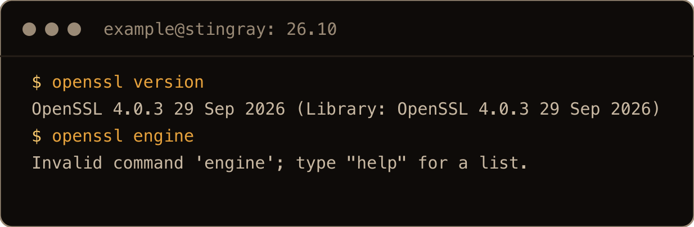

## 7. apt verifies with Sequoia

26.10 installs `sqv`, the signature checker from Sequoia PGP, and apt uses it. With apt's worker debugging on, every `InRelease` on 26.10 went through the `sqv` method. On 26.04 all four went through `gpgv`. Clear the cached `InRelease` files first, or apt has nothing new to verify:

```bash
sudo rm -f /var/lib/apt/lists/*InRelease
sudo apt-get -o Debug::pkgAcquire::Worker=1 update 2>&1 | grep -oE '(sqv|gpgv):201%20URI%20Done' | sort | uniq -c
```

```text
      4 sqv:201%20URI%20Done
```

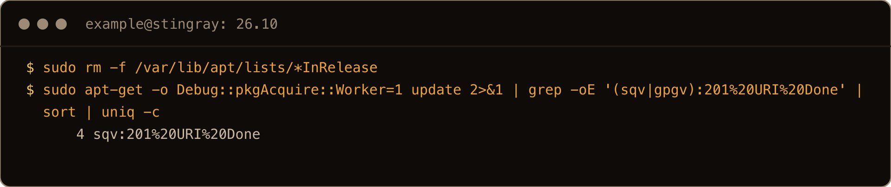

Coverage of the release, and Canonical's [announcement](https://canonical.com/blog/canonical-releases-ubuntu-26-10-stonking-stingray), talk about post quantum package signing. On the day I checked, the archive was still signed the old way. The `stonking` `InRelease` from 15 October carries one signature, RSA 4096, from the 2018 archive key. So for now the new part is the verifier, not the signature.

Where this can bite is third party repos. Sequoia's policy file, `/usr/share/apt/default-sequoia.config`, sets cutoff dates for weak algorithms. DSA keys passed theirs on 2024-02-01, and `rsa2048` lasts until 2030-02-01. A vendor repo still signed with a DSA key should be refused. I didn't have one to test. Docker's and Tailscale's repos verified fine on 26.10 in my [upgrade post](/blog/upgrade-ubuntu-26-04-to-26-10/#7-turn-your-vendor-repos-back-on).

## 8. A new timer: upki-fetch

`systemctl list-timers` on 26.10 has a newcomer:

```text
$ systemctl list-timers upki-fetch.timer --no-pager
NEXT                        LEFT LAST                        PASSED UNIT             ACTIVATES
Sun 2026-10-18 13:04:43 UTC 9min Thu 2026-10-15 17:00:58 UTC      - upki-fetch.timer upki-fetch.service

1 timers listed.
Pass --all to see loaded but inactive timers, too.
```

It comes from the `upki` package. `apt-cache show` says it fetches "CRLite revocations", a compact list of revoked TLS certificates. It runs every six hours as its own `upki` user, in a unit with the usual sandboxing. Nobody asks for it. `libcurl4t64` depends on `libupki-openssl1`, which depends on `upki`, so anything with curl brings it along. I didn't measure how much it downloads. If your servers sit behind an egress allowlist, expect a new outbound fetch every six hours and check where it goes.

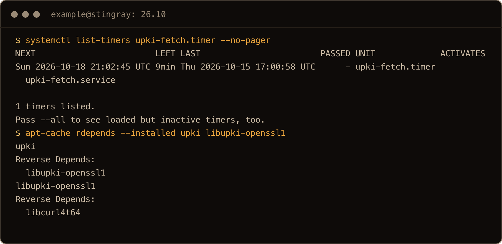

## 9. Server packages with new defaults

The release notes list a lot of server package bumps. These are the ones with changed defaults. I tested the first two.

**Postfix 3.11.7** defaults to `cdb` maps, and `hash:` now warns:

```text
$ postconf default_database_type
default_database_type = cdb
$ sudo postmap hash:/etc/postfix/access_test
postmap: warning: /etc/postfix/access_test: hash/btree support is deprecated.  Please switch to cdb or lmdb.
postmap: warning: See /usr/share/doc/postfix/NON_BERKELEYDB_README.gz for more info.
```

It still builds the `.db` file and exits 0, so nothing breaks today. The fix is to change `hash:` to `cdb:` in `main.cf` and run `postmap` again.

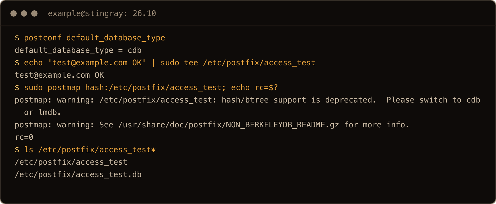

In the screenshot I created the test map first and added `echo rc=$?` to show the exit code.

**HAProxy 3.4.2**, up from 3.2. The stock `haproxy.cfg` has no `balance` line, so the new default applies. Per the release notes that's `random` (power of two choices) instead of `roundrobin`. `cpu-policy performance` and `option abortonclose` on HTTP backends are new defaults too. If you rely on round robin, write `balance roundrobin` explicitly.

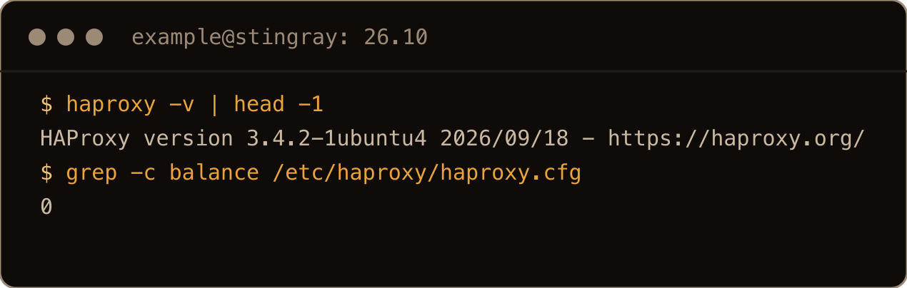

From the release notes only, not tested:

- MySQL goes from 8.4 LTS to 9.7 LTS. Back up first, and test the dump.
- PHP-FPM's systemd unit drops `PrivateTmp` and no longer creates a PID file.
- libvirt drops group based socket access in favour of polkit.
- `ssl-cert` makes 3072 bit keys instead of 2048 for new snakeoil certificates.

## 10. What did not change

On both releases:

- only `sshd` accepts connections on a public port; `systemd-resolved` and chrony stay on loopback;
- `ufw` 0.36.2 is installed and inactive;
- `sshd` allows password logins and X11 forwarding by default, so the [hardening steps](/blog/hardening-ubuntu-26-10-server/) still apply;
- `sudo` is `sudo-rs` (one point release newer), with the original `sudo` package still installed beside it;
- the default SSH key exchange list is identical.

## 11. Getting 26.10 this week

On 18 October Ubuntu still hadn't opened the normal upgrade path. The list at `changelogs.ubuntu.com/meta-release` had no `Dist: stonking` entry. A stock 26.04 has `Prompt=lts` and won't offer 26.10 at all. Once you set `Prompt=normal`, plain `do-release-upgrade` says `No new release found.` and you need `-d`. My [26.04 to 26.10 upgrade post](/blog/upgrade-ubuntu-26-04-to-26-10/) walks through it, including the vendor repos the upgrader turns off.

Hetzner has no 26.10 image. Its Ubuntu mirror returned 404 for `dists/stonking/Release` the same day, which is why an upgraded Hetzner box points at `archive.ubuntu.com`. Elsewhere, `ubuntu-26.10-live-server-amd64.iso` is on [releases.ubuntu.com/26.10](https://releases.ubuntu.com/26.10/) as usual. If you run Tailscale, it has no `stonking` repo yet; [here's the workaround](/blog/install-tailscale-ubuntu-26-10/).

## Gotchas I hit

- `apt install coreutils-from-gnu` fails. It needs `coreutils-from-uutils-` and `--allow-remove-essential` in the same command.
- `ls --version | grep GNU` finds nothing, so scripts that test for GNU take the wrong branch.
- Scripts in `/etc/init.d` and `/etc/rc.local` don't run on 26.10, and nothing tells you.
- The upgrader installed `openssh-client-gssapi` because of a line in Ubuntu's own `ssh_config`, and left `openssh-client` in `rc`. Don't purge it.
- `sshd -T` prints CamelCase and no GSSAPI options. Grep with `-i`.
- `openssl engine` is gone. PKCS#11 engine config needs the provider instead.
- `upki-fetch.timer` makes an outbound fetch every six hours.
- No Livepatch, no ESM, and support ends July 2027.

## Quick reference

| Check | Command |
| --- | --- |
| Support end | `pro security-status \| tail -3` |
| Which coreutils | `ls --version \| head -1` |
| GNU coreutils back | `sudo apt install coreutils-from-gnu coreutils-from-uutils- --allow-remove-essential` |
| Rust coreutils back | `sudo apt install coreutils-from-uutils coreutils-from-gnu- --allow-remove-essential` |
| Legacy boot scripts | `ls /etc/init.d/; ls -l /etc/rc.local` |
| D-Bus implementation | `systemctl status dbus` |
| OpenSSH build | `dpkg -l \| grep openssh` |
| Effective sshd config | `sudo sshd -T \| grep -i passwordauthentication` |
| OpenSSL | `openssl version` |
| apt sqv method present | `ls /usr/lib/apt/methods/sqv` |
| New timer | `systemctl list-timers upki-fetch.timer` |
| Postfix map type | `postconf default_database_type` |

Most of 26.10 is 26.04 with bigger numbers. Two things bite: boot scripts that stop running without a word, and July 2027. Check `/etc/init.d` before you upgrade, and put 27.04 in the calendar after.
