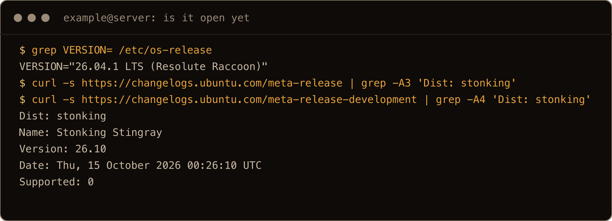
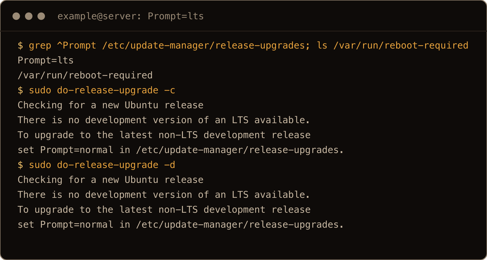
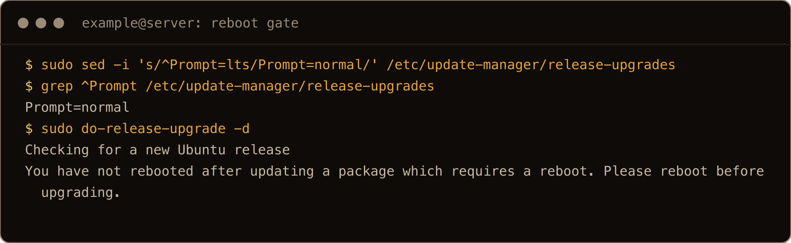
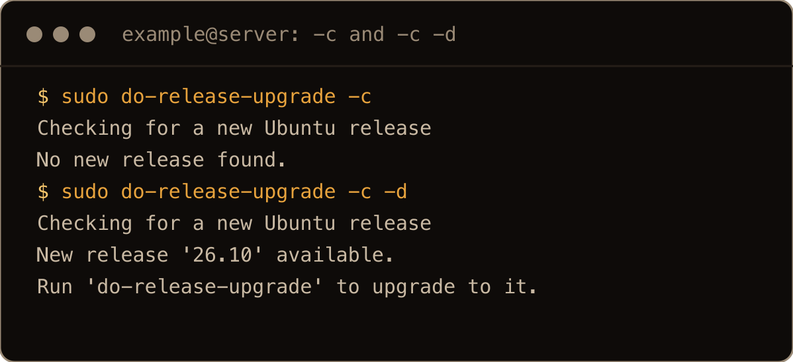
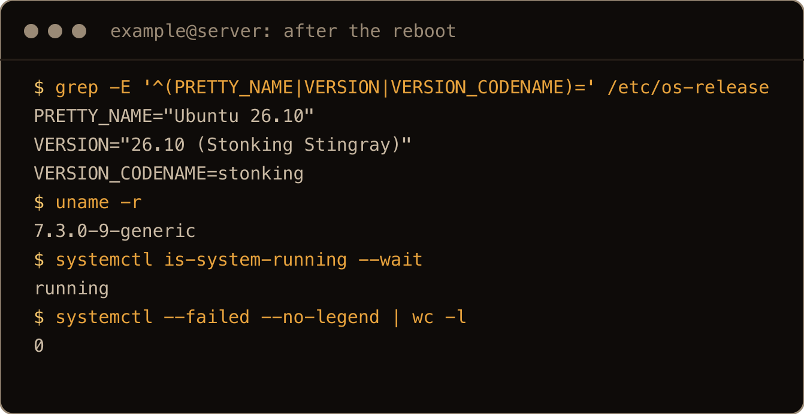
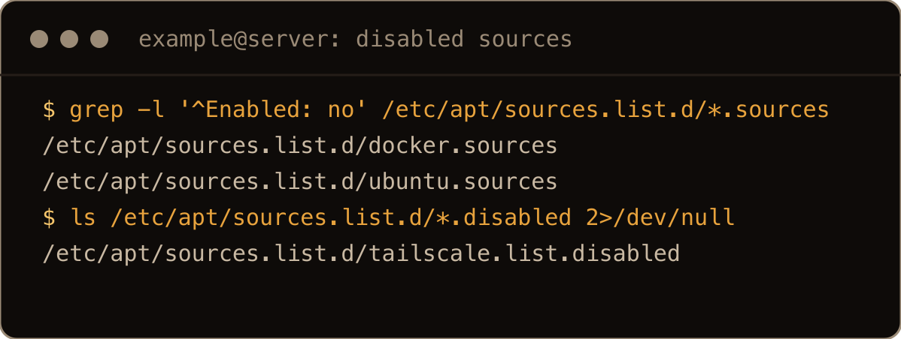
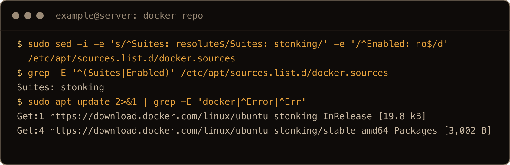
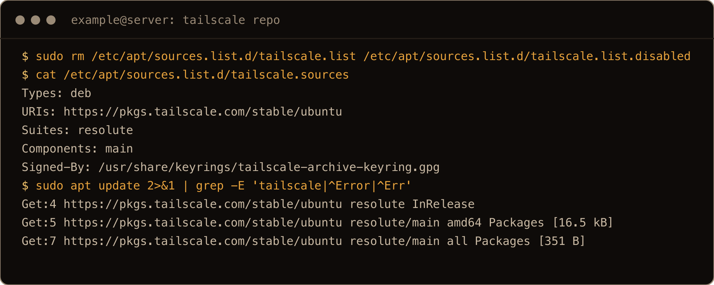
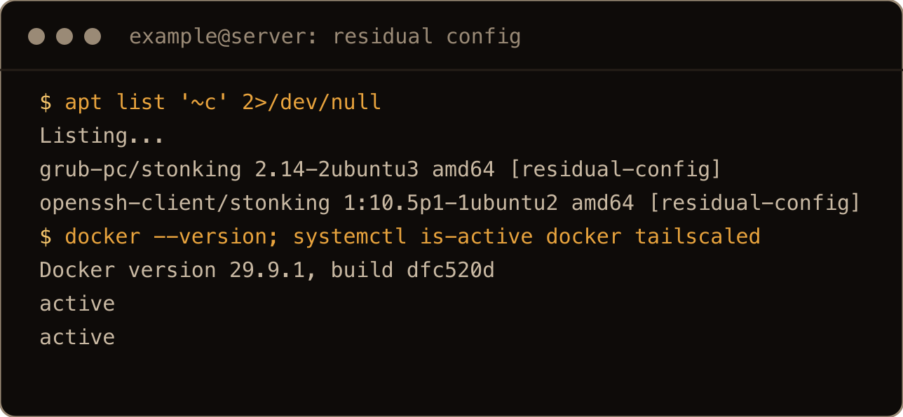

Ubuntu 26.10, "Stonking Stingray", came out yesterday. I ran `sudo do-release-upgrade` on a patched 26.04 server today and it told me there was nothing to upgrade to:

```text
Checking for a new Ubuntu release
No new release found.
```

Nothing is broken. Two separate switches decide whether 26.10 gets offered, one on your server and one on Ubuntu's, and in release week the one on Ubuntu's side is still off. This is how to get a 26.04 LTS server onto 26.10 today, what changes once Ubuntu flips its switch, and what the upgrader quietly does to your apt sources on the way.

Why leave an LTS at all? I just wanted the latest and greatest. I always love living on the edge, mwahahaha!

Know what you are signing up for first. 26.10 is an interim release, supported until July 2027, and you are leaving an LTS to get it. There is no supported way back down, so take a snapshot or a backup before you start.

> **TL;DR.** Set `Prompt=normal` in `/etc/update-manager/release-upgrades`, then `sudo apt update && sudo apt full-upgrade` and reboot if `/var/run/reboot-required` exists. If `curl -s https://changelogs.ubuntu.com/meta-release | grep 'Dist: stonking'` prints nothing, Ubuntu hasn't opened the upgrade yet: wait, or run `sudo do-release-upgrade -d`. Once it prints a line, plain `sudo do-release-upgrade` works. It took about 10 minutes on a small cloud server. Afterwards, re-enable the vendor repos the upgrader turned off, and don't purge `openssh-client`.

## Contents

- [1. The two switches](#1-the-two-switches)
- [2. "There is no development version of an LTS available."](#2-there-is-no-development-version-of-an-lts-available)
- [3. "You have not rebooted after updating a package which requires a reboot."](#3-you-have-not-rebooted-after-updating-a-package-which-requires-a-reboot)
- [4. "No new release found."](#4-no-new-release-found)
- [5. Run the upgrade](#5-run-the-upgrade)
- [6. Reboot and check](#6-reboot-and-check)
- [7. Turn your vendor repos back on](#7-turn-your-vendor-repos-back-on)
- [8. Leave openssh-client in "rc" alone](#8-leave-openssh-client-in-rc-alone)
- [Gotchas I hit](#gotchas-i-hit)
- [Quick reference](#quick-reference)

## 1. The two switches

`do-release-upgrade` doesn't look at the Ubuntu archive to decide what's new. It downloads a small text file from `changelogs.ubuntu.com` and offers whatever newer release that file lists. Which file it reads depends on two things:

| Your setting | File it reads | Lists 26.10 today? | What you see |
| --- | --- | --- | --- |
| `Prompt=lts` (stock 26.04) | `meta-release-lts` | never, it only lists LTS releases | `There is no development version of an LTS available.` |
| `Prompt=normal` | `meta-release` | not yet | `No new release found.` |
| `Prompt=normal` plus `-d` | `meta-release-development` | yes | `New release '26.10' available.` |

The first switch is yours: `Prompt` in `/etc/update-manager/release-upgrades`. The second is Ubuntu's: whether `stonking` has been added to `meta-release`. You can check that one yourself:

```bash
curl -s https://changelogs.ubuntu.com/meta-release | grep -A3 'Dist: stonking'
```

Today, the day after release, that prints nothing. The newest entry in the file is still 26.04.1. The development file already has it:

```text
$ curl -s https://changelogs.ubuntu.com/meta-release-development | grep -A4 'Dist: stonking'
Dist: stonking
Name: Stonking Stingray
Version: 26.10
Date: Thu, 15 October 2026 00:26:10 UTC
Supported: 0
```

That delay is on purpose. Ubuntu's [upgrade documentation](https://ubuntu.com/desktop/docs/en/26.04/how-to/upgrade-ubuntu-desktop/) says upgrades to a new interim release become available several days after the release date, "to allow time for any critical bugs to be fixed before prompting all users to upgrade." When the first `curl` above starts printing a stanza, the plain upgrade is open.



The screenshots come from a final clean run on a fresh 26.04 server with Docker and Tailscale installed, as a user called `example`.

## 2. "There is no development version of an LTS available."

Start here, because it's the first thing the upgrader checks. A stock 26.04 has `Prompt=lts`. Ask it about new releases, with or without `-d`, and you get the same answer:

```text
$ sudo do-release-upgrade -c
Checking for a new Ubuntu release
There is no development version of an LTS available.
To upgrade to the latest non-LTS development release 
set Prompt=normal in /etc/update-manager/release-upgrades.
```

You get it from `sudo do-release-upgrade -d` too, even with a reboot pending. That wording is misleading without `-d`, since you didn't ask about a development version. It's just the message `do-release-upgrade` prints whenever nothing is on offer and `Prompt` is `lts`. The point stands, though: with `Prompt=lts` the upgrader reads `meta-release-lts`, and an interim release never appears there. Your next offer on that setting is 28.04.



Switch it:

```bash
sudo sed -i 's/^Prompt=lts/Prompt=normal/' /etc/update-manager/release-upgrades
grep ^Prompt /etc/update-manager/release-upgrades
```

The upgrade keeps that setting, which is what you want on 26.10: the next stop from an interim release is 27.04.

## 3. "You have not rebooted after updating a package which requires a reboot."

Patch first:

```bash
sudo apt update
sudo apt full-upgrade
ls /var/run/reboot-required
```

On a fresh Hetzner 26.04 image that pulled in a new kernel (`7.0.0-30` to `7.0.0-38`) and a new `libc6`, and left a reboot pending. With `Prompt=normal` set, try the upgrade before rebooting and it stops straight away:

```text
$ sudo do-release-upgrade -d
Checking for a new Ubuntu release
You have not rebooted after updating a package which requires a reboot. Please reboot before upgrading.
```

If `/var/run/reboot-required` exists, `sudo reboot` and come back.



The order matters if you're wondering why you never saw this message. `do-release-upgrade` first asks whether there's a release to go to, and only once there is does it check that everything is installed (`Please install all available updates for your release before upgrading.`) and then that no reboot is pending. With `Prompt=lts` it never gets past the first question, so you see section 2's message instead. And `-c` stops after the first question too: `sudo do-release-upgrade -c -d` happily said `New release '26.10' available.` on a box that then refused to upgrade until it was rebooted.

## 4. "No new release found."

With `Prompt=normal` set and no `stonking` in `meta-release`, this is release week:

```text
$ sudo do-release-upgrade -c
Checking for a new Ubuntu release
No new release found.
$ sudo do-release-upgrade -c -d
Checking for a new Ubuntu release
New release '26.10' available.
Run 'do-release-upgrade' to upgrade to it.
```

Don't take the second message literally. Plain `sudo do-release-upgrade` still said `No new release found.`; until Ubuntu adds 26.10 to `meta-release`, only `sudo do-release-upgrade -d` starts it.



So you have two honest choices:

- **Wait.** Check the `curl` from section 1 every day or two. When `stonking` shows up, the plain `sudo do-release-upgrade` works and you get the upgrade Ubuntu has signed off for everyone.
- **Use `-d` now.** It goes through the development channel, but what you land on is the released 26.10: afterwards `/etc/os-release` said `PRETTY_NAME="Ubuntu 26.10"`, not the "development branch" the beta had. What you skip is the few days Ubuntu holds back to catch upgrade bugs.

Over past releases I've done both, because why not. It didn't really matter to me; I got to the same destination either way.

Before either, read the [26.10 release notes](https://documentation.ubuntu.com/release-notes/26.10/) known issues. Two that can stop you: machines with TPM-backed full disk encryption can't upgrade from 26.04 to 26.10 at release, and a dangling `/lib32` symlink can stop the upgrade while it installs `base-files`. Neither applied to my cloud server, so I haven't hit either.

## 5. Run the upgrade

Interactively, in today's release week:

```bash
sudo do-release-upgrade -d
```

Once 26.10 is in `meta-release`, the same thing without `-d`. Run interactively, the upgrader asks before it starts and is meant to stop for any config file you've changed (I ran it unattended, so I didn't see those prompts myself). Read them, they're your chance to keep your own config.

Over SSH it first asks `Continue running under SSH?` and tells you an additional ssh daemon will be started on port `1022`. That spare `sshd` is your way back in if the main one breaks. It only helps if you can reach it: if your firewall only lets 22 in, open 1022 to your own IP for the duration. Mine didn't, and from my laptop 1022 just timed out.

The upgrader only starts that spare `sshd` if it's still running under your SSH session when it gets to that check, which happens early: in my first run the listener was there a minute in. It walks up its parent processes looking for `sshd`. In a second run I started the unattended version below and closed the session a second later; the upgrade went fine, but no `sshd` ever listened on 1022. To see whether you have one:

```bash
sudo ss -tlnp | grep ':1022 '
```

Here's why it matters more than it sounds. While the upgrade replaced OpenSSH, port 22 refused new connections for a bit over two minutes (2 minutes 15 seconds in one run, 2 minutes 3 seconds in the other, starting a minute or two in):

```text
Oct 16 18:05:53 systemd[1]: Closed ssh.socket - OpenBSD Secure Shell server socket.
Oct 16 18:08:08 systemd[1]: Listening on ssh.socket - OpenBSD Secure Shell server socket.
```

During that window `ssh` to port 22 got `Connection refused`. If your session drops then, you wait it out, or you come in on the spare on 1022 if there is one.

For an unattended run that keeps going if your session drops:

```bash
sudo -v
sudo nohup bash -c 'do-release-upgrade -d -f DistUpgradeViewNonInteractive' > ~/upgrade.log 2>&1 < /dev/null &
tail -f ~/upgrade.log
```

Keep the session open (the `tail -f` does that) until `sudo ss -tlnp | grep ':1022 '` shows the spare `sshd`; after that it doesn't matter if you drop. `sudo -v` asks for your password first, in the foreground; a backgrounded `sudo` that needs a password just sits there. Run these from an interactive SSH session, not as a one-shot `ssh host '...'`: 26.04's `sudo-rs` refuses `sudo -v` without a terminal (`sudo: A terminal is required to authenticate`), and anything chained after it with `&&` never runs. If your account has passwordless sudo, skip `sudo -v` entirely; `sudo-rs` still asked my `NOPASSWD` user for a password on `-v`. `DistUpgradeViewNonInteractive` is meant to answer every question for you, config file prompts included. Fine on a server you can rebuild, not something to do blind on one you configured by hand.

![with the unattended upgrade started in the background, ss shows sshd listening on 0.0.0.0:1022 and [::]:1022](../../assets/upgrade-2610-rel-shot-05-spare-sshd.png)

In the screenshot the command has `; echo RC=$?` added inside the quotes, so I could see the upgrader's exit code at the end of the log.

On a Hetzner cx23 (2 vCPU, 4 GB) the unattended run took about 9 minutes 40 seconds with Docker and Tailscale installed, and about 7 minutes 20 seconds on a bare box. One warning near the top of the log looks alarming and was harmless: `Download is performed unsandboxed as root as file 'stonking.tar.gz.gpg' couldn't be accessed by user '_apt'`.

As for running it unattended: I usually do this on clean machines, because I use these Ubuntu boxes for testing and destroy them afterwards. I guess that's the SRE in me: servers are cattle. I use them and move on to the next one, and I rebuild from a gold image I keep ([ubuntu-dev](https://github.com/peculiarengineer-mk/ubuntu-dev) on my GitHub), which saves a lot of time.

## 6. Reboot and check

The upgrader leaves a reboot pending (new kernel, `libc6`, and `dbus-broker`). After it:

```text
$ grep -E '^(PRETTY_NAME|VERSION|VERSION_CODENAME)=' /etc/os-release
PRETTY_NAME="Ubuntu 26.10"
VERSION="26.10 (Stonking Stingray)"
VERSION_CODENAME=stonking
$ uname -r
7.3.0-9-generic
$ systemctl is-system-running --wait
running
$ systemctl --failed --no-legend
```

No failed units, the 1022 listener was gone, and `do-release-upgrade -c` went back to `No new release found.`, which on 26.10 is correct. `pro security-status` confirmed the clock: `Main/Restricted packages receive updates until 7/2027.` There's no Livepatch or ESM on an interim release, which is why my [26.10 hardening pass](/blog/hardening-ubuntu-26-10-server/) sets an automatic reboot window.



## 7. Turn your vendor repos back on

`apt update` on the upgraded box said `All packages are up to date.` That's not entirely true. The upgrader disabled every third-party source and mirror it didn't recognise, and it didn't shout about it. Before upgrading I'd installed Docker and Tailscale from their own repos, the way their install docs say. Afterwards, from `/var/log/dist-upgrade/main.log` and `/etc/apt/sources.list.d/`:

| Source before | After the upgrade |
| --- | --- |
| Hetzner's mirror in `ubuntu.sources` | `Enabled: no` ("unknown mirror"); new `archive.ubuntu.com` and `security.ubuntu.com` stanzas for `stonking` added below |
| `docker.sources`, suite `resolute` | `Enabled: no` added, suite still `resolute` |
| `tailscale.list` (one-line format) | "Could not migrate", emptied to a comment, copied to `tailscale.list.disabled` |

The packages themselves stay installed and running: Docker and `tailscaled` were both active after the reboot, and a test container came back up. They just stop getting updates. Check yours:

```bash
grep -l '^Enabled: no' /etc/apt/sources.list.d/*.sources
ls /etc/apt/sources.list.d/*.disabled 2>/dev/null
```



**Docker** publishes a `stonking` suite now, so move it up rather than just re-enabling it:

```bash
sudo sed -i -e 's/^Suites: resolute$/Suites: stonking/' -e '/^Enabled: no$/d' /etc/apt/sources.list.d/docker.sources
sudo apt update && sudo apt upgrade
```

That offered six packages, the same Docker versions rebuilt as `~ubuntu.26.10~stonking`, and the container kept running through it. My [Docker install post](/blog/install-docker-ubuntu-26-04/) sets up that same `docker.sources` file. I only tested this deb822 file, not an older one-line `docker.list`.



**Tailscale** has no `stonking` repo yet (its `dists/stonking/Release` is a 404), so point it at the 26.04 one, in the deb822 format the upgrader couldn't produce for you:

```bash
sudo rm /etc/apt/sources.list.d/tailscale.list /etc/apt/sources.list.d/tailscale.list.disabled
sudo tee /etc/apt/sources.list.d/tailscale.sources <<'EOF'
Types: deb
URIs: https://pkgs.tailscale.com/stable/ubuntu
Suites: resolute
Components: main
Signed-By: /usr/share/keyrings/tailscale-archive-keyring.gpg
EOF
sudo apt update
```



With `stonking` in there instead, `apt update` fails:

```text
Error: The repository 'https://pkgs.tailscale.com/stable/ubuntu stonking Release' does not have a Release file.
```

**HashiCorp** is in the same spot today: `stonking` is a 404, `resolute` is there. In the [beta upgrade](/blog/upgrade-ubuntu-26-04-to-26-10-beta/) the `resolute` suite worked for it on 26.10; this time I only checked the URLs.

What do I do when a vendor has no 26.10 repo yet? It depends, but I switch them to the old release so I have a working repo.

On Hetzner specifically, leave the Ubuntu mirror change alone: the box now gets 26.10 straight from `archive.ubuntu.com`, and when I wrote the hardening post Hetzner's mirror had no 26.10 packages yet. The [hardening post](/blog/hardening-ubuntu-26-10-server/#9-snapshot-the-hardened-box) covers what that means if you snapshot an upgraded box.

## 8. Leave openssh-client in "rc" alone

After the upgrade, `openssh-client` was removed but not purged, replaced by the new `openssh-client-gssapi`:

```text
$ apt list '~c'
grub-pc/stonking 2.14-2ubuntu3 amd64 [residual-config]
openssh-client/stonking 1:10.5p1-1ubuntu2 amd64 [residual-config]
```

That leftover is tempting to clean up. Don't. The [release notes](https://documentation.ubuntu.com/release-notes/26.10/) say not to purge an openssh package in `rc` state until the fix for LP: #2169738 is out, because purging it removes files the replacement still needs, and "remote access may be lost". So no `apt purge '~c'` and no `dpkg --purge openssh-client` on this box for now. A dry run of `apt autoremove` removed nothing.



## Gotchas I hit

- A stock 26.04 has `Prompt=lts` and never offers 26.10; the message mentions a "development version" even without `-d`.
- In release week `do-release-upgrade -c -d` says "Run 'do-release-upgrade'", and plain `do-release-upgrade` then says `No new release found.`
- A pending reboot from ordinary updates blocks the upgrade.
- Port 22 refused connections for about two minutes while OpenSSH was replaced; the fallback `sshd` on 1022 is the only SSH way in then, only if your firewall lets you reach it, and only if the upgrader was still attached to your SSH session when it started.
- `do-release-upgrade` checks for a release before it checks for a pending reboot, so with `Prompt=lts` you never see the reboot message, and `-c` never checks the reboot at all.
- `sudo -v` under `sudo-rs` needs a terminal, and asks even a `NOPASSWD` user for a password.
- The upgrader disables vendor repos and unknown mirrors, and a one-line `.list` it can't migrate gets emptied. Packages keep running without updates.
- Docker has a `stonking` suite; Tailscale and HashiCorp still need `resolute`.
- `openssh-client` sits in `rc` state afterwards; purging it can cost you SSH.

## Quick reference

| Step | Command |
| --- | --- |
| Allow interim releases | `sudo sed -i 's/^Prompt=lts/Prompt=normal/' /etc/update-manager/release-upgrades` |
| Patch | `sudo apt update && sudo apt full-upgrade` |
| Reboot if needed | `ls /var/run/reboot-required && sudo reboot` |
| Is the plain upgrade open? | `curl -s https://changelogs.ubuntu.com/meta-release \| grep 'Dist: stonking'` |
| Upgrade, release week | `sudo do-release-upgrade -d` |
| Upgrade, once open | `sudo do-release-upgrade` |
| Over SSH | open port 1022 to your IP first |
| Verify | `grep VERSION= /etc/os-release; uname -r; systemctl --failed` |
| Disabled sources | `grep -l '^Enabled: no' /etc/apt/sources.list.d/*.sources; ls /etc/apt/sources.list.d/*.disabled 2>/dev/null` |
| Don't | `apt purge '~c'` while `openssh-client` is in `rc` |

Your setting, then Ubuntu's switch, then your vendor repos. Get the first one right and the other two are just patience and a `sed`.
